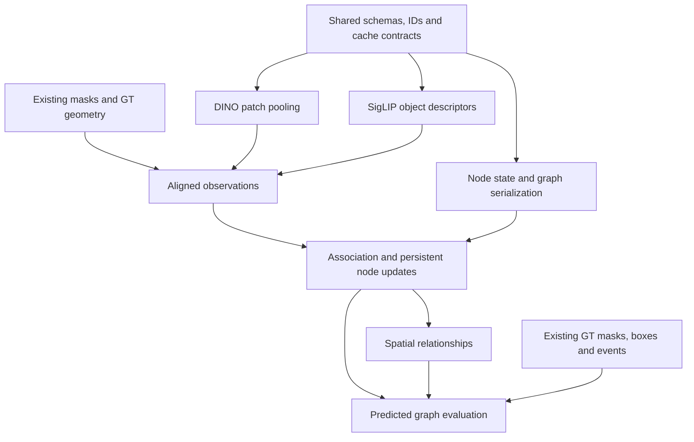

# Codex conversation

## User

Don't change anything in the code! Chat needs to be fixed for this to be able to run this project

## Assistant

I’ll inspect how the project runs and what the chat feature needs, without changing any code.

## Activity

    $ pwd
    /home/ost/kth/DD2600/eai-project
    ✓ • 0ms

## Activity

    $ git status --short
    ?? outputs/sam_room0/
    ✓ • 0ms

## Activity

    $ rg --files -g 'AGENTS.md' -g 'README*' -g 'package.json' -g 'pyproject.toml' -g 'requirements*.txt' -g '*lock*' -g 'docker-compose*' -g 'compose.y*' -g '.env*' -g '*chat*' -g '!node_modules' -g '!.git'
    pyproject.toml
    README.md
    uv.lock
    ✓ • 0ms

## User

Don't change anything in the code! What needs to be fixed for this to be able to run this project?

## Assistant

I’ll check the setup instructions, dependencies, and entry points to identify what’s blocking the project from running. I won’t change any code.

## Activity

    $ cat README.md
    # eai-project
    
    DD2600 course project.
    
    ## Setup
    
    Requires [uv](https://docs.astral.sh/uv/) and FFmpeg (used by torchcodec for video decoding).
    
    ```bash
    git clone https://github.com/johanhroos/eai-project.git
    cd eai-project
    uv sync --extra cu126   # or for blackwell: uv sync --extra cu130
    uv run --no-sync python -m ipykernel install --user --name eai-project --display-name "EAI project"
    ```
    
    Pick the extra that matches the GPU:
    
    | Extra   | GPU                                  | Notes                                             |
    |---------|--------------------------------------|---------------------------------------------------|
    | `cu130` | RTX 50-series (e.g. RTX 5090)        | Blackwell needs this; cu126 has no sm_120 kernels |
    | `cu126` | H100                                 | Also use it if `nvidia-smi` shows a driver < 580  |
    
    ## Check the environment
    
    ```bash
    uv run --no-sync python3 -m smoke
    ```
    
    It prints the torch/CUDA versions and GPU, then runs SDPA, `torch.compile`, and a video decode.
    
    IMPORTANT: Use `uv run --no-sync` for everything: a plain `uv run` re-syncs without the extra and replaces the CUDA build of
    torch with the default one from PyPI.
    
    ## Data
    
    Approx 46GB file.
    ```bash
    bash scripts/download_data.sh
    ```
    
    Downloads the 8 Replica scenes that have OpenLex3D labels (room0–2, office0–4) into `data/`. Rerunning resumes an interrupted
    download.
    
    | Path | Source | Contents |
    |---|---|---|
    | `data/vmap/<scene>/imap/{00,01}/` | [vMAP](https://github.com/kxhit/vMAP) | Two camera paths × 2000 frames: `rgb/`, `depth/` (uint16, mm), `semantic_instance/` (Replica object ID per pixel), `traj_w_c.txt` (camera-to-world 4×4 per line). Path `00` is the NICE-SLAM trajectory. |
    | `data/vmap/<scene>/habitat/info_semantic.json` | vMAP | Object ID → Replica class name |
    | `data/gt_openlex3d/replica/<scene>/` | [OpenLex3D](https://github.com/openlex3d/openlex3d) | Open-vocabulary labels and text queries per object ID |
    
    Camera: 1200×680, fx = fy = 600, cx = 599.5, cy = 339.5. Frames are numbered `0`–`1999` without zero padding, so sort
    by number. Scene names are `room_0` in vMAP and `room0` in OpenLex3D.
    
    ## SAM 3 preview
    
    Request access to [facebook/sam3](https://huggingface.co/facebook/sam3) and authenticate on the GPU machine
    with HuggingFace in terminal once.
    
    ```bash
    uv run --no-sync hf auth login
    ```
    
    Try running the cells in `notebooks/explore_data.ipynb`
    with the `EAI project` kernel.
    ✓ • 0ms

## Activity

    $ cat pyproject.toml
    [project]
    name = "eai-project"
    version = "0.1.0"
    description = "DD2600 course project"
    readme = "README.md"
    requires-python = ">=3.13"
    dependencies = [
        "einops>=0.8.2",
        "ipykernel>=7.3.0",
        "jupyter>=1.1.1",
        "jupyterlab>=4.6.4",
        "kernels==0.16.0",
        "matplotlib>=3.11.2",
        "numpy>=2.5.3",
        "pycocotools>=2.0.11",
        "rerun-sdk[notebook]>=0.38.1",
        "torch>=2.11.0",
        "torchcodec>=0.11.0",
        "torchvision>=0.26.0",
        "transformers>=5.17.0",
    ]
    
    [build-system]
    requires = ["uv_build>=0.10.9,<0.11.0"]
    build-backend = "uv_build"
    
    [tool.uv.build-backend]
    module-name = ["utils", "models", "graph"]
    
    [project.optional-dependencies]
    cu126 = ["torch>=2.11.0", "torchvision>=0.26.0", "torchcodec>=0.12.0"]
    cu130 = ["torch>=2.11.0", "torchvision>=0.26.0", "torchcodec>=0.12.0"]
    
    [tool.uv]
    conflicts = [[{ extra = "cu126" }, { extra = "cu130" }]]
    
    [tool.uv.sources]
    torch = [
        { index = "pytorch-cu126", extra = "cu126" },
        { index = "pytorch-cu130", extra = "cu130" },
    ]
    torchvision = [
        { index = "pytorch-cu126", extra = "cu126" },
        { index = "pytorch-cu130", extra = "cu130" },
    ]
    torchcodec = [
        { index = "pytorch-cu126", extra = "cu126" },
        { index = "pytorch-cu130", extra = "cu130" },
    ]
    
    [[tool.uv.index]]
    name = "pytorch-cu130"
    url = "https://download.pytorch.org/whl/cu130"
    explicit = true
    
    [[tool.uv.index]]
    name = "pytorch-cu126"
    url = "https://download.pytorch.org/whl/cu126"
    explicit = true
    
    [tool.ruff]
    target-version = "py313"
    line-length = 120
    indent-width = 4
    extend-exclude = [
        ".ipynb_checkpoints",
        ".pyenv",
        ".pytest_cache",
        ".vscode",
        "build",
        "site-packages",
    ]
    
    [tool.ruff.format]
    indent-style = "space"
    
    [tool.ruff.lint]
    select = [
    # Pycodestyle
    "E4",    # Import and whitespace errors
    "E7",    # Statement errors
    "E9",    # Syntax and runtime errors
    "E101",  # Mixed spaces and tabs
    "E501",  # Line too long
    # Core correctness
    "F",     # Pyflakes
    "B",     # Flake8-bugbear
    "PLE",   # Serious Pylint errors
    # Imports and modernization
    "I",     # Import sorting
    "UP",    # Modern Python syntax
    "PTH",   # Prefer pathlib
    # Code quality
    "C4",    # Better comprehensions
    "RET",   # Return-statement consistency
    "RSE",   # Raise-statement cleanup
    "PIE",   # Miscellaneous unnecessary/problematic code
    "SIM",   # Simplifiable code
    "PERF",  # Common performance mistakes
    "RUF",   # Ruff-specific checks
    # Documentation
    "D",     # Pydocstyle
    
    ]
    ignore = [
    # Check the style of existing docstrings without requiring docstrings
    # on every module, class, method, and function.
    "D100", # Missing module docstring
    "D101", # Missing public class docstring
    "D102", # Missing public method docstring
    "D103", # Missing public function docstring
    "D104", # Missing package docstring
    "D105", # Missing magic-method docstring
    "D106", # Missing public nested-class docstring
    "D107", # Missing init docstring
    ]
    exclude = ["*.ipynb"]
    
    [tool.ruff.lint.pydocstyle]
    convention = "google"
    
    [dependency-groups]
    dev = [
        "jedi-language-server>=0.47.0",
        "jupyterlab-git>=0.54.0",
        "jupyterlab-lsp>=5.3.0",
        "jupyterlab-vim>=4.1.4",
        "ruff>=0.15.18",
    ]
    ✓ • 0ms

## Activity

    $ ls -la
    total 668
    drwxr-xr-x 14 ost ost   4096 Oct 10 19:41 .
    drwxr-xr-x  5 ost ost   4096 Sep 29 12:50 ..
    dr-xr-xr-x  2 ost ost     40 Oct 10 19:41 .agents
    dr-xr-xr-x  2 ost ost     40 Oct 10 19:41 .aws
    dr-xr-xr-x  2 ost ost     40 Oct 10 19:41 .codex
    drwxr-xr-x  7 ost ost   4096 Oct 10 19:34 .git
    -rw-r--r--  1 ost ost    177 Oct  5 23:29 .gitignore
    drwxr-xr-x  2 ost ost   4096 Sep 29 18:03 .ipynb_checkpoints
    -rw-r--r--  1 ost ost      5 Sep 29 12:50 .python-version
    -rw-r--r--  1 ost ost   2446 Oct  5 23:29 README.md
    drwxr-xr-x  5 ost ost   4096 Sep 29 15:24 data
    drwxr-xr-x  2 ost ost   4096 Oct 10 19:34 notebooks
    drwxr-xr-x  2 ost ost   4096 Oct 10 19:34 notes
    drwxr-xr-x  5 ost ost   4096 Oct  5 23:29 outputs
    -rw-r--r--  1 ost ost   3130 Oct  5 23:29 pyproject.toml
    -rw-r--r--  1 ost ost   3230 Oct 10 19:34 run.py
    -rw-r--r--  1 ost ost  13065 Sep 29 12:50 sample.mp4
    drwxr-xr-x  2 ost ost   4096 Oct 10 19:34 scripts
    -rw-r--r--  1 ost ost    602 Sep 29 12:50 smoke.py
    drwxr-xr-x  5 ost ost   4096 Oct  5 23:29 src
    drwxr-xr-x  2 ost ost   4096 Oct 10 19:34 testing
    -rw-r--r--  1 ost ost 595409 Oct  5 23:29 uv.lock
    ✓ • 0ms

## Activity

    $ git status --short
    ?? outputs/sam_room0/
    ✓ • 0ms

## Activity

    $ rg --files -g '!outputs/**' -g '!uv.lock' -g '!.git' -g '!node_modules'
    smoke.py
    pyproject.toml
    README.md
    run.py
    src/models/sam.py
    src/models/siglip.py
    src/models/sam3.py
    src/models/dino.py
    src/models/__init__.py
    src/utils/image_crop.py
    src/utils/replica.py
    src/utils/schema.py
    src/utils/config.py
    src/utils/lift3d.py
    src/utils/__init__.py
    src/graph/graph.py
    src/graph/query.py
    src/graph/node.py
    src/graph/__init__.py
    sample.mp4
    notebooks/explore_data.ipynb
    notes/baseline-pipeline.txt
    notes/dino_pipeline.txt
    scripts/download_room0.sh
    scripts/extract_room0.sh
    scripts/download_data.sh
    scripts/test_sam_room0.py
    scripts/download_zip.sh
    testing/Untitled.ipynb
    testing/smoke.py
    ✓ • 0ms

## Activity

    $ rg --files -g 'AGENTS.md' -g '!node_modules' -g '!.git' -g '!outputs/**'
    ✗ (1) • 0ms

## Activity

    $ for path in /AGENTS.md /home/AGENTS.md /home/ost/AGENTS.md /home/ost/kth/AGENTS.md /home/ost/kth/DD2600/AGENTS.md /home/ost/kth/DD2600/eai-project/AGENTS.md; do if [ -f "$path" ]; then cat "$path"; fi; done
    ✓ • 0ms

## Activity

    $ nl -ba run.py
         1    """Run the pipeline on Replica runs. Each stage caches its output, so reruns only compute what is missing."""
         2
         3    import argparse
         4
         5    from models import sam
         6    from utils import replica
         7    from utils import lift3d
         8    from utils.schema import Masks, Run, check_aligned, load_stage, save_stage
         9
        10    parser = argparse.ArgumentParser(description=__doc__)
        11    parser.add_argument(
        12        "--source",
        13        nargs="+",
        14        default=[f"replica/{scene}/00" for scene in replica.SCENES],
        15        help="runs to compute, such as replica/room_0/00 (default: every scene's sequence 00)",
        16    )
        17    parser.add_argument("--stride", type=int, default=20)
        18    parser.add_argument("--mask-source", default="sam3", choices=["sam3", "gt"])
        19    parser.add_argument("--pose-source", default="gt", choices=["gt", "vggt"])
        20    parser.add_argument("--overwrite", action="store_true", help="recompute stages that are already cached")
        21    args = parser.parse_args()
        22    if args.stride < 1:
        23        parser.error("stride must be positive")
        24
        25    for source in args.source:
        26        run = Run(source=source, stride=args.stride, mask_source=args.mask_source, pose_source=args.pose_source)
        27        if not run.done("masks") or args.overwrite:
        28            if run.mask_source == "gt":
        29                masks, vocab = replica.gt_masks(run)
        30                metadata = {"vocab": vocab}
        31            else:
        32                frames, numbers = replica.load_run_rgb(run)
        33                vocab = replica.prompt_vocab(run)
        34                processor, model = sam.load_model()
        35                masks = sam.segment(frames, numbers, vocab, processor, model)
        36                metadata = {
        37                    "vocab": vocab,
        38                    "model": sam.MODEL_ID,
        39                    "score_threshold_detection": model.config.score_threshold_detection,
        40                    "new_det_thresh": model.config.new_det_thresh,
        41                }
        42            save_stage(run.stage_dir("masks"), masks, metadata)
        43            print(f"Saved {len(masks.frame)} masks to {run.stage_dir('masks')}")
        44        else: print(f"Skipping {run.source}: {run.stage_dir('masks')} exists")
        45
        46        if not run.done("boxes") or args.overwrite:
        47            masks = load_stage(run.stage_dir("masks"), Masks)
        48            save_stage(run.stage_dir("boxes"), lift3d.compute_boxes(run, masks), {"pose_source": run.pose_source})
        49            check_aligned(run, "boxes")
        50            print(f"Saved boxes to {run.stage_dir('boxes')}")
        51        else: print(f"Skipping {run.source}: {run.stage_dir('boxes')} exists")
        52
        53        # Ground truth for the evaluation: always from GT masks and poses, whatever mask_source and pose_source are
        54        if not run.done("events") or args.overwrite:
        55            meta = {"min_pixels": lift3d.MIN_PIXELS, "min_run": lift3d.MIN_RUN, "min_gap": lift3d.MIN_GAP}
        56            save_stage(run.stage_dir("events"), lift3d.compute_events(run), {**meta, "kinds": lift3d.KIND})
        57            print(f"Saved events to {run.stage_dir('events')}")
        58        else: print(f"Skipping {run.source}: {run.stage_dir('events')} exists")
        59
        60
        61        # FOR EVALUATION: always from GT masks and poses, whatever mask_source and pose_source are
        62        if not run.done("gt_boxes") or args.overwrite:
        63            save_stage(run.stage_dir("gt_boxes"), lift3d.compute_gt_boxes(run), {})
        64            print(f"Saved GT boxes to {run.stage_dir('gt_boxes')}")
        65        else: print(f"Skipping {run.source}: {run.stage_dir('gt_boxes')} exists")
        66
    ✓ • 0ms

## Activity

    $ command -v uv
        command -v python
        command -v python3
        command -v ffmpeg
        command -v nvidia-smi
        cat .python-version
        ls -la data
        ls -la /home/ost/kth/DD2600
    /usr/bin/python
    /usr/bin/python3
    /usr/bin/ffmpeg
    3.13
    total 20
    drwxr-xr-x  5 ost ost 4096 Sep 29 15:24 .
    drwxr-xr-x 14 ost ost 4096 Oct 10 19:41 ..
    drwxr-xr-x  2 ost ost 4096 Sep 29 14:17 downloads
    drwxr-xr-x  3 ost ost 4096 Sep 29 14:17 gt_openlex3d
    drwxr-xr-x  3 ost ost 4096 Sep 29 15:24 vmap
    total 20
    drwxr-xr-x  5 ost ost 4096 Sep 29 12:50 .
    drwxr-xr-x  4 ost ost 4096 Sep 24 00:00 ..
    drwxr-xr-x 14 ost ost 4096 Oct 10 19:41 eai-project
    drwxr-xr-x  8 ost ost 4096 Sep 25 13:24 openlex3d
    drwxr-xr-x  9 ost ost 4096 Sep 24 19:14 openlex3d_data
    ✓ • 0ms

## Activity

    $ nl -ba src/models/sam.py
        nl -ba src/models/sam3.py
        nl -ba src/models/siglip.py
        nl -ba src/models/dino.py
         1    """Extract masks from a video with SAM 3, prompted by the classes you want to segment."""
         2
         3    from functools import cache
         4
         5    import numpy as np
         6    import pycocotools.mask as mask_utils
         7    import torch
         8    from transformers import Sam3VideoModel, Sam3VideoProcessor
         9
        10    from utils.schema import Masks, encode_rle
        11
        12    MODEL_ID = "facebook/sam3"
        13
        14
        15    @cache
        16    def load_model() -> tuple[Sam3VideoProcessor, Sam3VideoModel]:
        17        """Load SAM 3 onto the GPU once per process; later calls return the same model."""
        18        processor = Sam3VideoProcessor.from_pretrained(MODEL_ID)
        19        model = Sam3VideoModel.from_pretrained(MODEL_ID, dtype=torch.bfloat16, attn_implementation="sdpa").to("cuda").eval()
        20        return processor, model
        21
        22
        23    @torch.inference_mode()
        24    def segment(
        25        frames: list[np.ndarray],
        26        frame_numbers: list[int],
        27        prompts: list[str],
        28        processor: Sam3VideoProcessor,
        29        model: Sam3VideoModel,
        30    ) -> Masks:
        31        """Track every prompt through the frames in one video session, so SAM IDs are unique across prompts.
        32
        33        frames are RGB (H, W, 3) uint8 in temporal order, and Masks.frame holds frame_numbers[i] for frames[i].
        34        Masks.prompt indexes prompts. SAM 3 keeps the masks of one prompt apart, but masks of different prompts can overlap.
        35        The whole clip and the tracker state stay in CPU memory during tracking. The tracker keeps every frame's masks and
        36        features for every object, so on the GPU it outgrew 32 GB at 100 frames; on the CPU it costs about 40% speed.
        37        """
        38        if len(frames) != len(frame_numbers):
        39            raise ValueError(f"got {len(frames)} frames but {len(frame_numbers)} frame numbers")
        40        if len(set(prompts)) != len(prompts):
        41            raise ValueError("prompts must be distinct: the session merges duplicates")
        42
        43        inference_session = processor.init_video_session(
        44            video=frames,
        45            inference_device="cuda",
        46            inference_state_device="cpu",
        47            processing_device="cpu",
        48            video_storage_device="cpu",
        49            dtype=torch.bfloat16,
        50        )
        51        processor.add_text_prompt(inference_session, prompts)
        52        prompt_index = {p: i for i, p in enumerate(prompts)}
        53
        54        frame, prompt, sam_id, score, rle = [], [], [], [], []
        55        with torch.autocast("cuda", dtype=torch.bfloat16):
        56            for model_prediction in model.propagate_in_video_iterator(inference_session, show_progress_bar=True):
        57                result = processor.postprocess_outputs(inference_session, model_prediction)
        58                ids = result["object_ids"].tolist()
        59                if not ids:
        60                    continue
        61                prompt_of = {i: prompt_index[p] for p, objs in result["prompt_to_obj_ids"].items() for i in objs}
        62                # frame_idx counts frames within this clip; encode right away so full-size masks never pile up
        63                frame += [frame_numbers[model_prediction.frame_idx]] * len(ids)
        64                prompt += [prompt_of[i] for i in ids]
        65                sam_id += ids
        66                score += result["scores"].tolist()
        67                rle += encode_rle(result["masks"].cpu().numpy())
        68
        69        return Masks(
        70            frame=np.array(frame, dtype=np.int32),
        71            prompt=np.array(prompt, dtype=np.int16),
        72            sam_id=np.array(sam_id, dtype=np.int32),
        73            score=np.array(score, dtype=np.float32),
        74            rle=rle,
        75        )
        76
        77
        78    def mask_boxes(rle: list[dict]) -> np.ndarray:
        79        """(N, 4) int32 bounding boxes (x0, y0, x1, y1) of Masks.rle rows, so image[y0:y1, x0:x1] crops mask i.
        80
        81        An empty mask gets the box (0, 0, 0, 0), so check x1 > x0 before cropping.
        82        """
        83        # toBbox gives COCO (x, y, w, h) with integer values, and a flat array when rle is empty
        84        xywh = mask_utils.toBbox(rle).reshape(-1, 4).astype(np.int32)
        85        return np.concatenate([xywh[:, :2], xywh[:, :2] + xywh[:, 2:]], axis=1)
         1    """Run Hugging Face SAM 3 video tracking on a short RGB clip and save masks to disk."""
         2
         3    import argparse
         4    import json
         5    from pathlib import Path
         6
         7    import numpy as np
         8    import torch
         9    from PIL import Image
        10    from transformers import Sam3VideoModel, Sam3VideoProcessor
        11
        12    MODEL_ID = "facebook/sam3"
        13
        14
        15    @torch.inference_mode()
        16    def segment_clip(frame_paths: list[Path], prompt: str, output_dir: Path) -> Path:
        17        """Save one NPZ per frame, plus a manifest mapping clip indices to source images.
        18
        19        Masks have the original image resolution. Object IDs are SAM tracks within this clip,
        20        not ground-truth instances or persistent graph IDs. Reusing output_dir overwrites this run.
        21        Requires access to facebook/sam3 and a Hugging Face login on the machine running inference.
        22        """
        23        if not frame_paths or not prompt.strip():
        24            raise ValueError("Provide at least one frame and a non-empty text prompt.")
        25        if not torch.cuda.is_available():
        26            raise RuntimeError("SAM 3 requires CUDA here. Select the project's GPU environment/kernel.")
        27
        28        frames = []
        29        for path in frame_paths:
        30            with Image.open(path) as image:
        31                frames.append(np.array(image.convert("RGB")))
        32        if any(frame.shape != frames[0].shape for frame in frames):
        33            raise ValueError("All clip frames must have the same resolution.")
        34
        35        output_dir = Path(output_dir)
        36        output_dir.mkdir(parents=True, exist_ok=True)
        37        manifest = {
        38            "model": MODEL_ID,
        39            "prompt": prompt,
        40            "frames": [str(Path(path).resolve()) for path in frame_paths],
        41            "complete": False,
        42        }
        43        manifest_path = output_dir / "manifest.json"
        44        manifest_path.write_text(json.dumps(manifest, indent=2) + "\n")
        45
        46        print(f"Loading {MODEL_ID}; tracking {prompt!r} over {len(frames)} frames.")
        47        processor = Sam3VideoProcessor.from_pretrained(MODEL_ID)
        48        model = Sam3VideoModel.from_pretrained(MODEL_ID, dtype=torch.bfloat16, attn_implementation="sdpa").to("cuda").eval()
        49        session = processor.init_video_session(
        50            video=frames,
        51            inference_device="cuda",
        52            processing_device="cpu",
        53            video_storage_device="cpu",
        54            dtype=torch.bfloat16,
        55        )
        56        processor.add_text_prompt(session, text=prompt)
        57        with torch.autocast("cuda", dtype=torch.bfloat16):
        58            for prediction in model.propagate_in_video_iterator(session, show_progress_bar=True):
        59                result = processor.postprocess_outputs(session, prediction)
        60                np.savez_compressed(
        61                    output_dir / f"{prediction.frame_idx:05d}.npz",
        62                    masks=result["masks"].cpu().numpy(),
        63                    object_ids=result["object_ids"].cpu().numpy(),
        64                    scores=result["scores"].float().cpu().numpy(),
        65                    boxes=result["boxes"].float().cpu().numpy(),
        66                )
        67
        68        manifest["complete"] = True
        69        manifest_path.write_text(json.dumps(manifest, indent=2) + "\n")
        70        print(f"Saved predictions to {output_dir}")
        71        return output_dir
        72
        73
        74    def main() -> None:
        75        from utils import replica
        76
        77        parser = argparse.ArgumentParser(description=__doc__)
        78        parser.add_argument("--scene", default="room_0", choices=replica.SCENES)
        79        parser.add_argument("--seq", default="00", choices=["00", "01"])
        80        parser.add_argument("--start", type=int, default=0)
        81        parser.add_argument("--frames", type=int, default=60)
        82        parser.add_argument("--step", type=int, default=1)
        83        parser.add_argument("--prompt", default="lamp")
        84        parser.add_argument("--output", type=Path, default=replica.REPO_ROOT / "outputs" / "sam3_preview")
        85        args = parser.parse_args()
        86        if args.start < 0 or args.frames < 1 or args.step < 1:
        87            parser.error("start must be non-negative; frames and step must be positive")
        88        rgb_dir = replica.sequence_dir(args.scene, args.seq) / "rgb"
        89        paths = [rgb_dir / f"rgb_{args.start + i * args.step}.png" for i in range(args.frames)]
        90        segment_clip(paths, args.prompt, args.output)
        91
        92
        93    if __name__ == "__main__":
        94        main()
         1    import torch
         2    from transformers import AutoModel, AutoImageProcessor
         3    from utils import replica
         4
         5    # Usage:
         6    # 1. Create a DINOEncoder with the desired DINO model.
         7    # 2. Load an RGB image as a NumPy array.
         8    # 3. Pass the image to encode().
         9    # 4. encode() returns a 1D DINO feature embedding for the image.
        10    #
        11    # Example:
        12    #   dino = DINOEncoder("facebook/dinov3-vitl16-pretrain-lvd1689m")
        13    #   embedding = dino.encode(rgb)
        14    #   print(embedding.shape)
        15
        16    class DINOEncoder:
        17        def __init__(self, model_name, device="cuda"):
        18            self.device = torch.device(device)
        19
        20            self.model = AutoModel.from_pretrained(model_name)
        21            self.processor = AutoImageProcessor.from_pretrained(model_name)
        22
        23            self.model.to(self.device)
        24            self.model.eval()
        25
        26        def encode(self, image):
        27            inputs = self.processor(
        28                images=image,
        29                return_tensors="pt",
        30            )
        31
        32            inputs = {
        33                key: value.to(self.device)
        34                for key, value in inputs.items()
        35            }
        36
        37            with torch.no_grad():
        38                outputs = self.model(**inputs)
        39
        40            embedding = outputs.pooler_output
        41
        42            return embedding.squeeze(0)
        43
        44
        45    if __name__ == "__main__":
        46        MODEL_NAME = "facebook/dinov3-vitl16-pretrain-lvd1689m"
        47
        48        dino = DINOEncoder(MODEL_NAME)
        49
        50        print(next(dino.model.parameters()).device)
        51
        52        # load image
        53        rgb, depth, ids = replica.load_frame("room_0", "00", 0)
        54        print(rgb.shape)
        55
        56        embedding = dino.encode(rgb.copy())
        57        print(embedding.shape)
    ✓ • 0ms

## Activity

    $ nl -ba src/utils/config.py
        nl -ba src/utils/schema.py
        nl -ba src/utils/replica.py
         1    from pathlib import Path
         2
         3    ROOT_DIR = Path(__file__).resolve().parents[2]
         4    OUTPUT_DIR = ROOT_DIR / "outputs"
         5    DATA_DIR = ROOT_DIR / "data"
         6
         7    STAGE_KEYS = {
         8        "masks": ("mask_source",),
         9        "features": ("mask_source",),
        10        "boxes": ("mask_source", "pose_source"),
        11        "events": (),
        12        "gt_boxes": (),
        13    }
         1    import json
         2    from dataclasses import dataclass, fields
         3    from pathlib import Path
         4
         5    import numpy as np
         6    import pycocotools.mask as mask_utils
         7
         8    from utils.config import OUTPUT_DIR, STAGE_KEYS
         9
        10
        11    def _check(name: str, a, dtype, shape: tuple) -> None:
        12        """Raise if `a` is not an array with this dtype and shape. None in `shape` matches any size."""
        13        if not isinstance(a, np.ndarray):
        14            raise TypeError(f"{name}: expected np.ndarray, got {type(a).__name__}")
        15        if a.dtype != dtype:
        16            raise TypeError(f"{name}: expected dtype {np.dtype(dtype)}, got {a.dtype}")
        17        if a.ndim != len(shape):
        18            raise ValueError(f"{name}: expected {len(shape)} dimensions, got shape {a.shape}")
        19        for expected, actual in zip(shape, a.shape, strict=True):
        20            if expected is not None and expected != actual:
        21                raise ValueError(f"{name}: expected shape {shape}, got {a.shape}")
        22
        23
        24    @dataclass(frozen=True)
        25    class Run:
        26        source: str  # "replica/room_0/00" or "phone/kitchen_1"
        27        stride: int
        28        mask_source: str  # "sam3" | "gt"
        29        pose_source: str  # "gt" | "vggt"
        30
        31        def stage_dir(self, stage: str) -> Path:
        32            tag = "_".join(getattr(self, k) for k in STAGE_KEYS[stage])
        33            return OUTPUT_DIR / self.source / f"stride{self.stride}" / tag / stage
        34
        35        def done(self, stage: str) -> bool:
        36            return (self.stage_dir(stage) / "metadata.json").exists()
        37
        38
        39    @dataclass
        40    class Features:
        41        dino: np.ndarray  # (N, D) float16, L2-normalized
        42        siglip: np.ndarray  # (N, D) float16, L2-normalized image embedding
        43
        44        def __post_init__(self):
        45            n = len(self.dino)
        46            _check("dino", self.dino, np.float16, (n, None))
        47            _check("siglip", self.siglip, np.float16, (n, None))
        48
        49
        50    @dataclass
        51    class Masks:
        52        """SAM 3 output for one set of frames. Row i of every field describes mask i. N masks in total."""
        53
        54        frame: np.ndarray  # (N,) int32, frame number
        55        prompt: np.ndarray  # (N,) int16, index into metadata["vocab"]
        56        sam_id: np.ndarray  # (N,) int32, SAM object ID
        57        score: np.ndarray  # (N,) float32, SAM predicted confidence
        58        # pycocotools RLE (https://en.wikipedia.org/wiki/Run-length_encoding) format for efficient storage of masks
        59        # can also efficiently compute e.g. IoU
        60        rle: list[dict]  # N RLE dicts: {'size', 'counts'}
        61
        62        def __post_init__(self):
        63            n = len(self.frame)
        64            _check("frame", self.frame, np.int32, (n,))
        65            _check("prompt", self.prompt, np.int16, (n,))
        66            _check("sam_id", self.sam_id, np.int32, (n,))
        67            _check("score", self.score, np.float32, (n,))
        68            if len(self.rle) != n:
        69                raise ValueError(f"rle: got {len(self.rle)} rows, expected {n}")
        70            if self.rle and not isinstance(self.rle[0]["counts"], str):
        71                raise TypeError("rle counts must be str: build rle with encode_rle")
        72
        73
        74    def encode_rle(masks: np.ndarray) -> list[dict]:
        75        """Masks.rle rows for a (N, H, W) bool stack of masks."""
        76        # pycocotools wants a Fortran-ordered (H, W, N) uint8 stack and returns counts as bytes, which JSON can't hold
        77        rles = mask_utils.encode(masks.transpose(1, 2, 0).astype(np.uint8, order="F"))
        78        return [{"size": r["size"], "counts": r["counts"].decode("ascii")} for r in rles]
        79
        80
        81    def check_aligned(run: Run, stage: str) -> None:
        82        """Check that all stages operate on the same number of masks."""
        83        n = json.loads((run.stage_dir(stage) / "metadata.json").read_text())["n_rows"]
        84        n_masks = json.loads((run.stage_dir("masks") / "metadata.json").read_text())["n_rows"]
        85        if n != n_masks:
        86            raise ValueError(f"{stage} has {n} rows, masks has {n_masks}")
        87
        88    @dataclass
        89    class Events:
        90        """Ground-truth hide and revisit events, one row per event, in frame order. Not aligned with the masks."""
        91
        92        object_id: np.ndarray  # (E,) int32, Replica object ID
        93        frame: np.ndarray  # (E,) int32, frame number: last visible frame (hidden) or first visible frame (revisited)
        94        kind: np.ndarray  # (E,) int8, 0 = hidden, 1 = revisited
        95        gap: np.ndarray  # (E,) int32, frames hidden before the revisit (0 for hidden events)
        96
        97        def __post_init__(self):
        98            n = len(self.object_id)
        99            _check("object_id", self.object_id, np.int32, (n,))
       100            _check("frame", self.frame, np.int32, (n,))
       101            _check("kind", self.kind, np.int8, (n,))
       102            _check("gap", self.gap, np.int32, (n,))
       103
       104    @dataclass
       105    class Boxes:
       106        """3D box of every mask: row i belongs to mask i of the masks stage. World frame, metres, axis-aligned.
       107
       108        box_min and box_max are NaN (and n_points 0) where a mask has too little valid depth.
       109        """
       110
       111        box_min: np.ndarray  # (N, 3) float32
       112        box_max: np.ndarray  # (N, 3) float32
       113        n_points: np.ndarray  # (N,) int32, depth points left after outlier removal
       114
       115        def __post_init__(self):
       116            n = len(self.box_min)
       117            _check("box_min", self.box_min, np.float32, (n, 3))
       118            _check("box_max", self.box_max, np.float32, (n, 3))
       119            _check("n_points", self.n_points, np.int32, (n,))
       120
       121    @dataclass
       122    class ObjectBoxes:
       123        """Ground-truth 3D box of each object, fused over all frames. Not aligned with the masks."""
       124
       125        object_id: np.ndarray  # (M,) int32, Replica object ID
       126        box_min: np.ndarray  # (M, 3) float32
       127        box_max: np.ndarray  # (M, 3) float32
       128        n_points: np.ndarray  # (M,) int32
       129
       130        def __post_init__(self):
       131            n = len(self.object_id)
       132            _check("object_id", self.object_id, np.int32, (n,))
       133            _check("box_min", self.box_min, np.float32, (n, 3))
       134            _check("box_max", self.box_max, np.float32, (n, 3))
       135            _check("n_points", self.n_points, np.int32, (n,))
       136
       137    def save_stage(stage_dir: Path, data, metadata: dict) -> None:
       138        """General function to cache data e.g. SAM masks or DINO features."""
       139        stage_dir.mkdir(parents=True, exist_ok=True)
       140        (stage_dir / "metadata.json").unlink(missing_ok=True)
       141
       142        values = {f.name: getattr(data, f.name) for f in fields(data)}
       143        arrays = {k: v for k, v in values.items() if isinstance(v, np.ndarray)}
       144        other = {k: v for k, v in values.items() if k not in arrays}
       145        metadata = {**metadata, "n_rows": len(getattr(data, fields(data)[0].name))}
       146
       147        np.savez_compressed(stage_dir / "arrays.npz", allow_pickle=False, **arrays)
       148        (stage_dir / "other.json").write_text(json.dumps(other))
       149        (stage_dir / "metadata.json").write_text(json.dumps(metadata, indent=2))
       150
       151
       152    def load_stage[T](stage_dir: Path, stage_class: type[T]) -> T:
       153        """Load a stage saved by save_stage; stage_class validates the data in __post_init__."""
       154        if not (stage_dir / "metadata.json").exists():
       155            raise FileNotFoundError(f"{stage_dir} is missing or incomplete")
       156        with np.load(stage_dir / "arrays.npz", allow_pickle=False) as f:
       157            arrays = {k: f[k] for k in f.files}
       158        other = json.loads((stage_dir / "other.json").read_text())
       159        return stage_class(**arrays, **other)
         1    """Load the Replica frames (vMAP) and object labels (OpenLex3D) that scripts/download_data.sh puts in DATA_DIR.
         2
         3    Poses are camera-to-world with OpenCV camera axes (x right, y down, z forward), and the world frame is z-up.
         4    Scenes use the vMAP names: room_0..2, office_0..4. Sequences are "00" (the NICE-SLAM camera path) and "01".
         5    """
         6
         7    import json
         8    from dataclasses import dataclass, field
         9    from pathlib import Path
        10
        11    import numpy as np
        12    import rerun as rr
        13    import rerun.blueprint as rrb
        14    from PIL import Image
        15
        16    from utils.config import DATA_DIR, ROOT_DIR
        17    from utils.schema import Masks, Run, encode_rle
        18
        19    REPO_ROOT = ROOT_DIR
        20    SCENES = ["room_0", "room_1", "room_2", "office_0", "office_1", "office_2", "office_3", "office_4"]
        21    N_FRAMES = 2000
        22    WIDTH, HEIGHT = 1200, 680
        23    K = np.array([[600.0, 0.0, 599.5], [0.0, 600.0, 339.5], [0.0, 0.0, 1.0]])
        24    # Replica classes that name no kind of object (unlabelled, catch-all or blurred-out), so make no sense as a text prompt
        25    NON_OBJECTS = {"undefined", "non-plane", "anonymize_picture", "anonymize_text"}
        26
        27
        28    @dataclass
        29    class ReplicaObject:
        30        id: int
        31        class_name: str  # Replica class
        32        # OpenLex3D labels by category, empty for objects OpenLex3D leaves out. synonyms, vis_sim and depictions hold
        33        # names; clutter holds the IDs (as strings) of nearby objects, not names.
        34        labels: dict[str, list[str]] = field(default_factory=dict)
        35
        36
        37    def sequence_dir(scene: str, seq: str = "00") -> Path:
        38        return DATA_DIR / "vmap" / scene / "imap" / seq
        39
        40
        41    def load_poses(scene: str, seq: str = "00") -> np.ndarray:
        42        """Camera-to-world 4x4 matrices, one per frame: shape (N_FRAMES, 4, 4)."""
        43        return np.loadtxt(sequence_dir(scene, seq) / "traj_w_c.txt").reshape(-1, 4, 4)
        44
        45
        46    def frame_numbers(stride: int) -> range:
        47        """The frames a run with this stride uses: every stride-th frame from 0."""
        48        return range(0, N_FRAMES, stride)
        49
        50
        51    def load_rgb(scene: str, seq: str, i: int) -> np.ndarray:
        52        """Frame i as RGB (H, W, 3) uint8."""
        53        return _load_png(sequence_dir(scene, seq) / "rgb" / f"rgb_{i}.png")
        54
        55
        56    def load_depth(scene: str, seq: str, i: int) -> np.ndarray:
        57        """Frame i as depth (H, W) float32 in metres, 0 where there is no depth."""
        58        return _load_png(sequence_dir(scene, seq) / "depth" / f"depth_{i}.png").astype(np.float32) / 1000
        59
        60
        61    def load_instance_ids(scene: str, seq: str, i: int) -> np.ndarray:
        62        """Frame i as Replica object IDs (H, W) uint16, 0 where there is no object."""
        63        return _load_png(sequence_dir(scene, seq) / "semantic_instance" / f"semantic_instance_{i}.png")
        64
        65
        66    def load_frame(scene: str, seq: str, i: int) -> tuple[np.ndarray, np.ndarray, np.ndarray]:
        67        """Frame i as RGB, depth and object IDs: see load_rgb, load_depth and load_instance_ids."""
        68        return load_rgb(scene, seq, i), load_depth(scene, seq, i), load_instance_ids(scene, seq, i)
        69
        70
        71    def load_objects(scene: str) -> dict[int, ReplicaObject]:
        72        """All objects in the scene by ID, the value the instance masks hold (0 is no object)."""
        73        with (DATA_DIR / "vmap" / scene / "habitat" / "info_semantic.json").open() as f:
        74            objects = {o["id"]: ReplicaObject(o["id"], o["class_name"]) for o in json.load(f)["objects"]}
        75        with (DATA_DIR / "gt_openlex3d" / "replica" / scene.replace("_", "") / "gt_categories.json").open() as f:
        76            for sample in json.load(f)["dataset"]["samples"]:
        77                objects[sample["object_id"]].labels = sample["labels"]["image_attributes"]
        78        return objects
        79
        80
        81    def class_names(objects: dict[int, ReplicaObject], promptable: bool = False) -> list[str]:
        82        """The distinct Replica classes of these objects, sorted. promptable leaves out NON_OBJECTS."""
        83        names = {o.class_name for o in objects.values()}
        84        return sorted(names - NON_OBJECTS if promptable else names)
        85
        86
        87    def parse_source(source: str) -> tuple[str, str]:
        88        """Scene and sequence of a Run.source such as "replica/room_0/00"."""
        89        dataset, scene, seq = source.split("/")
        90        if dataset != "replica" or scene not in SCENES or seq not in ("00", "01"):
        91            raise ValueError(f"not a Replica source: {source!r}")
        92        return scene, seq
        93
        94
        95    def load_run_rgb(run: Run) -> tuple[list[np.ndarray], list[int]]:
        96        """RGB frames of a run, (H, W, 3) uint8 in temporal order, and their frame numbers. Stride 1 is about 5 GB."""
        97        scene, seq = parse_source(run.source)
        98        numbers = list(frame_numbers(run.stride))
        99        return [load_rgb(scene, seq, i) for i in numbers], numbers
       100
       101
       102    def prompt_vocab(run: Run) -> list[str]:
       103        """The scene's Replica classes that make sense as text prompts.
       104
       105        gt_masks keeps every class, so a vocab from this differs from the GT one: match them by name, not by index.
       106        """
       107        scene, _ = parse_source(run.source)
       108        return class_names(load_objects(scene), promptable=True)
       109
       110
       111    def gt_masks(run: Run) -> tuple[Masks, list[str]]:
       112        """Ground-truth instance masks for every stride-th frame, in the same format SAM 3 produces, plus their vocab.
       113
       114        One row per object visible in a frame. sam_id is the Replica object ID, prompt indexes the vocab (the scene's
       115        Replica class names, sorted) and score is 1. Pixels whose ID is missing from info_semantic.json are skipped.
       116        """
       117        scene, seq = parse_source(run.source)
       118        objects = load_objects(scene)
       119        vocab = class_names(objects)
       120        prompt_of = {o.id: vocab.index(o.class_name) for o in objects.values()}
       121
       122        frame, prompt, sam_id, rle = [], [], [], []
       123        for i in frame_numbers(run.stride):
       124            ids = load_instance_ids(scene, seq, i)
       125            visible = [j for j in np.unique(ids).tolist() if j in prompt_of]
       126            if not visible:
       127                continue
       128            rle += encode_rle(ids == np.array(visible, dtype=ids.dtype)[:, None, None])
       129            frame += [i] * len(visible)
       130            prompt += [prompt_of[j] for j in visible]
       131            sam_id += visible
       132
       133        masks = Masks(
       134            frame=np.array(frame, dtype=np.int32),
       135            prompt=np.array(prompt, dtype=np.int16),
       136            sam_id=np.array(sam_id, dtype=np.int32),
       137            score=np.ones(len(frame), dtype=np.float32),
       138            rle=rle,
       139        )
       140        return masks, vocab
       141
       142
       143    def log_to_rerun(scene: str, seq: str = "00", step: int = 20) -> None:
       144        """Log every step-th frame to the active Rerun recording, together with the camera path and object labels.
       145
       146        The depth image sits under the pinhole camera, so Rerun also shows it as a point cloud in the world frame.
       147        The layout puts RGB, depth and the object masks (over RGB, hover for labels) in separate views next to 3D.
       148        """
       149        image = "world/camera/image"
       150        rr.send_blueprint(
       151            rrb.Blueprint(
       152                rrb.Horizontal(
       153                    rrb.Spatial3DView(origin="world", contents=["+ $origin/**", f"- /{image}/instances"], name="3D"),
       154                    rrb.Vertical(
       155                        rrb.Spatial2DView(origin=image, contents="$origin/rgb", name="RGB"),
       156                        rrb.Spatial2DView(origin=image, contents="$origin/depth", name="Depth"),
       157                        rrb.Spatial2DView(origin=image, contents=["$origin/rgb", "$origin/instances"], name="Objects"),
       158                    ),
       159                    column_shares=[3, 2],
       160                )
       161            )
       162        )
       163
       164        poses = load_poses(scene, seq)
       165        labels = [rr.AnnotationInfo(id=0, label="void", color=(0, 0, 0))]
       166        for o in load_objects(scene).values():
       167            synonyms = ", ".join(o.labels.get("synonyms", [])[:3])
       168            labels.append(rr.AnnotationInfo(id=o.id, label=f"{o.class_name} ({synonyms})" if synonyms else o.class_name))
       169
       170        rr.log("world", rr.ViewCoordinates.RIGHT_HAND_Z_UP, static=True)
       171        rr.log("world", rr.AnnotationContext(labels), static=True)
       172        rr.log("world/trajectory", rr.LineStrips3D([poses[:, :3, 3]], radii=0.01), static=True)
       173        rr.log("world/camera/image", rr.Pinhole(image_from_camera=K, width=WIDTH, height=HEIGHT), static=True)
       174        for i in range(0, len(poses), step):
       175            rgb, depth, ids = load_frame(scene, seq, i)
       176            rr.set_time("frame", sequence=i)
       177            rr.log("world/camera", rr.Transform3D(translation=poses[i, :3, 3], mat3x3=poses[i, :3, :3]))
       178            rr.log("world/camera/image/rgb", rr.Image(rgb).compress(jpeg_quality=85))
       179            mm = np.round(depth * 1000).astype(np.uint16)  # half the size of float metres
       180            rr.log("world/camera/image/depth", rr.DepthImage(mm, meter=1000))
       181            rr.log("world/camera/image/instances", rr.SegmentationImage(ids))
       182
       183
       184    def _load_png(path: Path) -> np.ndarray:
       185        with Image.open(path) as im:
       186            return np.asarray(im)
    ✓ • 0ms

## Activity

    $ nl -ba src/graph/graph.py
        nl -ba src/graph/node.py
        nl -ba src/graph/query.py
        nl -ba src/utils/lift3d.py
        nl -ba src/utils/image_crop.py
         1    """3D stages of the pipeline: lift masks to 3D boxes, plus the ground truth the evaluation needs.
         2
         3      compute_boxes     per mask (row-aligned with the masks stage): world-frame 3D box
         4      compute_events    GT only: when each object is hidden (leaves view) and revisited (comes back)
         5      compute_gt_boxes  GT only: one fused 3D box per object, to score the predicted boxes against
         6
         7    Replica objects never move, so "hidden" means "not visible", either out of the field of view or occluded.
         8    """
         9
        10    import numpy as np
        11    import pycocotools.mask as mask_utils
        12    from dataclasses import dataclass
        13
        14    import numpy as np
        15    from scipy.ndimage import binary_erosion
        16
        17    from utils import replica
        18    # from utils.events import extract_events
        19    # from utils.geometry import backproject, mask_to_box, robust_filter
        20    from utils.schema import Boxes, Events, ObjectBoxes, Run
        21
        22
        23    def geometry_source(run: Run):
        24        """Returns get(frame) -> (depth (H, W) m, K (3, 3), c2w (4, 4)) for the run's pose_source.
        25
        26        pose_source "vggt" plugs in here: it must supply depth, intrinsics and poses with this same signature.
        27        """
        28        scene, seq = replica.parse_source(run.source)
        29        if run.pose_source != "gt":
        30            raise NotImplementedError(f"pose_source {run.pose_source!r}: depth, K and poses come from the VGGT stage")
        31        poses = replica.load_poses(scene, seq)
        32        return lambda i: (replica.load_depth(scene, seq, i), replica.K, poses[i])
        33
        34
        35    def compute_boxes(run: Run, masks) -> Boxes:
        36        """One 3D box per mask. Rows with too little valid depth get NaN and n_points 0."""
        37        get = geometry_source(run)
        38        n = len(masks.frame)
        39        box_min = np.full((n, 3), np.nan, np.float32)
        40        box_max = np.full((n, 3), np.nan, np.float32)
        41        n_points = np.zeros(n, np.int32)
        42        for frame in np.unique(masks.frame): # process all masks per frame together (shared frame info)
        43            rows = np.nonzero(masks.frame == frame)[0]
        44            depth, K, c2w = get(int(frame))
        45            stack = mask_utils.decode([masks.rle[r] for r in rows]).astype(bool)  # (H, W, k)
        46            if stack.shape[:2] != depth.shape:
        47                raise ValueError(f"frame {frame}: masks are {stack.shape[:2]} but depth is {depth.shape}")
        48            for k, r in enumerate(rows):
        49                box = mask_to_box(depth, K, c2w, stack[:, :, k])
        50                if box is not None:
        51                    box_min[r], box_max[r], n_points[r] = box.min, box.max, box.n_points
        52        return Boxes(box_min, box_max, n_points)
        53
        54    def rle_area(rles: list[dict], chunk=255) -> np.ndarray:
        55        """Pixel count of each RLE mask. pycocotools.mask.area fails on NumPy 2 for more than 255 masks at once."""
        56        if not rles:
        57            return np.zeros(0, np.int64)
        58        return np.concatenate([mask_utils.area(rles[i : i + chunk]) for i in range(0, len(rles), chunk)]).astype(np.int64)
        59
        60    def visibility_pixels(run: Run):
        61        """GT visibility: (frames (F,), pixels (F, n_ids)) where pixels[f, id] is the object's pixel count."""
        62        masks, _ = replica.gt_masks(run)
        63        frames = np.array(replica.frame_numbers(run.stride))
        64        pixels = np.zeros((len(frames), int(masks.sam_id.max()) + 1 if len(masks.sam_id) else 1), np.int32)
        65        if len(masks.frame):
        66            pixels[masks.frame // run.stride, masks.sam_id] = rle_area(masks.rle)
        67        return frames, pixels
        68
        69
        70    def compute_events(run: Run) -> Events:
        71        frames, pixels = visibility_pixels(run)
        72        events, _ = extract_events(pixels, frames, MIN_PIXELS, MIN_RUN, MIN_GAP)
        73        return Events(
        74            object_id=np.array([e["object_id"] for e in events], np.int32),
        75            frame=np.array([e["frame"] for e in events], np.int32),
        76            kind=np.array([KIND[e["type"]] for e in events], np.int8),
        77            gap=np.array([e.get("gap_frames", 0) for e in events], np.int32),
        78        )
        79
        80
        81    def compute_gt_boxes(run: Run, sample_per_frame=2000, seed=0) -> ObjectBoxes:
        82        """Fuse each object's GT points over all frames and take a robust box."""
        83        scene, seq = replica.parse_source(run.source)
        84        get = geometry_source(run)
        85        rng = np.random.default_rng(seed)
        86        chunks: dict[int, list] = {}
        87        for i in replica.frame_numbers(run.stride):
        88            depth, K, c2w = get(i)
        89            ids = replica.load_instance_ids(scene, seq, i)
        90            for oid in np.unique(ids):
        91                if oid == 0:
        92                    continue
        93                pts, _ = backproject(depth, K, c2w, ids == oid)
        94                if len(pts) < 200:
        95                    continue
        96                if len(pts) > sample_per_frame:
        97                    pts = pts[rng.choice(len(pts), sample_per_frame, replace=False)]
        98                chunks.setdefault(int(oid), []).append(pts)
        99
       100        rows = []
       101        for oid in sorted(chunks):
       102            pts = robust_filter(np.concatenate(chunks[oid]), mad_scale=4.0)
       103            if len(pts) >= 50:
       104                rows.append((oid, pts.min(0), pts.max(0), len(pts)))
       105        return ObjectBoxes(
       106            object_id=np.array([r[0] for r in rows], np.int32),
       107            box_min=np.array([r[1] for r in rows], np.float32).reshape(-1, 3),
       108            box_max=np.array([r[2] for r in rows], np.float32).reshape(-1, 3),
       109            n_points=np.array([r[3] for r in rows], np.int32),
       110        )
       111
       112    # GEOMETRY HELPERS
       113
       114    def backproject(depth, K, c2w, mask=None, max_depth=10.0):
       115        """Lift pixels to world-space points. Returns (N, 3) points and the (N, 2) pixel coords (v, u)."""
       116        valid = (depth > 0) & (depth < max_depth)
       117        if mask is not None:
       118            valid &= mask
       119        v, u = np.nonzero(valid)
       120        z = depth[v, u]
       121        x = (u - K[0, 2]) * z / K[0, 0]
       122        y = (v - K[1, 2]) * z / K[1, 1]
       123        cam = np.stack([x, y, z, np.ones_like(z)], axis=1)
       124        return (cam @ c2w.T)[:, :3], np.stack([v, u], axis=1)
       125
       126
       127    def robust_filter(points, mad_scale=3.0):
       128        """Drop outliers: keep points within mad_scale * MAD of the median, per axis.
       129        Handles depth bleeding at mask edges ("flying pixels") and wrong mask pixels."""
       130        if len(points) < 10:
       131            return points
       132        med = np.median(points, axis=0)
       133        mad = np.median(np.abs(points - med), axis=0) * 1.4826 + 1e-3  # +1 mm floor
       134        keep = np.all(np.abs(points - med) <= mad_scale * mad, axis=1)
       135        return points[keep]
       136
       137
       138    @dataclass
       139    class Box3D:
       140        min: np.ndarray  # (3,)
       141        max: np.ndarray  # (3,)
       142        n_points: int
       143
       144        @property
       145        def center(self):
       146            return (self.min + self.max) / 2
       147
       148        @property
       149        def size(self):
       150            return self.max - self.min
       151
       152        @property
       153        def volume(self):
       154            return float(np.prod(np.maximum(self.size, 0)))
       155
       156
       157    def mask_to_box(depth, K, c2w, mask, erode_px=2, min_points=50, mad_scale=3.0, max_depth=10.0):
       158        """Axis-aligned world-frame box of a mask, or None if too few valid depth pixels."""
       159        if erode_px > 0:
       160            eroded = binary_erosion(mask, iterations=erode_px)
       161            if eroded.sum() >= min_points:  # don't erode small objects away
       162                mask = eroded
       163        pts, _ = backproject(depth, K, c2w, mask, max_depth)
       164        pts = robust_filter(pts, mad_scale)
       165        if len(pts) < min_points:
       166            return None
       167        return Box3D(pts.min(0), pts.max(0), len(pts))
       168
       169
       170    def box_iou_3d(a: Box3D, b: Box3D) -> float:
       171        lo, hi = np.maximum(a.min, b.min), np.minimum(a.max, b.max)
       172        inter = float(np.prod(np.maximum(hi - lo, 0)))
       173        union = a.volume + b.volume - inter
       174        return inter / union if union > 0 else 0.0
       175
       176
       177    # EVENTS: keep track of objects when they leave and re-appear in the scene
       178
       179    # Thresholds in raw frames, so they do not change with the run's stride
       180    MIN_PIXELS = 500  # an object counts as visible in a frame above this many pixels
       181    MIN_RUN = 50  # shorter visible runs are ignored as flicker
       182    MIN_GAP = 60  # hidden at least this long before a return counts as a revisit
       183
       184    KIND = {"hidden": 0, "revisited": 1}
       185
       186    def extract_events(pixels, frame_indices, min_pixels=500, min_run=10, min_gap=60, ignore_ids=(0,)):
       187        """Per object: visible runs and hide/revisit events.
       188
       189        min_pixels: pixel count for the object to count as visible in a frame
       190        min_run:    a visible run shorter than this is ignored (flicker)
       191        min_gap:    hidden at least this long before a return counts as a revisit
       192        min_run and min_gap are in raw frames, so they don't depend on the stride.
       193        """
       194        frame_indices = np.asarray(frame_indices)
       195        step = int(frame_indices[1] - frame_indices[0]) if len(frame_indices) > 1 else 1
       196        min_run = int(np.ceil(min_run / step))   # in exported frames from here on
       197        min_gap = int(np.ceil(min_gap / step))
       198        events, summary = [], {}
       199        for o in range(pixels.shape[1]):
       200            if o in ignore_ids:
       201                continue
       202            vis = pixels[:, o] >= min_pixels
       203            runs = _runs(vis)
       204            runs = [(s, e) for s, e in runs if e - s + 1 >= min_run]
       205            # merge runs separated by a short gap: not a real hide
       206            merged = []
       207            for s, e in runs:
       208                if merged and s - merged[-1][1] - 1 < min_gap:
       209                    merged[-1] = (merged[-1][0], e)
       210                else:
       211                    merged.append((s, e))
       212            if not merged:
       213                continue
       214            summary[o] = {"runs": [(int(frame_indices[s]), int(frame_indices[e])) for s, e in merged]}
       215            for (_, e1), (s2, _) in zip(merged[:-1], merged[1:]):
       216                events.append({"object_id": int(o), "type": "hidden", "frame": int(frame_indices[e1])})
       217                events.append({"object_id": int(o), "type": "revisited", "frame": int(frame_indices[s2]),
       218                               "gap_frames": int(frame_indices[s2] - frame_indices[e1])})
       219        events.sort(key=lambda ev: (ev["frame"], ev["object_id"]))
       220        return events, summary
       221
       222
       223    def _runs(mask):
       224        """Inclusive (start, end) index pairs of True runs."""
       225        d = np.diff(np.concatenate([[0], mask.astype(int), [0]]))
       226        return list(zip(np.nonzero(d == 1)[0], np.nonzero(d == -1)[0] - 1))
         1    """Utilities for cropping objects from images."""
         2
         3
         4    def pad_bbox(bbox, image_shape, padding=0.1):
         5        """Add padding to an [x1, y1, x2, y2] bounding box."""
         6        x1, y1, x2, y2 = bbox
         7        height, width = image_shape[:2]
         8
         9        bbox_width = x2 - x1
        10        bbox_height = y2 - y1
        11
        12        pad_x = bbox_width * padding
        13        pad_y = bbox_height * padding
        14
        15        x1 = max(0, int(x1 - pad_x))
        16        y1 = max(0, int(y1 - pad_y))
        17        x2 = min(width, int(x2 + pad_x))
        18        y2 = min(height, int(y2 + pad_y))
        19
        20        return x1, y1, x2, y2
        21
        22
        23    def crop_bbox(image, bbox, padding=0.1):
        24        """Crop one padded bounding box."""
        25        x1, y1, x2, y2 = pad_bbox(bbox, image.shape, padding)
        26        return image[y1:y2, x1:x2]
        27
        28
        29    def crop_bboxes(image, bboxes, padding=0.1):
        30        """Crop multiple padded bounding boxes."""
        31        return [crop_bbox(image, bbox, padding) for bbox in bboxes]
    ✓ • 0ms

## Activity

    $ rg -n '^name = "(scipy|numpy|torch|torchvision|torchcodec|transformers|pillow|rerun-sdk|uv-build)"|scipy|5\.17\.0|2\.11\.0' uv.lock
    830:    { name = "torch", specifier = ">=2.11.0" },
    831:    { name = "torch", marker = "extra == 'cu126'", specifier = ">=2.11.0", index = "https://download.pytorch.org/whl/cu126", conflict = { package = "eai-project", extra = "cu126" } },
    832:    { name = "torch", marker = "extra == 'cu130'", specifier = ">=2.11.0", index = "https://download.pytorch.org/whl/cu130", conflict = { package = "eai-project", extra = "cu130" } },
    839:    { name = "transformers", specifier = ">=5.17.0" },
    2020:name = "numpy"
    2461:name = "pillow"
    3081:name = "rerun-sdk"
    3514:name = "torch"
    3553:name = "torch"
    3596:name = "torch"
    3638:name = "torchcodec"
    3660:name = "torchcodec"
    3679:name = "torchcodec"
    3698:name = "torchvision"
    3726:name = "torchvision"
    3757:name = "torchvision"
    3826:name = "transformers"
    3827:version = "5.17.0"
    3840:sdist = { url = "https://files.pythonhosted.org/packages/0e/9e/750649904a065007a838981785b2bd8d9ff26154c6c341ac67d0b7f82c68/transformers-5.17.0.tar.gz", hash = "sha256:a153be279169b55b92d8000bf4af294aed684503d091cca7804da2dd8a9de000", size = 9817878, upload-time = "2026-09-09T15:39:56.886Z" }
    3842:    { url = "https://files.pythonhosted.org/packages/e8/d0/c502b60d684adbd98a8dc7d5bb866842772b816ac4354e4608be240041ae/transformers-5.17.0-py3-none-any.whl", hash = "sha256:78ec1ce21579b38dfb83950a0658cd119f87212a2fcfdff478096ce9d6c03801", size = 12295140, upload-time = "2026-09-09T15:39:53.746Z" },
    ✓ • 0ms

## Activity

    $ nl -ba src/models/sam.py
        nl -ba src/models/__init__.py
        nl -ba smoke.py
        nl -ba testing/smoke.py
         1    """Extract masks from a video with SAM 3, prompted by the classes you want to segment."""
         2
         3    from functools import cache
         4
         5    import numpy as np
         6    import pycocotools.mask as mask_utils
         7    import torch
         8    from transformers import Sam3VideoModel, Sam3VideoProcessor
         9
        10    from utils.schema import Masks, encode_rle
        11
        12    MODEL_ID = "facebook/sam3"
        13
        14
        15    @cache
        16    def load_model() -> tuple[Sam3VideoProcessor, Sam3VideoModel]:
        17        """Load SAM 3 onto the GPU once per process; later calls return the same model."""
        18        processor = Sam3VideoProcessor.from_pretrained(MODEL_ID)
        19        model = Sam3VideoModel.from_pretrained(MODEL_ID, dtype=torch.bfloat16, attn_implementation="sdpa").to("cuda").eval()
        20        return processor, model
        21
        22
        23    @torch.inference_mode()
        24    def segment(
        25        frames: list[np.ndarray],
        26        frame_numbers: list[int],
        27        prompts: list[str],
        28        processor: Sam3VideoProcessor,
        29        model: Sam3VideoModel,
        30    ) -> Masks:
        31        """Track every prompt through the frames in one video session, so SAM IDs are unique across prompts.
        32
        33        frames are RGB (H, W, 3) uint8 in temporal order, and Masks.frame holds frame_numbers[i] for frames[i].
        34        Masks.prompt indexes prompts. SAM 3 keeps the masks of one prompt apart, but masks of different prompts can overlap.
        35        The whole clip and the tracker state stay in CPU memory during tracking. The tracker keeps every frame's masks and
        36        features for every object, so on the GPU it outgrew 32 GB at 100 frames; on the CPU it costs about 40% speed.
        37        """
        38        if len(frames) != len(frame_numbers):
        39            raise ValueError(f"got {len(frames)} frames but {len(frame_numbers)} frame numbers")
        40        if len(set(prompts)) != len(prompts):
        41            raise ValueError("prompts must be distinct: the session merges duplicates")
        42
        43        inference_session = processor.init_video_session(
        44            video=frames,
        45            inference_device="cuda",
        46            inference_state_device="cpu",
        47            processing_device="cpu",
        48            video_storage_device="cpu",
        49            dtype=torch.bfloat16,
        50        )
        51        processor.add_text_prompt(inference_session, prompts)
        52        prompt_index = {p: i for i, p in enumerate(prompts)}
        53
        54        frame, prompt, sam_id, score, rle = [], [], [], [], []
        55        with torch.autocast("cuda", dtype=torch.bfloat16):
        56            for model_prediction in model.propagate_in_video_iterator(inference_session, show_progress_bar=True):
        57                result = processor.postprocess_outputs(inference_session, model_prediction)
        58                ids = result["object_ids"].tolist()
        59                if not ids:
        60                    continue
        61                prompt_of = {i: prompt_index[p] for p, objs in result["prompt_to_obj_ids"].items() for i in objs}
        62                # frame_idx counts frames within this clip; encode right away so full-size masks never pile up
        63                frame += [frame_numbers[model_prediction.frame_idx]] * len(ids)
        64                prompt += [prompt_of[i] for i in ids]
        65                sam_id += ids
        66                score += result["scores"].tolist()
        67                rle += encode_rle(result["masks"].cpu().numpy())
        68
        69        return Masks(
        70            frame=np.array(frame, dtype=np.int32),
        71            prompt=np.array(prompt, dtype=np.int16),
        72            sam_id=np.array(sam_id, dtype=np.int32),
        73            score=np.array(score, dtype=np.float32),
        74            rle=rle,
        75        )
        76
        77
        78    def mask_boxes(rle: list[dict]) -> np.ndarray:
        79        """(N, 4) int32 bounding boxes (x0, y0, x1, y1) of Masks.rle rows, so image[y0:y1, x0:x1] crops mask i.
        80
        81        An empty mask gets the box (0, 0, 0, 0), so check x1 > x0 before cropping.
        82        """
        83        # toBbox gives COCO (x, y, w, h) with integer values, and a flat array when rle is empty
        84        xywh = mask_utils.toBbox(rle).reshape(-1, 4).astype(np.int32)
        85        return np.concatenate([xywh[:, :2], xywh[:, :2] + xywh[:, 2:]], axis=1)
         1    """Model inference helpers."""
         1    import torch
         2    import torch.nn.functional as F
         3    from torchcodec.decoders import VideoDecoder
         4
         5    print(torch.__version__, torch.version.cuda, torch.cuda.get_device_name(), torch.cuda.get_device_capability())
         6    x = torch.randn(4, 8, 1024, 64, device="cuda", dtype=torch.bfloat16)
         7    print("sdpa", F.scaled_dot_product_attention(x, x, x).shape)
         8    f = torch.compile(lambda a: (a @ a.transpose(-1, -2)).softmax(-1))
         9    print("compile", f(x).shape)
        10    print("decode", VideoDecoder("sample.mp4")[0].shape)  # add device="cuda" if you decode on GPU
        11    print("free/total GB", [round(v / 1e9, 1) for v in torch.cuda.mem_get_info()])
         1    import sys
         2
         3    print("=== Python ===")
         4    print(sys.version)
         5
         6    print("\n=== PyTorch ===")
         7    import torch
         8
         9    print("PyTorch:", torch.__version__)
        10    print("CUDA available:", torch.cuda.is_available())
        11
        12    if torch.cuda.is_available():
        13        print("CUDA version:", torch.version.cuda)
        14        print("GPU:", torch.cuda.get_device_name(0))
        15        print(
        16            "VRAM:",
        17            round(torch.cuda.get_device_properties(0).total_memory / 1024**3, 1),
        18            "GiB",
        19        )
        20
        21    print("\n=== CUDA computation ===")
        22
        23    if torch.cuda.is_available():
        24        x = torch.randn(1000, 1000, device="cuda")
        25        y = x @ x
        26        print("Matrix multiplication:", y.shape)
        27        print("Device:", y.device)
        28        print("CUDA computation: OK")
        29    else:
        30        print("CUDA computation: SKIPPED")
        31
        32    print("\n=== Packages ===")
        33
        34    packages = [
        35        "numpy",
        36        "PIL",
        37        "transformers",
        38    ]
        39
        40    for package in packages:
        41        try:
        42            module = __import__(package)
        43            version = getattr(module, "__version__", "unknown")
        44            print(f"{package}: OK ({version})")
        45        except Exception as e:
        46            print(f"{package}: FAILED ({e})")
        47
        48    print("\n=== Result ===")
        49    print("Smoke test finished.")
    ✓ • 0ms

## Activity

    $ wc -l src/models/*.py src/graph/*.py src/utils/*.py
        nl -ba notes/baseline-pipeline.txt
        nl -ba notes/dino_pipeline.txt
        nl -ba .gitignore
        1 src/models/__init__.py
       57 src/models/dino.py
       85 src/models/sam.py
       94 src/models/sam3.py
        0 src/models/siglip.py
        0 src/graph/__init__.py
        0 src/graph/graph.py
        0 src/graph/node.py
        0 src/graph/query.py
        0 src/utils/__init__.py
       13 src/utils/config.py
       31 src/utils/image_crop.py
      225 src/utils/lift3d.py
      186 src/utils/replica.py
      159 src/utils/schema.py
      851 total
         1    RGB frame + Depth + GT camera pose
         2            │
         3            ├───────────────────────────────┐
         4            │                               │
         5            ↓                               ↓
         6           SAM                            DINOv3
         7            ↓                               ↓
         8       object masks                    patch features
         9            │                               │
        10            └──────────────┬────────────────┘
        11                           ↓
        12                      mask pooling
        13                           ↓
        14                   DINO descriptors
        15                           │
        16                           │
        17    RGB frame + masks      │
        18            ↓              │
        19          SigLIP           │
        20            ↓              │
        21     SigLIP descriptors    │
        22            │              │
        23            └──────┬───────┘
        24                   │
        25                   │
        26    masks + depth + GT pose
        27            ↓
        28         geometry
        29            ↓
        30    3D position / 3D bounding box
        31            │
        32            │
        33            └──────────┐
        34                       ↓
        35                  Object detection
        36                       │
        37            ┌──────────┼───────────┐
        38            ↓          ↓           ↓
        39       DINO desc.  SigLIP desc.  3D info
        40            └──────────┼───────────┘
        41                       ↓
        42              matching across frames
        43                       ↓
        44              same object or new?
        45                       ↓
        46                  object graph
        47                       ↓
        48            ┌──────────┴──────────┐
        49            ↓                     ↓
        50        object nodes         spatial edges
        51            ↓
        52     persistent world representation
         1    Patch tokens:
         2
         3        RGB → DINO → patch tokens
         4                          +
         5                      SAM mask
         6                          ↓
         7                     mask pooling
         8                          ↓
         9                  object descriptor
        10
        11    CLS token whole image feature:
        12
        13
        14        RGB image → DINOv3 → CLS token
        15                                 ↓
        16                      image descriptor [D]
        17
        18    CLS per object:
        19
        20        RGB image + SAM masks
        21                  ↓
        22              object crops
        23                  ↓
        24               DINOv3
        25                  ↓
        26              CLS tokens
        27                  ↓
        28        object descriptors [N, D]
        29
        30    Register tokens:
        31
        32        RGB image → DINOv3 → register tokens
        33                                 ↓
        34                      register features [R, D]
        35
        36
        37
        38    Bounding box
        39
        40    RGB frame
        41       │
        42       └──→ SAM
        43              ↓
        44         object masks
        45              ↓
        46       bounding box per mask
        47              ↓
        48        crop RGB image
        49              ↓
        50            DINOv3
        51              ↓
        52       DINO features/tokens
        53              ↓
        54       object descriptor
        55              ↓
        56    one vector per object [N, D]
         1    # Python-generated files
         2    __pycache__/
         3    *.py[oc]
         4    build/
         5    dist/
         6    wheels/
         7    *.egg-info
         8    .ipynb_checkpoints/
         9
        10    # Virtual environments
        11    .venv
        12
        13    # Data
        14    /data/
        15    .virtual_documents/
        16    .ruff_cache/
    ✓ • 0ms

## Activity

    $ nl -ba scripts/download_data.sh
        nl -ba scripts/download_room0.sh
        nl -ba scripts/extract_room0.sh
        nl -ba scripts/test_sam_room0.py
        nl -ba scripts/download_zip.sh
         1    #!/usr/bin/env bash
         2    # Download the Replica data for the 8 OpenLex3D scenes into data/ (or $DATA_DIR).
         3    # Run with --help for usage. Rerunning resumes an interrupted download and skips finished parts.
         4    set -euo pipefail
         5
         6    # The Replica scenes that have OpenLex3D labels (vMAP names them room_0, ..., OpenLex3D room0, ...)
         7    SCENES=(room_0 room_1 room_2 office_0 office_1 office_2 office_3 office_4)
         8    SEQUENCES=(00 01)  # 00 is the NICE-SLAM camera path, 01 a second path through the same scene
         9    N_FRAMES=2000
        10
        11    REPO_ROOT="$(cd "$(dirname "${BASH_SOURCE[0]}")/.." && pwd)"
        12    DATA_DIR="${DATA_DIR:-$REPO_ROOT/data}"
        13    DL_DIR="$DATA_DIR/downloads"
        14    KEEP_ARCHIVES="${KEEP_ARCHIVES:-0}"
        15
        16    usage() {
        17        cat <<EOF
        18    Usage: scripts/download_data.sh
        19
        20    Downloads, for the 8 Replica scenes in OpenLex3D:
        21      OpenLex3D labels   names and text queries per object       20 MB  -> \$DATA_DIR/gt_openlex3d/
        22      vMAP Replica       per frame: RGB, depth, pose and          45 GB  -> \$DATA_DIR/vmap/
        23                         instance mask, 2 x 2000 frames per scene
        24
        25    Needs about 95 GB free while downloading and 46 GB afterwards.
        26
        27    Environment:
        28      DATA_DIR=path     where to put the data (default: $REPO_ROOT/data)
        29      KEEP_ARCHIVES=1   keep the downloaded zips after extraction (default: delete them)
        30    EOF
        31    }
        32
        33    fetch() {  # fetch URL DIR: download into DIR, resuming a partial file
        34        wget --continue --quiet --show-progress --progress=bar:force:noscroll --directory-prefix "$2" "$1"
        35    }
        36
        37    cleanup() {
        38        [[ $KEEP_ARCHIVES == 1 ]] || rm -f "$@"
        39    }
        40
        41    missing=0
        42    need() {
        43        [[ -e $1 ]] || { echo "  missing: $1" >&2; missing=1; }
        44    }
        45
        46    need_frames() {  # need_frames DIR PATTERN: DIR must hold N_FRAMES files matching PATTERN
        47        local n
        48        n=$(find "$1" -maxdepth 1 -name "$2" 2>/dev/null | wc -l)
        49        ((n == N_FRAMES)) || { echo "  $1: expected $N_FRAMES files matching $2, found $n" >&2; missing=1; }
        50    }
        51
        52    finish() {  # finish NAME OUT_DIR: fail if a check failed, otherwise mark OUT_DIR as complete
        53        if ((missing)); then
        54            echo "$1: extraction incomplete, see missing files above" >&2
        55            exit 1
        56        fi
        57        touch "$2/.complete"
        58        echo "$1: done -> $2"
        59    }
        60
        61    get_labels() {
        62        local out="$DATA_DIR/gt_openlex3d"
        63        [[ -e $out/.complete ]] && { echo "labels: already done"; return; }
        64        echo "labels: downloading OpenLex3D labels"
        65        fetch http://aisdatasets.cs.uni-freiburg.de/openlex3d/gt_openlex3d.zip "$DL_DIR"
        66        unzip -qo "$DL_DIR/gt_openlex3d.zip" -d "$DATA_DIR"
        67        for s in "${SCENES[@]}"; do
        68            s="${s/_/}"  # room_0 -> room0
        69            need "$out/replica/$s/gt_categories.json"
        70            need "$out/replica/$s/gt_categories_query_to_object_mapping_all.json"
        71        done
        72        finish labels "$out"
        73        cleanup "$DL_DIR/gt_openlex3d.zip"
        74    }
        75
        76    get_vmap() {
        77        local out="$DATA_DIR/vmap"
        78        [[ -e $out/.complete ]] && { echo "vmap: already done"; return; }
        79        echo "vmap: downloading Replica frames with instance masks"
        80        fetch https://huggingface.co/datasets/kxic/vMAP/resolve/main/vmap.zip "$DL_DIR"
        81        echo "vmap: extracting (skipping the 10 GB of mesh textures, which only a renderer needs)"
        82        unzip -qo "$DL_DIR/vmap.zip" -x 'vmap/*/textures/*' -d "$DATA_DIR"
        83        for s in "${SCENES[@]}"; do
        84            need "$out/$s/habitat/info_semantic.json"
        85            need "$out/$s/habitat/mesh_semantic.ply"
        86            for q in "${SEQUENCES[@]}"; do
        87                local seq="$out/$s/imap/$q"
        88                need "$seq/traj_w_c.txt"
        89                need_frames "$seq/rgb" 'rgb_*.png'
        90                need_frames "$seq/depth" 'depth_*.png'
        91                need_frames "$seq/semantic_instance" 'semantic_instance_*.png'
        92            done
        93        done
        94        finish vmap "$out"
        95        cleanup "$DL_DIR/vmap.zip"
        96    }
        97
        98    case "${1:-}" in
        99        "") ;;
       100        -h | --help) usage; exit 0 ;;
       101        *) echo "unknown argument: $1" >&2; usage >&2; exit 1 ;;
       102    esac
       103
       104    mkdir -p "$DATA_DIR"
       105    free_gb=$(($(df -Pk "$DATA_DIR" | awk 'NR == 2 {print $4}') / 1024 / 1024))
       106    ((free_gb >= 95)) || echo "warning: only $free_gb GB free in $DATA_DIR; the download needs about 95 GB" >&2
       107
       108    get_labels
       109    get_vmap
       110    rmdir "$DL_DIR" 2>/dev/null || true
       111
       112    cat <<EOF
       113
       114    Frames:  $DATA_DIR/vmap/<scene>/imap/{00,01}/, frame i = 0..1999 (not zero-padded, so sort by number)
       115             rgb/rgb_<i>.png, depth/depth_<i>.png (millimetres),
       116             semantic_instance/semantic_instance_<i>.png (Replica object ID per pixel),
       117             traj_w_c.txt (one camera-to-world 4x4 per line), 1200x680, fx = fy = 600, cx = 599.5, cy = 339.5
       118    Names:   $DATA_DIR/vmap/<scene>/habitat/info_semantic.json (object ID -> Replica class)
       119    Labels:  $DATA_DIR/gt_openlex3d/replica/<scene without underscore>/ (keyed by the same object IDs)
       120    EOF
         1    #!/usr/bin/env bash
         2    # Download only Replica room_0 for local OpenLex3D development.
         3    #
         4    # Downloads:
         5    #   - OpenLex3D ground-truth labels
         6    #   - vMAP archive
         7    #   - Extracts ONLY room_0
         8    #
         9    # The large vMAP zip is deleted after extraction unless KEEP_ARCHIVES=1.
        10
        11    set -euo pipefail
        12
        13    SCENE="room_0"
        14    SEQUENCES=(00 01)
        15    N_FRAMES=2000
        16
        17    REPO_ROOT="$(cd "$(dirname "${BASH_SOURCE[0]}")/.." && pwd)"
        18    DATA_DIR="${DATA_DIR:-$REPO_ROOT/data}"
        19    DL_DIR="$DATA_DIR/downloads"
        20    KEEP_ARCHIVES="${KEEP_ARCHIVES:-0}"
        21
        22    usage() {
        23        cat <<EOF
        24    Usage: scripts/download_data_room0.sh
        25
        26    Downloads Replica room_0 for OpenLex3D.
        27
        28    Data:
        29      OpenLex3D labels
        30      vMAP room_0:
        31        - RGB
        32        - depth
        33        - camera poses
        34        - semantic instance masks
        35        - Habitat semantic information
        36
        37    Environment:
        38      DATA_DIR=path
        39          Dataset destination.
        40          Default: $REPO_ROOT/data
        41
        42      KEEP_ARCHIVES=1
        43          Keep downloaded zip files.
        44          Default: delete after extraction.
        45    EOF
        46    }
        47
        48    fetch() {
        49        local url="$1"
        50        local dir="$2"
        51
        52        mkdir -p "$dir"
        53
        54        wget \
        55            --continue \
        56            --quiet \
        57            --show-progress \
        58            --progress=bar:force:noscroll \
        59            --directory-prefix "$dir" \
        60            "$url"
        61    }
        62
        63    cleanup() {
        64        [[ "$KEEP_ARCHIVES" == "1" ]] || rm -f "$@"
        65    }
        66
        67    missing=0
        68
        69    need() {
        70        [[ -e "$1" ]] || {
        71            echo "missing: $1" >&2
        72            missing=1
        73        }
        74    }
        75
        76    need_frames() {
        77        local dir="$1"
        78        local pattern="$2"
        79        local n
        80
        81        n=$(find "$dir" -maxdepth 1 -name "$pattern" 2>/dev/null | wc -l)
        82
        83        if (( n != N_FRAMES )); then
        84            echo "$dir: expected $N_FRAMES files matching $pattern, found $n" >&2
        85            missing=1
        86        fi
        87    }
        88
        89    get_labels() {
        90
        91        local out="$DATA_DIR/gt_openlex3d"
        92
        93        if [[ -e "$out/replica/room0/gt_categories.json" ]]; then
        94            echo "labels: room_0 labels already present"
        95            return
        96        fi
        97
        98        echo "labels: downloading OpenLex3D labels"
        99
       100        fetch \
       101            "http://aisdatasets.cs.uni-freiburg.de/openlex3d/gt_openlex3d.zip" \
       102            "$DL_DIR"
       103
       104        echo "labels: extracting room0"
       105
       106        unzip -qo \
       107            "$DL_DIR/gt_openlex3d.zip" \
       108            'gt_openlex3d/replica/room0/*' \
       109            -d "$DATA_DIR"
       110
       111        need "$out/replica/room0/gt_categories.json"
       112        need "$out/replica/room0/gt_categories_query_to_object_mapping_all.json"
       113
       114        if (( missing )); then
       115            echo "labels: extraction incomplete" >&2
       116            exit 1
       117        fi
       118
       119        echo "labels: done"
       120
       121        cleanup "$DL_DIR/gt_openlex3d.zip"
       122    }
       123
       124    get_vmap() {
       125
       126        local out="$DATA_DIR/vmap/$SCENE"
       127
       128        if [[ -e "$out/.complete" ]]; then
       129            echo "vmap room_0: already done"
       130            return
       131        fi
       132
       133        echo "vmap: downloading archive (~45 GB)"
       134
       135        fetch \
       136            "https://huggingface.co/datasets/kxic/vMAP/resolve/main/vmap.zip" \
       137            "$DL_DIR"
       138
       139        echo "vmap: extracting ONLY room_0"
       140
       141        # Extract everything belonging to room_0 except the large
       142        # renderer textures, which aren't needed by our pipeline.
       143        unzip -qo \
       144            "$DL_DIR/vmap.zip" \
       145            "vmap/$SCENE/*" \
       146            -x "vmap/$SCENE/textures/*" \
       147            -d "$DATA_DIR"
       148
       149        echo "vmap: verifying room_0"
       150
       151        need "$out/habitat/info_semantic.json"
       152        need "$out/habitat/mesh_semantic.ply"
       153
       154        for q in "${SEQUENCES[@]}"; do
       155
       156            local seq="$out/imap/$q"
       157
       158            need "$seq/traj_w_c.txt"
       159
       160            need_frames "$seq/rgb" \
       161                'rgb_*.png'
       162
       163            need_frames "$seq/depth" \
       164                'depth_*.png'
       165
       166            need_frames "$seq/semantic_instance" \
       167                'semantic_instance_*.png'
       168
       169        done
       170
       171        if (( missing )); then
       172            echo "vmap room_0: extraction incomplete" >&2
       173            exit 1
       174        fi
       175
       176        touch "$out/.complete"
       177
       178        echo "vmap room_0: done -> $out"
       179
       180        echo "Removing large vMAP archive..."
       181        cleanup "$DL_DIR/vmap.zip"
       182    }
       183
       184    case "${1:-}" in
       185        "")
       186            ;;
       187        -h|--help)
       188            usage
       189            exit 0
       190            ;;
       191        *)
       192            echo "unknown argument: $1" >&2
       193            usage >&2
       194            exit 1
       195            ;;
       196    esac
       197
       198    mkdir -p "$DATA_DIR"
       199    mkdir -p "$DL_DIR"
       200
       201    get_labels
       202    get_vmap
       203
       204    rmdir "$DL_DIR" 2>/dev/null || true
       205
       206    cat <<EOF
       207
       208    Done.
       209
       210    Dataset:
       211
       212    $DATA_DIR/
       213    ├── gt_openlex3d/
       214    │   └── replica/
       215    │       └── room0/
       216    │
       217    └── vmap/
       218        └── room_0/
       219            ├── habitat/
       220            │   ├── info_semantic.json
       221            │   └── mesh_semantic.ply
       222            │
       223            └── imap/
       224                ├── 00/
       225                │   ├── rgb/
       226                │   ├── depth/
       227                │   ├── semantic_instance/
       228                │   └── traj_w_c.txt
       229                │
       230                └── 01/
       231                    ├── rgb/
       232                    ├── depth/
       233                    ├── semantic_instance/
       234                    └── traj_w_c.txt
       235
       236    Camera:
       237        resolution = 1200 x 680
       238        fx = fy = 600
       239        cx = 599.5
       240        cy = 339.5
       241
       242    Depth is stored in millimetres.
       243
       244    EOF
         1    #!/usr/bin/env bash
         2    # Extract Replica room_0 from an existing vMAP archive, without downloading anything.
         3    set -euo pipefail
         4
         5    REPO_ROOT="$(cd "$(dirname "${BASH_SOURCE[0]}")/.." && pwd)"
         6    DATA_DIR="${DATA_DIR:-$REPO_ROOT/data}"
         7    VMAP_ARCHIVE="$DATA_DIR/downloads/vmap.zip"
         8    LABELS_ARCHIVE="$DATA_DIR/downloads/gt_openlex3d.zip"
         9    SCENE_DIR="$DATA_DIR/vmap/room_0"
        10    LABELS_DIR="$DATA_DIR/gt_openlex3d/replica/room0"
        11
        12    usage() {
        13        cat <<EOF
        14    Usage: bash scripts/extract_room0.sh
        15
        16    Extracts only Replica room_0 from an existing vmap.zip into DATA_DIR/vmap/room_0.
        17    Includes both camera sequences, RGB, depth, semantic masks, poses, and scene metadata.
        18    Renderer textures are skipped. The archive is kept.
        19
        20    If the room0 OpenLex3D labels are missing, extracts them from
        21    DATA_DIR/downloads/gt_openlex3d.zip (if present).
        22
        23    DATA_DIR defaults to $REPO_ROOT/data.
        24    EOF
        25    }
        26
        27    case "${1:-}" in
        28        "") ;;
        29        -h | --help) usage; exit 0 ;;
        30        *) echo "Unknown argument: $1" >&2; usage >&2; exit 1 ;;
        31    esac
        32
        33    if [[ ! -f "$VMAP_ARCHIVE" ]]; then
        34        echo "Missing vMAP archive: $VMAP_ARCHIVE" >&2
        35        exit 1
        36    fi
        37    if ! command -v python3 >/dev/null 2>&1; then
        38        echo "This script requires python3." >&2
        39        exit 1
        40    fi
        41
        42    extract_prefix() {
        43        python3 - "$1" "$2" "$3" "${4:-}" <<'PY'
        44    import sys
        45    from pathlib import Path, PurePosixPath
        46    from zipfile import ZipFile
        47
        48    archive_path, destination, prefix, excluded_prefix = sys.argv[1:]
        49    with ZipFile(archive_path) as archive:
        50        members = [
        51            info for info in archive.infolist()
        52            if info.filename.startswith(prefix)
        53            and (not excluded_prefix or not info.filename.startswith(excluded_prefix))
        54            and not info.is_dir()
        55        ]
        56        if not members:
        57            raise SystemExit(f"No files matching {prefix!r} in {archive_path}")
        58        for info in members:
        59            if ".." in PurePosixPath(info.filename).parts or info.filename.startswith("/"):
        60                raise SystemExit(f"Unsafe archive path: {info.filename}")
        61        for index, info in enumerate(members, 1):
        62            archive.extract(info, Path(destination))
        63            if index % 2000 == 0 or index == len(members):
        64                print(f"Extracted {index}/{len(members)} files", flush=True)
        65    PY
        66    }
        67
        68    require_file() {
        69        if [[ ! -s "$1" ]]; then
        70            echo "Missing or empty: $1" >&2
        71            exit 1
        72        fi
        73    }
        74
        75    check_frames() {
        76        local dir="$1" prefix="$2" count
        77        if [[ ! -d "$dir" ]]; then
        78            echo "Missing directory: $dir" >&2
        79            exit 1
        80        fi
        81        count=$(find "$dir" -maxdepth 1 -type f -name "${prefix}_*.png" | wc -l)
        82        if (( count != 2000 )); then
        83            echo "Expected 2000 ${prefix} PNGs in $dir, found $count" >&2
        84            exit 1
        85        fi
        86        require_file "$dir/${prefix}_0.png"
        87        require_file "$dir/${prefix}_1999.png"
        88    }
        89
        90    check_poses() {
        91        local file="$1"
        92        require_file "$file"
        93        if ! awk 'NF != 16 { invalid = 1 } END { if (NR != 2000 || invalid) exit 1 }' "$file"; then
        94            echo "Expected 2000 camera poses with 16 values each in $file" >&2
        95            exit 1
        96        fi
        97    }
        98
        99    # The labels are already extracted in this project; use the archive only if needed.
       100    if [[ ! -s "$LABELS_DIR/gt_categories.json" || ! -s "$LABELS_DIR/gt_categories_query_to_object_mapping_all.json" ]]; then
       101        if [[ ! -f "$LABELS_ARCHIVE" ]]; then
       102            echo "Missing room0 labels and label archive: $LABELS_ARCHIVE" >&2
       103            exit 1
       104        fi
       105        echo "Extracting OpenLex3D room0 labels..."
       106        extract_prefix "$LABELS_ARCHIVE" "$DATA_DIR" 'gt_openlex3d/replica/room0/'
       107    fi
       108    require_file "$LABELS_DIR/gt_categories.json"
       109    require_file "$LABELS_DIR/gt_categories_query_to_object_mapping_all.json"
       110
       111    echo "Extracting Replica room_0 from $VMAP_ARCHIVE (about 6 GiB)..."
       112    mkdir -p "$SCENE_DIR"
       113    rm -f "$SCENE_DIR/.complete"
       114    extract_prefix "$VMAP_ARCHIVE" "$DATA_DIR" 'vmap/room_0/' 'vmap/room_0/textures/'
       115
       116    require_file "$SCENE_DIR/habitat/info_semantic.json"
       117    require_file "$SCENE_DIR/habitat/mesh_semantic.ply"
       118    for seq in 00 01; do
       119        seq_dir="$SCENE_DIR/imap/$seq"
       120        check_poses "$seq_dir/traj_w_c.txt"
       121        check_frames "$seq_dir/rgb" rgb
       122        check_frames "$seq_dir/depth" depth
       123        check_frames "$seq_dir/semantic_instance" semantic_instance
       124    done
       125
       126    touch "$SCENE_DIR/.complete"
       127    echo "Verified room_0 data in $SCENE_DIR"
       128    echo "Kept archive at $VMAP_ARCHIVE"
         1    """Test SAM 1 ViT-B automatic masks on one Replica room_0 frame.
         2
         3    Run from the project directory:
         4        micromamba run -n eai-room0 python scripts/test_sam_room0.py
         5    """
         6
         7    import argparse
         8    from pathlib import Path
         9    from time import perf_counter
        10
        11    import matplotlib.pyplot as plt
        12    import numpy as np
        13    import torch
        14    from segment_anything import SamAutomaticMaskGenerator, sam_model_registry
        15
        16    from utils import replica
        17
        18
        19    def main() -> None:
        20        checkpoint = replica.REPO_ROOT.parent / "openlex3d_data" / "checkpoints" / "sam_vit_b_01ec64.pth"
        21        parser = argparse.ArgumentParser(description=__doc__)
        22        parser.add_argument("--frame", type=int, default=0)
        23        parser.add_argument("--seq", choices=["00", "01"], default="00")
        24        parser.add_argument("--checkpoint", type=Path, default=checkpoint)
        25        parser.add_argument("--output", type=Path, help="Where to save the comparison figure")
        26        parser.add_argument("--no-show", action="store_true", help="Save the figure without opening a window")
        27        args = parser.parse_args()
        28        if not 0 <= args.frame < replica.N_FRAMES:
        29            parser.error(f"frame must be between 0 and {replica.N_FRAMES - 1}")
        30        if not args.checkpoint.is_file():
        31            parser.error(f"Checkpoint not found: {args.checkpoint}. Set --checkpoint to the ViT-B checkpoint.")
        32        if not torch.cuda.is_available():
        33            raise RuntimeError("GPU unavailable. Run with the eai-room0 environment on your ROCm machine.")
        34
        35        # ROCm PyTorch uses the same 'cuda' device interface as NVIDIA PyTorch.
        36        print("GPU:", torch.cuda.get_device_name(0), flush=True)
        37        image, depth, instance_ids = replica.load_frame("room_0", args.seq, args.frame)
        38        print("Image:", image.shape, "depth:", depth.shape, "instance IDs:", instance_ids.shape, flush=True)
        39
        40        sam = sam_model_registry["vit_b"](checkpoint=str(args.checkpoint))
        41        sam.to(device="cuda").eval()
        42        mask_generator = SamAutomaticMaskGenerator(sam)
        43
        44        print("Generating automatic masks...", flush=True)
        45        started = perf_counter()
        46        with torch.inference_mode():
        47            masks = mask_generator.generate(image)
        48        print(f"Number of masks: {len(masks)} ({perf_counter() - started:.1f} seconds)", flush=True)
        49        if not masks:
        50            raise RuntimeError("SAM returned no masks for this frame.")
        51        if any(mask["segmentation"].shape != image.shape[:2] for mask in masks):
        52            raise RuntimeError("SAM masks do not match the original image resolution.")
        53
        54        for i, mask in enumerate(masks[:10]):
        55            print(i, "area =", mask["area"], "bbox =", mask["bbox"], "score =", mask["predicted_iou"])
        56
        57        # Draw large masks first, then let smaller masks overwrite their colours.
        58        # One overlay keeps memory use small; seeded colours make reruns comparable.
        59        rng = np.random.default_rng(0)
        60        overlay = np.zeros((*image.shape[:2], 4), dtype=np.float32)
        61        for mask in sorted(masks, key=lambda item: item["area"], reverse=True):
        62            overlay[mask["segmentation"]] = [*rng.random(3), 0.45]
        63
        64        # Ground-truth instance IDs and SAM regions are separate sets of masks.
        65        colours = np.random.default_rng(0).uniform(0.2, 1.0, (int(instance_ids.max()) + 1, 3))
        66        colours[0] = 0
        67        fig, axes = plt.subplots(2, 2, figsize=(16, 9), layout="constrained")
        68        axes[0, 0].imshow(image)
        69        axes[0, 0].set_title("RGB")
        70        depth_plot = axes[0, 1].imshow(np.ma.masked_equal(depth, 0), cmap="turbo")
        71        axes[0, 1].set_title("Depth")
        72        fig.colorbar(depth_plot, ax=axes[0, 1], label="metres", shrink=0.8)
        73        axes[1, 0].imshow(colours[instance_ids])
        74        axes[1, 0].set_title("Replica instance IDs (ground truth)")
        75        axes[1, 1].imshow(image)
        76        axes[1, 1].imshow(overlay)
        77        axes[1, 1].set_title(f"SAM 1 ViT-B: {len(masks)} automatic masks")
        78        for ax in axes.flat:
        79            ax.axis("off")
        80        fig.suptitle(f"room_0 / sequence {args.seq} / frame {args.frame}")
        81
        82        output = args.output or replica.REPO_ROOT / "outputs" / "sam_room0" / f"{args.seq}_{args.frame:05d}.png"
        83        output.parent.mkdir(parents=True, exist_ok=True)
        84        fig.savefig(output, dpi=150)
        85        print("Saved comparison:", output, flush=True)
        86        if not args.no_show:
        87            plt.show()
        88        plt.close(fig)
        89
        90
        91    if __name__ == "__main__":
        92        main()
         1    #!/usr/bin/env bash
         2
         3    set -euo pipefail
         4
         5    REPO_ROOT="$(cd "$(dirname "${BASH_SOURCE[0]}")/.." && pwd)"
         6    DATA_DIR="${DATA_DIR:-$REPO_ROOT/data}"
         7    DL_DIR="$DATA_DIR/downloads"
         8
         9    mkdir -p "$DL_DIR"
        10
        11    echo "Downloading vMAP archive (~45 GB)..."
        12
        13    wget \
        14        --continue \
        15        --show-progress \
        16        --progress=bar:force:noscroll \
        17        --directory-prefix "$DL_DIR" \
        18        "https://huggingface.co/datasets/kxic/vMAP/resolve/main/vmap.zip"
        19
        20    echo
        21    echo "Done."
        22    echo "Archive: $DL_DIR/vmap.zip"
    ✓ • 0ms

## Activity

    $ python3 -B - <<'PY'
        import sys, importlib.util, ast
        from pathlib import Path
        print('Python:', sys.version)
        for module in ('numpy','torch','torchvision','transformers','scipy','pycocotools','rerun','PIL','uv','ruff'):
            try:
                spec = importlib.util.find_spec(module)
                print(module, spec.origin if spec is not None else 'MISSING')
            except Exception as e:
                print(module, type(e).__name__, str(e))
        for path in [Path('run.py'), Path('smoke.py'), *Path('src').rglob('*.py'), *Path('scripts').rglob('*.py')]:
            try:
                ast.parse(path.read_text(), filename=str(path))
            except SyntaxError as e:
                print('SYNTAX ERROR:', path, e)
        for scene in ('room_0','room_1','room_2','office_0','office_1','office_2','office_3','office_4'):
            base=Path('data/vmap')/scene
            print('DATA', scene, 'metadata', (base/'habitat/info_semantic.json').exists(), 'labels', (Path('data/gt_openlex3d/replica')/scene.replace('_','')/'gt_categories.json').exists())
            for seq in ('00','01'):
                p = base/'imap'/seq
                if p.exists():
                    print(' ', seq, 'poses', (p/'traj_w_c.txt').exists(), {name: len(list((p/name).glob('*.png'))) for name in ('rgb','depth','semantic_instance')})
        PY
    Python: 3.14.7 (main, Aug 10 2026, 07:46:56) [GCC 16.1.1 20260728]
    numpy /usr/lib/python3.14/site-packages/numpy/__init__.py
    torch MISSING
    torchvision MISSING
    transformers MISSING
    scipy MISSING
    pycocotools MISSING
    rerun MISSING
    PIL /usr/lib/python3.14/site-packages/PIL/__init__.py
    uv MISSING
    ruff MISSING
    DATA room_0 metadata True labels True
      00 poses True {'rgb': 2000, 'depth': 2000, 'semantic_instance': 4000}
      01 poses True {'rgb': 2000, 'depth': 2000, 'semantic_instance': 4000}
    DATA room_1 metadata False labels False
    DATA room_2 metadata False labels False
    DATA office_0 metadata False labels False
    DATA office_1 metadata False labels False
    DATA office_2 metadata False labels False
    DATA office_3 metadata False labels False
    DATA office_4 metadata False labels False
    ✓ • 0ms

## Assistant

The available Python environment is missing PyTorch and several project dependencies, and only `room_0` is present even though the runner defaults to all eight scenes. I also found that the code imports SciPy without declaring it as a dependency. I’m checking for further code blockers before giving you the fix list.

## Activity

    $ sed -n '110,210p' src/utils/replica.py
        command -v micromamba
        command -v conda
        command -v rocm-smi
        command -v lspci
        ls -la /dev/dri
    
    def gt_masks(run: Run) -> tuple[Masks, list[str]]:
        """Ground-truth instance masks for every stride-th frame, in the same format SAM 3 produces, plus their vocab.
    
        One row per object visible in a frame. sam_id is the Replica object ID, prompt indexes the vocab (the scene's
        Replica class names, sorted) and score is 1. Pixels whose ID is missing from info_semantic.json are skipped.
        """
        scene, seq = parse_source(run.source)
        objects = load_objects(scene)
        vocab = class_names(objects)
        prompt_of = {o.id: vocab.index(o.class_name) for o in objects.values()}
    
        frame, prompt, sam_id, rle = [], [], [], []
        for i in frame_numbers(run.stride):
            ids = load_instance_ids(scene, seq, i)
            visible = [j for j in np.unique(ids).tolist() if j in prompt_of]
            if not visible:
                continue
            rle += encode_rle(ids == np.array(visible, dtype=ids.dtype)[:, None, None])
            frame += [i] * len(visible)
            prompt += [prompt_of[j] for j in visible]
            sam_id += visible
    
        masks = Masks(
            frame=np.array(frame, dtype=np.int32),
            prompt=np.array(prompt, dtype=np.int16),
            sam_id=np.array(sam_id, dtype=np.int32),
            score=np.ones(len(frame), dtype=np.float32),
            rle=rle,
        )
        return masks, vocab
    
    
    def log_to_rerun(scene: str, seq: str = "00", step: int = 20) -> None:
        """Log every step-th frame to the active Rerun recording, together with the camera path and object labels.
    
        The depth image sits under the pinhole camera, so Rerun also shows it as a point cloud in the world frame.
        The layout puts RGB, depth and the object masks (over RGB, hover for labels) in separate views next to 3D.
        """
        image = "world/camera/image"
        rr.send_blueprint(
            rrb.Blueprint(
                rrb.Horizontal(
                    rrb.Spatial3DView(origin="world", contents=["+ $origin/**", f"- /{image}/instances"], name="3D"),
                    rrb.Vertical(
                        rrb.Spatial2DView(origin=image, contents="$origin/rgb", name="RGB"),
                        rrb.Spatial2DView(origin=image, contents="$origin/depth", name="Depth"),
                        rrb.Spatial2DView(origin=image, contents=["$origin/rgb", "$origin/instances"], name="Objects"),
                    ),
                    column_shares=[3, 2],
                )
            )
        )
    
        poses = load_poses(scene, seq)
        labels = [rr.AnnotationInfo(id=0, label="void", color=(0, 0, 0))]
        for o in load_objects(scene).values():
            synonyms = ", ".join(o.labels.get("synonyms", [])[:3])
            labels.append(rr.AnnotationInfo(id=o.id, label=f"{o.class_name} ({synonyms})" if synonyms else o.class_name))
    
        rr.log("world", rr.ViewCoordinates.RIGHT_HAND_Z_UP, static=True)
        rr.log("world", rr.AnnotationContext(labels), static=True)
        rr.log("world/trajectory", rr.LineStrips3D([poses[:, :3, 3]], radii=0.01), static=True)
        rr.log("world/camera/image", rr.Pinhole(image_from_camera=K, width=WIDTH, height=HEIGHT), static=True)
        for i in range(0, len(poses), step):
            rgb, depth, ids = load_frame(scene, seq, i)
            rr.set_time("frame", sequence=i)
            rr.log("world/camera", rr.Transform3D(translation=poses[i, :3, 3], mat3x3=poses[i, :3, :3]))
            rr.log("world/camera/image/rgb", rr.Image(rgb).compress(jpeg_quality=85))
            mm = np.round(depth * 1000).astype(np.uint16)  # half the size of float metres
            rr.log("world/camera/image/depth", rr.DepthImage(mm, meter=1000))
            rr.log("world/camera/image/instances", rr.SegmentationImage(ids))
    
    
    def _load_png(path: Path) -> np.ndarray:
        with Image.open(path) as im:
            return np.asarray(im)
    /usr/bin/micromamba
    /opt/miniconda3/condabin/conda
    /opt/rocm/bin/rocm-smi
    /usr/bin/lspci
    ls: cannot access '/dev/dri': No such file or directory
    ✗ (2) • 0ms

## Activity

    $ python3 -B - <<'PY'
        from pathlib import Path
        paths=[Path('/home/ost/.local/bin'),Path('/home/ost/.local/share/mamba/envs'),Path('/home/ost/micromamba/envs'),Path('/opt/conda/envs'),Path('/home/ost/miniconda3/envs')]
        for path in paths:
            if path.exists():
                print(path, [p.name for p in path.iterdir()])
        for seq in ('00','01'):
            base=Path('data/vmap/room_0/imap')/seq
            for dirname,prefix in [('rgb','rgb'),('depth','depth'),('semantic_instance','semantic_instance')]:
                p=base/dirname
                found={f.name for f in p.glob(f'{prefix}_*.png')}
                expected={f'{prefix}_{i}.png' for i in range(2000)}
                missing=expected-found
                print(seq,dirname,'expected files missing',len(missing), 'examples',sorted(missing)[:4])
            lines=(base/'traj_w_c.txt').read_text().splitlines()
            print(seq,'poses',len(lines),'invalid rows',sum(len(line.split())!=16 for line in lines))
        PY
    /home/ost/.local/bin ['django-admin', 'codex', 'steam-close.sh', 'wallpaper-select', 'sqlformat', 'normalizer']
    /home/ost/.local/share/mamba/envs ['openlex3d-env', 'eai-room0']
    00 rgb expected files missing 0 examples []
    00 depth expected files missing 0 examples []
    00 semantic_instance expected files missing 0 examples []
    00 poses 2000 invalid rows 0
    01 rgb expected files missing 0 examples []
    01 depth expected files missing 0 examples []
    01 semantic_instance expected files missing 0 examples []
    01 poses 2000 invalid rows 0
    ✓ • 0ms

## Activity

    $ python3 -B - <<'PY'
        import json, tomllib
        from pathlib import Path
        project=tomllib.loads(Path('pyproject.toml').read_text())
        lock=tomllib.loads(Path('uv.lock').read_text())
        print('SciPy locked:', any(p['name']=='scipy' for p in lock['package']))
        for name in ('torch','torchvision','torchcodec','numpy','transformers','pycocotools'):
            print('LOCK',name,[(p['version'],p.get('source')) for p in lock['package'] if p['name']==name])
        for path in Path('outputs').rglob('*.json'):
            if path.name in ('metadata.json','manifest.json'):
                try:
                    data=json.loads(path.read_text())
                    print('CACHE',path,json.dumps(data)[:1400])
                except Exception as e:
                    print('CACHE ERROR',path,str(e))
        for path in [*Path('notebooks').glob('*.ipynb'),*Path('testing').glob('*.ipynb')]:
            notebook=json.loads(path.read_text())
            print('\nNOTEBOOK',path)
            for i,cell in enumerate(notebook.get('cells',[])):
                if cell.get('cell_type')=='code':
                    source=''.join(cell.get('source',[]))
                    print('CELL',i,source[:4500])
                    for output in cell.get('outputs',[]):
                        if output.get('output_type')=='error':
                            print('SAVED ERROR', output.get('ename'),output.get('evalue'))
        PY
    SciPy locked: False
    LOCK torch [('2.14.0', {'registry': 'https://pypi.org/simple'}), ('2.14.0+cu126', {'registry': 'https://download.pytorch.org/whl/cu126'}), ('2.14.0+cu130', {'registry': 'https://download.pytorch.org/whl/cu130'})]
    LOCK torchvision [('0.29.0', {'registry': 'https://pypi.org/simple'}), ('0.29.0+cu126', {'registry': 'https://download.pytorch.org/whl/cu126'}), ('0.29.0+cu130', {'registry': 'https://download.pytorch.org/whl/cu130'})]
    LOCK torchcodec [('0.16.0', {'registry': 'https://pypi.org/simple'}), ('0.16.0+cu126', {'registry': 'https://download.pytorch.org/whl/cu126'}), ('0.16.0+cu130', {'registry': 'https://download.pytorch.org/whl/cu130'})]
    LOCK numpy [('2.5.3', {'registry': 'https://pypi.org/simple'})]
    LOCK transformers [('5.17.0', {'registry': 'https://pypi.org/simple'})]
    LOCK pycocotools [('2.0.11', {'registry': 'https://pypi.org/simple'})]
    CACHE outputs/sam3_preview/manifest.json {"model": "facebook/sam3", "prompt": "lamp", "frames": ["/home/johan/courses/eai_project/data/vmap/room_0/imap/00/rgb/rgb_0.png", "/home/johan/courses/eai_project/data/vmap/room_0/imap/00/rgb/rgb_1.png", "/home/johan/courses/eai_project/data/vmap/room_0/imap/00/rgb/rgb_2.png", "/home/johan/courses/eai_project/data/vmap/room_0/imap/00/rgb/rgb_3.png", "/home/johan/courses/eai_project/data/vmap/room_0/imap/00/rgb/rgb_4.png", "/home/johan/courses/eai_project/data/vmap/room_0/imap/00/rgb/rgb_5.png", "/home/johan/courses/eai_project/data/vmap/room_0/imap/00/rgb/rgb_6.png", "/home/johan/courses/eai_project/data/vmap/room_0/imap/00/rgb/rgb_7.png", "/home/johan/courses/eai_project/data/vmap/room_0/imap/00/rgb/rgb_8.png", "/home/johan/courses/eai_project/data/vmap/room_0/imap/00/rgb/rgb_9.png", "/home/johan/courses/eai_project/data/vmap/room_0/imap/00/rgb/rgb_10.png", "/home/johan/courses/eai_project/data/vmap/room_0/imap/00/rgb/rgb_11.png", "/home/johan/courses/eai_project/data/vmap/room_0/imap/00/rgb/rgb_12.png", "/home/johan/courses/eai_project/data/vmap/room_0/imap/00/rgb/rgb_13.png", "/home/johan/courses/eai_project/data/vmap/room_0/imap/00/rgb/rgb_14.png", "/home/johan/courses/eai_project/data/vmap/room_0/imap/00/rgb/rgb_15.png", "/home/johan/courses/eai_project/data/vmap/room_0/imap/00/rgb/rgb_16.png", "/home/johan/courses/eai_project/data/vmap/room_0/imap/00/rgb/rgb_17.png", "/ho
    CACHE outputs/replica/office_4/00/stride20/gt/masks/metadata.json {"vocab": ["anonymize_picture", "anonymize_text", "bench", "bin", "camera", "ceiling", "chair", "clock", "door", "floor", "lamp", "non-plane", "panel", "table", "tv-screen", "undefined", "vent", "wall", "wall-plug", "window"], "n_rows": 1857}
    CACHE outputs/replica/room_1/00/stride20/gt/masks/metadata.json {"vocab": ["basket", "bed", "blanket", "blinds", "book", "cabinet", "ceiling", "comforter", "door", "floor", "indoor-plant", "lamp", "nightstand", "panel", "picture", "pillow", "plate", "rug", "switch", "undefined", "vase", "vent", "wall", "wall-plug", "window"], "n_rows": 1963}
    CACHE outputs/replica/office_0/00/stride20/gt/masks/metadata.json {"vocab": ["anonymize_picture", "anonymize_text", "bin", "blinds", "camera", "ceiling", "chair", "clock", "desk-organizer", "door", "floor", "indoor-plant", "lamp", "other-leaf", "panel", "pillar", "plant-stand", "rug", "sofa", "switch", "table", "tablet", "tissue-paper", "tv-screen", "undefined", "vent", "wall", "wall-plug"], "n_rows": 1768}
    CACHE outputs/replica/office_3/00/stride20/gt/masks/metadata.json {"vocab": ["anonymize_picture", "anonymize_text", "bench", "bin", "blinds", "bottle", "box", "camera", "ceiling", "chair", "clock", "cushion", "desk-organizer", "door", "floor", "lamp", "other-leaf", "panel", "pipe", "sofa", "switch", "table", "tablet", "tissue-paper", "tv-stand", "undefined", "vent", "wall", "wall-plug", "window"], "n_rows": 3126}
    CACHE outputs/replica/room_2/00/stride20/gt/masks/metadata.json {"vocab": ["anonymize_picture", "blinds", "bottle", "bowl", "box", "ceiling", "chair", "door", "floor", "indoor-plant", "lamp", "plate", "rug", "sculpture", "shelf", "switch", "table", "undefined", "vase", "vent", "wall", "wall-plug", "window"], "n_rows": 2421}
    CACHE outputs/replica/office_2/00/stride20/gt/masks/metadata.json {"vocab": ["anonymize_picture", "anonymize_text", "bin", "bottle", "camera", "ceiling", "chair", "clock", "cushion", "door", "floor", "lamp", "other-leaf", "panel", "sofa", "stool", "table", "tablet", "tissue-paper", "tv-screen", "undefined", "vent", "wall", "wall-plug", "window"], "n_rows": 2111}
    CACHE outputs/replica/room_0/00/stride30/gt/masks/metadata.json {"vocab": ["basket", "blanket", "blinds", "book", "cabinet", "candle", "ceiling", "chair", "cushion", "door", "floor", "indoor-plant", "lamp", "picture", "pillar", "plant-stand", "plate", "pot", "rug", "sofa", "stool", "switch", "table", "undefined", "vase", "vent", "wall", "wall-plug", "window"], "n_rows": 2446}
    CACHE outputs/replica/room_0/00/stride30/sam3/masks/metadata.json {"vocab": ["basket", "blanket", "blinds", "book", "cabinet", "candle", "ceiling", "chair", "cushion", "door", "floor", "indoor-plant", "lamp", "picture", "pillar", "plant-stand", "plate", "pot", "rug", "sofa", "stool", "switch", "table", "vase", "vent", "wall", "wall-plug", "window"], "model": "facebook/sam3", "score_threshold_detection": 0.5, "new_det_thresh": 0.7, "n_rows": 2648}
    CACHE outputs/replica/room_0/00/stride20/gt/masks/metadata.json {"vocab": ["basket", "blanket", "blinds", "book", "cabinet", "candle", "ceiling", "chair", "cushion", "door", "floor", "indoor-plant", "lamp", "picture", "pillar", "plant-stand", "plate", "pot", "rug", "sofa", "stool", "switch", "table", "undefined", "vase", "vent", "wall", "wall-plug", "window"], "n_rows": 3648}
    CACHE outputs/replica/room_0/00/stride20/sam3/masks/metadata.json {"vocab": ["basket", "blanket", "blinds", "book", "cabinet", "candle", "ceiling", "chair", "cushion", "door", "floor", "indoor-plant", "lamp", "picture", "pillar", "plant-stand", "plate", "pot", "rug", "sofa", "stool", "switch", "table", "vase", "vent", "wall", "wall-plug", "window"], "model": "facebook/sam3", "score_threshold_detection": 0.5, "new_det_thresh": 0.7, "n_rows": 4090}
    CACHE outputs/replica/room_0/00/stride100/gt/masks/metadata.json {"vocab": ["basket", "blanket", "blinds", "book", "cabinet", "candle", "ceiling", "chair", "cushion", "door", "floor", "indoor-plant", "lamp", "picture", "pillar", "plant-stand", "plate", "pot", "rug", "sofa", "stool", "switch", "table", "undefined", "vase", "vent", "wall", "wall-plug", "window"], "n_rows": 707}
    CACHE outputs/replica/room_0/00/stride100/sam3/masks/metadata.json {"vocab": ["basket", "blanket", "blinds", "book", "cabinet", "candle", "ceiling", "chair", "cushion", "door", "floor", "indoor-plant", "lamp", "picture", "pillar", "plant-stand", "plate", "pot", "rug", "sofa", "stool", "switch", "table", "vase", "vent", "wall", "wall-plug", "window"], "model": "facebook/sam3", "score_threshold_detection": 0.5, "new_det_thresh": 0.7, "n_rows": 765}
    CACHE outputs/replica/room_0/00/stride1/gt/masks/metadata.json {"vocab": ["basket", "blanket", "blinds", "book", "cabinet", "candle", "ceiling", "chair", "cushion", "door", "floor", "indoor-plant", "lamp", "picture", "pillar", "plant-stand", "plate", "pot", "rug", "sofa", "stool", "switch", "table", "undefined", "vase", "vent", "wall", "wall-plug", "window"], "n_rows": 72901}
    CACHE outputs/replica/office_1/00/stride20/gt/masks/metadata.json {"vocab": ["anonymize_text", "bin", "blanket", "blinds", "bottle", "ceiling", "chair", "cloth", "desk", "desk-organizer", "door", "floor", "lamp", "monitor", "other-leaf", "panel", "pillar", "pillow", "switch", "table", "tissue-paper", "undefined", "vent", "wall", "wall-plug"], "n_rows": 1475}
    
    NOTEBOOK notebooks/explore_data.ipynb
    CELL 1 import matplotlib.pyplot as plt
    import numpy as np
    import rerun as rr
    
    from utils import replica
    
    SCENE, SEQ = "room_0", "00"  # replica.SCENES, sequence "00" or "01"
    objects = replica.load_objects(SCENE)
    poses = replica.load_poses(SCENE, SEQ)
    
    # A fixed random colour per object ID and black for 0 (no object), so neighbouring IDs look different
    lut = np.random.default_rng(0).uniform(0.2, 1, (max(objects) + 1, 3))
    lut[0] = 0
    CELL 3 i = 0
    rgb, depth, ids = replica.load_frame(SCENE, SEQ, i)
    
    fig, axes = plt.subplots(1, 3, figsize=(18, 4), layout="constrained")
    axes[0].imshow(rgb)
    im = axes[1].imshow(np.ma.masked_equal(depth, 0), cmap="turbo")
    fig.colorbar(im, ax=axes[1], label="depth (m)")
    axes[2].imshow(lut[ids])
    for ax, title in zip(axes, ["RGB", "depth", "object IDs"], strict=True):
        ax.set_title(f"{title}, frame {i}")
        ax.axis("off")
    CELL 5 fig, axes = plt.subplots(2, 4, figsize=(20, 6), layout="constrained")
    for ax, i in zip(axes.flat, np.linspace(0, replica.N_FRAMES - 1, axes.size, dtype=int), strict=True):
        ax.imshow(replica.load_frame(SCENE, SEQ, i)[0])
        ax.set_title(f"frame {i}")
        ax.axis("off")
    CELL 7 xy = poses[:, :2, 3]
    fig, ax = plt.subplots(figsize=(7, 7))
    points = ax.scatter(*xy.T, c=np.arange(len(xy)), s=2)
    fig.colorbar(points, ax=ax, label="frame", shrink=0.7)
    ax.quiver(*xy[::100].T, *poses[::100, :2, 2].T, angles="xy", width=0.004)
    ax.set(aspect="equal", xlabel="x (m)", ylabel="y (m)", title=f"{SCENE} / {SEQ}");
    CELL 9 i = 0
    rgb, _, ids = replica.load_frame(SCENE, SEQ, i)
    visible, pixels = np.unique(ids[ids > 0], return_counts=True)
    obj = next(objects[j] for j in visible[np.argsort(-pixels)] if objects[j].labels.get("vis_sim"))
    
    mask = ids == obj.id
    plt.figure(figsize=(9, 5))
    plt.imshow(np.where(mask[..., None], rgb, rgb // 4))
    plt.title(f"object {obj.id}: {obj.class_name}")
    plt.axis("off")
    for category, names in obj.labels.items():
        if category == "clutter":
            names = [f"{objects[int(j)].class_name} ({j})" if int(j) in objects else j for j in names]
        print(f"{category:>10}: {', '.join(names)}")
    print("\nAll objects in the frame:", ", ".join(sorted({objects[j].class_name for j in visible})))
    CELL 11 rr.init(f"replica_{SCENE}_{SEQ}")
    rr.notebook_show(height=700)
    replica.log_to_rerun(SCENE, SEQ, step=20)
    CELL 12
    CELL 14 from models.sam3 import segment_clip
    from utils import replica
    
    SCENE, SEQ = "room_0", "00"
    START, N_FRAMES, STEP = 0, 60, 1
    PROMPT = "lamp"
    RUN_SAM = True
    OUTPUT = replica.REPO_ROOT / "outputs" / "sam3_preview"
    
    frame_ids = range(START, START + N_FRAMES * STEP, STEP)
    frame_paths = [replica.sequence_dir(SCENE, SEQ) / "rgb" / f"rgb_{i}.png" for i in frame_ids]
    if RUN_SAM:
        segment_clip(frame_paths, PROMPT, OUTPUT)
    CELL 15 import json
    from pathlib import Path
    
    import numpy as np
    import rerun as rr
    import rerun.blueprint as rrb
    from PIL import Image
    
    manifest = json.loads((OUTPUT / "manifest.json").read_text())
    if not manifest["complete"]:
        raise RuntimeError("The SAM run did not finish. Rerun the inference cell.")
    
    rr.init("sam3_preview")
    rr.notebook_show(height=650)
    rr.send_blueprint(
        rrb.Blueprint(
            rrb.Horizontal(
                rrb.Spatial2DView(origin="clip", contents="clip/rgb", name="RGB"),
                rrb.Spatial2DView(origin="clip", contents="clip/**", name=f"SAM 3: {manifest['prompt']}"),
            )
        )
    )
    
    all_ids = set()
    for clip_index, source_path in enumerate(manifest["frames"]):
        with Image.open(source_path) as image:
            rgb = np.array(image.convert("RGB"))
        with np.load(OUTPUT / f"{clip_index:05d}.npz", allow_pickle=False) as result:
            masks, ids = result["masks"], result["object_ids"]
            scores, boxes = result["scores"], result["boxes"]
        all_ids.update(ids.tolist())
        # Reserve 0 for background; SAM track IDs can start at 0.
        segments = np.zeros(rgb.shape[:2], dtype=np.uint32)
        for index in np.argsort(scores):
            segments[masks[index]] = int(ids[index]) + 1
        rr.set_time("frame", sequence=int(Path(source_path).stem.rsplit("_", 1)[-1]))
        rr.log(
            "clip",
            rr.AnnotationContext(
                [
                    rr.AnnotationInfo(id=0, label="background", color=(0, 0, 0, 0)),
                    *[rr.AnnotationInfo(id=int(i) + 1, label=f"track {i}") for i in ids],
                ]
            ),
        )
        rr.log("clip/rgb", rr.Image(rgb).compress(jpeg_quality=90))
        rr.log("clip/masks", rr.SegmentationImage(segments, opacity=0.45))
        rr.log(
            "clip/boxes",
            rr.Boxes2D(
                array=boxes,
                array_format=rr.Box2DFormat.XYXY,
                class_ids=ids + 1,
                labels=[f"track {i}: {score:.2f}" for i, score in zip(ids, scores, strict=True)],
                show_labels=True,
            ),
        )
    
    print(f"{len(manifest['frames'])} frames; {len(all_ids)} SAM tracks for {manifest['prompt']!r}.")
    CELL 17 import json
    
    import numpy as np
    import pycocotools.mask as mask_utils
    
    from models import sam
    from utils import replica
    from utils.schema import Masks, Run, load_stage
    
    SCENE, SEQ, STRIDE = "room_0", "00", 20
    runs = {s: Run(f"replica/{SCENE}/{SEQ}", STRIDE, mask_source=s, pose_source="gt") for s in ("gt", "sam3")}
    runs = {s: run for s, run in runs.items() if run.done("masks")}  # run.py --mask-source <s> caches the missing ones
    
    stages = {}
    for source, run in runs.items():
        masks = load_stage(run.stage_dir("masks"), Masks)
        vocab = json.loads((run.stage_dir("masks") / "metadata.json").read_text())["vocab"]
        stages[source] = masks, vocab
    
        prompt_of = dict(zip(masks.sam_id.tolist(), masks.prompt.tolist()))
        boxes = sam.mask_boxes(masks.rle)
        missing = sorted(set(vocab) - {vocab[p] for p in prompt_of.values()})
        print(f"{source}: {len(masks.frame)} masks in {len(np.unique(masks.frame))} frames, {len(prompt_of)} objects")
        print(f"  empty masks: {np.sum(boxes[:, 2] <= boxes[:, 0])}, prompts never found: {', '.join(missing) or 'none'}")
        # One prompt per ID, else IDs would collide across prompts
        assert all(prompt_of[i] == p for i, p in zip(masks.sam_id.tolist(), masks.prompt.tolist())), "an ID has two prompts"
    
    
    def paint(masks: Masks, rows: np.ndarray) -> np.ndarray:
        """(H, W) uint16 image of sam_id + 1 for these mask rows, 0 for no mask; higher scores paint over lower ones."""
        rows = rows[np.argsort(masks.score[rows], kind="stable")]
        image = np.zeros(masks.rle[0]["size"], dtype=np.uint16)
        if len(rows):
            stack = mask_utils.decode([masks.rle[r] for r in rows])  # (H, W, N) uint8
            for k, r in enumerate(rows):
                image[stack[:, :, k] > 0] = masks.sam_id[r] + 1
        return image
    
    
    # The GT stage must give back the Replica instance images it was made from
    if "gt" in stages:
        gt_masks, _ = stages["gt"]
        objects = replica.load_objects(SCENE)
        for i in np.unique(gt_masks.frame)[::10]:
            ids = replica.load_instance_ids(SCENE, SEQ, i).astype(np.int64)
            known = np.isin(ids, list(objects))
            painted = paint(gt_masks, np.flatnonzero(gt_masks.frame == i)).astype(np.int64) - 1
            assert np.array_equal(painted[known], ids[known]) and (painted[~known] == -1).all(), f"frame {i} differs"
        print("GT stage matches the Replica instance images")
    CELL 18 import rerun as rr
    import rerun.blueprint as rrb
    
    rr.init(f"masks_{SCENE}_{SEQ}")
    rr.notebook_show(height=600)
    rr.send_blueprint(
        rrb.Blueprint(
            rrb.Horizontal(
                *[rrb.Spatial2DView(origin="frame", contents=["$origin/rgb", f"$origin/{s}/**"], name=s) for s in stages]
            )
        )
    )
    for source, (masks, vocab) in stages.items():
        labels = {i: vocab[p] for i, p in zip(masks.sam_id.tolist(), masks.prompt.tolist())}
        infos = [rr.AnnotationInfo(id=0, label="none", color=(0, 0, 0, 0))]
        infos += [rr.AnnotationInfo(id=i + 1, label=f"{name} #{i}") for i, name in sorted(labels.items())]
        rr.log(f"frame/{source}", rr.AnnotationContext(infos), static=True)
    
    for i in replica.frame_numbers(STRIDE):
        rr.set_time("frame", sequence=i)
        rr.log("frame/rgb", rr.Image(replica.load_rgb(SCENE, SEQ, i)).compress(jpeg_quality=85))
        for source, (masks, vocab) in stages.items():
            rows = np.flatnonzero(masks.frame == i)
            rr.log(f"frame/{source}/masks", rr.SegmentationImage(paint(masks, rows), opacity=0.5))
            rr.log(
                f"frame/{source}/boxes",
                rr.Boxes2D(
                    array=sam.mask_boxes([masks.rle[r] for r in rows]),
                    array_format=rr.Box2DFormat.XYXY,
                    class_ids=masks.sam_id[rows] + 1,
                    labels=[f"{vocab[masks.prompt[r]]} #{masks.sam_id[r]} {masks.score[r]:.2f}" for r in rows],
                ),
            )
    CELL 20 from utils import lift3d
    from utils.lift3d import Box3D, box_iou_3d
    from utils.schema import Boxes, Events, Masks, ObjectBoxes, Run, load_stage
    
    run3d = Run(f"replica/{SCENE}/{SEQ}", STRIDE, mask_source="gt", pose_source="gt")  # or mask_source="sam3"
    masks3d = load_stage(run3d.stage_dir("masks"), Masks)
    boxes3d = load_stage(run3d.stage_dir("boxes"), Boxes)
    events = load_stage(run3d.stage_dir("events"), Events)
    gt_boxes = load_stage(run3d.stage_dir("gt_boxes"), ObjectBoxes)
    print(f"{len(masks3d.frame)} masks, {np.isnan(boxes3d.box_min[:, 0]).sum()} without a box, {len(gt_boxes.object_id)} GT boxes")
    CELL 22 frame3d = int(masks3d.frame[0])
    depth3d, K3d, c2w3d = lift3d.geometry_source(run3d)(frame3d)
    points, _ = lift3d.backproject(depth3d, K3d, c2w3d)
    colors = replica.load_rgb(SCENE, SEQ, frame3d)[depth3d > 0][::1]  # same order as backproject
    
    rr.init(f"boxes3d_{SCENE}_{SEQ}")
    rr.notebook_show(height=650)
    rr.log("world", rr.ViewCoordinates.RIGHT_HAND_Z_UP, static=True)
    keep = slice(None, None, 8)
    rr.log("world/points", rr.Points3D(points[keep], colors=colors[keep]))
    rows = np.flatnonzero((masks3d.frame == frame3d) & (boxes3d.n_points > 0))
    rr.log("world/boxes", rr.Boxes3D(
        mins=boxes3d.box_min[rows],
        sizes=boxes3d.box_max[rows] - boxes3d.box_min[rows],
        labels=[objects[int(masks3d.sam_id[r])].class_name for r in rows],
    ))
    CELL 24 gt3d = {int(o): Box3D(lo, hi, 0) for o, lo, hi in zip(gt_boxes.object_id, gt_boxes.box_min, gt_boxes.box_max)}
    scores = {}
    for r in np.flatnonzero(boxes3d.n_points > 0):
        oid = int(masks3d.sam_id[r])
        if oid in gt3d:  # SAM track IDs are not Replica IDs, so this check is only meaningful with mask_source="gt"
            pred = Box3D(boxes3d.box_min[r], boxes3d.box_max[r], int(boxes3d.n_points[r]))
            scores.setdefault(oid, []).append((box_iou_3d(pred, gt3d[oid]), np.linalg.norm(pred.center - gt3d[oid].center)))
    
    print("lowest median IoU:")
    for oid, v in sorted(scores.items(), key=lambda kv: np.median([s[0] for s in kv[1]]))[:10]:
        iou, err = np.median(v, axis=0)
        print(f"{objects[oid].class_name:>14} ({oid}): IoU {iou:.2f}, centre error {err:.2f} m, over {len(v)} frames")
    CELL 25 # Relative to object size: a 0.5 m centre error is huge for a lamp and small for a wall
    rows = []
    for oid, v in scores.items():
        iou, err = np.median(v, axis=0)
        size = gt3d[oid].size
        rows.append((oid, iou, err, err / np.linalg.norm(size), size.max(), len(v)))
    rows = np.array(rows)
    
    compact = rows[:, 4] < 1.0  # largest GT dimension under 1 m
    for name, sel in [("compact objects (< 1 m)", compact), ("large objects", ~compact)]:
        if sel.any():
            print(f"{name}: {sel.sum()} objects, median IoU {np.median(rows[sel, 1]):.2f}, "
                  f"median centre error {np.median(rows[sel, 2]):.2f} m = {np.median(rows[sel, 3]):.0%} of the box diagonal")
    
    print("\nworst compact objects by centre error relative to size:")
    idx = np.flatnonzero(compact)
    for r in rows[idx[np.argsort(-rows[idx, 3])][:8]]:
        print(f"{objects[int(r[0])].class_name:>14} ({int(r[0])}): IoU {r[1]:.2f}, centre error {r[2]:.2f} m "
              f"({r[3]:.0%} of diagonal), size {r[4]:.2f} m, {int(r[5])} frames")
    CELL 27 frames3d, pixels3d = lift3d.visibility_pixels(run3d)
    oids = sorted(set(events.object_id.tolist()))
    print(f"{len(oids)} objects with a revisit, {(events.kind == 1).sum()} revisit events")
    
    fig, ax = plt.subplots(figsize=(14, max(3, 0.25 * len(oids))))
    ax.imshow(pixels3d[:, oids].T >= lift3d.MIN_PIXELS, aspect="auto", cmap="Greys", extent=[0, frames3d[-1], len(oids), 0])
    for oid, f, kind in zip(events.object_id, events.frame, events.kind, strict=True):
        ax.plot(f, oids.index(int(oid)) + 0.5, "|", color="limegreen" if kind else "red", ms=10)
    ax.set_yticks(np.arange(len(oids)) + 0.5, [f"{objects[o].class_name} {o}" for o in oids], fontsize=7)
    ax.set(xlabel="frame", title=run3d.source)
    
    NOTEBOOK testing/Untitled.ipynb
    CELL 0 import sys
    import torch
    
    print("Python:", sys.executable)
    print("PyTorch:", torch.__version__)
    print("CUDA:", torch.cuda.is_available())
    
    if torch.cuda.is_available():
        print("GPU:", torch.cuda.get_device_name(0))
    
    x = torch.randn(1000, 1000, device="cuda")
    y = x @ x
    
    print("Tensor:", y.shape)
    print("Device:", y.device)
    ✓ • 0ms

## Activity

    $ python3 -B - <<'PY'
        from pathlib import Path
        import json
        for name in ('eai-room0','openlex3d-env'):
            root=Path('/home/ost/.local/share/mamba/envs')/name
            for p in (root/'conda-meta').glob('python-*.json'):
                d=json.loads(p.read_text())
                if d.get('name')=='python':
                    print(name,'conda python',d.get('version'))
            for p in root.glob('lib/python*/site-packages/torch/version.py'):
                print(name,p)
                print(p.read_text()[:2000])
            for p in root.glob('lib/python*/site-packages/eai_project*.dist-info/direct_url.json'):
                print(name,p,p.read_text())
        PY
    eai-room0 conda python 3.11.16
    eai-room0 /home/ost/.local/share/mamba/envs/eai-room0/lib/python3.1/site-packages/torch/version.py
    from typing import Optional
    
    __all__ = ['__version__', 'debug', 'cuda', 'git_version', 'hip', 'rocm', 'xpu']
    __version__ = '2.14.0+rocm7.2'
    debug = False
    cuda: Optional[str] = None
    git_version = '08187d9e0fba026dc8217405802ab5381dc88d90'
    hip: Optional[str] = '7.2.53211'
    rocm: Optional[str] = '7.2.1'
    xpu: Optional[str] = None
    
    eai-room0 /home/ost/.local/share/mamba/envs/eai-room0/lib/python3.11/site-packages/torch/version.py
    from typing import Optional
    
    __all__ = ['__version__', 'debug', 'cuda', 'git_version', 'hip', 'rocm', 'xpu']
    __version__ = '2.14.0+rocm7.2'
    debug = False
    cuda: Optional[str] = None
    git_version = '08187d9e0fba026dc8217405802ab5381dc88d90'
    hip: Optional[str] = '7.2.53211'
    rocm: Optional[str] = '7.2.1'
    xpu: Optional[str] = None
    
    openlex3d-env conda python 3.11.16
    openlex3d-env /home/ost/.local/share/mamba/envs/openlex3d-env/lib/python3.1/site-packages/torch/version.py
    from typing import Optional
    
    __all__ = ['__version__', 'debug', 'cuda', 'git_version', 'hip', 'rocm', 'xpu']
    __version__ = '2.14.0+rocm7.2'
    debug = False
    cuda: Optional[str] = None
    git_version = '08187d9e0fba026dc8217405802ab5381dc88d90'
    hip: Optional[str] = '7.2.53211'
    rocm: Optional[str] = '7.2.1'
    xpu: Optional[str] = None
    
    openlex3d-env /home/ost/.local/share/mamba/envs/openlex3d-env/lib/python3.11/site-packages/torch/version.py
    from typing import Optional
    
    __all__ = ['__version__', 'debug', 'cuda', 'git_version', 'hip', 'rocm', 'xpu']
    __version__ = '2.14.0+rocm7.2'
    debug = False
    cuda: Optional[str] = None
    git_version = '08187d9e0fba026dc8217405802ab5381dc88d90'
    hip: Optional[str] = '7.2.53211'
    rocm: Optional[str] = '7.2.1'
    xpu: Optional[str] = None
    
    ✓ • 0ms

## Activity

    $ python3 -B run.py --help
    Traceback (most recent call last):
      File "/home/ost/kth/DD2600/eai-project/run.py", line 5, in <module>
        from models import sam
    ModuleNotFoundError: No module named 'models'
    ✗ (1) • 0ms

## Activity

    $ lspci -nn
    00:00.0 Host bridge [0600]: Advanced Micro Devices, Inc. [AMD] Raphael/Granite Ridge Root Complex [1022:14d8]
    00:00.2 IOMMU [0806]: Advanced Micro Devices, Inc. [AMD] Raphael/Granite Ridge IOMMU [1022:14d9]
    00:01.0 Host bridge [0600]: Advanced Micro Devices, Inc. [AMD] Raphael/Granite Ridge Dummy Host Bridge [1022:14da]
    00:01.1 PCI bridge [0604]: Advanced Micro Devices, Inc. [AMD] Raphael/Granite Ridge GPP Bridge [1022:14db]
    00:01.2 PCI bridge [0604]: Advanced Micro Devices, Inc. [AMD] Raphael/Granite Ridge GPP Bridge [1022:14db]
    00:02.0 Host bridge [0600]: Advanced Micro Devices, Inc. [AMD] Raphael/Granite Ridge Dummy Host Bridge [1022:14da]
    00:02.1 PCI bridge [0604]: Advanced Micro Devices, Inc. [AMD] Raphael/Granite Ridge GPP Bridge [1022:14db]
    00:02.2 PCI bridge [0604]: Advanced Micro Devices, Inc. [AMD] Raphael/Granite Ridge GPP Bridge [1022:14db]
    00:03.0 Host bridge [0600]: Advanced Micro Devices, Inc. [AMD] Raphael/Granite Ridge Dummy Host Bridge [1022:14da]
    00:04.0 Host bridge [0600]: Advanced Micro Devices, Inc. [AMD] Raphael/Granite Ridge Dummy Host Bridge [1022:14da]
    00:08.0 Host bridge [0600]: Advanced Micro Devices, Inc. [AMD] Raphael/Granite Ridge Dummy Host Bridge [1022:14da]
    00:08.1 PCI bridge [0604]: Advanced Micro Devices, Inc. [AMD] Raphael/Granite Ridge Internal GPP Bridge to Bus [C:A] [1022:14dd]
    00:08.3 PCI bridge [0604]: Advanced Micro Devices, Inc. [AMD] Raphael/Granite Ridge Internal GPP Bridge to Bus [C:A] [1022:14dd]
    00:14.0 SMBus [0c05]: Advanced Micro Devices, Inc. [AMD] FCH SMBus Controller [1022:790b] (rev 71)
    00:14.3 ISA bridge [0601]: Advanced Micro Devices, Inc. [AMD] FCH LPC Bridge [1022:790e] (rev 51)
    00:18.0 Host bridge [0600]: Advanced Micro Devices, Inc. [AMD] Raphael/Granite Ridge Data Fabric; Function 0 [1022:14e0]
    00:18.1 Host bridge [0600]: Advanced Micro Devices, Inc. [AMD] Raphael/Granite Ridge Data Fabric; Function 1 [1022:14e1]
    00:18.2 Host bridge [0600]: Advanced Micro Devices, Inc. [AMD] Raphael/Granite Ridge Data Fabric; Function 2 [1022:14e2]
    00:18.3 Host bridge [0600]: Advanced Micro Devices, Inc. [AMD] Raphael/Granite Ridge Data Fabric; Function 3 [1022:14e3]
    00:18.4 Host bridge [0600]: Advanced Micro Devices, Inc. [AMD] Raphael/Granite Ridge Data Fabric; Function 4 [1022:14e4]
    00:18.5 Host bridge [0600]: Advanced Micro Devices, Inc. [AMD] Raphael/Granite Ridge Data Fabric; Function 5 [1022:14e5]
    00:18.6 Host bridge [0600]: Advanced Micro Devices, Inc. [AMD] Raphael/Granite Ridge Data Fabric; Function 6 [1022:14e6]
    00:18.7 Host bridge [0600]: Advanced Micro Devices, Inc. [AMD] Raphael/Granite Ridge Data Fabric; Function 7 [1022:14e7]
    01:00.0 PCI bridge [0604]: Advanced Micro Devices, Inc. [AMD/ATI] Navi 10 XL Upstream Port of PCI Express Switch [1002:1478] (rev 10)
    02:00.0 PCI bridge [0604]: Advanced Micro Devices, Inc. [AMD/ATI] Navi 10 XL Downstream Port of PCI Express Switch [1002:1479] (rev 10)
    03:00.0 VGA compatible controller [0300]: Advanced Micro Devices, Inc. [AMD/ATI] Navi 31 [Radeon RX 7900 XT/7900 XTX/7900 GRE/7900M] [1002:744c] (rev ce)
    03:00.1 Audio device [0403]: Advanced Micro Devices, Inc. [AMD/ATI] Navi 31 HDMI/DP Audio [1002:ab30]
    04:00.0 Non-Volatile memory controller [0108]: Samsung Electronics Co Ltd NVMe SSD Controller PM9C1a (DRAM-less) [144d:a80d]
    05:00.0 PCI bridge [0604]: Advanced Micro Devices, Inc. [AMD] 600 Series Chipset PCIe Switch Upstream Port [1022:43f4] (rev 01)
    06:00.0 PCI bridge [0604]: Advanced Micro Devices, Inc. [AMD] 600 Series Chipset PCIe Switch Downstream Port [1022:43f5] (rev 01)
    06:01.0 PCI bridge [0604]: Advanced Micro Devices, Inc. [AMD] 600 Series Chipset PCIe Switch Downstream Port [1022:43f5] (rev 01)
    06:02.0 PCI bridge [0604]: Advanced Micro Devices, Inc. [AMD] 600 Series Chipset PCIe Switch Downstream Port [1022:43f5] (rev 01)
    06:03.0 PCI bridge [0604]: Advanced Micro Devices, Inc. [AMD] 600 Series Chipset PCIe Switch Downstream Port [1022:43f5] (rev 01)
    06:04.0 PCI bridge [0604]: Advanced Micro Devices, Inc. [AMD] 600 Series Chipset PCIe Switch Downstream Port [1022:43f5] (rev 01)
    06:05.0 PCI bridge [0604]: Advanced Micro Devices, Inc. [AMD] 600 Series Chipset PCIe Switch Downstream Port [1022:43f5] (rev 01)
    06:06.0 PCI bridge [0604]: Advanced Micro Devices, Inc. [AMD] 600 Series Chipset PCIe Switch Downstream Port [1022:43f5] (rev 01)
    06:07.0 PCI bridge [0604]: Advanced Micro Devices, Inc. [AMD] 600 Series Chipset PCIe Switch Downstream Port [1022:43f5] (rev 01)
    06:08.0 PCI bridge [0604]: Advanced Micro Devices, Inc. [AMD] 600 Series Chipset PCIe Switch Downstream Port [1022:43f5] (rev 01)
    06:0c.0 PCI bridge [0604]: Advanced Micro Devices, Inc. [AMD] 600 Series Chipset PCIe Switch Downstream Port [1022:43f5] (rev 01)
    06:0d.0 PCI bridge [0604]: Advanced Micro Devices, Inc. [AMD] 600 Series Chipset PCIe Switch Downstream Port [1022:43f5] (rev 01)
    09:00.0 Network controller [0280]: Realtek Semiconductor Co., Ltd. RTL8852CE PCIe 802.11ax Wireless Network Controller [10ec:c852] (rev 01)
    0a:00.0 Ethernet controller [0200]: Realtek Semiconductor Co., Ltd. RTL8125 2.5GbE Controller [10ec:8125] (rev 05)
    10:00.0 USB controller [0c03]: Advanced Micro Devices, Inc. [AMD] 600 Series Chipset USB 3.2 Controller [1022:43f7] (rev 01)
    11:00.0 SATA controller [0106]: Advanced Micro Devices, Inc. [AMD] 600 Series Chipset SATA Controller [1022:43f6] (rev 01)
    12:00.0 Non-Volatile memory controller [0108]: Samsung Electronics Co Ltd NVMe SSD Controller S4LV008[Pascal] [144d:a80c]
    13:00.0 VGA compatible controller [0300]: Advanced Micro Devices, Inc. [AMD/ATI] Raphael [Radeon 610M] [1002:164e] (rev c3)
    13:00.1 Audio device [0403]: Advanced Micro Devices, Inc. [AMD/ATI] Radeon High Definition Audio Controller [1002:1640]
    13:00.2 Encryption controller [1080]: Advanced Micro Devices, Inc. [AMD] Family 19h PSP/CCP [1022:1649]
    13:00.3 USB controller [0c03]: Advanced Micro Devices, Inc. [AMD] Raphael/Granite Ridge USB 3.1 xHCI [1022:15b6]
    13:00.4 USB controller [0c03]: Advanced Micro Devices, Inc. [AMD] Raphael/Granite Ridge USB 3.1 xHCI [1022:15b7]
    13:00.6 Audio device [0403]: Advanced Micro Devices, Inc. [AMD] Ryzen HD Audio Controller [1022:15e3]
    14:00.0 USB controller [0c03]: Advanced Micro Devices, Inc. [AMD] Raphael/Granite Ridge USB 2.0 xHCI [1022:15b8]
    ✓ • 0ms

## Activity

    $ /home/ost/.local/share/mamba/envs/eai-room0/bin/python -B - <<'PY'
        import sys, importlib.util, importlib.metadata, ast
        from pathlib import Path
        print('ENV',sys.executable,sys.version)
        for name in ('torch','torchvision','transformers','numpy','scipy','pycocotools','rerun-sdk','segment-anything','uv'):
            try:
                print(name,importlib.metadata.version(name))
            except importlib.metadata.PackageNotFoundError:
                print(name,'MISSING')
        for path in (Path('src/utils/schema.py'),Path('src/models/sam.py')):
            try:
                ast.parse(path.read_text())
                print('SYNTAX OK',path)
            except SyntaxError as e:
                print('SYNTAX FAIL',path,str(e))
        PY
    ENV /home/ost/.local/share/mamba/envs/eai-room0/bin/python 3.11.16 (main, Sep  2 2026, 23:39:52) [GCC 15.3.0]
    torch 2.14.0+rocm7.2
    torchvision 0.29.0+rocm7.2
    transformers 5.17.0
    numpy 2.4.6
    scipy MISSING
    pycocotools MISSING
    rerun-sdk 0.38.1
    segment-anything 1.0
    uv MISSING
    SYNTAX FAIL src/utils/schema.py expected '(' (<unknown>, line 152)
    SYNTAX OK src/models/sam.py
    ✓ • 0ms

## Activity

    $ /home/ost/.local/share/mamba/envs/openlex3d-env/bin/python -B - <<'PY'
        import sys, importlib.metadata, ast
        from pathlib import Path
        print('ENV',sys.executable,sys.version)
        for name in ('torch','torchvision','transformers','numpy','scipy','pycocotools','rerun-sdk','segment-anything','uv'):
            try:
                print(name,importlib.metadata.version(name))
            except importlib.metadata.PackageNotFoundError:
                print(name,'MISSING')
        try:
            ast.parse(Path('src/utils/schema.py').read_text())
            print('SCHEMA SYNTAX OK')
        except SyntaxError as e:
            print('SCHEMA SYNTAX FAIL',str(e))
        PY
    ENV /home/ost/.local/share/mamba/envs/openlex3d-env/bin/python 3.11.16 (main, Aug 27 2026, 14:44:21) [GCC 14.3.0]
    torch 2.14.0+rocm7.2
    torchvision 0.29.0+rocm7.2
    transformers MISSING
    numpy 2.4.6
    scipy 1.17.1
    pycocotools MISSING
    rerun-sdk MISSING
    segment-anything 1.0
    uv MISSING
    SCHEMA SYNTAX FAIL expected '(' (<unknown>, line 152)
    ✓ • 0ms

## Activity

    $ rg -n 'def init_video_session|def add_text_prompt|def postprocess_outputs|prompt_to_obj_ids|inference_state_device' /home/ost/.local/share/mamba/envs/eai-room0/lib/python3.11/site-packages/transformers/models/sam3_video
    /home/ost/.local/share/mamba/envs/eai-room0/lib/python3.11/site-packages/transformers/models/sam3_video/processing_sam3_video.py:101:    def add_text_prompt(self, inference_session: Sam3VideoInferenceSession, text: str | list[str]):
    /home/ost/.local/share/mamba/envs/eai-room0/lib/python3.11/site-packages/transformers/models/sam3_video/processing_sam3_video.py:133:    def init_video_session(
    /home/ost/.local/share/mamba/envs/eai-room0/lib/python3.11/site-packages/transformers/models/sam3_video/processing_sam3_video.py:137:        inference_state_device: Union[str, "torch.device"] | None = None,
    /home/ost/.local/share/mamba/envs/eai-room0/lib/python3.11/site-packages/transformers/models/sam3_video/processing_sam3_video.py:152:            inference_state_device (`str` or `torch.device`, *optional*):
    /home/ost/.local/share/mamba/envs/eai-room0/lib/python3.11/site-packages/transformers/models/sam3_video/processing_sam3_video.py:164:        inference_state_device = inference_state_device if inference_state_device is not None else inference_device
    /home/ost/.local/share/mamba/envs/eai-room0/lib/python3.11/site-packages/transformers/models/sam3_video/processing_sam3_video.py:180:            inference_state_device=inference_state_device,
    /home/ost/.local/share/mamba/envs/eai-room0/lib/python3.11/site-packages/transformers/models/sam3_video/processing_sam3_video.py:247:    def postprocess_outputs(
    /home/ost/.local/share/mamba/envs/eai-room0/lib/python3.11/site-packages/transformers/models/sam3_video/processing_sam3_video.py:273:                - **prompt_to_obj_ids** (`dict[str, list[int]]`): Mapping from prompt text to list of
    /home/ost/.local/share/mamba/envs/eai-room0/lib/python3.11/site-packages/transformers/models/sam3_video/processing_sam3_video.py:357:        # Build prompt_to_obj_ids mapping: group object IDs by their associated prompt text.
    /home/ost/.local/share/mamba/envs/eai-room0/lib/python3.11/site-packages/transformers/models/sam3_video/processing_sam3_video.py:358:        prompt_to_obj_ids = {}
    /home/ost/.local/share/mamba/envs/eai-room0/lib/python3.11/site-packages/transformers/models/sam3_video/processing_sam3_video.py:362:            prompt_to_obj_ids.setdefault(prompt_text, []).append(obj_id)
    /home/ost/.local/share/mamba/envs/eai-room0/lib/python3.11/site-packages/transformers/models/sam3_video/processing_sam3_video.py:369:            "prompt_to_obj_ids": prompt_to_obj_ids,
    /home/ost/.local/share/mamba/envs/eai-room0/lib/python3.11/site-packages/transformers/models/sam3_video/modeling_sam3_video.py:73:        inference_state_device: torch.device | str = "cpu",
    /home/ost/.local/share/mamba/envs/eai-room0/lib/python3.11/site-packages/transformers/models/sam3_video/modeling_sam3_video.py:77:        self.inference_state_device = inference_state_device
    /home/ost/.local/share/mamba/envs/eai-room0/lib/python3.11/site-packages/transformers/models/sam3_video/modeling_sam3_video.py:91:                cached[key] = value.to(self.inference_state_device, non_blocking=True)
    /home/ost/.local/share/mamba/envs/eai-room0/lib/python3.11/site-packages/transformers/models/sam3_video/modeling_sam3_video.py:93:                cached[key] = [v.to(self.inference_state_device, non_blocking=True) for v in value]
    /home/ost/.local/share/mamba/envs/eai-room0/lib/python3.11/site-packages/transformers/models/sam3_video/modeling_sam3_video.py:132:        inference_state_device (`torch.device`, *optional*, defaults to `"cpu"`):
    /home/ost/.local/share/mamba/envs/eai-room0/lib/python3.11/site-packages/transformers/models/sam3_video/modeling_sam3_video.py:148:        inference_state_device: torch.device | str = "cpu",
    /home/ost/.local/share/mamba/envs/eai-room0/lib/python3.11/site-packages/transformers/models/sam3_video/modeling_sam3_video.py:161:        self.inference_state_device = inference_state_device
    /home/ost/.local/share/mamba/envs/eai-room0/lib/python3.11/site-packages/transformers/models/sam3_video/modeling_sam3_video.py:169:            inference_state_device=self.inference_state_device,
    /home/ost/.local/share/mamba/envs/eai-room0/lib/python3.11/site-packages/transformers/models/sam3_video/modeling_sam3_video.py:352:                self.inference_state_device, non_blocking=True
    ✓ • 0ms

## Activity

    $ rg -n 'def __init__|initially detected object_ids|score_threshold_detection|new_det_thresh|def propagate_in_video_iterator' /home/ost/.local/share/mamba/envs/eai-room0/lib/python3.11/site-packages/transformers/models/sam3_video/configuration_sam3_video.py /home/ost/.local/share/mamba/envs/eai-room0/lib/python3.11/site-packages/transformers/models/sam3_video/modeling_sam3_video.py
    /home/ost/.local/share/mamba/envs/eai-room0/lib/python3.11/site-packages/transformers/models/sam3_video/modeling_sam3_video.py:70:    def __init__(
    /home/ost/.local/share/mamba/envs/eai-room0/lib/python3.11/site-packages/transformers/models/sam3_video/modeling_sam3_video.py:142:    def __init__(
    /home/ost/.local/share/mamba/envs/eai-room0/lib/python3.11/site-packages/transformers/models/sam3_video/modeling_sam3_video.py:508:    def __init__(self, config: Sam3VideoConfig):
    /home/ost/.local/share/mamba/envs/eai-room0/lib/python3.11/site-packages/transformers/models/sam3_video/modeling_sam3_video.py:514:        self.score_threshold_detection = config.score_threshold_detection
    /home/ost/.local/share/mamba/envs/eai-room0/lib/python3.11/site-packages/transformers/models/sam3_video/modeling_sam3_video.py:518:        self.new_det_thresh = config.new_det_thresh
    /home/ost/.local/share/mamba/envs/eai-room0/lib/python3.11/site-packages/transformers/models/sam3_video/modeling_sam3_video.py:619:                    prob_threshold=self.score_threshold_detection,
    /home/ost/.local/share/mamba/envs/eai-room0/lib/python3.11/site-packages/transformers/models/sam3_video/modeling_sam3_video.py:628:            pos_pred_idx = torch.where(pred_probs > self.score_threshold_detection)
    /home/ost/.local/share/mamba/envs/eai-room0/lib/python3.11/site-packages/transformers/models/sam3_video/modeling_sam3_video.py:714:        new_det_thresh = self.new_det_thresh
    /home/ost/.local/share/mamba/envs/eai-room0/lib/python3.11/site-packages/transformers/models/sam3_video/modeling_sam3_video.py:772:        is_new_det = (det_scores >= new_det_thresh) & ~det_matches_any_trk  # (N,)
    /home/ost/.local/share/mamba/envs/eai-room0/lib/python3.11/site-packages/transformers/models/sam3_video/modeling_sam3_video.py:1791:    def propagate_in_video_iterator(
    /home/ost/.local/share/mamba/envs/eai-room0/lib/python3.11/site-packages/transformers/models/sam3_video/configuration_sam3_video.py:38:    score_threshold_detection (`float`, *optional*, defaults to 0.5):
    /home/ost/.local/share/mamba/envs/eai-room0/lib/python3.11/site-packages/transformers/models/sam3_video/configuration_sam3_video.py:48:    new_det_thresh (`float`, *optional*, defaults to 0.7):
    /home/ost/.local/share/mamba/envs/eai-room0/lib/python3.11/site-packages/transformers/models/sam3_video/configuration_sam3_video.py:116:    score_threshold_detection: float = 0.5
    /home/ost/.local/share/mamba/envs/eai-room0/lib/python3.11/site-packages/transformers/models/sam3_video/configuration_sam3_video.py:120:    new_det_thresh: float = 0.7
    ✓ • 0ms

## Activity

    $ /home/ost/.local/share/mamba/envs/eai-room0/bin/python -B - <<'PY'
        from pathlib import Path
        import importlib.util
        for name in ('utils','models','graph'):
            s=importlib.util.find_spec(name)
            print(name, s.origin if s else 'MISSING (src directory not on module path)')
        for path in Path('/home/ost/.local/share/mamba/envs/eai-room0/lib/python3.11/site-packages').glob('*eai*'):
            print('installed project marker',path.name)
        PY
    utils /home/ost/kth/DD2600/eai-project/src/utils/__init__.py
    models /home/ost/kth/DD2600/eai-project/src/models/__init__.py
    graph /home/ost/kth/DD2600/eai-project/src/graph/__init__.py
    installed project marker eai_project_src.pth
    ✓ • 0ms

## Activity

    Opened https://docs.pytorch.org/docs/stable/notes/hip.html

## Assistant

I found the main mismatch: your `eai-room0` environment has ROCm PyTorch for the AMD GPU, but uses Python 3.11. The project requires Python 3.13, and its schema fails to parse on 3.11. That environment also lacks `pycocotools` and SciPy. The README’s CUDA setup commands don’t match this AMD machine.

## Activity

    $ git diff --stat
        git status --short
    ?? outputs/sam_room0/
    ✓ • 0ms

## Activity

    $ nl -ba pyproject.toml | head -n 70
        sed -n '130,190p' /home/ost/.local/share/mamba/envs/eai-room0/lib/python3.11/site-packages/transformers/models/sam3_video/processing_sam3_video.py
        rg -n 'mins:|def __init__|class Boxes3D' /home/ost/.local/share/mamba/envs/eai-room0/lib/python3.11/site-packages/rerun_sdk/rerun/archetypes/boxes3d_ext.py
         1    [project]
         2    name = "eai-project"
         3    version = "0.1.0"
         4    description = "DD2600 course project"
         5    readme = "README.md"
         6    requires-python = ">=3.13"
         7    dependencies = [
         8        "einops>=0.8.2",
         9        "ipykernel>=7.3.0",
        10        "jupyter>=1.1.1",
        11        "jupyterlab>=4.6.4",
        12        "kernels==0.16.0",
        13        "matplotlib>=3.11.2",
        14        "numpy>=2.5.3",
        15        "pycocotools>=2.0.11",
        16        "rerun-sdk[notebook]>=0.38.1",
        17        "torch>=2.11.0",
        18        "torchcodec>=0.11.0",
        19        "torchvision>=0.26.0",
        20        "transformers>=5.17.0",
        21    ]
        22
        23    [build-system]
        24    requires = ["uv_build>=0.10.9,<0.11.0"]
        25    build-backend = "uv_build"
        26
        27    [tool.uv.build-backend]
        28    module-name = ["utils", "models", "graph"]
        29
        30    [project.optional-dependencies]
        31    cu126 = ["torch>=2.11.0", "torchvision>=0.26.0", "torchcodec>=0.12.0"]
        32    cu130 = ["torch>=2.11.0", "torchvision>=0.26.0", "torchcodec>=0.12.0"]
        33
        34    [tool.uv]
        35    conflicts = [[{ extra = "cu126" }, { extra = "cu130" }]]
        36
        37    [tool.uv.sources]
        38    torch = [
        39        { index = "pytorch-cu126", extra = "cu126" },
        40        { index = "pytorch-cu130", extra = "cu130" },
        41    ]
        42    torchvision = [
        43        { index = "pytorch-cu126", extra = "cu126" },
        44        { index = "pytorch-cu130", extra = "cu130" },
        45    ]
        46    torchcodec = [
        47        { index = "pytorch-cu126", extra = "cu126" },
        48        { index = "pytorch-cu130", extra = "cu130" },
        49    ]
        50
        51    [[tool.uv.index]]
        52    name = "pytorch-cu130"
        53    url = "https://download.pytorch.org/whl/cu130"
        54    explicit = true
        55
        56    [[tool.uv.index]]
        57    name = "pytorch-cu126"
        58    url = "https://download.pytorch.org/whl/cu126"
        59    explicit = true
        60
        61    [tool.ruff]
        62    target-version = "py313"
        63    line-length = 120
        64    indent-width = 4
        65    extend-exclude = [
        66        ".ipynb_checkpoints",
        67        ".pyenv",
        68        ".pytest_cache",
        69        ".vscode",
        70        "build",
    
            return inference_session
    
        def init_video_session(
            self,
            video: VideoInput | None = None,
            inference_device: Union[str, "torch.device"] = "cpu",
            inference_state_device: Union[str, "torch.device"] | None = None,
            processing_device: Union[str, "torch.device"] | None = None,
            video_storage_device: Union[str, "torch.device"] | None = None,
            max_vision_features_cache_size: int = 1,
            dtype: torch.dtype = torch.float32,
        ):
            """
            Initializes a video session for inference.
            If a video is provided (async inference), the video will be processed and stored on the `video_storage_device`.
    
            Args:
                video (`VideoInput`, *optional*):
                    The video to process. No need to provide when streaming.
                inference_device (`str` or `torch.device`, *optional*, defaults to "cpu"):
                    The device to use for inference.
                inference_state_device (`str` or `torch.device`, *optional*):
                    The device to store the inference state on.
                processing_device (`str` or `torch.device`, *optional*):
                    The device to use for video processing.
                video_storage_device (`str` or `torch.device`, *optional*):
                    The device to store the processed video frames on.
                max_vision_features_cache_size (`int`, *optional*, defaults to 1):
                    The maximum number of vision features to cache.
                dtype (`torch.dtype`, *optional*, defaults to `torch.float32`):
                    The torch dtype to use for the whole session.
            """
            video_storage_device = video_storage_device if video_storage_device is not None else inference_device
            inference_state_device = inference_state_device if inference_state_device is not None else inference_device
            processing_device = processing_device if processing_device is not None else inference_device
            pixel_values_video = None
            video_height = None
            video_width = None
            if video is not None:
                processed_video = self.video_processor(videos=video, device=processing_device, return_tensors="pt")
                pixel_values_video = processed_video.pixel_values_videos[0]
                video_height = processed_video.original_sizes[0][0]
                video_width = processed_video.original_sizes[0][1]
            inference_session = Sam3VideoInferenceSession(
                video=pixel_values_video,
                video_height=video_height,
                video_width=video_width,
                inference_device=inference_device,
                video_storage_device=video_storage_device,
                inference_state_device=inference_state_device,
                dtype=dtype,
                max_vision_features_cache_size=max_vision_features_cache_size,
            )
            return inference_session
    
        def _apply_non_overlapping_constraints(self, pred_masks):
            """
            Apply non-overlapping constraints to the object scores in pred_masks. Here we
            keep only the highest scoring object at each spatial location in pred_masks.
            """
    13:class Boxes3DExt:
    16:    def __init__(
    20:        mins: encodings.Vec3DArrayLike | None = None,
    42:        mins:
    ✓ • 0ms

## Activity

    $ /home/ost/.local/share/mamba/envs/eai-room0/bin/python -B - <<'PY'
        import importlib.metadata
        import tomllib
        from pathlib import Path
        from packaging.requirements import Requirement
        project=tomllib.loads(Path('pyproject.toml').read_text())
        for text in project['project']['dependencies']:
            requirement=Requirement(text)
            try:
                version=importlib.metadata.version(requirement.name)
                if version not in requirement.specifier:
                    print('VERSION MISMATCH',requirement.name,'installed',version,'requires',str(requirement.specifier))
            except importlib.metadata.PackageNotFoundError:
                print('MISSING',requirement.name)
        PY
    MISSING jupyter
    MISSING kernels
    VERSION MISMATCH numpy installed 2.4.6 requires >=2.5.3
    MISSING pycocotools
    MISSING torchcodec
    ✓ • 0ms

## Activity

    $ /home/ost/.local/share/mamba/envs/eai-room0/bin/python -B run.py --help
    Traceback (most recent call last):
      File "/home/ost/kth/DD2600/eai-project/run.py", line 5, in <module>
        from models import sam
      File "/home/ost/kth/DD2600/eai-project/src/models/sam.py", line 6, in <module>
        import pycocotools.mask as mask_utils
    ModuleNotFoundError: No module named 'pycocotools'
    ✗ (1) • 0ms

## Activity

    Opened https://docs.pytorch.org/docs/2.14/notes/hip.html

## Activity

    Searched for 'torch.device' in https://docs.pytorch.org/docs/2.14/notes/hip.html

## Assistant

I changed nothing. **The main blockers are the Python environment and dependency setup.**

1. **Use Python 3.13.** Your `eai-room0` environment uses 3.11, but [pyproject.toml](/home/ost/kth/DD2600/eai-project/pyproject.toml:6) requires ≥3.13. I confirmed that [schema.py](/home/ost/kth/DD2600/eai-project/src/utils/schema.py:152) fails to parse on 3.11.

2. **Complete the dependencies.** Running `run.py --help` in `eai-room0` currently fails with `No module named 'pycocotools'`. SciPy is also missing—and [lift3d.py](/home/ost/kth/DD2600/eai-project/src/utils/lift3d.py:15) imports it even though it is absent from both the dependency list and lockfile. Other gaps include `kernels`, `torchcodec`, `jupyter`, and NumPy below the required version.

3. **Use an AMD-compatible setup.** Your GPU is AMD Navi 31; the README’s `cu126`/`cu130` extras target NVIDIA. The Python 3.13 environment needs ROCm PyTorch. The code’s `"cuda"` device strings are correct for ROCm. [PyTorch documentation](https://docs.pytorch.org/docs/2.14/notes/hip.html#hip-interfaces-reuse-the-cuda-interfaces)

4. **Select the available scene.** Only `room_0` is present, while the runner defaults to all eight scenes. Once the environment is fixed, start with:
   ```bash
   python run.py --source replica/room_0/00 --mask-source gt --pose-source gt
   ```
   SAM3 additionally needs approved Hugging Face access and authentication.

There are also unfinished parts: `--pose-source vggt` explicitly raises `NotImplementedError`, and the SigLIP and graph modules are empty. Those need implementation for the full planned pipeline, but they do not block the current GT-based stages.

I verified the startup errors and checked the source; inference remains untested because startup is blocked.

## User

Dont change anything  in the code. Fix the environment so it is correct, creata a new venv if nessesary.

## Assistant

I’ll create a separate Python 3.13 environment with ROCm PyTorch, install the project dependencies, and verify startup and GPU access. I’ll leave the code and lockfile unchanged.

## Activity

    $ git status --short
        ls -ld .venv /dev/kfd /dev/dri /opt/rocm /opt/rocm-7.2* /opt/miniconda3 2>/dev/null
        command -v uv
        command -v micromamba
        command -v conda
        command -v python3.13
    ?? outputs/sam_room0/
    drwxr-xr-x 18 nobody nobody 4096 May 16 20:22 /opt/miniconda3
    drwxr-xr-x 10 nobody nobody 4096 Sep  7 15:58 /opt/rocm
    /usr/bin/micromamba
    /opt/miniconda3/condabin/conda
    ✗ (1) • 0ms

## Activity

    $ df -h . /tmp
        cat /home/ost/.local/share/mamba/envs/eai-room0/lib/python3.11/site-packages/eai_project_src.pth
        nl -ba smoke.py
        nl -ba pyproject.toml | head -n 62
    Filesystem      Size  Used Avail Use% Mounted on
    /dev/nvme0n1p2  802G  605G  157G  80% /home/ost/kth/DD2600/eai-project
    tmpfs            16G  186M   16G   2% /tmp
    /home/ost/kth/DD2600/eai-project/src
         1    import torch
         2    import torch.nn.functional as F
         3    from torchcodec.decoders import VideoDecoder
         4
         5    print(torch.__version__, torch.version.cuda, torch.cuda.get_device_name(), torch.cuda.get_device_capability())
         6    x = torch.randn(4, 8, 1024, 64, device="cuda", dtype=torch.bfloat16)
         7    print("sdpa", F.scaled_dot_product_attention(x, x, x).shape)
         8    f = torch.compile(lambda a: (a @ a.transpose(-1, -2)).softmax(-1))
         9    print("compile", f(x).shape)
        10    print("decode", VideoDecoder("sample.mp4")[0].shape)  # add device="cuda" if you decode on GPU
        11    print("free/total GB", [round(v / 1e9, 1) for v in torch.cuda.mem_get_info()])
         1    [project]
         2    name = "eai-project"
         3    version = "0.1.0"
         4    description = "DD2600 course project"
         5    readme = "README.md"
         6    requires-python = ">=3.13"
         7    dependencies = [
         8        "einops>=0.8.2",
         9        "ipykernel>=7.3.0",
        10        "jupyter>=1.1.1",
        11        "jupyterlab>=4.6.4",
        12        "kernels==0.16.0",
        13        "matplotlib>=3.11.2",
        14        "numpy>=2.5.3",
        15        "pycocotools>=2.0.11",
        16        "rerun-sdk[notebook]>=0.38.1",
        17        "torch>=2.11.0",
        18        "torchcodec>=0.11.0",
        19        "torchvision>=0.26.0",
        20        "transformers>=5.17.0",
        21    ]
        22
        23    [build-system]
        24    requires = ["uv_build>=0.10.9,<0.11.0"]
        25    build-backend = "uv_build"
        26
        27    [tool.uv.build-backend]
        28    module-name = ["utils", "models", "graph"]
        29
        30    [project.optional-dependencies]
        31    cu126 = ["torch>=2.11.0", "torchvision>=0.26.0", "torchcodec>=0.12.0"]
        32    cu130 = ["torch>=2.11.0", "torchvision>=0.26.0", "torchcodec>=0.12.0"]
        33
        34    [tool.uv]
        35    conflicts = [[{ extra = "cu126" }, { extra = "cu130" }]]
        36
        37    [tool.uv.sources]
        38    torch = [
        39        { index = "pytorch-cu126", extra = "cu126" },
        40        { index = "pytorch-cu130", extra = "cu130" },
        41    ]
        42    torchvision = [
        43        { index = "pytorch-cu126", extra = "cu126" },
        44        { index = "pytorch-cu130", extra = "cu130" },
        45    ]
        46    torchcodec = [
        47        { index = "pytorch-cu126", extra = "cu126" },
        48        { index = "pytorch-cu130", extra = "cu130" },
        49    ]
        50
        51    [[tool.uv.index]]
        52    name = "pytorch-cu130"
        53    url = "https://download.pytorch.org/whl/cu130"
        54    explicit = true
        55
        56    [[tool.uv.index]]
        57    name = "pytorch-cu126"
        58    url = "https://download.pytorch.org/whl/cu126"
        59    explicit = true
        60
        61    [tool.ruff]
        62    target-version = "py313"
    ✓ • 0ms

## Activity

    $ python3 -B - <<'PY'
        from pathlib import Path
        import json
        for root in (Path('/home/ost/.local/share/mamba/envs/eai-room0'), Path('/home/ost/.local/share/mamba/envs/openlex3d-env')):
            print('ENV',root)
            for pkg in ('torch','torchvision','transformers','numpy','scipy','pycocotools','kernels','torchcodec','rerun_sdk'):
                for p in root.glob(f'lib/python3.11/site-packages/{pkg.replace("-", "_")}*.dist-info/direct_url.json'):
                    data=json.loads(p.read_text())
                    url=data.get('url','')
                    if url.startswith('https://download.pytorch.org/') or url.startswith('file:'):
                        print(pkg,url)
            for p in root.glob('lib/python3.11/site-packages/torch-*.dist-info/METADATA'):
                print('\n'.join(l for l in p.read_text().splitlines() if l.startswith(('Requires-Python:', 'Requires-Dist:'))))
        for root in (Path('/usr/bin'),Path('/opt/miniconda3/bin'),Path('/home/ost/.local/share/uv/python'),Path('/home/ost/.cache/uv')):
            if root.exists():
                print('PYTHON/CACHE',root,[p.name for p in root.glob('python*')][:30])
        PY
    ENV /home/ost/.local/share/mamba/envs/eai-room0
    Requires-Python: >=3.10
    Requires-Dist: filelock
    Requires-Dist: typing-extensions>=4.10.0
    Requires-Dist: setuptools>=77.0.3
    Requires-Dist: sympy>=1.13.3
    Requires-Dist: networkx>=2.5.1
    Requires-Dist: jinja2
    Requires-Dist: fsspec>=0.8.5
    Requires-Dist: triton-rocm~=3.8.0; platform_system == "Linux" and python_version < "3.15"
    Requires-Dist: optree>=0.13.0; extra == "optree"
    Requires-Dist: opt-einsum>=3.3; extra == "opt-einsum"
    Requires-Dist: pyyaml; extra == "pyyaml"
    ENV /home/ost/.local/share/mamba/envs/openlex3d-env
    Requires-Python: >=3.10
    Requires-Dist: filelock
    Requires-Dist: typing-extensions>=4.10.0
    Requires-Dist: setuptools>=77.0.3
    Requires-Dist: sympy>=1.13.3
    Requires-Dist: networkx>=2.5.1
    Requires-Dist: jinja2
    Requires-Dist: fsspec>=0.8.5
    Requires-Dist: triton-rocm~=3.8.0; platform_system == "Linux" and python_version < "3.15"
    Requires-Dist: optree>=0.13.0; extra == "optree"
    Requires-Dist: opt-einsum>=3.3; extra == "opt-einsum"
    Requires-Dist: pyyaml; extra == "pyyaml"
    PYTHON/CACHE /usr/bin ['python3', 'python', 'pythontex', 'python-config', 'python3.14', 'python3-config', 'python3.14-config']
    PYTHON/CACHE /opt/miniconda3/bin ['python3', 'python', 'python3.13-config', 'python3.1', 'python3-config', 'python3.13']
    ✓ • 0ms

## Activity

    $ /home/ost/.local/share/mamba/envs/eai-room0/bin/python -B -m pip cache list
    WARNING: The directory '/home/ost/.cache/pip' or its parent directory is not owned or is not writable by the current user. The cache has been disabled. Check the permissions and owner of that directory. If executing pip with sudo, you should use sudo's -H flag.
    ERROR: pip cache commands can not function since cache is disabled.
    ✗ (1) • 0ms

## Activity

    $ python3 -B - <<'PY'
        from pathlib import Path
        import hashlib,json
        tracked = ['pyproject.toml','uv.lock','README.md','run.py','smoke.py']+[str(p) for root in ('src','scripts','notebooks','notes','testing') for p in Path(root).rglob('*') if p.is_file() and '__pycache__' not in p.parts and '.ipynb_checkpoints' not in p.parts]
        files={name:hashlib.sha256(Path(name).read_bytes()).hexdigest() for name in tracked}
        Path('/tmp/eai-environment-source-hashes.json').write_text(json.dumps(files,indent=2))
        print('Recorded',len(files),'source/document hashes for change verification')
        PY
    Recorded 30 source/document hashes for change verification
    ✓ • 0ms

## Activity

    $ /opt/miniconda3/bin/python3.13 -B -V
        /opt/miniconda3/bin/python3.13 -B -m venv --help
    Python 3.13.13
    usage: venv [-h] [--system-site-packages] [--symlinks | --copies] [--clear]
                [--upgrade] [--without-pip] [--prompt PROMPT] [--upgrade-deps]
                [--without-scm-ignore-files]
                ENV_DIR [ENV_DIR ...]
    
    Creates virtual Python environments in one or more target directories.
    
    positional arguments:
      ENV_DIR               A directory to create the environment in.
    
    options:
      -h, --help            show this help message and exit
      --system-site-packages
                            Give the virtual environment access to the system
                            site-packages dir.
      --symlinks            Try to use symlinks rather than copies, when symlinks
                            are not the default for the platform.
      --copies              Try to use copies rather than symlinks, even when
                            symlinks are the default for the platform.
      --clear               Delete the contents of the environment directory if it
                            already exists, before environment creation.
      --upgrade             Upgrade the environment directory to use this version
                            of Python, assuming Python has been upgraded in-place.
      --without-pip         Skips installing or upgrading pip in the virtual
                            environment (pip is bootstrapped by default)
      --prompt PROMPT       Provides an alternative prompt prefix for this
                            environment.
      --upgrade-deps        Upgrade core dependencies (pip) to the latest version
                            in PyPI
      --without-scm-ignore-files
                            Skips adding SCM ignore files to the environment
                            directory (Git is supported by default).
    
    Once an environment has been created, you may wish to activate it, e.g. by
    sourcing an activate script in its bin directory.
    ✓ • 0ms

## Activity

    Opened https://download.pytorch.org/whl/rocm7.2/torch/

## Activity

    $ /opt/miniconda3/bin/python3.13 -B -m venv --prompt eai-project .venv
    ✓ • 1.28s

## Activity

    Opened https://download.pytorch.org/whl/cpu/torchcodec/

## Activity

    $ .venv/bin/python -B -m pip install --disable-pip-version-check --no-cache-dir uv
    WARNING: Retrying (Retry(total=4, connect=None, read=None, redirect=None, status=None)) after connection broken by 'NewConnectionError('<pip._vendor.urllib3.connection.HTTPSConnection object at 0x7f8ad751e900>: Failed to establish a new connection: [Errno -2] Name or service not known')': /simple/uv/
    WARNING: Retrying (Retry(total=3, connect=None, read=None, redirect=None, status=None)) after connection broken by 'NewConnectionError('<pip._vendor.urllib3.connection.HTTPSConnection object at 0x7f8ad7434e10>: Failed to establish a new connection: [Errno -2] Name or service not known')': /simple/uv/
    WARNING: Retrying (Retry(total=2, connect=None, read=None, redirect=None, status=None)) after connection broken by 'NewConnectionError('<pip._vendor.urllib3.connection.HTTPSConnection object at 0x7f8ad7435090>: Failed to establish a new connection: [Errno -2] Name or service not known')': /simple/uv/
    WARNING: Retrying (Retry(total=1, connect=None, read=None, redirect=None, status=None)) after connection broken by 'NewConnectionError('<pip._vendor.urllib3.connection.HTTPSConnection object at 0x7f8ad7435310>: Failed to establish a new connection: [Errno -2] Name or service not known')': /simple/uv/
    WARNING: Retrying (Retry(total=0, connect=None, read=None, redirect=None, status=None)) after connection broken by 'NewConnectionError('<pip._vendor.urllib3.connection.HTTPSConnection object at 0x7f8ad7435590>: Failed to establish a new connection: [Errno -2] Name or service not known')': /simple/uv/
    ERROR: Could not find a version that satisfies the requirement uv (from versions: none)
    ERROR: No matching distribution found for uv
    ✗ (1) • 7.79s

## Activity

    $ .venv/bin/python -B -m pip install --disable-pip-version-check --no-cache-dir uv
    Collecting uv
      Downloading uv-0.13.0-py3-none-manylinux_2_17_x86_64.manylinux2014_x86_64.whl.metadata (11 kB)
    Downloading uv-0.13.0-py3-none-manylinux_2_17_x86_64.manylinux2014_x86_64.whl (17.9 MB)
       ━━━━━━━━━━━━━━━━━━━━━━━━━━━━━━━━━━━━━━━━ 17.9/17.9 MB 11.8 MB/s  0:00:01
    Installing collected packages: uv
    Successfully installed uv-0.13.0
    ✓ • 2.20s

## Assistant

The new `.venv` now uses Python 3.13. I’m installing the versions from the existing lockfile, using ROCm builds for PyTorch and adding the missing SciPy dependency. The sandbox blocked downloads, so installation needs the network approval just requested.

## Activity

    $ python3 -B - <<'PY'
        from pathlib import Path
        import tomllib
        lock=tomllib.loads(Path('uv.lock').read_text())
        versions={}
        for p in lock['package']:
            if p['name']=='eai-project' or 'registry' not in p.get('source',{}):
                continue
            versions.setdefault(p['name'],set()).add(p['version'].split('+')[0])
        constraints=[]
        for name, values in sorted(versions.items()):
            if name in ('torch','torchvision','torchcodec'):
                continue
            if len(values)==1:
                constraints.append(f'{name}=={next(iter(values))}')
            else:
                print('Multiple versions, omitted constraint:',name,sorted(values))
        constraints += ['torch==2.14.0+rocm7.2','torchvision==0.29.0+rocm7.2']
        path=Path('.venv/constraints-rocm.txt')
        path.write_text('\n'.join(constraints)+'\n')
        print('Environment-only constraint file:',path,'packages',len(constraints))
        PY
    Multiple versions, omitted constraint: cuda-bindings ['12.9.9', '13.4.3']
    Multiple versions, omitted constraint: cuda-toolkit ['12.6.3', '13.0.3.0']
    Environment-only constraint file: .venv/constraints-rocm.txt packages 206
    ✓ • 0ms

## Activity

    Searched for 'torchcodec-0.16.0' in https://download.pytorch.org/whl/cpu/torchcodec/

## Activity

    $ ps -eo pid,etime,stat,args | rg 'uv pip install|pip install|python3.13 -B -m venv'
          1       00:00 Ss   codex-linux-sandbox --sandbox-policy-cwd /home/ost/kth/DD2600/eai-project --command-cwd /home/ost/kth/DD2600/eai-project --permission-profile {"type":"managed","file_system":{"type":"restricted","entries":[{"path":{"type":"special","value":{"kind":"root"}},"access":"read"},{"path":{"type":"path","path":"/home/ost/kth/DD2600/eai-project"},"access":"write"},{"path":{"type":"special","value":{"kind":"slash_tmp"}},"access":"write"},{"path":{"type":"special","value":{"kind":"tmpdir"}},"access":"write"},{"path":{"type":"path","path":"/home/ost/kth/DD2600/eai-project/.git"},"access":"read","missing_path_behavior":"skip"},{"path":{"type":"path","path":"/home/ost/kth/DD2600/eai-project/.agents"},"access":"read","missing_path_behavior":"skip"},{"path":{"type":"path","path":"/home/ost/kth/DD2600/eai-project/.codex"},"access":"read","missing_path_behavior":"skip"},{"path":{"type":"path","path":"/home/ost/kth/DD2600/eai-project/.aws"},"access":"read","missing_path_behavior":"skip"}]},"network":"restricted"} --apply-seccomp-then-exec -- /usr/bin/bash -c __CODEX_SNAPSHOT_OVERRIDE_SET_0="${CODEX_APPLY_PATCH_PRESERVE_LINE_ENDINGS+x}" __CODEX_SNAPSHOT_OVERRIDE_0="${CODEX_APPLY_PATCH_PRESERVE_LINE_ENDINGS-}" __CODEX_SNAPSHOT_OVERRIDE_SET_1="${CODEX_PERMISSION_PROFILE+x}" __CODEX_SNAPSHOT_OVERRIDE_1="${CODEX_PERMISSION_PROFILE-}" __CODEX_SNAPSHOT_OVERRIDE_SET_2="${CODEX_PLUGIN_METRICS_OUTPUT+x}" __CODEX_SNAPSHOT_OVERRIDE_2="${CODEX_PLUGIN_METRICS_OUTPUT-}" __CODEX_SNAPSHOT_OVERRIDE_SET_3="${CODEX_SESSION_ID+x}" __CODEX_SNAPSHOT_OVERRIDE_3="${CODEX_SESSION_ID-}" __CODEX_SNAPSHOT_OVERRIDE_SET_4="${CODEX_THREAD_ID+x}" __CODEX_SNAPSHOT_OVERRIDE_4="${CODEX_THREAD_ID-}" __CODEX_SNAPSHOT_OVERRIDE_SET_5="${CODEX_VERSION+x}" __CODEX_SNAPSHOT_OVERRIDE_5="${CODEX_VERSION-}" __CODEX_SNAPSHOT_PROXY_OVERRIDE_SET_0="${ALL_PROXY+x}" __CODEX_SNAPSHOT_PROXY_OVERRIDE_0="${ALL_PROXY-}" __CODEX_SNAPSHOT_PROXY_OVERRIDE_SET_1="${BUNDLE_HTTPS_PROXY+x}" __CODEX_SNAPSHOT_PROXY_OVERRIDE_1="${BUNDLE_HTTPS_PROXY-}" __CODEX_SNAPSHOT_PROXY_OVERRIDE_SET_2="${BUNDLE_HTTP_PROXY+x}" __CODEX_SNAPSHOT_PROXY_OVERRIDE_2="${BUNDLE_HTTP_PROXY-}" __CODEX_SNAPSHOT_PROXY_OVERRIDE_SET_3="${BUNDLE_NO_PROXY+x}" __CODEX_SNAPSHOT_PROXY_OVERRIDE_3="${BUNDLE_NO_PROXY-}" __CODEX_SNAPSHOT_PROXY_OVERRIDE_SET_4="${BUNDLE_SSL_CA_CERT+x}" __CODEX_SNAPSHOT_PROXY_OVERRIDE_4="${BUNDLE_SSL_CA_CERT-}" __CODEX_SNAPSHOT_PROXY_OVERRIDE_SET_5="${CARGO_HTTP_CAINFO+x}" __CODEX_SNAPSHOT_PROXY_OVERRIDE_5="${CARGO_HTTP_CAINFO-}" __CODEX_SNAPSHOT_PROXY_OVERRIDE_SET_6="${CODEX_CA_CERTIFICATE+x}" __CODEX_SNAPSHOT_PROXY_OVERRIDE_6="${CODEX_CA_CERTIFICATE-}" __CODEX_SNAPSHOT_PROXY_OVERRIDE_SET_7="${CODEX_NETWORK_ALLOW_LOCAL_BINDING+x}" __CODEX_SNAPSHOT_PROXY_OVERRIDE_7="${CODEX_NETWORK_ALLOW_LOCAL_BINDING-}" __CODEX_SNAPSHOT_PROXY_OVERRIDE_SET_8="${CODEX_NETWORK_PROXY_ACTIVE+x}" __CODEX_SNAPSHOT_PROXY_OVERRIDE_8="${CODEX_NETWORK_PROXY_ACTIVE-}" __CODEX_SNAPSHOT_PROXY_OVERRIDE_SET_9="${CODEX_NETWORK_PROXY_ATTRIBUTION+x}" __CODEX_SNAPSHOT_PROXY_OVERRIDE_9="${CODEX_NETWORK_PROXY_ATTRIBUTION-}" __CODEX_SNAPSHOT_PROXY_OVERRIDE_SET_10="${CODEX_NETWORK_PROXY_BROKERED_CREDENTIALS+x}" __CODEX_SNAPSHOT_PROXY_OVERRIDE_10="${CODEX_NETWORK_PROXY_BROKERED_CREDENTIALS-}" __CODEX_SNAPSHOT_PROXY_OVERRIDE_SET_11="${CODEX_NETWORK_PROXY_CREDENTIAL_BROKER_ACTIVE+x}" __CODEX_SNAPSHOT_PROXY_OVERRIDE_11="${CODEX_NETWORK_PROXY_CREDENTIAL_BROKER_ACTIVE-}" __CODEX_SNAPSHOT_PROXY_OVERRIDE_SET_12="${CURL_CA_BUNDLE+x}" __CODEX_SNAPSHOT_PROXY_OVERRIDE_12="${CURL_CA_BUNDLE-}" __CODEX_SNAPSHOT_PROXY_OVERRIDE_SET_13="${DOCKER_HTTPS_PROXY+x}" __CODEX_SNAPSHOT_PROXY_OVERRIDE_13="${DOCKER_HTTPS_PROXY-}" __CODEX_SNAPSHOT_PROXY_OVERRIDE_SET_14="${DOCKER_HTTP_PROXY+x}" __CODEX_SNAPSHOT_PROXY_OVERRIDE_14="${DOCKER_HTTP_PROXY-}" __CODEX_SNAPSHOT_PROXY_OVERRIDE_SET_15="${ELECTRON_GET_USE_PROXY+x}" __CODEX_SNAPSHOT_PROXY_OVERRIDE_15="${ELECTRON_GET_USE_PROXY-}" __CODEX_SNAPSHOT_PROXY_OVERRIDE_SET_16="${FTP_PROXY+x}" __CODEX_SNAPSHOT_PROXY_OVERRIDE_16="${FTP_PROXY-}" __CODEX_SNAPSHOT_PROXY_OVERRIDE_SET_17="${GIT_SSL_CAINFO+x}" __CODEX_SNAPSHOT_PROXY_OVERRIDE_17="${GIT_SSL_CAINFO-}" __CODEX_SNAPSHOT_PROXY_OVERRIDE_SET_18="${HTTPS_PROXY+x}" __CODEX_SNAPSHOT_PROXY_OVERRIDE_18="${HTTPS_PROXY-}" __CODEX_SNAPSHOT_PROXY_OVERRIDE_SET_19="${HTTP_PROXY+x}" __CODEX_SNAPSHOT_PROXY_OVERRIDE_19="${HTTP_PROXY-}" __CODEX_SNAPSHOT_PROXY_OVERRIDE_SET_20="${NODE_EXTRA_CA_CERTS+x}" __CODEX_SNAPSHOT_PROXY_OVERRIDE_20="${NODE_EXTRA_CA_CERTS-}" __CODEX_SNAPSHOT_PROXY_OVERRIDE_SET_21="${NODE_USE_ENV_PROXY+x}" __CODEX_SNAPSHOT_PROXY_OVERRIDE_21="${NODE_USE_ENV_PROXY-}" __CODEX_SNAPSHOT_PROXY_OVERRIDE_SET_22="${NO_PROXY+x}" __CODEX_SNAPSHOT_PROXY_OVERRIDE_22="${NO_PROXY-}" __CODEX_SNAPSHOT_PROXY_OVERRIDE_SET_23="${NPM_CONFIG_CAFILE+x}" __CODEX_SNAPSHOT_PROXY_OVERRIDE_23="${NPM_CONFIG_CAFILE-}" __CODEX_SNAPSHOT_PROXY_OVERRIDE_SET_24="${NPM_CONFIG_HTTPS_PROXY+x}" __CODEX_SNAPSHOT_PROXY_OVERRIDE_24="${NPM_CONFIG_HTTPS_PROXY-}" __CODEX_SNAPSHOT_PROXY_OVERRIDE_SET_25="${NPM_CONFIG_HTTP_PROXY+x}" __CODEX_SNAPSHOT_PROXY_OVERRIDE_25="${NPM_CONFIG_HTTP_PROXY-}" __CODEX_SNAPSHOT_PROXY_OVERRIDE_SET_26="${NPM_CONFIG_NOPROXY+x}" __CODEX_SNAPSHOT_PROXY_OVERRIDE_26="${NPM_CONFIG_NOPROXY-}" __CODEX_SNAPSHOT_PROXY_OVERRIDE_SET_27="${NPM_CONFIG_PROXY+x}" __CODEX_SNAPSHOT_PROXY_OVERRIDE_27="${NPM_CONFIG_PROXY-}" __CODEX_SNAPSHOT_PROXY_OVERRIDE_SET_28="${PIP_CERT+x}" __CODEX_SNAPSHOT_PROXY_OVERRIDE_28="${PIP_CERT-}" __CODEX_SNAPSHOT_PROXY_OVERRIDE_SET_29="${PIP_PROXY+x}" __CODEX_SNAPSHOT_PROXY_OVERRIDE_29="${PIP_PROXY-}" __CODEX_SNAPSHOT_PROXY_OVERRIDE_SET_30="${REQUESTS_CA_BUNDLE+x}" __CODEX_SNAPSHOT_PROXY_OVERRIDE_30="${REQUESTS_CA_BUNDLE-}" __CODEX_SNAPSHOT_PROXY_OVERRIDE_SET_31="${SSL_CERT_FILE+x}" __CODEX_SNAPSHOT_PROXY_OVERRIDE_31="${SSL_CERT_FILE-}" __CODEX_SNAPSHOT_PROXY_OVERRIDE_SET_32="${WSS_PROXY+x}" __CODEX_SNAPSHOT_PROXY_OVERRIDE_32="${WSS_PROXY-}" __CODEX_SNAPSHOT_PROXY_OVERRIDE_SET_33="${WS_PROXY+x}" __CODEX_SNAPSHOT_PROXY_OVERRIDE_33="${WS_PROXY-}" __CODEX_SNAPSHOT_PROXY_OVERRIDE_SET_34="${YARN_HTTPS_PROXY+x}" __CODEX_SNAPSHOT_PROXY_OVERRIDE_34="${YARN_HTTPS_PROXY-}" __CODEX_SNAPSHOT_PROXY_OVERRIDE_SET_35="${YARN_HTTP_PROXY+x}" __CODEX_SNAPSHOT_PROXY_OVERRIDE_35="${YARN_HTTP_PROXY-}" __CODEX_SNAPSHOT_PROXY_OVERRIDE_SET_36="${YARN_NO_PROXY+x}" __CODEX_SNAPSHOT_PROXY_OVERRIDE_36="${YARN_NO_PROXY-}" __CODEX_SNAPSHOT_PROXY_OVERRIDE_SET_37="${all_proxy+x}" __CODEX_SNAPSHOT_PROXY_OVERRIDE_37="${all_proxy-}" __CODEX_SNAPSHOT_PROXY_OVERRIDE_SET_38="${ftp_proxy+x}" __CODEX_SNAPSHOT_PROXY_OVERRIDE_38="${ftp_proxy-}" __CODEX_SNAPSHOT_PROXY_OVERRIDE_SET_39="${http_proxy+x}" __CODEX_SNAPSHOT_PROXY_OVERRIDE_39="${http_proxy-}" __CODEX_SNAPSHOT_PROXY_OVERRIDE_SET_40="${https_proxy+x}" __CODEX_SNAPSHOT_PROXY_OVERRIDE_40="${https_proxy-}" __CODEX_SNAPSHOT_PROXY_OVERRIDE_SET_41="${no_proxy+x}" __CODEX_SNAPSHOT_PROXY_OVERRIDE_41="${no_proxy-}" __CODEX_SNAPSHOT_PROXY_OVERRIDE_SET_42="${npm_config_cafile+x}" __CODEX_SNAPSHOT_PROXY_OVERRIDE_42="${npm_config_cafile-}" __CODEX_SNAPSHOT_PROXY_OVERRIDE_SET_43="${npm_config_http_proxy+x}" __CODEX_SNAPSHOT_PROXY_OVERRIDE_43="${npm_config_http_proxy-}" __CODEX_SNAPSHOT_PROXY_OVERRIDE_SET_44="${npm_config_https_proxy+x}" __CODEX_SNAPSHOT_PROXY_OVERRIDE_44="${npm_config_https_proxy-}" __CODEX_SNAPSHOT_PROXY_OVERRIDE_SET_45="${npm_config_noproxy+x}" __CODEX_SNAPSHOT_PROXY_OVERRIDE_45="${npm_config_noproxy-}" __CODEX_SNAPSHOT_PROXY_OVERRIDE_SET_46="${npm_config_proxy+x}" __CODEX_SNAPSHOT_PROXY_OVERRIDE_46="${npm_config_proxy-}" __CODEX_SNAPSHOT_PROXY_OVERRIDE_SET_47="${ws_proxy+x}" __CODEX_SNAPSHOT_PROXY_OVERRIDE_47="${ws_proxy-}" __CODEX_SNAPSHOT_PROXY_OVERRIDE_SET_48="${wss_proxy+x}" __CODEX_SNAPSHOT_PROXY_OVERRIDE_48="${wss_proxy-}" __CODEX_SNAPSHOT_PROXY_ENV_SET="${CODEX_NETWORK_PROXY_ACTIVE+x}"  if . '/home/ost/.codex/shell_snapshots/01a126e2-50fc-7ae3-9805-f928193074a5.1791653728512517990.sh' >/dev/null 2>&1; then :; fi  if [ -n "${__CODEX_SNAPSHOT_OVERRIDE_SET_0}" ]; then   if [ -z "${CODEX_APPLY_PATCH_PRESERVE_LINE_ENDINGS+x}" ] || [ "${CODEX_APPLY_PATCH_PRESERVE_LINE_ENDINGS-}" != "${__CODEX_SNAPSHOT_OVERRIDE_0}" ]; then export CODEX_APPLY_PATCH_PRESERVE_LINE_ENDINGS="${__CODEX_SNAPSHOT_OVERRIDE_0}"; else export CODEX_APPLY_PATCH_PRESERVE_LINE_ENDINGS; fi else builtin unset CODEX_APPLY_PATCH_PRESERVE_LINE_ENDINGS 2>/dev/null || command unset CODEX_APPLY_PATCH_PRESERVE_LINE_ENDINGS; fi builtin unset __CODEX_SNAPSHOT_OVERRIDE_SET_0 __CODEX_SNAPSHOT_OVERRIDE_0 2>/dev/null || command unset __CODEX_SNAPSHOT_OVERRIDE_SET_0 __CODEX_SNAPSHOT_OVERRIDE_0 if [ -n "${__CODEX_SNAPSHOT_OVERRIDE_SET_1}" ]; then   if [ -z "${CODEX_PERMISSION_PROFILE+x}" ] || [ "${CODEX_PERMISSION_PROFILE-}" != "${__CODEX_SNAPSHOT_OVERRIDE_1}" ]; then export CODEX_PERMISSION_PROFILE="${__CODEX_SNAPSHOT_OVERRIDE_1}"; else export CODEX_PERMISSION_PROFILE; fi else builtin unset CODEX_PERMISSION_PROFILE 2>/dev/null || command unset CODEX_PERMISSION_PROFILE; fi builtin unset __CODEX_SNAPSHOT_OVERRIDE_SET_1 __CODEX_SNAPSHOT_OVERRIDE_1 2>/dev/null || command unset __CODEX_SNAPSHOT_OVERRIDE_SET_1 __CODEX_SNAPSHOT_OVERRIDE_1 if [ -n "${__CODEX_SNAPSHOT_OVERRIDE_SET_2}" ]; then   if [ -z "${CODEX_PLUGIN_METRICS_OUTPUT+x}" ] || [ "${CODEX_PLUGIN_METRICS_OUTPUT-}" != "${__CODEX_SNAPSHOT_OVERRIDE_2}" ]; then export CODEX_PLUGIN_METRICS_OUTPUT="${__CODEX_SNAPSHOT_OVERRIDE_2}"; else export CODEX_PLUGIN_METRICS_OUTPUT; fi else builtin unset CODEX_PLUGIN_METRICS_OUTPUT 2>/dev/null || command unset CODEX_PLUGIN_METRICS_OUTPUT; fi builtin unset __CODEX_SNAPSHOT_OVERRIDE_SET_2 __CODEX_SNAPSHOT_OVERRIDE_2 2>/dev/null || command unset __CODEX_SNAPSHOT_OVERRIDE_SET_2 __CODEX_SNAPSHOT_OVERRIDE_2 if [ -n "${__CODEX_SNAPSHOT_OVERRIDE_SET_3}" ]; then   if [ -z "${CODEX_SESSION_ID+x}" ] || [ "${CODEX_SESSION_ID-}" != "${__CODEX_SNAPSHOT_OVERRIDE_3}" ]; then export CODEX_SESSION_ID="${__CODEX_SNAPSHOT_OVERRIDE_3}"; else export CODEX_SESSION_ID; fi else builtin unset CODEX_SESSION_ID 2>/dev/null || command unset CODEX_SESSION_ID; fi builtin unset __CODEX_SNAPSHOT_OVERRIDE_SET_3 __CODEX_SNAPSHOT_OVERRIDE_3 2>/dev/null || command unset __CODEX_SNAPSHOT_OVERRIDE_SET_3 __CODEX_SNAPSHOT_OVERRIDE_3 if [ -n "${__CODEX_SNAPSHOT_OVERRIDE_SET_4}" ]; then   if [ -z "${CODEX_THREAD_ID+x}" ] || [ "${CODEX_THREAD_ID-}" != "${__CODEX_SNAPSHOT_OVERRIDE_4}" ]; then export CODEX_THREAD_ID="${__CODEX_SNAPSHOT_OVERRIDE_4}"; else export CODEX_THREAD_ID; fi else builtin unset CODEX_THREAD_ID 2>/dev/null || command unset CODEX_THREAD_ID; fi builtin unset __CODEX_SNAPSHOT_OVERRIDE_SET_4 __CODEX_SNAPSHOT_OVERRIDE_4 2>/dev/null || command unset __CODEX_SNAPSHOT_OVERRIDE_SET_4 __CODEX_SNAPSHOT_OVERRIDE_4 if [ -n "${__CODEX_SNAPSHOT_OVERRIDE_SET_5}" ]; then   if [ -z "${CODEX_VERSION+x}" ] || [ "${CODEX_VERSION-}" != "${__CODEX_SNAPSHOT_OVERRIDE_5}" ]; then export CODEX_VERSION="${__CODEX_SNAPSHOT_OVERRIDE_5}"; else export CODEX_VERSION; fi else builtin unset CODEX_VERSION 2>/dev/null || command unset CODEX_VERSION; fi builtin unset __CODEX_SNAPSHOT_OVERRIDE_SET_5 __CODEX_SNAPSHOT_OVERRIDE_5 2>/dev/null || command unset __CODEX_SNAPSHOT_OVERRIDE_SET_5 __CODEX_SNAPSHOT_OVERRIDE_5 if [ -n "$__CODEX_SNAPSHOT_PROXY_ENV_SET" ] || [ -n "${CODEX_NETWORK_PROXY_ACTIVE+x}" ]; then if [ -n "${__CODEX_SNAPSHOT_PROXY_OVERRIDE_SET_0}" ]; then   if [ -z "${ALL_PROXY+x}" ] || [ "${ALL_PROXY-}" != "${__CODEX_SNAPSHOT_PROXY_OVERRIDE_0}" ]; then export ALL_PROXY="${__CODEX_SNAPSHOT_PROXY_OVERRIDE_0}"; else export ALL_PROXY; fi else builtin unset ALL_PROXY 2>/dev/null || command unset ALL_PROXY; fi builtin unset __CODEX_SNAPSHOT_PROXY_OVERRIDE_SET_0 __CODEX_SNAPSHOT_PROXY_OVERRIDE_0 2>/dev/null || command unset __CODEX_SNAPSHOT_PROXY_OVERRIDE_SET_0 __CODEX_SNAPSHOT_PROXY_OVERRIDE_0 if [ -n "${__CODEX_SNAPSHOT_PROXY_OVERRIDE_SET_1}" ]; then   if [ -z "${BUNDLE_HTTPS_PROXY+x}" ] || [ "${BUNDLE_HTTPS_PROXY-}" != "${__CODEX_SNAPSHOT_PROXY_OVERRIDE_1}" ]; then export BUNDLE_HTTPS_PROXY="${__CODEX_SNAPSHOT_PROXY_OVERRIDE_1}"; else export BUNDLE_HTTPS_PROXY; fi else builtin unset BUNDLE_HTTPS_PROXY 2>/dev/null || command unset BUNDLE_HTTPS_PROXY; fi builtin unset __CODEX_SNAPSHOT_PROXY_OVERRIDE_SET_1 __CODEX_SNAPSHOT_PROXY_OVERRIDE_1 2>/dev/null || command unset __CODEX_SNAPSHOT_PROXY_OVERRIDE_SET_1 __CODEX_SNAPSHOT_PROXY_OVERRIDE_1 if [ -n "${__CODEX_SNAPSHOT_PROXY_OVERRIDE_SET_2}" ]; then   if [ -z "${BUNDLE_HTTP_PROXY+x}" ] || [ "${BUNDLE_HTTP_PROXY-}" != "${__CODEX_SNAPSHOT_PROXY_OVERRIDE_2}" ]; then export BUNDLE_HTTP_PROXY="${__CODEX_SNAPSHOT_PROXY_OVERRIDE_2}"; else export BUNDLE_HTTP_PROXY; fi else builtin unset BUNDLE_HTTP_PROXY 2>/dev/null || command unset BUNDLE_HTTP_PROXY; fi builtin unset __CODEX_SNAPSHOT_PROXY_OVERRIDE_SET_2 __CODEX_SNAPSHOT_PROXY_OVERRIDE_2 2>/dev/null || command unset __CODEX_SNAPSHOT_PROXY_OVERRIDE_SET_2 __CODEX_SNAPSHOT_PROXY_OVERRIDE_2 if [ -n "${__CODEX_SNAPSHOT_PROXY_OVERRIDE_SET_3}" ]; then   if [ -z "${BUNDLE_NO_PROXY+x}" ] || [ "${BUNDLE_NO_PROXY-}" != "${__CODEX_SNAPSHOT_PROXY_OVERRIDE_3}" ]; then export BUNDLE_NO_PROXY="${__CODEX_SNAPSHOT_PROXY_OVERRIDE_3}"; else export BUNDLE_NO_PROXY; fi else builtin unset BUNDLE_NO_PROXY 2>/dev/null || command unset BUNDLE_NO_PROXY; fi builtin unset __CODEX_SNAPSHOT_PROXY_OVERRIDE_SET_3 __CODEX_SNAPSHOT_PROXY_OVERRIDE_3 2>/dev/null || command unset __CODEX_SNAPSHOT_PROXY_OVERRIDE_SET_3 __CODEX_SNAPSHOT_PROXY_OVERRIDE_3 if [ -n "${__CODEX_SNAPSHOT_PROXY_OVERRIDE_SET_4}" ]; then   if [ -z "${BUNDLE_SSL_CA_CERT+x}" ] || [ "${BUNDLE_SSL_CA_CERT-}" != "${__CODEX_SNAPSHOT_PROXY_OVERRIDE_4}" ]; then export BUNDLE_SSL_CA_CERT="${__CODEX_SNAPSHOT_PROXY_OVERRIDE_4}"; else export BUNDLE_SSL_CA_CERT; fi else builtin unset BUNDLE_SSL_CA_CERT 2>/dev/null || command unset BUNDLE_SSL_CA_CERT; fi builtin unset __CODEX_SNAPSHOT_PROXY_OVERRIDE_SET_4 __CODEX_SNAPSHOT_PROXY_OVERRIDE_4 2>/dev/null || command unset __CODEX_SNAPSHOT_PROXY_OVERRIDE_SET_4 __CODEX_SNAPSHOT_PROXY_OVERRIDE_4 if [ -n "${__CODEX_SNAPSHOT_PROXY_OVERRIDE_SET_5}" ]; then   if [ -z "${CARGO_HTTP_CAINFO+x}" ] || [ "${CARGO_HTTP_CAINFO-}" != "${__CODEX_SNAPSHOT_PROXY_OVERRIDE_5}" ]; then export CARGO_HTTP_CAINFO="${__CODEX_SNAPSHOT_PROXY_OVERRIDE_5}"; else export CARGO_HTTP_CAINFO; fi else builtin unset CARGO_HTTP_CAINFO 2>/dev/null || command unset CARGO_HTTP_CAINFO; fi builtin unset __CODEX_SNAPSHOT_PROXY_OVERRIDE_SET_5 __CODEX_SNAPSHOT_PROXY_OVERRIDE_5 2>/dev/null || command unset __CODEX_SNAPSHOT_PROXY_OVERRIDE_SET_5 __CODEX_SNAPSHOT_PROXY_OVERRIDE_5 if [ -n "${__CODEX_SNAPSHOT_PROXY_OVERRIDE_SET_6}" ]; then   if [ -z "${CODEX_CA_CERTIFICATE+x}" ] || [ "${CODEX_CA_CERTIFICATE-}" != "${__CODEX_SNAPSHOT_PROXY_OVERRIDE_6}" ]; then export CODEX_CA_CERTIFICATE="${__CODEX_SNAPSHOT_PROXY_OVERRIDE_6}"; else export CODEX_CA_CERTIFICATE; fi else builtin unset CODEX_CA_CERTIFICATE 2>/dev/null || command unset CODEX_CA_CERTIFICATE; fi builtin unset __CODEX_SNAPSHOT_PROXY_OVERRIDE_SET_6 __CODEX_SNAPSHOT_PROXY_OVERRIDE_6 2>/dev/null || command unset __CODEX_SNAPSHOT_PROXY_OVERRIDE_SET_6 __CODEX_SNAPSHOT_PROXY_OVERRIDE_6 if [ -n "${__CODEX_SNAPSHOT_PROXY_OVERRIDE_SET_7}" ]; then   if [ -z "${CODEX_NETWORK_ALLOW_LOCAL_BINDING+x}" ] || [ "${CODEX_NETWORK_ALLOW_LOCAL_BINDING-}" != "${__CODEX_SNAPSHOT_PROXY_OVERRIDE_7}" ]; then export CODEX_NETWORK_ALLOW_LOCAL_BINDING="${__CODEX_SNAPSHOT_PROXY_OVERRIDE_7}"; else export CODEX_NETWORK_ALLOW_LOCAL_BINDING; fi else builtin unset CODEX_NETWORK_ALLOW_LOCAL_BINDING 2>/dev/null || command unset CODEX_NETWORK_ALLOW_LOCAL_BINDING; fi builtin unset __CODEX_SNAPSHOT_PROXY_OVERRIDE_SET_7 __CODEX_SNAPSHOT_PROXY_OVERRIDE_7 2>/dev/null || command unset __CODEX_SNAPSHOT_PROXY_OVERRIDE_SET_7 __CODEX_SNAPSHOT_PROXY_OVERRIDE_7 if [ -n "${__CODEX_SNAPSHOT_PROXY_OVERRIDE_SET_8}" ]; then   if [ -z "${CODEX_NETWORK_PROXY_ACTIVE+x}" ] || [ "${CODEX_NETWORK_PROXY_ACTIVE-}" != "${__CODEX_SNAPSHOT_PROXY_OVERRIDE_8}" ]; then export CODEX_NETWORK_PROXY_ACTIVE="${__CODEX_SNAPSHOT_PROXY_OVERRIDE_8}"; else export CODEX_NETWORK_PROXY_ACTIVE; fi else builtin unset CODEX_NETWORK_PROXY_ACTIVE 2>/dev/null || command unset CODEX_NETWORK_PROXY_ACTIVE; fi builtin unset __CODEX_SNAPSHOT_PROXY_OVERRIDE_SET_8 __CODEX_SNAPSHOT_PROXY_OVERRIDE_8 2>/dev/null || command unset __CODEX_SNAPSHOT_PROXY_OVERRIDE_SET_8 __CODEX_SNAPSHOT_PROXY_OVERRIDE_8 if [ -n "${__CODEX_SNAPSHOT_PROXY_OVERRIDE_SET_9}" ]; then   if [ -z "${CODEX_NETWORK_PROXY_ATTRIBUTION+x}" ] || [ "${CODEX_NETWORK_PROXY_ATTRIBUTION-}" != "${__CODEX_SNAPSHOT_PROXY_OVERRIDE_9}" ]; then export CODEX_NETWORK_PROXY_ATTRIBUTION="${__CODEX_SNAPSHOT_PROXY_OVERRIDE_9}"; else export CODEX_NETWORK_PROXY_ATTRIBUTION; fi else builtin unset CODEX_NETWORK_PROXY_ATTRIBUTION 2>/dev/null || command unset CODEX_NETWORK_PROXY_ATTRIBUTION; fi builtin unset __CODEX_SNAPSHOT_PROXY_OVERRIDE_SET_9 __CODEX_SNAPSHOT_PROXY_OVERRIDE_9 2>/dev/null || command unset __CODEX_SNAPSHOT_PROXY_OVERRIDE_SET_9 __CODEX_SNAPSHOT_PROXY_OVERRIDE_9 if [ -n "${__CODEX_SNAPSHOT_PROXY_OVERRIDE_SET_10}" ]; then   if [ -z "${CODEX_NETWORK_PROXY_BROKERED_CREDENTIALS+x}" ] || [ "${CODEX_NETWORK_PROXY_BROKERED_CREDENTIALS-}" != "${__CODEX_SNAPSHOT_PROXY_OVERRIDE_10}" ]; then export CODEX_NETWORK_PROXY_BROKERED_CREDENTIALS="${__CODEX_SNAPSHOT_PROXY_OVERRIDE_10}"; else export CODEX_NETWORK_PROXY_BROKERED_CREDENTIALS; fi else builtin unset CODEX_NETWORK_PROXY_BROKERED_CREDENTIALS 2>/dev/null || command unset CODEX_NETWORK_PROXY_BROKERED_CREDENTIALS; fi builtin unset __CODEX_SNAPSHOT_PROXY_OVERRIDE_SET_10 __CODEX_SNAPSHOT_PROXY_OVERRIDE_10 2>/dev/null || command unset __CODEX_SNAPSHOT_PROXY_OVERRIDE_SET_10 __CODEX_SNAPSHOT_PROXY_OVERRIDE_10 if [ -n "${__CODEX_SNAPSHOT_PROXY_OVERRIDE_SET_11}" ]; then   if [ -z "${CODEX_NETWORK_PROXY_CREDENTIAL_BROKER_ACTIVE+x}" ] || [ "${CODEX_NETWORK_PROXY_CREDENTIAL_BROKER_ACTIVE-}" != "${__CODEX_SNAPSHOT_PROXY_OVERRIDE_11}" ]; then export CODEX_NETWORK_PROXY_CREDENTIAL_BROKER_ACTIVE="${__CODEX_SNAPSHOT_PROXY_OVERRIDE_11}"; else export CODEX_NETWORK_PROXY_CREDENTIAL_BROKER_ACTIVE; fi else builtin unset CODEX_NETWORK_PROXY_CREDENTIAL_BROKER_ACTIVE 2>/dev/null || command unset CODEX_NETWORK_PROXY_CREDENTIAL_BROKER_ACTIVE; fi builtin unset __CODEX_SNAPSHOT_PROXY_OVERRIDE_SET_11 __CODEX_SNAPSHOT_PROXY_OVERRIDE_11 2>/dev/null || command unset __CODEX_SNAPSHOT_PROXY_OVERRIDE_SET_11 __CODEX_SNAPSHOT_PROXY_OVERRIDE_11 if [ -n "${__CODEX_SNAPSHOT_PROXY_OVERRIDE_SET_12}" ]; then   if [ -z "${CURL_CA_BUNDLE+x}" ] || [ "${CURL_CA_BUNDLE-}" != "${__CODEX_SNAPSHOT_PROXY_OVERRIDE_12}" ]; then export CURL_CA_BUNDLE="${__CODEX_SNAPSHOT_PROXY_OVERRIDE_12}"; else export CURL_CA_BUNDLE; fi else builtin unset CURL_CA_BUNDLE 2>/dev/null || command unset CURL_CA_BUNDLE; fi builtin unset __CODEX_SNAPSHOT_PROXY_OVERRIDE_SET_12 __CODEX_SNAPSHOT_PROXY_OVERRIDE_12 2>/dev/null || command unset __CODEX_SNAPSHOT_PROXY_OVERRIDE_SET_12 __CODEX_SNAPSHOT_PROXY_OVERRIDE_12 if [ -n "${__CODEX_SNAPSHOT_PROXY_OVERRIDE_SET_13}" ]; then   if [ -z "${DOCKER_HTTPS_PROXY+x}" ] || [ "${DOCKER_HTTPS_PROXY-}" != "${__CODEX_SNAPSHOT_PROXY_OVERRIDE_13}" ]; then export DOCKER_HTTPS_PROXY="${__CODEX_SNAPSHOT_PROXY_OVERRIDE_13}"; else export DOCKER_HTTPS_PROXY; fi else builtin unset DOCKER_HTTPS_PROXY 2>/dev/null || command unset DOCKER_HTTPS_PROXY; fi builtin unset __CODEX_SNAPSHOT_PROXY_OVERRIDE_SET_13 __CODEX_SNAPSHOT_PROXY_OVERRIDE_13 2>/dev/null || command unset __CODEX_SNAPSHOT_PROXY_OVERRIDE_SET_13 __CODEX_SNAPSHOT_PROXY_OVERRIDE_13 if [ -n "${__CODEX_SNAPSHOT_PROXY_OVERRIDE_SET_14}" ]; then   if [ -z "${DOCKER_HTTP_PROXY+x}" ] || [ "${DOCKER_HTTP_PROXY-}" != "${__CODEX_SNAPSHOT_PROXY_OVERRIDE_14}" ]; then export DOCKER_HTTP_PROXY="${__CODEX_SNAPSHOT_PROXY_OVERRIDE_14}"; else export DOCKER_HTTP_PROXY; fi else builtin unset DOCKER_HTTP_PROXY 2>/dev/null || command unset DOCKER_HTTP_PROXY; fi builtin unset __CODEX_SNAPSHOT_PROXY_OVERRIDE_SET_14 __CODEX_SNAPSHOT_PROXY_OVERRIDE_14 2>/dev/null || command unset __CODEX_SNAPSHOT_PROXY_OVERRIDE_SET_14 __CODEX_SNAPSHOT_PROXY_OVERRIDE_14 if [ -n "${__CODEX_SNAPSHOT_PROXY_OVERRIDE_SET_15}" ]; then   if [ -z "${ELECTRON_GET_USE_PROXY+x}" ] || [ "${ELECTRON_GET_USE_PROXY-}" != "${__CODEX_SNAPSHOT_PROXY_OVERRIDE_15}" ]; then export ELECTRON_GET_USE_PROXY="${__CODEX_SNAPSHOT_PROXY_OVERRIDE_15}"; else export ELECTRON_GET_USE_PROXY; fi else builtin unset ELECTRON_GET_USE_PROXY 2>/dev/null || command unset ELECTRON_GET_USE_PROXY; fi builtin unset __CODEX_SNAPSHOT_PROXY_OVERRIDE_SET_15 __CODEX_SNAPSHOT_PROXY_OVERRIDE_15 2>/dev/null || command unset __CODEX_SNAPSHOT_PROXY_OVERRIDE_SET_15 __CODEX_SNAPSHOT_PROXY_OVERRIDE_15 if [ -n "${__CODEX_SNAPSHOT_PROXY_OVERRIDE_SET_16}" ]; then   if [ -z "${FTP_PROXY+x}" ] || [ "${FTP_PROXY-}" != "${__CODEX_SNAPSHOT_PROXY_OVERRIDE_16}" ]; then export FTP_PROXY="${__CODEX_SNAPSHOT_PROXY_OVERRIDE_16}"; else export FTP_PROXY; fi else builtin unset FTP_PROXY 2>/dev/null || command unset FTP_PROXY; fi builtin unset __CODEX_SNAPSHOT_PROXY_OVERRIDE_SET_16 __CODEX_SNAPSHOT_PROXY_OVERRIDE_16 2>/dev/null || command unset __CODEX_SNAPSHOT_PROXY_OVERRIDE_SET_16 __CODEX_SNAPSHOT_PROXY_OVERRIDE_16 if [ -n "${__CODEX_SNAPSHOT_PROXY_OVERRIDE_SET_17}" ]; then   if [ -z "${GIT_SSL_CAINFO+x}" ] || [ "${GIT_SSL_CAINFO-}" != "${__CODEX_SNAPSHOT_PROXY_OVERRIDE_17}" ]; then export GIT_SSL_CAINFO="${__CODEX_SNAPSHOT_PROXY_OVERRIDE_17}"; else export GIT_SSL_CAINFO; fi else builtin unset GIT_SSL_CAINFO 2>/dev/null || command unset GIT_SSL_CAINFO; fi builtin unset __CODEX_SNAPSHOT_PROXY_OVERRIDE_SET_17 __CODEX_SNAPSHOT_PROXY_OVERRIDE_17 2>/dev/null || command unset __CODEX_SNAPSHOT_PROXY_OVERRIDE_SET_17 __CODEX_SNAPSHOT_PROXY_OVERRIDE_17 if [ -n "${__CODEX_SNAPSHOT_PROXY_OVERRIDE_SET_18}" ]; then   if [ -z "${HTTPS_PROXY+x}" ] || [ "${HTTPS_PROXY-}" != "${__CODEX_SNAPSHOT_PROXY_OVERRIDE_18}" ]; then export HTTPS_PROXY="${__CODEX_SNAPSHOT_PROXY_OVERRIDE_18}"; else export HTTPS_PROXY; fi else builtin unset HTTPS_PROXY 2>/dev/null || command unset HTTPS_PROXY; fi builtin unset __CODEX_SNAPSHOT_PROXY_OVERRIDE_SET_18 __CODEX_SNAPSHOT_PROXY_OVERRIDE_18 2>/dev/null || command unset __CODEX_SNAPSHOT_PROXY_OVERRIDE_SET_18 __CODEX_SNAPSHOT_PROXY_OVERRIDE_18 if [ -n "${__CODEX_SNAPSHOT_PROXY_OVERRIDE_SET_19}" ]; then   if [ -z "${HTTP_PROXY+x}" ] || [ "${HTTP_PROXY-}" != "${__CODEX_SNAPSHOT_PROXY_OVERRIDE_19}" ]; then export HTTP_PROXY="${__CODEX_SNAPSHOT_PROXY_OVERRIDE_19}"; else export HTTP_PROXY; fi else builtin unset HTTP_PROXY 2>/dev/null || command unset HTTP_PROXY; fi builtin unset __CODEX_SNAPSHOT_PROXY_OVERRIDE_SET_19 __CODEX_SNAPSHOT_PROXY_OVERRIDE_19 2>/dev/null || command unset __CODEX_SNAPSHOT_PROXY_OVERRIDE_SET_19 __CODEX_SNAPSHOT_PROXY_OVERRIDE_19 if [ -n "${__CODEX_SNAPSHOT_PROXY_OVERRIDE_SET_20}" ]; then   if [ -z "${NODE_EXTRA_CA_CERTS+x}" ] || [ "${NODE_EXTRA_CA_CERTS-}" != "${__CODEX_SNAPSHOT_PROXY_OVERRIDE_20}" ]; then export NODE_EXTRA_CA_CERTS="${__CODEX_SNAPSHOT_PROXY_OVERRIDE_20}"; else export NODE_EXTRA_CA_CERTS; fi else builtin unset NODE_EXTRA_CA_CERTS 2>/dev/null || command unset NODE_EXTRA_CA_CERTS; fi builtin unset __CODEX_SNAPSHOT_PROXY_OVERRIDE_SET_20 __CODEX_SNAPSHOT_PROXY_OVERRIDE_20 2>/dev/null || command unset __CODEX_SNAPSHOT_PROXY_OVERRIDE_SET_20 __CODEX_SNAPSHOT_PROXY_OVERRIDE_20 if [ -n "${__CODEX_SNAPSHOT_PROXY_OVERRIDE_SET_21}" ]; then   if [ -z "${NODE_USE_ENV_PROXY+x}" ] || [ "${NODE_USE_ENV_PROXY-}" != "${__CODEX_SNAPSHOT_PROXY_OVERRIDE_21}" ]; then export NODE_USE_ENV_PROXY="${__CODEX_SNAPSHOT_PROXY_OVERRIDE_21}"; else export NODE_USE_ENV_PROXY; fi else builtin unset NODE_USE_ENV_PROXY 2>/dev/null || command unset NODE_USE_ENV_PROXY; fi builtin unset __CODEX_SNAPSHOT_PROXY_OVERRIDE_SET_21 __CODEX_SNAPSHOT_PROXY_OVERRIDE_21 2>/dev/null || command unset __CODEX_SNAPSHOT_PROXY_OVERRIDE_SET_21 __CODEX_SNAPSHOT_PROXY_OVERRIDE_21 if [ -n "${__CODEX_SNAPSHOT_PROXY_OVERRIDE_SET_22}" ]; then   if [ -z "${NO_PROXY+x}" ] || [ "${NO_PROXY-}" != "${__CODEX_SNAPSHOT_PROXY_OVERRIDE_22}" ]; then export NO_PROXY="${__CODEX_SNAPSHOT_PROXY_OVERRIDE_22}"; else export NO_PROXY; fi else builtin unset NO_PROXY 2>/dev/null || command unset NO_PROXY; fi builtin unset __CODEX_SNAPSHOT_PROXY_OVERRIDE_SET_22 __CODEX_SNAPSHOT_PROXY_OVERRIDE_22 2>/dev/null || command unset __CODEX_SNAPSHOT_PROXY_OVERRIDE_SET_22 __CODEX_SNAPSHOT_PROXY_OVERRIDE_22 if [ -n "${__CODEX_SNAPSHOT_PROXY_OVERRIDE_SET_23}" ]; then   if [ -z "${NPM_CONFIG_CAFILE+x}" ] || [ "${NPM_CONFIG_CAFILE-}" != "${__CODEX_SNAPSHOT_PROXY_OVERRIDE_23}" ]; then export NPM_CONFIG_CAFILE="${__CODEX_SNAPSHOT_PROXY_OVERRIDE_23}"; else export NPM_CONFIG_CAFILE; fi else builtin unset NPM_CONFIG_CAFILE 2>/dev/null || command unset NPM_CONFIG_CAFILE; fi builtin unset __CODEX_SNAPSHOT_PROXY_OVERRIDE_SET_23 __CODEX_SNAPSHOT_PROXY_OVERRIDE_23 2>/dev/null || command unset __CODEX_SNAPSHOT_PROXY_OVERRIDE_SET_23 __CODEX_SNAPSHOT_PROXY_OVERRIDE_23 if [ -n "${__CODEX_SNAPSHOT_PROXY_OVERRIDE_SET_24}" ]; then   if [ -z "${NPM_CONFIG_HTTPS_PROXY+x}" ] || [ "${NPM_CONFIG_HTTPS_PROXY-}" != "${__CODEX_SNAPSHOT_PROXY_OVERRIDE_24}" ]; then export NPM_CONFIG_HTTPS_PROXY="${__CODEX_SNAPSHOT_PROXY_OVERRIDE_24}"; else export NPM_CONFIG_HTTPS_PROXY; fi else builtin unset NPM_CONFIG_HTTPS_PROXY 2>/dev/null || command unset NPM_CONFIG_HTTPS_PROXY; fi builtin unset __CODEX_SNAPSHOT_PROXY_OVERRIDE_SET_24 __CODEX_SNAPSHOT_PROXY_OVERRIDE_24 2>/dev/null || command unset __CODEX_SNAPSHOT_PROXY_OVERRIDE_SET_24 __CODEX_SNAPSHOT_PROXY_OVERRIDE_24 if [ -n "${__CODEX_SNAPSHOT_PROXY_OVERRIDE_SET_25}" ]; then   if [ -z "${NPM_CONFIG_HTTP_PROXY+x}" ] || [ "${NPM_CONFIG_HTTP_PROXY-}" != "${__CODEX_SNAPSHOT_PROXY_OVERRIDE_25}" ]; then export NPM_CONFIG_HTTP_PROXY="${__CODEX_SNAPSHOT_PROXY_OVERRIDE_25}"; else export NPM_CONFIG_HTTP_PROXY; fi else builtin unset NPM_CONFIG_HTTP_PROXY 2>/dev/null || command unset NPM_CONFIG_HTTP_PROXY; fi builtin unset __CODEX_SNAPSHOT_PROXY_OVERRIDE_SET_25 __CODEX_SNAPSHOT_PROXY_OVERRIDE_25 2>/dev/null || command unset __CODEX_SNAPSHOT_PROXY_OVERRIDE_SET_25 __CODEX_SNAPSHOT_PROXY_OVERRIDE_25 if [ -n "${__CODEX_SNAPSHOT_PROXY_OVERRIDE_SET_26}" ]; then   if [ -z "${NPM_CONFIG_NOPROXY+x}" ] || [ "${NPM_CONFIG_NOPROXY-}" != "${__CODEX_SNAPSHOT_PROXY_OVERRIDE_26}" ]; then export NPM_CONFIG_NOPROXY="${__CODEX_SNAPSHOT_PROXY_OVERRIDE_26}"; else export NPM_CONFIG_NOPROXY; fi else builtin unset NPM_CONFIG_NOPROXY 2>/dev/null || command unset NPM_CONFIG_NOPROXY; fi builtin unset __CODEX_SNAPSHOT_PROXY_OVERRIDE_SET_26 __CODEX_SNAPSHOT_PROXY_OVERRIDE_26 2>/dev/null || command unset __CODEX_SNAPSHOT_PROXY_OVERRIDE_SET_26 __CODEX_SNAPSHOT_PROXY_OVERRIDE_26 if [ -n "${__CODEX_SNAPSHOT_PROXY_OVERRIDE_SET_27}" ]; then   if [ -z "${NPM_CONFIG_PROXY+x}" ] || [ "${NPM_CONFIG_PROXY-}" != "${__CODEX_SNAPSHOT_PROXY_OVERRIDE_27}" ]; then export NPM_CONFIG_PROXY="${__CODEX_SNAPSHOT_PROXY_OVERRIDE_27}"; else export NPM_CONFIG_PROXY; fi else builtin unset NPM_CONFIG_PROXY 2>/dev/null || command unset NPM_CONFIG_PROXY; fi builtin unset __CODEX_SNAPSHOT_PROXY_OVERRIDE_SET_27 __CODEX_SNAPSHOT_PROXY_OVERRIDE_27 2>/dev/null || command unset __CODEX_SNAPSHOT_PROXY_OVERRIDE_SET_27 __CODEX_SNAPSHOT_PROXY_OVERRIDE_27 if [ -n "${__CODEX_SNAPSHOT_PROXY_OVERRIDE_SET_28}" ]; then   if [ -z "${PIP_CERT+x}" ] || [ "${PIP_CERT-}" != "${__CODEX_SNAPSHOT_PROXY_OVERRIDE_28}" ]; then export PIP_CERT="${__CODEX_SNAPSHOT_PROXY_OVERRIDE_28}"; else export PIP_CERT; fi else builtin unset PIP_CERT 2>/dev/null || command unset PIP_CERT; fi builtin unset __CODEX_SNAPSHOT_PROXY_OVERRIDE_SET_28 __CODEX_SNAPSHOT_PROXY_OVERRIDE_28 2>/dev/null || command unset __CODEX_SNAPSHOT_PROXY_OVERRIDE_SET_28 __CODEX_SNAPSHOT_PROXY_OVERRIDE_28 if [ -n "${__CODEX_SNAPSHOT_PROXY_OVERRIDE_SET_29}" ]; then   if [ -z "${PIP_PROXY+x}" ] || [ "${PIP_PROXY-}" != "${__CODEX_SNAPSHOT_PROXY_OVERRIDE_29}" ]; then export PIP_PROXY="${__CODEX_SNAPSHOT_PROXY_OVERRIDE_29}"; else export PIP_PROXY; fi else builtin unset PIP_PROXY 2>/dev/null || command unset PIP_PROXY; fi builtin unset __CODEX_SNAPSHOT_PROXY_OVERRIDE_SET_29 __CODEX_SNAPSHOT_PROXY_OVERRIDE_29 2>/dev/null || command unset __CODEX_SNAPSHOT_PROXY_OVERRIDE_SET_29 __CODEX_SNAPSHOT_PROXY_OVERRIDE_29 if [ -n "${__CODEX_SNAPSHOT_PROXY_OVERRIDE_SET_30}" ]; then   if [ -z "${REQUESTS_CA_BUNDLE+x}" ] || [ "${REQUESTS_CA_BUNDLE-}" != "${__CODEX_SNAPSHOT_PROXY_OVERRIDE_30}" ]; then export REQUESTS_CA_BUNDLE="${__CODEX_SNAPSHOT_PROXY_OVERRIDE_30}"; else export REQUESTS_CA_BUNDLE; fi else builtin unset REQUESTS_CA_BUNDLE 2>/dev/null || command unset REQUESTS_CA_BUNDLE; fi builtin unset __CODEX_SNAPSHOT_PROXY_OVERRIDE_SET_30 __CODEX_SNAPSHOT_PROXY_OVERRIDE_30 2>/dev/null || command unset __CODEX_SNAPSHOT_PROXY_OVERRIDE_SET_30 __CODEX_SNAPSHOT_PROXY_OVERRIDE_30 if [ -n "${__CODEX_SNAPSHOT_PROXY_OVERRIDE_SET_31}" ]; then   if [ -z "${SSL_CERT_FILE+x}" ] || [ "${SSL_CERT_FILE-}" != "${__CODEX_SNAPSHOT_PROXY_OVERRIDE_31}" ]; then export SSL_CERT_FILE="${__CODEX_SNAPSHOT_PROXY_OVERRIDE_31}"; else export SSL_CERT_FILE; fi else builtin unset SSL_CERT_FILE 2>/dev/null || command unset SSL_CERT_FILE; fi builtin unset __CODEX_SNAPSHOT_PROXY_OVERRIDE_SET_31 __CODEX_SNAPSHOT_PROXY_OVERRIDE_31 2>/dev/null || command unset __CODEX_SNAPSHOT_PROXY_OVERRIDE_SET_31 __CODEX_SNAPSHOT_PROXY_OVERRIDE_31 if [ -n "${__CODEX_SNAPSHOT_PROXY_OVERRIDE_SET_32}" ]; then   if [ -z "${WSS_PROXY+x}" ] || [ "${WSS_PROXY-}" != "${__CODEX_SNAPSHOT_PROXY_OVERRIDE_32}" ]; then export WSS_PROXY="${__CODEX_SNAPSHOT_PROXY_OVERRIDE_32}"; else export WSS_PROXY; fi else builtin unset WSS_PROXY 2>/dev/null || command unset WSS_PROXY; fi builtin unset __CODEX_SNAPSHOT_PROXY_OVERRIDE_SET_32 __CODEX_SNAPSHOT_PROXY_OVERRIDE_32 2>/dev/null || command unset __CODEX_SNAPSHOT_PROXY_OVERRIDE_SET_32 __CODEX_SNAPSHOT_PROXY_OVERRIDE_32 if [ -n "${__CODEX_SNAPSHOT_PROXY_OVERRIDE_SET_33}" ]; then   if [ -z "${WS_PROXY+x}" ] || [ "${WS_PROXY-}" != "${__CODEX_SNAPSHOT_PROXY_OVERRIDE_33}" ]; then export WS_PROXY="${__CODEX_SNAPSHOT_PROXY_OVERRIDE_33}"; else export WS_PROXY; fi else builtin unset WS_PROXY 2>/dev/null || command unset WS_PROXY; fi builtin unset __CODEX_SNAPSHOT_PROXY_OVERRIDE_SET_33 __CODEX_SNAPSHOT_PROXY_OVERRIDE_33 2>/dev/null || command unset __CODEX_SNAPSHOT_PROXY_OVERRIDE_SET_33 __CODEX_SNAPSHOT_PROXY_OVERRIDE_33 if [ -n "${__CODEX_SNAPSHOT_PROXY_OVERRIDE_SET_34}" ]; then   if [ -z "${YARN_HTTPS_PROXY+x}" ] || [ "${YARN_HTTPS_PROXY-}" != "${__CODEX_SNAPSHOT_PROXY_OVERRIDE_34}" ]; then export YARN_HTTPS_PROXY="${__CODEX_SNAPSHOT_PROXY_OVERRIDE_34}"; else export YARN_HTTPS_PROXY; fi else builtin unset YARN_HTTPS_PROXY 2>/dev/null || command unset YARN_HTTPS_PROXY; fi builtin unset __CODEX_SNAPSHOT_PROXY_OVERRIDE_SET_34 __CODEX_SNAPSHOT_PROXY_OVERRIDE_34 2>/dev/null || command unset __CODEX_SNAPSHOT_PROXY_OVERRIDE_SET_34 __CODEX_SNAPSHOT_PROXY_OVERRIDE_34 if [ -n "${__CODEX_SNAPSHOT_PROXY_OVERRIDE_SET_35}" ]; then   if [ -z "${YARN_HTTP_PROXY+x}" ] || [ "${YARN_HTTP_PROXY-}" != "${__CODEX_SNAPSHOT_PROXY_OVERRIDE_35}" ]; then export YARN_HTTP_PROXY="${__CODEX_SNAPSHOT_PROXY_OVERRIDE_35}"; else export YARN_HTTP_PROXY; fi else builtin unset YARN_HTTP_PROXY 2>/dev/null || command unset YARN_HTTP_PROXY; fi builtin unset __CODEX_SNAPSHOT_PROXY_OVERRIDE_SET_35 __CODEX_SNAPSHOT_PROXY_OVERRIDE_35 2>/dev/null || command unset __CODEX_SNAPSHOT_PROXY_OVERRIDE_SET_35 __CODEX_SNAPSHOT_PROXY_OVERRIDE_35 if [ -n "${__CODEX_SNAPSHOT_PROXY_OVERRIDE_SET_36}" ]; then   if [ -z "${YARN_NO_PROXY+x}" ] || [ "${YARN_NO_PROXY-}" != "${__CODEX_SNAPSHOT_PROXY_OVERRIDE_36}" ]; then export YARN_NO_PROXY="${__CODEX_SNAPSHOT_PROXY_OVERRIDE_36}"; else export YARN_NO_PROXY; fi else builtin unset YARN_NO_PROXY 2>/dev/null || command unset YARN_NO_PROXY; fi builtin unset __CODEX_SNAPSHOT_PROXY_OVERRIDE_SET_36 __CODEX_SNAPSHOT_PROXY_OVERRIDE_36 2>/dev/null || command unset __CODEX_SNAPSHOT_PROXY_OVERRIDE_SET_36 __CODEX_SNAPSHOT_PROXY_OVERRIDE_36 if [ -n "${__CODEX_SNAPSHOT_PROXY_OVERRIDE_SET_37}" ]; then   if [ -z "${all_proxy+x}" ] || [ "${all_proxy-}" != "${__CODEX_SNAPSHOT_PROXY_OVERRIDE_37}" ]; then export all_proxy="${__CODEX_SNAPSHOT_PROXY_OVERRIDE_37}"; else export all_proxy; fi else builtin unset all_proxy 2>/dev/null || command unset all_proxy; fi builtin unset __CODEX_SNAPSHOT_PROXY_OVERRIDE_SET_37 __CODEX_SNAPSHOT_PROXY_OVERRIDE_37 2>/dev/null || command unset __CODEX_SNAPSHOT_PROXY_OVERRIDE_SET_37 __CODEX_SNAPSHOT_PROXY_OVERRIDE_37 if [ -n "${__CODEX_SNAPSHOT_PROXY_OVERRIDE_SET_38}" ]; then   if [ -z "${ftp_proxy+x}" ] || [ "${ftp_proxy-}" != "${__CODEX_SNAPSHOT_PROXY_OVERRIDE_38}" ]; then export ftp_proxy="${__CODEX_SNAPSHOT_PROXY_OVERRIDE_38}"; else export ftp_proxy; fi else builtin unset ftp_proxy 2>/dev/null || command unset ftp_proxy; fi builtin unset __CODEX_SNAPSHOT_PROXY_OVERRIDE_SET_38 __CODEX_SNAPSHOT_PROXY_OVERRIDE_38 2>/dev/null || command unset __CODEX_SNAPSHOT_PROXY_OVERRIDE_SET_38 __CODEX_SNAPSHOT_PROXY_OVERRIDE_38 if [ -n "${__CODEX_SNAPSHOT_PROXY_OVERRIDE_SET_39}" ]; then   if [ -z "${http_proxy+x}" ] || [ "${http_proxy-}" != "${__CODEX_SNAPSHOT_PROXY_OVERRIDE_39}" ]; then export http_proxy="${__CODEX_SNAPSHOT_PROXY_OVERRIDE_39}"; else export http_proxy; fi else builtin unset http_proxy 2>/dev/null || command unset http_proxy; fi builtin unset __CODEX_SNAPSHOT_PROXY_OVERRIDE_SET_39 __CODEX_SNAPSHOT_PROXY_OVERRIDE_39 2>/dev/null || command unset __CODEX_SNAPSHOT_PROXY_OVERRIDE_SET_39 __CODEX_SNAPSHOT_PROXY_OVERRIDE_39 if [ -n "${__CODEX_SNAPSHOT_PROXY_OVERRIDE_SET_40}" ]; then   if [ -z "${https_proxy+x}" ] || [ "${https_proxy-}" != "${__CODEX_SNAPSHOT_PROXY_OVERRIDE_40}" ]; then export https_proxy="${__CODEX_SNAPSHOT_PROXY_OVERRIDE_40}"; else export https_proxy; fi else builtin unset https_proxy 2>/dev/null || command unset https_proxy; fi builtin unset __CODEX_SNAPSHOT_PROXY_OVERRIDE_SET_40 __CODEX_SNAPSHOT_PROXY_OVERRIDE_40 2>/dev/null || command unset __CODEX_SNAPSHOT_PROXY_OVERRIDE_SET_40 __CODEX_SNAPSHOT_PROXY_OVERRIDE_40 if [ -n "${__CODEX_SNAPSHOT_PROXY_OVERRIDE_SET_41}" ]; then   if [ -z "${no_proxy+x}" ] || [ "${no_proxy-}" != "${__CODEX_SNAPSHOT_PROXY_OVERRIDE_41}" ]; then export no_proxy="${__CODEX_SNAPSHOT_PROXY_OVERRIDE_41}"; else export no_proxy; fi else builtin unset no_proxy 2>/dev/null || command unset no_proxy; fi builtin unset __CODEX_SNAPSHOT_PROXY_OVERRIDE_SET_41 __CODEX_SNAPSHOT_PROXY_OVERRIDE_41 2>/dev/null || command unset __CODEX_SNAPSHOT_PROXY_OVERRIDE_SET_41 __CODEX_SNAPSHOT_PROXY_OVERRIDE_41 if [ -n "${__CODEX_SNAPSHOT_PROXY_OVERRIDE_SET_42}" ]; then   if [ -z "${npm_config_cafile+x}" ] || [ "${npm_config_cafile-}" != "${__CODEX_SNAPSHOT_PROXY_OVERRIDE_42}" ]; then export npm_config_cafile="${__CODEX_SNAPSHOT_PROXY_OVERRIDE_42}"; else export npm_config_cafile; fi else builtin unset npm_config_cafile 2>/dev/null || command unset npm_config_cafile; fi builtin unset __CODEX_SNAPSHOT_PROXY_OVERRIDE_SET_42 __CODEX_SNAPSHOT_PROXY_OVERRIDE_42 2>/dev/null || command unset __CODEX_SNAPSHOT_PROXY_OVERRIDE_SET_42 __CODEX_SNAPSHOT_PROXY_OVERRIDE_42 if [ -n "${__CODEX_SNAPSHOT_PROXY_OVERRIDE_SET_43}" ]; then   if [ -z "${npm_config_http_proxy+x}" ] || [ "${npm_config_http_proxy-}" != "${__CODEX_SNAPSHOT_PROXY_OVERRIDE_43}" ]; then export npm_config_http_proxy="${__CODEX_SNAPSHOT_PROXY_OVERRIDE_43}"; else export npm_config_http_proxy; fi else builtin unset npm_config_http_proxy 2>/dev/null || command unset npm_config_http_proxy; fi builtin unset __CODEX_SNAPSHOT_PROXY_OVERRIDE_SET_43 __CODEX_SNAPSHOT_PROXY_OVERRIDE_43 2>/dev/null || command unset __CODEX_SNAPSHOT_PROXY_OVERRIDE_SET_43 __CODEX_SNAPSHOT_PROXY_OVERRIDE_43 if [ -n "${__CODEX_SNAPSHOT_PROXY_OVERRIDE_SET_44}" ]; then   if [ -z "${npm_config_https_proxy+x}" ] || [ "${npm_config_https_proxy-}" != "${__CODEX_SNAPSHOT_PROXY_OVERRIDE_44}" ]; then export npm_config_https_proxy="${__CODEX_SNAPSHOT_PROXY_OVERRIDE_44}"; else export npm_config_https_proxy; fi else builtin unset npm_config_https_proxy 2>/dev/null || command unset npm_config_https_proxy; fi builtin unset __CODEX_SNAPSHOT_PROXY_OVERRIDE_SET_44 __CODEX_SNAPSHOT_PROXY_OVERRIDE_44 2>/dev/null || command unset __CODEX_SNAPSHOT_PROXY_OVERRIDE_SET_44 __CODEX_SNAPSHOT_PROXY_OVERRIDE_44 if [ -n "${__CODEX_SNAPSHOT_PROXY_OVERRIDE_SET_45}" ]; then   if [ -z "${npm_config_noproxy+x}" ] || [ "${npm_config_noproxy-}" != "${__CODEX_SNAPSHOT_PROXY_OVERRIDE_45}" ]; then export npm_config_noproxy="${__CODEX_SNAPSHOT_PROXY_OVERRIDE_45}"; else export npm_config_noproxy; fi else builtin unset npm_config_noproxy 2>/dev/null || command unset npm_config_noproxy; fi builtin unset __CODEX_SNAPSHOT_PROXY_OVERRIDE_SET_45 __CODEX_SNAPSHOT_PROXY_OVERRIDE_45 2>/dev/null || command unset __CODEX_SNAPSHOT_PROXY_OVERRIDE_SET_45 __CODEX_SNAPSHOT_PROXY_OVERRIDE_45 if [ -n "${__CODEX_SNAPSHOT_PROXY_OVERRIDE_SET_46}" ]; then   if [ -z "${npm_config_proxy+x}" ] || [ "${npm_config_proxy-}" != "${__CODEX_SNAPSHOT_PROXY_OVERRIDE_46}" ]; then export npm_config_proxy="${__CODEX_SNAPSHOT_PROXY_OVERRIDE_46}"; else export npm_config_proxy; fi else builtin unset npm_config_proxy 2>/dev/null || command unset npm_config_proxy; fi builtin unset __CODEX_SNAPSHOT_PROXY_OVERRIDE_SET_46 __CODEX_SNAPSHOT_PROXY_OVERRIDE_46 2>/dev/null || command unset __CODEX_SNAPSHOT_PROXY_OVERRIDE_SET_46 __CODEX_SNAPSHOT_PROXY_OVERRIDE_46 if [ -n "${__CODEX_SNAPSHOT_PROXY_OVERRIDE_SET_47}" ]; then   if [ -z "${ws_proxy+x}" ] || [ "${ws_proxy-}" != "${__CODEX_SNAPSHOT_PROXY_OVERRIDE_47}" ]; then export ws_proxy="${__CODEX_SNAPSHOT_PROXY_OVERRIDE_47}"; else export ws_proxy; fi else builtin unset ws_proxy 2>/dev/null || command unset ws_proxy; fi builtin unset __CODEX_SNAPSHOT_PROXY_OVERRIDE_SET_47 __CODEX_SNAPSHOT_PROXY_OVERRIDE_47 2>/dev/null || command unset __CODEX_SNAPSHOT_PROXY_OVERRIDE_SET_47 __CODEX_SNAPSHOT_PROXY_OVERRIDE_47 if [ -n "${__CODEX_SNAPSHOT_PROXY_OVERRIDE_SET_48}" ]; then   if [ -z "${wss_proxy+x}" ] || [ "${wss_proxy-}" != "${__CODEX_SNAPSHOT_PROXY_OVERRIDE_48}" ]; then export wss_proxy="${__CODEX_SNAPSHOT_PROXY_OVERRIDE_48}"; else export wss_proxy; fi else builtin unset wss_proxy 2>/dev/null || command unset wss_proxy; fi builtin unset __CODEX_SNAPSHOT_PROXY_OVERRIDE_SET_48 __CODEX_SNAPSHOT_PROXY_OVERRIDE_48 2>/dev/null || command unset __CODEX_SNAPSHOT_PROXY_OVERRIDE_SET_48 __CODEX_SNAPSHOT_PROXY_OVERRIDE_48 fi if [ -n "${PATH:-}" ]; then export PATH='/home/ost/.codex/packages/app-server-daemon/releases/0.162.1-x86_64-unknown-linux-musl/codex-path':"$PATH"; else export PATH='/home/ost/.codex/packages/app-server-daemon/releases/0.162.1-x86_64-unknown-linux-musl/codex-path'; fi  exec '/usr/bin/bash' -c 'ps -eo pid,etime,stat,args | rg '"'"'uv pip install|pip install|python3.13 -B -m venv'"'"' '
          2       00:00 S    /usr/bin/bash -c ps -eo pid,etime,stat,args | rg 'uv pip install|pip install|python3.13 -B -m venv'
          4       00:00 S    rg uv pip install|pip install|python3.13 -B -m venv
    ✓ • 0ms

## Activity

    $ ffmpeg -version
    ffmpeg version n9.0.2 Copyright (c) 2000-2026 the FFmpeg developers
    built with gcc 16 (GCC)
    configuration: --prefix=/usr --disable-debug --disable-static --disable-stripping --enable-amf --enable-avisynth --enable-cuda-llvm --enable-lto --enable-fontconfig --enable-frei0r --enable-gmp --enable-gnutls --enable-gpl --enable-ladspa --enable-lcms2 --enable-libaom --enable-libass --enable-libbluray --enable-libbs2b --enable-libdav1d --enable-libdrm --enable-libdvdnav --enable-libdvdread --enable-libfreetype --enable-libfribidi --enable-libgsm --enable-libharfbuzz --enable-libiec61883 --enable-libjack --enable-libjxl --enable-libmodplug --enable-libmp3lame --enable-libopencore_amrnb --enable-libopencore_amrwb --enable-libopenjpeg --enable-libopenmpt --enable-libopus --enable-libplacebo --enable-libpulse --enable-librav1e --enable-librsvg --enable-librubberband --enable-libsnappy --enable-libsoxr --enable-libspeex --enable-libsrt --enable-libssh --enable-libsvtav1 --enable-libtheora --enable-libv4l2 --enable-libvidstab --enable-libvmaf --enable-libvorbis --enable-libvpl --enable-libvpx --enable-libwebp --enable-libx264 --enable-libx265 --enable-libxcb --enable-libxml2 --enable-libxvid --enable-libzimg --enable-libzmq --enable-nvdec --enable-nvenc --enable-opencl --enable-opengl --enable-shared --enable-vapoursynth --enable-version3 --enable-vulkan --disable-decoder=magicyuv
    libavutil      61.  1.102 / 61.  1.102
    libavcodec     63.  1.102 / 63.  1.102
    libavformat    63.  1.102 / 63.  1.102
    libavdevice    63.  1.102 / 63.  1.102
    libavfilter    12.  1.102 / 12.  1.102
    libswscale     10.  1.102 / 10.  1.102
    libswresample   7.  1.102 /  7.  1.102
    
    Exiting with exit code 0
    ✓ • 0ms

## Activity

    $ .venv/bin/python -B - <<'PY'
        import sys,json,hashlib
        from pathlib import Path
        print('Venv:',sys.prefix)
        print('Python:',sys.version.split()[0])
        original=json.loads(Path('/tmp/eai-environment-source-hashes.json').read_text())
        changed=[name for name,value in original.items() if hashlib.sha256(Path(name).read_bytes()).hexdigest()!=value]
        print('Changed source/document files:',changed)
        print('UV:',(Path(sys.prefix)/'bin/uv').exists())
        PY
    Venv: /home/ost/kth/DD2600/eai-project/.venv
    Python: 3.13.13
    Changed source/document files: []
    UV: True
    ✓ • 0ms

## Activity

    $ python3 -B - <<'PY'
        from pathlib import Path
        for root in (Path('/opt/miniconda3/lib'), Path('/usr/lib'), Path('/home/ost/.local/share/mamba/envs/eai-room0/lib'), Path('/home/ost/.local/share/mamba/envs/openlex3d-env/lib')):
            print(root,[p.name for p in root.glob('libavcodec.so*')])
        PY
    /opt/miniconda3/lib []
    /usr/lib ['libavcodec.so.63', 'libavcodec.so.58', 'libavcodec.so', 'libavcodec.so.63.1.102', 'libavcodec.so.58.134.100']
    /home/ost/.local/share/mamba/envs/eai-room0/lib []
    /home/ost/.local/share/mamba/envs/openlex3d-env/lib []
    ✓ • 0ms

## Activity

    $ du -sh .venv/.cache/uv
        ls -la .venv/.cache/uv
    19M    .venv/.cache/uv
    total 32
    drwxr-xr-x 6 ost ost 4096 Oct 10 19:49 .
    drwxr-xr-x 3 ost ost 4096 Oct 10 19:49 ..
    -rw-r--r-- 1 ost ost    1 Oct 10 19:49 .gitignore
    -rw-rw-rw- 1 ost ost    0 Oct 10 19:49 .lock
    -rw-r--r-- 1 ost ost   43 Oct 10 19:49 CACHEDIR.TAG
    drwxr-xr-x 3 ost ost 4096 Oct 10 19:49 interpreter-v4
    drwxr-xr-x 2 ost ost 4096 Oct 10 19:49 sdists-v10
    drwxr-xr-x 4 ost ost 4096 Oct 10 19:49 simple-v26
    drwxr-xr-x 4 ost ost 4096 Oct 10 19:49 wheels-v7
    ✓ • 0ms

## Assistant

Dependency installation is still running. I’m keeping all environment files inside `.venv`; the source files and lockfile are unchanged. Once installation finishes, I’ll check imports, video decoding, and the project’s GPU smoke test.

## Activity

    $ python3 -B - <<'PY'
        from pathlib import Path
        script = '''import sys
        import tomllib
        import importlib.metadata as metadata
        import tempfile
        from pathlib import Path
        
        import numpy as np
        from packaging.requirements import Requirement
        import torch
        import torchvision
        from transformers import Sam3VideoModel, Sam3VideoProcessor
        from torchcodec.decoders import VideoDecoder
        from models import sam, dino
        from utils import replica, lift3d
        from utils.schema import Run, Masks, load_stage, save_stage
        
        print("Python:", sys.version.split()[0], flush=True)
        print("PyTorch:", torch.__version__, "HIP:", torch.version.hip, flush=True)
        print("Torchvision:", torchvision.__version__, flush=True)
        project = tomllib.loads(Path("pyproject.toml").read_text())
        for text in project["project"]["dependencies"] + project["dependency-groups"]["dev"]:
            requirement = Requirement(text)
            installed = metadata.version(requirement.name)
            assert installed in requirement.specifier, (requirement.name, installed, requirement.specifier)
        print("All declared project and development requirements satisfied", flush=True)
        print("SciPy:", metadata.version("scipy"), flush=True)
        
        run = Run("replica/room_0/00", stride=2000, mask_source="gt", pose_source="gt")
        masks, vocab = replica.gt_masks(run)
        assert len(masks.frame) > 0
        boxes = lift3d.compute_boxes(run, masks)
        assert len(boxes.box_min) == len(masks.frame)
        assert np.any(boxes.n_points > 0)
        with tempfile.TemporaryDirectory(prefix="eai-env-check-", dir="/tmp") as directory:
            save_stage(Path(directory), masks, {"vocab": vocab})
            loaded = load_stage(Path(directory), Masks)
            assert np.array_equal(loaded.frame, masks.frame)
        print("Replica frame, GT masks, 3D boxes and cache round trip passed:", len(masks.frame), "masks", flush=True)
        video_frame = VideoDecoder("sample.mp4")[0]
        assert video_frame.ndim == 3
        print("FFmpeg video decode:", tuple(video_frame.shape), flush=True)
        print("SAM3 and DINO imports passed", flush=True)
        print("GPU available:", torch.cuda.is_available(), flush=True)
        '''
        Path('/tmp/eai-env-check.py').write_text(script)
        print('Prepared environment verification outside the source tree')
        PY
    Prepared environment verification outside the source tree
    ✓ • 0ms

## Activity

    $ du -sh .venv/.cache/uv
        rg --files .venv/.cache/uv/simple-v26 .venv/.cache/uv/wheels-v7 | head -n 25
    19M    .venv/.cache/uv
    ✓ • 0ms

## Activity

    $ ls -la .venv/.cache/uv/simple-v26
        ls -la .venv/.cache/uv/wheels-v7
        ls -la .venv/lib/python3.13/site-packages
    total 16
    drwxr-xr-x 4 ost ost 4096 Oct 10 19:49 .
    drwxr-xr-x 6 ost ost 4096 Oct 10 19:49 ..
    drwxr-xr-x 4 ost ost 4096 Oct 10 19:49 index
    drwxr-xr-x 2 ost ost 4096 Oct 10 19:49 pypi
    total 16
    drwxr-xr-x  4 ost ost 4096 Oct 10 19:49 .
    drwxr-xr-x  6 ost ost 4096 Oct 10 19:49 ..
    drwxr-xr-x  4 ost ost 4096 Oct 10 19:49 index
    drwxr-xr-x 62 ost ost 4096 Oct 10 19:49 pypi
    total 24
    drwxr-xr-x 6 ost ost 4096 Oct 10 19:48 .
    drwxr-xr-x 3 ost ost 4096 Oct 10 19:46 ..
    drwxr-xr-x 5 ost ost 4096 Oct 10 19:46 pip
    drwxr-xr-x 3 ost ost 4096 Oct 10 19:46 pip-26.0.1.dist-info
    drwxr-xr-x 3 ost ost 4096 Oct 10 19:48 uv
    drwxr-xr-x 4 ost ost 4096 Oct 10 19:48 uv-0.13.0.dist-info
    ✓ • 0ms

## Activity

    $ .venv/bin/uv --version
        .venv/bin/uv pip list --python .venv/bin/python --cache-dir .venv/.cache/uv
    uv 0.13.0 (x86_64-unknown-linux-gnu)
    Package Version
    ------- -------
    pip     26.0.1
    uv      0.13.0
    ✓ • 0ms

## Activity

    $ python3 -B - <<'PY'
        from pathlib import Path
        from datetime import datetime
        print('Time:',datetime.now().isoformat(timespec='seconds'))
        for root in ('simple-v26', 'wheels-v7'):
            path=Path('.venv/.cache/uv')/root
            files=[p for p in path.rglob('*') if p.is_file()]
            print(root,'files',len(files))
            for p in sorted(files,key=lambda p:p.stat().st_mtime,reverse=True)[:8]:
                print(datetime.fromtimestamp(p.stat().st_mtime).isoformat(timespec='seconds'),p.relative_to(Path('.venv/.cache/uv')))
        PY
    Time: 2026-10-10T19:51:43
    simple-v26 files 81
    2026-10-10T19:49:04 simple-v26/index/185791452ba3b3e7/pillow.rkyv
    2026-10-10T19:49:03 simple-v26/index/185791452ba3b3e7/typing-extensions.rkyv
    2026-10-10T19:49:03 simple-v26/index/e1d141a6ca947dff/typing-extensions.rkyv
    2026-10-10T19:49:03 simple-v26/index/e1d141a6ca947dff/pillow.rkyv
    2026-10-10T19:49:03 simple-v26/pypi/rerun-notebook.rkyv
    2026-10-10T19:49:03 simple-v26/index/185791452ba3b3e7/packaging.rkyv
    2026-10-10T19:49:03 simple-v26/pypi/typing-extensions.rkyv
    2026-10-10T19:49:03 simple-v26/pypi/pyarrow.rkyv
    wheels-v7 files 65
    2026-10-10T19:49:04 wheels-v7/index/185791452ba3b3e7/pillow/12.3.0-cp313-cp313-manylinux_2_27_x86_64.manylinux_2_28_x86_64.msgpack
    2026-10-10T19:49:03 wheels-v7/pypi/rerun-notebook/0.38.1-py2.py3-none-any.msgpack
    2026-10-10T19:49:03 wheels-v7/pypi/sigstore/4.5.0-py3-none-any.msgpack
    2026-10-10T19:49:03 wheels-v7/pypi/fonttools/4.66.0-cp313-cp313-manylinux2014_x86_64.manylinux_2_17_x86_64.msgpack
    2026-10-10T19:49:03 wheels-v7/pypi/kiwisolver/1.5.1-cp313-cp313-manylinux2014_x86_64.manylinux_2_17_x86_64.msgpack
    2026-10-10T19:49:03 wheels-v7/pypi/pyarrow/25.0.1-cp313-cp313-manylinux_2_28_x86_64.msgpack
    2026-10-10T19:49:03 wheels-v7/pypi/contourpy/1.4.0-cp313-cp313-manylinux_2_27_x86_64.manylinux_2_28_x86_64.msgpack
    2026-10-10T19:49:03 wheels-v7/pypi/python-dateutil/2.9.0.post0-py2.py3-none-any.msgpack
    ✓ • 0ms

## Activity

    $ ls -lh .venv/.cache/uv/wheels-v7/index/*/torch/* .venv/.cache/uv/wheels-v7/index/*/torchvision/* .venv/.cache/uv/wheels-v7/index/*/torchcodec/* 2>/dev/null
    -rw-r--r-- 1 ost ost 548 Oct 10 19:49 .venv/.cache/uv/wheels-v7/index/185791452ba3b3e7/torchvision/0.29.0+rocm7.2-cp313-cp313-manylinux_2_28_x86_64.msgpack
    -rw-r--r-- 1 ost ost 508 Oct 10 19:49 .venv/.cache/uv/wheels-v7/index/e1d141a6ca947dff/torchcodec/0.16.0+cpu-1327baa276961286.msgpack
    ✗ (2) • 0ms

## Assistant

The other packages have started resolving, but PyTorch’s wheel metadata is taking longer than expected. I’m checking the installer before continuing with validation.

## Activity

    $ ps -C uv -o pid,etime,stat,wchan:40,args
        PID     ELAPSED STAT WCHAN                                    COMMAND
      98406       03:58 Ssl  futex_do_wait                            .venv/bin/uv pip install --python .venv/bin/python --cache-dir .venv/.cache/uv --index https://download.pytorch.org/whl/rocm7.2 --index https://download.pytorch.org/whl/cpu --index-strategy unsafe-best-match --constraint .venv/constraints-rocm.txt --group dev --editable . scipy segment-anything torchcodec==0.16.0+cpu
    ✓ • 0ms

## Activity

    $ .venv/bin/uv pip install --python .venv/bin/python --cache-dir .venv/.cache/uv --index https://download.pytorch.org/whl/rocm7.2 --index https://download.pytorch.org/whl/cpu --index-strategy unsafe-best-match --constraint .venv/constraints-rocm.txt --group dev --editable . scipy segment-anything 'torchcodec==0.16.0+cpu'
    ✗ (130) • 4m 09s

## Activity

    $ kill -INT 98406
    ✓ • 0ms

## Activity

    $ du -sh .venv/.cache/uv
    1.9G    .venv/.cache/uv
    ✓ • 0ms

## Assistant

The retry resolved the dependencies, and the packages are downloading now, including ROCm PyTorch and CPU video decoding. After installation, I’ll run the project checks and add an “EAI project” notebook kernel inside `.venv`.

## Activity

    $ du -sh .venv/.cache/uv
    2.8G    .venv/.cache/uv
    ✓ • 0ms

## Activity

    $ du -sh .venv/.cache/uv
        df -h .
    5.1G    .venv/.cache/uv
    Filesystem      Size  Used Avail Use% Mounted on
    /dev/nvme0n1p2  802G  610G  152G  81% /home/ost/kth/DD2600/eai-project
    ✓ • 0ms

## Assistant

The ROCm GPU libraries are still downloading; the environment cache has reached about 5 GB. The dependency versions have resolved successfully, and I’ll run validation as soon as installation finishes.

## Activity

    $ du -sh .venv/.cache/uv
    7.1G    .venv/.cache/uv
    ✓ • 0ms

## Assistant

The download is still progressing, and the cache is now about 7 GB. Most dependencies have downloaded; PyTorch remains in progress. There’s enough disk space, and no installation errors have been reported.

## Activity

    $ du -sh .venv/.cache/uv
    8.8G    .venv/.cache/uv
    ✓ • 0ms

## Assistant

The PyTorch download is still moving. I’ve prepared the checks for imports, one Replica frame, 3D boxes, cache loading, video decoding, and GPU computation, so validation can start immediately afterward.

## Activity

    $ du -sh .venv/.cache/uv
    11G    .venv/.cache/uv
    ✓ • 0ms

## Activity

    $ du -sh /home/ost/.local/share/mamba/envs/eai-room0/lib/python3.11/site-packages/torch
    14G    /home/ost/.local/share/mamba/envs/eai-room0/lib/python3.11/site-packages/torch
    ✓ • 68ms

## Assistant

The download is still progressing. For context, the same ROCm PyTorch version occupies about 14 GB in your old environment. I’m installing it separately in `.venv` and leaving that environment untouched.

## Activity

    $ du -sh .venv/.cache/uv
    14G    .venv/.cache/uv
    ✓ • 0ms

## Assistant

The environment cache has reached about 14 GB, close to the size of the existing installation. PyTorch is still downloading; the startup and GPU checks are ready to run afterward.

## Activity

    $ .venv/bin/uv pip install --verbose --python .venv/bin/python --cache-dir .venv/.cache/uv --index https://download.pytorch.org/whl/rocm7.2 --index https://download.pytorch.org/whl/cpu --index-strategy unsafe-best-match --constraint .venv/constraints-rocm.txt --group dev --editable . scipy segment-anything 'torchcodec==0.16.0+cpu'
    DEBUG Found workspace root: /home/ost/kth/DD2600/eai-project
    DEBUG Adding root workspace member: /home/ost/kth/DD2600/eai-project
    DEBUG Found workspace configuration at `/home/ost/kth/DD2600/eai-project/pyproject.toml`
    DEBUG Searching for user configuration in: /home/ost/.config/uv/uv.toml
    DEBUG uv 0.13.0 (x86_64-unknown-linux-gnu)
    DEBUG Marking explicit source tree for reinstall: /home/ost/kth/DD2600/eai-project
    DEBUG Checking for Python interpreter at path `.venv/bin/python`
    DEBUG Using Python 3.13.13 environment at: .venv
    DEBUG Using request connect timeout of 10s and read timeout of 30s
    DEBUG Found PEP 621 metadata for `/home/ost/kth/DD2600/eai-project` in `pyproject.toml` (eai-project)
    DEBUG Found project root: /home/ost/kth/DD2600/eai-project
    DEBUG Found static `pyproject.toml` for: eai-project @ file:///home/ost/kth/DD2600/eai-project
    DEBUG Solving with installed Python version: 3.13.13
    DEBUG Solving with target Python version: >=3.13.13
    DEBUG Adding direct dependency: scipy*
    DEBUG Adding direct dependency: segment-anything*
    DEBUG Adding direct dependency: torchcodec==0.16.0+cpu
    DEBUG Adding direct dependency: eai-project*
    DEBUG Adding direct dependency: jedi-language-server>=0.47.0
    DEBUG Adding direct dependency: jedi-language-server>=0.47.0, <0.47.0+
    DEBUG Adding direct dependency: jupyterlab-git>=0.54.0
    DEBUG Adding direct dependency: jupyterlab-git>=0.54.1, <0.54.1+
    DEBUG Adding direct dependency: jupyterlab-lsp>=5.3.0
    DEBUG Adding direct dependency: jupyterlab-lsp>=5.3.0, <5.3.0+
    DEBUG Adding direct dependency: jupyterlab-vim>=4.1.4
    DEBUG Adding direct dependency: jupyterlab-vim>=4.1.4, <4.1.4+
    DEBUG Adding direct dependency: ruff>=0.15.18
    DEBUG Adding direct dependency: ruff>=0.16.9, <0.16.9+
    DEBUG Searching for a compatible version of eai-project @ `file:///home/ost/kth/DD2600/eai-project` (*)
    DEBUG Adding transitive dependency for eai-project==0.1.0: einops>=0.8.2
    DEBUG Adding transitive dependency for eai-project==0.1.0: einops>=0.8.2, <0.8.2+
    DEBUG Adding transitive dependency for eai-project==0.1.0: ipykernel>=7.3.0
    DEBUG Adding transitive dependency for eai-project==0.1.0: ipykernel>=7.3.0, <7.3.0+
    DEBUG Adding transitive dependency for eai-project==0.1.0: jupyter>=1.1.1
    DEBUG Adding transitive dependency for eai-project==0.1.0: jupyter>=1.1.1, <1.1.1+
    DEBUG Adding transitive dependency for eai-project==0.1.0: jupyterlab>=4.6.4
    DEBUG Adding transitive dependency for eai-project==0.1.0: jupyterlab>=4.6.4, <4.6.4+
    DEBUG Adding transitive dependency for eai-project==0.1.0: kernels>=0.16.0, <0.16.0+
    DEBUG Adding transitive dependency for eai-project==0.1.0: kernels>=0.16.0, <0.16.0+
    DEBUG Adding transitive dependency for eai-project==0.1.0: matplotlib>=3.11.2
    DEBUG Adding transitive dependency for eai-project==0.1.0: matplotlib>=3.11.2, <3.11.2+
    DEBUG Adding transitive dependency for eai-project==0.1.0: numpy>=2.5.3
    DEBUG Adding transitive dependency for eai-project==0.1.0: numpy>=2.5.3, <2.5.3+
    DEBUG Adding transitive dependency for eai-project==0.1.0: pycocotools>=2.0.11
    DEBUG Adding transitive dependency for eai-project==0.1.0: pycocotools>=2.0.11, <2.0.11+
    DEBUG Adding transitive dependency for eai-project==0.1.0: rerun-sdk[notebook]>=0.38.1
    DEBUG Adding transitive dependency for eai-project==0.1.0: rerun-sdk>=0.38.1, <0.38.1+
    DEBUG Adding transitive dependency for eai-project==0.1.0: torch>=2.11.0
    DEBUG Adding transitive dependency for eai-project==0.1.0: torch==2.14.0+rocm7.2
    DEBUG Adding transitive dependency for eai-project==0.1.0: torchcodec>=0.11.0
    DEBUG Adding transitive dependency for eai-project==0.1.0: torchvision>=0.26.0
    DEBUG Adding transitive dependency for eai-project==0.1.0: torchvision==0.29.0+rocm7.2
    DEBUG Adding transitive dependency for eai-project==0.1.0: transformers>=5.17.0
    DEBUG Adding transitive dependency for eai-project==0.1.0: transformers>=5.17.0, <5.17.0+
    DEBUG Found fresh response for: https://pypi.org/simple/scipy/
    DEBUG Found fresh response for: https://pypi.org/simple/segment-anything/
    DEBUG Found fresh response for: https://download.pytorch.org/whl/cpu/torchcodec/
    DEBUG Found fresh response for: https://pypi.org/simple/torchcodec/
    DEBUG No cache entry for: https://download.pytorch.org/whl/rocm7.2/torchcodec/
    DEBUG Sending fresh GET request for: https://download.pytorch.org/whl/rocm7.2/torchcodec/
    DEBUG Found fresh response for: https://pypi.org/simple/jedi-language-server/
    DEBUG Found fresh response for: https://pypi.org/simple/jupyterlab-git/
    DEBUG Found fresh response for: https://pypi.org/simple/jupyterlab-lsp/
    DEBUG Found fresh response for: https://pypi.org/simple/jupyterlab-vim/
    DEBUG Found fresh response for: https://pypi.org/simple/einops/
    DEBUG No cache entry for: https://download.pytorch.org/whl/rocm7.2/jedi-language-server/
    DEBUG Sending fresh GET request for: https://download.pytorch.org/whl/rocm7.2/jedi-language-server/
    DEBUG Found fresh response for: https://pypi.org/simple/ipykernel/
    DEBUG No cache entry for: https://download.pytorch.org/whl/cpu/jedi-language-server/
    DEBUG Sending fresh GET request for: https://download.pytorch.org/whl/cpu/jedi-language-server/
    DEBUG Found fresh response for: https://pypi.org/simple/jupyterlab/
    DEBUG Found fresh response for: https://pypi.org/simple/kernels/
    DEBUG Found fresh response for: https://pypi.org/simple/matplotlib/
    DEBUG Found fresh response for: https://pypi.org/simple/jupyter/
    DEBUG No cache entry for: https://download.pytorch.org/whl/rocm7.2/jupyterlab-git/
    DEBUG Sending fresh GET request for: https://download.pytorch.org/whl/rocm7.2/jupyterlab-git/
    DEBUG Found stale response for: https://download.pytorch.org/whl/cpu/numpy/
    DEBUG No cache entry for: https://download.pytorch.org/whl/cpu/jupyterlab-git/
    DEBUG Sending fresh GET request for: https://download.pytorch.org/whl/cpu/jupyterlab-git/
    DEBUG Found fresh response for: https://pypi.org/simple/pycocotools/
    DEBUG No cache entry for: https://download.pytorch.org/whl/rocm7.2/jupyterlab-lsp/
    DEBUG Sending fresh GET request for: https://download.pytorch.org/whl/rocm7.2/jupyterlab-lsp/
    DEBUG Found fresh response for: https://pypi.org/simple/numpy/
    DEBUG No cache entry for: https://download.pytorch.org/whl/cpu/jupyterlab-lsp/
    DEBUG Sending fresh GET request for: https://download.pytorch.org/whl/cpu/jupyterlab-lsp/
    DEBUG No cache entry for: https://download.pytorch.org/whl/rocm7.2/jupyterlab-vim/
    DEBUG Sending fresh GET request for: https://download.pytorch.org/whl/rocm7.2/jupyterlab-vim/
    DEBUG No cache entry for: https://download.pytorch.org/whl/cpu/jupyterlab-vim/
    DEBUG Sending fresh GET request for: https://download.pytorch.org/whl/cpu/jupyterlab-vim/
    DEBUG Found stale response for: https://download.pytorch.org/whl/rocm7.2/numpy/
    DEBUG No cache entry for: https://download.pytorch.org/whl/rocm7.2/ruff/
    DEBUG Sending fresh GET request for: https://download.pytorch.org/whl/rocm7.2/ruff/
    DEBUG No cache entry for: https://download.pytorch.org/whl/cpu/ruff/
    DEBUG Sending fresh GET request for: https://download.pytorch.org/whl/cpu/ruff/
    DEBUG No cache entry for: https://download.pytorch.org/whl/rocm7.2/einops/
    DEBUG Sending fresh GET request for: https://download.pytorch.org/whl/rocm7.2/einops/
    DEBUG No cache entry for: https://download.pytorch.org/whl/cpu/einops/
    DEBUG Sending fresh GET request for: https://download.pytorch.org/whl/cpu/einops/
    DEBUG No cache entry for: https://download.pytorch.org/whl/rocm7.2/ipykernel/
    DEBUG Sending fresh GET request for: https://download.pytorch.org/whl/rocm7.2/ipykernel/
    DEBUG No cache entry for: https://download.pytorch.org/whl/cpu/ipykernel/
    DEBUG Sending fresh GET request for: https://download.pytorch.org/whl/cpu/ipykernel/
    DEBUG No cache entry for: https://download.pytorch.org/whl/rocm7.2/jupyter/
    DEBUG Sending fresh GET request for: https://download.pytorch.org/whl/rocm7.2/jupyter/
    DEBUG Found fresh response for: https://pypi.org/simple/ruff/
    DEBUG No cache entry for: https://download.pytorch.org/whl/cpu/jupyter/
    DEBUG Sending fresh GET request for: https://download.pytorch.org/whl/cpu/jupyter/
    DEBUG No cache entry for: https://download.pytorch.org/whl/rocm7.2/scipy/
    DEBUG Sending fresh GET request for: https://download.pytorch.org/whl/rocm7.2/scipy/
    DEBUG No cache entry for: https://download.pytorch.org/whl/cpu/scipy/
    DEBUG Sending fresh GET request for: https://download.pytorch.org/whl/cpu/scipy/
    DEBUG No cache entry for: https://download.pytorch.org/whl/rocm7.2/jupyterlab/
    DEBUG Sending fresh GET request for: https://download.pytorch.org/whl/rocm7.2/jupyterlab/
    DEBUG No cache entry for: https://download.pytorch.org/whl/cpu/jupyterlab/
    DEBUG Sending fresh GET request for: https://download.pytorch.org/whl/cpu/jupyterlab/
    DEBUG No cache entry for: https://download.pytorch.org/whl/rocm7.2/kernels/
    DEBUG Sending fresh GET request for: https://download.pytorch.org/whl/rocm7.2/kernels/
    DEBUG No cache entry for: https://download.pytorch.org/whl/cpu/kernels/
    DEBUG Sending fresh GET request for: https://download.pytorch.org/whl/cpu/kernels/
    DEBUG No cache entry for: https://download.pytorch.org/whl/rocm7.2/matplotlib/
    DEBUG Sending fresh GET request for: https://download.pytorch.org/whl/rocm7.2/matplotlib/
    DEBUG No cache entry for: https://download.pytorch.org/whl/cpu/matplotlib/
    DEBUG Sending fresh GET request for: https://download.pytorch.org/whl/cpu/matplotlib/
    DEBUG Sending revalidation request for: https://download.pytorch.org/whl/cpu/numpy/
    DEBUG Sending revalidation request for: https://download.pytorch.org/whl/rocm7.2/numpy/
    DEBUG No cache entry for: https://download.pytorch.org/whl/rocm7.2/pycocotools/
    DEBUG Sending fresh GET request for: https://download.pytorch.org/whl/rocm7.2/pycocotools/
    DEBUG No cache entry for: https://download.pytorch.org/whl/cpu/pycocotools/
    DEBUG Sending fresh GET request for: https://download.pytorch.org/whl/cpu/pycocotools/
    DEBUG No cache entry for: https://download.pytorch.org/whl/rocm7.2/rerun-sdk/
    DEBUG Sending fresh GET request for: https://download.pytorch.org/whl/rocm7.2/rerun-sdk/
    DEBUG No cache entry for: https://download.pytorch.org/whl/cpu/rerun-sdk/
    DEBUG Sending fresh GET request for: https://download.pytorch.org/whl/cpu/rerun-sdk/
    DEBUG Found fresh response for: https://pypi.org/simple/rerun-sdk/
    DEBUG No cache entry for: https://download.pytorch.org/whl/rocm7.2/segment-anything/
    DEBUG Sending fresh GET request for: https://download.pytorch.org/whl/rocm7.2/segment-anything/
    DEBUG No cache entry for: https://download.pytorch.org/whl/cpu/segment-anything/
    DEBUG Sending fresh GET request for: https://download.pytorch.org/whl/cpu/segment-anything/
    DEBUG Found fresh response for: https://download.pytorch.org/whl/rocm7.2/torch/
    DEBUG Found stale response for: https://download.pytorch.org/whl/cpu/torch/
    DEBUG Found fresh response for: https://pypi.org/simple/torch/
    DEBUG Found stale response for: https://download.pytorch.org/whl/rocm7.2/torchvision/
    DEBUG Sending revalidation request for: https://download.pytorch.org/whl/cpu/torch/
    DEBUG Found fresh response for: https://download.pytorch.org/whl/cpu/torchvision/
    DEBUG Found fresh response for: https://pypi.org/simple/torchvision/
    DEBUG Found fresh response for: https://pypi.org/simple/transformers/
    DEBUG Sending revalidation request for: https://download.pytorch.org/whl/rocm7.2/torchvision/
    DEBUG No cache entry for: https://download.pytorch.org/whl/cpu/transformers/
    DEBUG Sending fresh GET request for: https://download.pytorch.org/whl/cpu/transformers/
    DEBUG No cache entry for: https://download.pytorch.org/whl/rocm7.2/transformers/
    DEBUG Sending fresh GET request for: https://download.pytorch.org/whl/rocm7.2/transformers/
    DEBUG Found not-modified response for: https://download.pytorch.org/whl/cpu/torch/
    DEBUG No cache entry for: https://download-r2.pytorch.org/whl/rocm7.2/torch-2.14.0%2Brocm7.2-cp313-cp313-manylinux_2_28_x86_64.whl
    DEBUG Sending fresh HEAD request for: https://download-r2.pytorch.org/whl/rocm7.2/torch-2.14.0%2Brocm7.2-cp313-cp313-manylinux_2_28_x86_64.whl
    DEBUG Found not-modified response for: https://download.pytorch.org/whl/cpu/numpy/
    DEBUG No netrc file found
    DEBUG No credentials file found at `/home/ost/.local/share/uv/credentials/credentials.toml`
    DEBUG Found not-modified response for: https://download.pytorch.org/whl/rocm7.2/torchvision/
    DEBUG Found fresh response for: https://download-r2.pytorch.org/whl/rocm7.2/torchvision-0.29.0%2Brocm7.2-cp313-cp313-manylinux_2_28_x86_64.whl.metadata
    DEBUG Searching for a compatible version of torchcodec (==0.16.0+cpu)
    DEBUG Selecting: torchcodec==0.16.0+cpu [compatible] (torchcodec-0.16.0+cpu-cp313-cp313-manylinux_2_27_x86_64.manylinux_2_28_x86_64.whl)
    DEBUG Found fresh response for: https://download.pytorch.org/whl/cpu/torchcodec-0.16.0%2Bcpu-cp313-cp313-manylinux_2_27_x86_64.manylinux_2_28_x86_64.whl.metadata
    DEBUG Found fresh response for: https://files.pythonhosted.org/packages/3d/02/77b271f5dc58bfbc0b577c877b2365d1ffea2afe66a80c13f2312820348c/ipykernel-7.3.0-py3-none-any.whl.metadata
    DEBUG Searching for a compatible version of jedi-language-server (>=0.47.0, <0.47.0+)
    DEBUG Selecting: jedi-language-server==0.47.0 [compatible] (jedi_language_server-0.47.0-py3-none-any.whl)
    DEBUG Found fresh response for: https://files.pythonhosted.org/packages/05/e1/ad4afa632b4ea58f422391d11e86b5100b5578879af6bf04bf5aaf4beede/jedi_language_server-0.47.0-py3-none-any.whl.metadata
    DEBUG Adding transitive dependency for jedi-language-server==0.47.0: cattrs>=23.1.2
    DEBUG Adding transitive dependency for jedi-language-server==0.47.0: cattrs>=26.2.1, <26.2.1+
    DEBUG Adding transitive dependency for jedi-language-server==0.47.0: docstring-to-markdown<1
    DEBUG Adding transitive dependency for jedi-language-server==0.47.0: docstring-to-markdown>=0.17, <0.17+
    DEBUG Adding transitive dependency for jedi-language-server==0.47.0: jedi>=0.19.2, <0.21
    DEBUG Adding transitive dependency for jedi-language-server==0.47.0: jedi>=0.20.0, <0.20.0+
    DEBUG Adding transitive dependency for jedi-language-server==0.47.0: lsprotocol>=2023.0.1
    DEBUG Adding transitive dependency for jedi-language-server==0.47.0: lsprotocol>=2025.0.0, <2025.0.0+
    DEBUG Adding transitive dependency for jedi-language-server==0.47.0: pygls>=2.0.0, <3
    DEBUG Adding transitive dependency for jedi-language-server==0.47.0: pygls>=2.1.1, <2.1.1+
    DEBUG Found fresh response for: https://pypi.org/simple/docstring-to-markdown/
    DEBUG Found fresh response for: https://pypi.org/simple/cattrs/
    DEBUG Found fresh response for: https://pypi.org/simple/jedi/
    DEBUG Found fresh response for: https://pypi.org/simple/lsprotocol/
    DEBUG No cache entry for: https://download.pytorch.org/whl/rocm7.2/cattrs/
    DEBUG Sending fresh GET request for: https://download.pytorch.org/whl/rocm7.2/cattrs/
    DEBUG Found fresh response for: https://pypi.org/simple/pygls/
    DEBUG No cache entry for: https://download.pytorch.org/whl/cpu/cattrs/
    DEBUG Sending fresh GET request for: https://download.pytorch.org/whl/cpu/cattrs/
    DEBUG No cache entry for: https://download.pytorch.org/whl/rocm7.2/docstring-to-markdown/
    DEBUG Sending fresh GET request for: https://download.pytorch.org/whl/rocm7.2/docstring-to-markdown/
    DEBUG No cache entry for: https://download.pytorch.org/whl/cpu/docstring-to-markdown/
    DEBUG Sending fresh GET request for: https://download.pytorch.org/whl/cpu/docstring-to-markdown/
    DEBUG No cache entry for: https://download.pytorch.org/whl/rocm7.2/jedi/
    DEBUG Sending fresh GET request for: https://download.pytorch.org/whl/rocm7.2/jedi/
    DEBUG No cache entry for: https://download.pytorch.org/whl/cpu/jedi/
    DEBUG Sending fresh GET request for: https://download.pytorch.org/whl/cpu/jedi/
    DEBUG No cache entry for: https://download.pytorch.org/whl/rocm7.2/lsprotocol/
    DEBUG Sending fresh GET request for: https://download.pytorch.org/whl/rocm7.2/lsprotocol/
    DEBUG No cache entry for: https://download.pytorch.org/whl/cpu/lsprotocol/
    DEBUG Sending fresh GET request for: https://download.pytorch.org/whl/cpu/lsprotocol/
    DEBUG No cache entry for: https://download.pytorch.org/whl/rocm7.2/pygls/
    DEBUG Sending fresh GET request for: https://download.pytorch.org/whl/rocm7.2/pygls/
    DEBUG No cache entry for: https://download.pytorch.org/whl/cpu/pygls/
    DEBUG Sending fresh GET request for: https://download.pytorch.org/whl/cpu/pygls/
    DEBUG Searching for a compatible version of jupyterlab-git (>=0.54.1, <0.54.1+)
    DEBUG Selecting: jupyterlab-git==0.54.1 [compatible] (jupyterlab_git-0.54.1-py3-none-any.whl)
    DEBUG Found fresh response for: https://files.pythonhosted.org/packages/c3/50/c16696bd56fc05f59d9c79aa6f90c63d27151d4583c1c5aa436f79b3fa8f/jupyterlab_git-0.54.1-py3-none-any.whl.metadata
    DEBUG Adding transitive dependency for jupyterlab-git==0.54.1: jupyter-server>=2.0.1, <3
    DEBUG Adding transitive dependency for jupyterlab-git==0.54.1: jupyter-server>=2.21.1, <2.21.1+
    DEBUG Adding transitive dependency for jupyterlab-git==0.54.1: jupyterlab-git-core[nbdime]>=0.52.0
    DEBUG Adding transitive dependency for jupyterlab-git==0.54.1: jupyterlab-git-core>=0.54.1, <0.54.1+
    DEBUG Adding transitive dependency for jupyterlab-git==0.54.1: traitlets>=5.0, <6.dev0
    DEBUG Adding transitive dependency for jupyterlab-git==0.54.1: traitlets>=5.16.1, <5.16.1+
    DEBUG Found fresh response for: https://pypi.org/simple/jupyter-server/
    DEBUG Found fresh response for: https://pypi.org/simple/jupyterlab-git-core/
    DEBUG No cache entry for: https://download.pytorch.org/whl/rocm7.2/jupyter-server/
    DEBUG Sending fresh GET request for: https://download.pytorch.org/whl/rocm7.2/jupyter-server/
    DEBUG Found fresh response for: https://pypi.org/simple/traitlets/
    DEBUG No cache entry for: https://download.pytorch.org/whl/cpu/jupyter-server/
    DEBUG Sending fresh GET request for: https://download.pytorch.org/whl/cpu/jupyter-server/
    DEBUG No cache entry for: https://download.pytorch.org/whl/rocm7.2/jupyterlab-git-core/
    DEBUG Sending fresh GET request for: https://download.pytorch.org/whl/rocm7.2/jupyterlab-git-core/
    DEBUG No cache entry for: https://download.pytorch.org/whl/cpu/jupyterlab-git-core/
    DEBUG Sending fresh GET request for: https://download.pytorch.org/whl/cpu/jupyterlab-git-core/
    DEBUG No cache entry for: https://download.pytorch.org/whl/rocm7.2/traitlets/
    DEBUG Sending fresh GET request for: https://download.pytorch.org/whl/rocm7.2/traitlets/
    DEBUG No cache entry for: https://download.pytorch.org/whl/cpu/traitlets/
    DEBUG Sending fresh GET request for: https://download.pytorch.org/whl/cpu/traitlets/
    DEBUG Found fresh response for: https://files.pythonhosted.org/packages/a9/df/e7c10292f348cf55178a5b3c0092a38ea68891a3945f199ae8b7b8ac9dc1/matplotlib-3.11.2-cp313-cp313-manylinux2014_x86_64.manylinux_2_17_x86_64.whl.metadata
    DEBUG Found fresh response for: https://files.pythonhosted.org/packages/0b/f5/ec0e49e5a6f28a346f94a7c5a8a90bc192da4d456e9b06ca5ed57c4e028d/kernels-0.16.0-py3-none-any.whl.metadata
    DEBUG Found fresh response for: https://files.pythonhosted.org/packages/2a/09/f8d8f8f31e4483c10a906437b4ce31bdf3d6d417b73fe33f1a8b59e34228/einops-0.8.2-py3-none-any.whl.metadata
    DEBUG Searching for a compatible version of jupyterlab-lsp (>=5.3.0, <5.3.0+)
    DEBUG Selecting: jupyterlab-lsp==5.3.0 [compatible] (jupyterlab_lsp-5.3.0-py3-none-any.whl)
    DEBUG Found fresh response for: https://files.pythonhosted.org/packages/95/7a/cc44f9b548f126372ed48ca0f9691f7802204e1dbdea14ab091f411900fb/jupyterlab_lsp-5.3.0-py3-none-any.whl.metadata
    DEBUG Adding transitive dependency for jupyterlab-lsp==5.3.0: jupyter-lsp>=2.0.0
    DEBUG Adding transitive dependency for jupyterlab-lsp==5.3.0: jupyter-lsp>=2.3.1, <2.3.1+
    DEBUG Adding transitive dependency for jupyterlab-lsp==5.3.0: jupyterlab>=4.1.0, <5.0.0a0
    DEBUG Adding transitive dependency for jupyterlab-lsp==5.3.0: jupyterlab>=4.6.4, <4.6.4+
    DEBUG No cache entry for: https://download.pytorch.org/whl/rocm7.2/jupyter-lsp/
    DEBUG Sending fresh GET request for: https://download.pytorch.org/whl/rocm7.2/jupyter-lsp/
    DEBUG No cache entry for: https://download.pytorch.org/whl/cpu/jupyter-lsp/
    DEBUG Sending fresh GET request for: https://download.pytorch.org/whl/cpu/jupyter-lsp/
    DEBUG Found fresh response for: https://pypi.org/simple/jupyter-lsp/
    DEBUG Found fresh response for: https://files.pythonhosted.org/packages/38/64/285f20a31679bf547b75602702f7800e74dbabae36ef324f716c02804753/jupyter-1.1.1-py2.py3-none-any.whl.metadata
    DEBUG Found fresh response for: https://files.pythonhosted.org/packages/41/48/6450ed9243315322bbc19ac57b9b70d66a20bf1d38d124c96bc4bf6af9ea/scipy-1.18.1-cp313-cp313-manylinux_2_27_x86_64.manylinux_2_28_x86_64.whl.metadata
    DEBUG Found fresh response for: https://files.pythonhosted.org/packages/3b/e4/072bc0d3c6d45d414062a06af7ee81c02a2c12d769c358ec9919f9995ffd/jupyterlab-4.6.4-py3-none-any.whl.metadata
    DEBUG Searching for a compatible version of jupyterlab-vim (>=4.1.4, <4.1.4+)
    DEBUG Selecting: jupyterlab-vim==4.1.4 [compatible] (jupyterlab_vim-4.1.4-py3-none-any.whl)
    DEBUG Found fresh response for: https://files.pythonhosted.org/packages/a6/2f/65805236702729ebaa19ba34bd977a4582df2a020a365f8cc49445de2a8d/jupyterlab_vim-4.1.4-py3-none-any.whl.metadata
    DEBUG Adding transitive dependency for jupyterlab-vim==4.1.4: jupyterlab>=4.2.0, <5
    DEBUG Adding transitive dependency for jupyterlab-vim==4.1.4: jupyterlab>=4.6.4, <4.6.4+
    DEBUG Searching for a compatible version of ruff (>=0.16.9, <0.16.9+)
    DEBUG Selecting: ruff==0.16.9 [compatible] (ruff-0.16.9-py3-none-manylinux_2_17_x86_64.manylinux2014_x86_64.whl)
    DEBUG Found fresh response for: https://files.pythonhosted.org/packages/bc/b8/9c543074918061abbefc3bd139bee22de35abedb00dde0f2d27288838962/ruff-0.16.9-py3-none-manylinux_2_17_x86_64.manylinux2014_x86_64.whl.metadata
    DEBUG Searching for a compatible version of einops (>=0.8.2, <0.8.2+)
    DEBUG Selecting: einops==0.8.2 [compatible] (einops-0.8.2-py3-none-any.whl)
    DEBUG Searching for a compatible version of ipykernel (>=7.3.0, <7.3.0+)
    DEBUG Selecting: ipykernel==7.3.0 [compatible] (ipykernel-7.3.0-py3-none-any.whl)
    DEBUG Adding transitive dependency for ipykernel==7.3.0: comm>=0.1.1
    DEBUG Adding transitive dependency for ipykernel==7.3.0: comm>=0.2.3, <0.2.3+
    DEBUG Adding transitive dependency for ipykernel==7.3.0: debugpy>=1.6.5
    DEBUG Adding transitive dependency for ipykernel==7.3.0: debugpy>=1.8.22, <1.8.22+
    DEBUG Adding transitive dependency for ipykernel==7.3.0: ipython>=7.23.1
    DEBUG Adding transitive dependency for ipykernel==7.3.0: ipython>=9.17.1, <9.17.1+
    DEBUG Adding transitive dependency for ipykernel==7.3.0: jupyter-client>=8.9.0
    DEBUG Adding transitive dependency for ipykernel==7.3.0: jupyter-client>=8.10.0, <8.10.0+
    DEBUG Adding transitive dependency for ipykernel==7.3.0: jupyter-core>=5.1, <6.0.dev0 | >=6.1.dev0
    DEBUG Adding transitive dependency for ipykernel==7.3.0: jupyter-core>=5.9.1, <5.9.1+
    DEBUG Adding transitive dependency for ipykernel==7.3.0: matplotlib-inline>=0.1
    DEBUG Adding transitive dependency for ipykernel==7.3.0: matplotlib-inline>=0.2.2, <0.2.2+
    DEBUG Adding transitive dependency for ipykernel==7.3.0: nest-asyncio2>=1.7.0
    DEBUG Adding transitive dependency for ipykernel==7.3.0: nest-asyncio2>=1.7.3, <1.7.3+
    DEBUG Adding transitive dependency for ipykernel==7.3.0: packaging>=22
    DEBUG Adding transitive dependency for ipykernel==7.3.0: packaging>=26.3, <26.3+
    DEBUG Adding transitive dependency for ipykernel==7.3.0: psutil>=5.7
    DEBUG Adding transitive dependency for ipykernel==7.3.0: psutil>=7.2.2, <7.2.2+
    DEBUG Adding transitive dependency for ipykernel==7.3.0: pyzmq>=25
    DEBUG Adding transitive dependency for ipykernel==7.3.0: pyzmq>=27.2.0, <27.2.0+
    DEBUG Adding transitive dependency for ipykernel==7.3.0: tornado>=6.4.1
    DEBUG Adding transitive dependency for ipykernel==7.3.0: tornado>=6.5.10, <6.5.10+
    DEBUG Adding transitive dependency for ipykernel==7.3.0: traitlets>=5.4.0
    DEBUG Adding transitive dependency for ipykernel==7.3.0: traitlets>=5.16.1, <5.16.1+
    DEBUG Searching for a compatible version of jupyter (>=1.1.1, <1.1.1+)
    DEBUG Selecting: jupyter==1.1.1 [compatible] (jupyter-1.1.1-py2.py3-none-any.whl)
    DEBUG Adding transitive dependency for jupyter==1.1.1: notebook*
    DEBUG Adding transitive dependency for jupyter==1.1.1: notebook>=7.6.3, <7.6.3+
    DEBUG Adding transitive dependency for jupyter==1.1.1: jupyter-console*
    DEBUG Adding transitive dependency for jupyter==1.1.1: jupyter-console>=6.6.3, <6.6.3+
    DEBUG Adding transitive dependency for jupyter==1.1.1: nbconvert*
    DEBUG Adding transitive dependency for jupyter==1.1.1: nbconvert>=7.17.1, <7.17.1+
    DEBUG Adding transitive dependency for jupyter==1.1.1: ipykernel*
    DEBUG Adding transitive dependency for jupyter==1.1.1: ipykernel>=7.3.0, <7.3.0+
    DEBUG Adding transitive dependency for jupyter==1.1.1: ipywidgets*
    DEBUG Found fresh response for: https://pypi.org/simple/comm/
    DEBUG Adding transitive dependency for jupyter==1.1.1: ipywidgets>=8.1.9, <8.1.9+
    DEBUG Adding transitive dependency for jupyter==1.1.1: jupyterlab*
    DEBUG Adding transitive dependency for jupyter==1.1.1: jupyterlab>=4.6.4, <4.6.4+
    DEBUG Searching for a compatible version of jupyterlab (>=4.6.4, <4.6.4+)
    DEBUG Selecting: jupyterlab==4.6.4 [compatible] (jupyterlab-4.6.4-py3-none-any.whl)
    DEBUG Adding transitive dependency for jupyterlab==4.6.4: async-lru>=1.0.0
    DEBUG Adding transitive dependency for jupyterlab==4.6.4: async-lru>=2.3.0, <2.3.0+
    DEBUG Adding transitive dependency for jupyterlab==4.6.4: httpx>=0.25.0, <1
    DEBUG Adding transitive dependency for jupyterlab==4.6.4: httpx>=0.28.1, <0.28.1+
    DEBUG Adding transitive dependency for jupyterlab==4.6.4: ipykernel>=6.5.0, <6.30.0 | >=6.30.0+
    DEBUG Adding transitive dependency for jupyterlab==4.6.4: ipykernel>=7.3.0, <7.3.0+
    DEBUG Adding transitive dependency for jupyterlab==4.6.4: jinja2>=3.0.3
    DEBUG Adding transitive dependency for jupyterlab==4.6.4: jinja2>=3.1.6, <3.1.6+
    DEBUG Adding transitive dependency for jupyterlab==4.6.4: jupyter-builder>=1.0.2
    DEBUG Adding transitive dependency for jupyterlab==4.6.4: jupyter-builder>=1.2.3, <1.2.3+
    DEBUG Adding transitive dependency for jupyterlab==4.6.4: jupyter-core*
    DEBUG Adding transitive dependency for jupyterlab==4.6.4: jupyter-core>=5.9.1, <5.9.1+
    DEBUG Adding transitive dependency for jupyterlab==4.6.4: jupyter-lsp>=2.0.0
    DEBUG Adding transitive dependency for jupyterlab==4.6.4: jupyter-lsp>=2.3.1, <2.3.1+
    DEBUG Adding transitive dependency for jupyterlab==4.6.4: jupyter-server>=2.19.0, <3
    DEBUG Adding transitive dependency for jupyterlab==4.6.4: jupyter-server>=2.21.1, <2.21.1+
    DEBUG Adding transitive dependency for jupyterlab==4.6.4: jupyterlab-server>=2.28.0, <3
    DEBUG Adding transitive dependency for jupyterlab==4.6.4: jupyterlab-server>=2.28.1, <2.28.1+
    DEBUG Adding transitive dependency for jupyterlab==4.6.4: notebook-shim>=0.2
    DEBUG Adding transitive dependency for jupyterlab==4.6.4: notebook-shim>=0.2.4, <0.2.4+
    DEBUG Adding transitive dependency for jupyterlab==4.6.4: packaging>=23.2
    DEBUG Adding transitive dependency for jupyterlab==4.6.4: packaging>=26.3, <26.3+
    DEBUG Adding transitive dependency for jupyterlab==4.6.4: tornado>=6.2.0
    DEBUG Adding transitive dependency for jupyterlab==4.6.4: tornado>=6.5.10, <6.5.10+
    DEBUG Adding transitive dependency for jupyterlab==4.6.4: traitlets*
    DEBUG Adding transitive dependency for jupyterlab==4.6.4: traitlets>=5.16.1, <5.16.1+
    DEBUG Searching for a compatible version of kernels (>=0.16.0, <0.16.0+)
    DEBUG Selecting: kernels==0.16.0 [compatible] (kernels-0.16.0-py3-none-any.whl)
    DEBUG Found fresh response for: https://pypi.org/simple/jupyter-core/
    DEBUG Found fresh response for: https://pypi.org/simple/debugpy/
    DEBUG Adding transitive dependency for kernels==0.16.0: huggingface-hub>=1.10.0
    DEBUG Adding transitive dependency for kernels==0.16.0: huggingface-hub>=1.33.0, <1.33.0+
    DEBUG Adding transitive dependency for kernels==0.16.0: kernels-data>=0.14.0.dev1
    DEBUG Adding transitive dependency for kernels==0.16.0: kernels-data>=0.16.2, <0.16.2+
    DEBUG Adding transitive dependency for kernels==0.16.0: packaging>=20.0
    DEBUG Adding transitive dependency for kernels==0.16.0: packaging>=26.3, <26.3+
    DEBUG Adding transitive dependency for kernels==0.16.0: pyyaml>=6
    DEBUG Found fresh response for: https://pypi.org/simple/jupyter-client/
    DEBUG Adding transitive dependency for kernels==0.16.0: pyyaml>=6.0.3, <6.0.3+
    DEBUG Adding transitive dependency for kernels==0.16.0: sigstore>=4, <5
    DEBUG Adding transitive dependency for kernels==0.16.0: sigstore>=4.5.0, <4.5.0+
    DEBUG Adding transitive dependency for kernels==0.16.0: tomlkit>=0.13.3
    DEBUG Adding transitive dependency for kernels==0.16.0: tomlkit>=0.15.1, <0.15.1+
    DEBUG Found fresh response for: https://pypi.org/simple/matplotlib-inline/
    DEBUG Searching for a compatible version of matplotlib (>=3.11.2, <3.11.2+)
    DEBUG Selecting: matplotlib==3.11.2 [compatible] (matplotlib-3.11.2-cp313-cp313-manylinux2014_x86_64.manylinux_2_17_x86_64.whl)
    DEBUG Found fresh response for: https://pypi.org/simple/nest-asyncio2/
    DEBUG Found fresh response for: https://pypi.org/simple/ipython/
    DEBUG Found fresh response for: https://download.pytorch.org/whl/rocm7.2/packaging/
    DEBUG Found stale response for: https://download.pytorch.org/whl/cpu/packaging/
    DEBUG Adding transitive dependency for matplotlib==3.11.2: contourpy>=1.0.1
    DEBUG Adding transitive dependency for matplotlib==3.11.2: contourpy>=1.4.0, <1.4.0+
    DEBUG Adding transitive dependency for matplotlib==3.11.2: cycler>=0.10
    DEBUG Adding transitive dependency for matplotlib==3.11.2: cycler>=0.12.1, <0.12.1+
    DEBUG Adding transitive dependency for matplotlib==3.11.2: fonttools>=4.28.2
    DEBUG Adding transitive dependency for matplotlib==3.11.2: fonttools>=4.66.0, <4.66.0+
    DEBUG Adding transitive dependency for matplotlib==3.11.2: kiwisolver>=1.3.1
    DEBUG Adding transitive dependency for matplotlib==3.11.2: kiwisolver>=1.5.1, <1.5.1+
    DEBUG Adding transitive dependency for matplotlib==3.11.2: numpy>=1.25
    DEBUG Adding transitive dependency for matplotlib==3.11.2: numpy>=2.5.3, <2.5.3+
    DEBUG Adding transitive dependency for matplotlib==3.11.2: packaging>=20.0
    DEBUG Adding transitive dependency for matplotlib==3.11.2: packaging>=26.3, <26.3+
    DEBUG Adding transitive dependency for matplotlib==3.11.2: pillow>=9
    DEBUG Adding transitive dependency for matplotlib==3.11.2: pillow>=12.3.0, <12.3.0+
    DEBUG Adding transitive dependency for matplotlib==3.11.2: pyparsing>=3
    DEBUG Adding transitive dependency for matplotlib==3.11.2: pyparsing>=3.3.3, <3.3.3+
    DEBUG Adding transitive dependency for matplotlib==3.11.2: python-dateutil>=2.7
    DEBUG Adding transitive dependency for matplotlib==3.11.2: python-dateutil>=2.9.0.post0, <2.9.0.post0+
    DEBUG No cache entry for: https://download.pytorch.org/whl/rocm7.2/comm/
    DEBUG Sending fresh GET request for: https://download.pytorch.org/whl/rocm7.2/comm/
    DEBUG No cache entry for: https://download.pytorch.org/whl/cpu/comm/
    DEBUG Sending fresh GET request for: https://download.pytorch.org/whl/cpu/comm/
    DEBUG No cache entry for: https://download.pytorch.org/whl/rocm7.2/debugpy/
    DEBUG Sending fresh GET request for: https://download.pytorch.org/whl/rocm7.2/debugpy/
    DEBUG No cache entry for: https://download.pytorch.org/whl/cpu/debugpy/
    DEBUG Sending fresh GET request for: https://download.pytorch.org/whl/cpu/debugpy/
    DEBUG No cache entry for: https://download.pytorch.org/whl/rocm7.2/ipython/
    DEBUG Sending fresh GET request for: https://download.pytorch.org/whl/rocm7.2/ipython/
    DEBUG No cache entry for: https://download.pytorch.org/whl/cpu/ipython/
    DEBUG Sending fresh GET request for: https://download.pytorch.org/whl/cpu/ipython/
    DEBUG No cache entry for: https://download.pytorch.org/whl/rocm7.2/jupyter-client/
    DEBUG Sending fresh GET request for: https://download.pytorch.org/whl/rocm7.2/jupyter-client/
    DEBUG No cache entry for: https://download.pytorch.org/whl/cpu/jupyter-client/
    DEBUG Sending fresh GET request for: https://download.pytorch.org/whl/cpu/jupyter-client/
    DEBUG No cache entry for: https://download.pytorch.org/whl/rocm7.2/jupyter-core/
    DEBUG Sending fresh GET request for: https://download.pytorch.org/whl/rocm7.2/jupyter-core/
    DEBUG No cache entry for: https://download.pytorch.org/whl/cpu/jupyter-core/
    DEBUG Sending fresh GET request for: https://download.pytorch.org/whl/cpu/jupyter-core/
    DEBUG No cache entry for: https://download.pytorch.org/whl/rocm7.2/matplotlib-inline/
    DEBUG Sending fresh GET request for: https://download.pytorch.org/whl/rocm7.2/matplotlib-inline/
    DEBUG No cache entry for: https://download.pytorch.org/whl/cpu/matplotlib-inline/
    DEBUG Sending fresh GET request for: https://download.pytorch.org/whl/cpu/matplotlib-inline/
    DEBUG No cache entry for: https://download.pytorch.org/whl/rocm7.2/nest-asyncio2/
    DEBUG Sending fresh GET request for: https://download.pytorch.org/whl/rocm7.2/nest-async
    ... command output truncated for persistence ...
    th/DD2600/eai-project/.venv/.cache/uv/archive-v0/P6sP-FcU1NqUAAZx/ipywidgets-8.1.9.dist-info/licenses/LICENSE` to `/home/ost/kth/DD2600/eai-project/.venv/lib/python3.13/site-packages/ipywidgets-8.1.9.dist-info/licenses/LICENSE`: Operation not supported (os error 95), falling back
    DEBUG Failed to reflink `/home/ost/kth/DD2600/eai-project/.venv/.cache/uv/archive-v0/Vp5ypHMY2mDDxwBZ/jedi_language_server/__init__.py` to `/home/ost/kth/DD2600/eai-project/.venv/lib/python3.13/site-packages/jedi_language_server/__init__.py`: Operation not supported (os error 95), falling back
    DEBUG Failed to reflink `/home/ost/kth/DD2600/eai-project/.venv/.cache/uv/archive-v0/qpAQIKhSw3OQwZfg/zipp-4.1.0.dist-info/licenses/LICENSE` to `/home/ost/kth/DD2600/eai-project/.venv/lib/python3.13/site-packages/zipp-4.1.0.dist-info/licenses/LICENSE`: Operation not supported (os error 95), falling back
    DEBUG Failed to reflink `/home/ost/kth/DD2600/eai-project/.venv/.cache/uv/archive-v0/JVKsoFrR-sqkvSqp/kernels/python_depends.json` to `/home/ost/kth/DD2600/eai-project/.venv/lib/python3.13/site-packages/kernels/python_depends.json`: Operation not supported (os error 95), falling back
    DEBUG Failed to reflink `/home/ost/kth/DD2600/eai-project/.venv/.cache/uv/archive-v0/cPoZfT99IYaQ6xVB/jupyter_server/prometheus/__init__.py` to `/home/ost/kth/DD2600/eai-project/.venv/lib/python3.13/site-packages/jupyter_server/prometheus/__init__.py`: Operation not supported (os error 95), falling back
    DEBUG Failed to reflink `/home/ost/kth/DD2600/eai-project/.venv/.cache/uv/archive-v0/QBlCMVm7DAZ7rT5b/dateutil/__init__.py` to `/home/ost/kth/DD2600/eai-project/.venv/lib/python3.13/site-packages/dateutil/__init__.py`: Operation not supported (os error 95), falling back
    DEBUG Failed to reflink `/home/ost/kth/DD2600/eai-project/.venv/.cache/uv/archive-v0/y3EE0xHLe-hm9VlQ/stack_data-0.6.3.dist-info/METADATA` to `/home/ost/kth/DD2600/eai-project/.venv/lib/python3.13/site-packages/stack_data-0.6.3.dist-info/METADATA`: Operation not supported (os error 95), falling back
    DEBUG Failed to reflink `/home/ost/kth/DD2600/eai-project/.venv/.cache/uv/archive-v0/mroh9_MOvxiucyuP/tornado-6.5.10.dist-info/licenses/LICENSE` to `/home/ost/kth/DD2600/eai-project/.venv/lib/python3.13/site-packages/tornado-6.5.10.dist-info/licenses/LICENSE`: Operation not supported (os error 95), falling back
    DEBUG Failed to reflink `/home/ost/kth/DD2600/eai-project/.venv/.cache/uv/archive-v0/Gmakslvf9fhfwujt/typing_inspection/__init__.py` to `/home/ost/kth/DD2600/eai-project/.venv/lib/python3.13/site-packages/typing_inspection/__init__.py`: Operation not supported (os error 95), falling back
    DEBUG Failed to reflink `/home/ost/kth/DD2600/eai-project/.venv/.cache/uv/archive-v0/MiUfJtVOL4tiygaJ/bs4/_deprecation.py` to `/home/ost/kth/DD2600/eai-project/.venv/lib/python3.13/site-packages/bs4/_deprecation.py`: Operation not supported (os error 95), falling back
    DEBUG Failed to reflink `/home/ost/kth/DD2600/eai-project/.venv/.cache/uv/archive-v0/SsrOAbIR2_YhKQ8N/uri_template-1.3.0.dist-info/LICENSE` to `/home/ost/kth/DD2600/eai-project/.venv/lib/python3.13/site-packages/uri_template-1.3.0.dist-info/LICENSE`: Operation not supported (os error 95), falling back
    DEBUG Failed to reflink `/home/ost/kth/DD2600/eai-project/.venv/.cache/uv/archive-v0/KamuyEIGhWKBUoOf/pexpect-4.9.0.dist-info/LICENSE` to `/home/ost/kth/DD2600/eai-project/.venv/lib/python3.13/site-packages/pexpect-4.9.0.dist-info/LICENSE`: Operation not supported (os error 95), falling back
    DEBUG Failed to reflink `/home/ost/kth/DD2600/eai-project/.venv/.cache/uv/archive-v0/m_yOYz2AGTOOvQZv/websocket_client-1.9.2.dist-info/licenses/LICENSE` to `/home/ost/kth/DD2600/eai-project/.venv/lib/python3.13/site-packages/websocket_client-1.9.2.dist-info/licenses/LICENSE`: Operation not supported (os error 95), falling back
    DEBUG Failed to reflink `/home/ost/kth/DD2600/eai-project/.venv/.cache/uv/archive-v0/zWRIL0lBLYKywwU5/importlib_metadata-9.0.1.dist-info/licenses/LICENSE` to `/home/ost/kth/DD2600/eai-project/.venv/lib/python3.13/site-packages/importlib_metadata-9.0.1.dist-info/licenses/LICENSE`: Operation not supported (os error 95), falling back
    DEBUG Failed to reflink `/home/ost/kth/DD2600/eai-project/.venv/.cache/uv/archive-v0/pFgtSV6VrvdHZM26/executing-2.2.1.dist-info/METADATA` to `/home/ost/kth/DD2600/eai-project/.venv/lib/python3.13/site-packages/executing-2.2.1.dist-info/METADATA`: Operation not supported (os error 95), falling back
    DEBUG Failed to reflink `/home/ost/kth/DD2600/eai-project/.venv/.cache/uv/archive-v0/0Af3z_wAd1TbEDU7/certifi/__init__.py` to `/home/ost/kth/DD2600/eai-project/.venv/lib/python3.13/site-packages/certifi/__init__.py`: Operation not supported (os error 95), falling back
    DEBUG Failed to reflink `/home/ost/kth/DD2600/eai-project/.venv/.cache/uv/archive-v0/ZLMafwRZhGnBzpTM/email_validator/__init__.py` to `/home/ost/kth/DD2600/eai-project/.venv/lib/python3.13/site-packages/email_validator/__init__.py`: Operation not supported (os error 95), falling back
    DEBUG Failed to reflink `/home/ost/kth/DD2600/eai-project/.venv/.cache/uv/archive-v0/Zsljx7Si3cCWeMh_/prometheus_client/parser.py` to `/home/ost/kth/DD2600/eai-project/.venv/lib/python3.13/site-packages/prometheus_client/parser.py`: Operation not supported (os error 95), falling back
    DEBUG Failed to reflink `/home/ost/kth/DD2600/eai-project/.venv/.cache/uv/archive-v0/Zmm2Ofa1hNRmnOBH/notebook_shim/__init__.py` to `/home/ost/kth/DD2600/eai-project/.venv/lib/python3.13/site-packages/notebook_shim/__init__.py`: Operation not supported (os error 95), falling back
    DEBUG Failed to reflink `/home/ost/kth/DD2600/eai-project/.venv/.cache/uv/archive-v0/qy0Lrt7E82J9HOeU/h11-0.16.0.dist-info/licenses/LICENSE.txt` to `/home/ost/kth/DD2600/eai-project/.venv/lib/python3.13/site-packages/h11-0.16.0.dist-info/licenses/LICENSE.txt`: Operation not supported (os error 95), falling back
    DEBUG Failed to reflink `/home/ost/kth/DD2600/eai-project/.venv/.cache/uv/archive-v0/z7VEFkZCHrbHTg1q/webcolors/__init__.py` to `/home/ost/kth/DD2600/eai-project/.venv/lib/python3.13/site-packages/webcolors/__init__.py`: Operation not supported (os error 95), falling back
    DEBUG Failed to reflink `/home/ost/kth/DD2600/eai-project/.venv/.cache/uv/archive-v0/B4Zu_okk-Z50xC-5/charset_normalizer/__init__.py` to `/home/ost/kth/DD2600/eai-project/.venv/lib/python3.13/site-packages/charset_normalizer/__init__.py`: Operation not supported (os error 95), falling back
    DEBUG Failed to reflink `/home/ost/kth/DD2600/eai-project/.venv/.cache/uv/archive-v0/_eF1CBncP4xG1E_j/jsonschema/__init__.py` to `/home/ost/kth/DD2600/eai-project/.venv/lib/python3.13/site-packages/jsonschema/__init__.py`: Operation not supported (os error 95), falling back
    DEBUG Failed to reflink `/home/ost/kth/DD2600/eai-project/.venv/.cache/uv/archive-v0/Oaq4dlKz6QYIhy8Q/einops-0.8.2.dist-info/licenses/LICENSE` to `/home/ost/kth/DD2600/eai-project/.venv/lib/python3.13/site-packages/einops-0.8.2.dist-info/licenses/LICENSE`: Operation not supported (os error 95), falling back
    DEBUG Failed to reflink `/home/ost/kth/DD2600/eai-project/.venv/.cache/uv/archive-v0/RUDfVynMsx7qQC81/jupyterlab_git_core-0.54.1.data/data/share/jupyter/labextensions/@jupyterlab/git/schemas/@jupyterlab/git/package.json.orig` to `/home/ost/kth/DD2600/eai-project/.venv/lib/python3.13/site-packages/jupyterlab_git_core-0.54.1.data/data/share/jupyter/labextensions/@jupyterlab/git/schemas/@jupyterlab/git/package.json.orig`: Operation not supported (os error 95), falling back
    DEBUG Failed to reflink `/home/ost/kth/DD2600/eai-project/.venv/.cache/uv/archive-v0/PA5CrUwqtvBNzn62/mistune/__init__.py` to `/home/ost/kth/DD2600/eai-project/.venv/lib/python3.13/site-packages/mistune/__init__.py`: Operation not supported (os error 95), falling back
    DEBUG Failed to reflink `/home/ost/kth/DD2600/eai-project/.venv/.cache/uv/archive-v0/fbMzDNEx_am84_pH/jupyter_builder-1.2.3.dist-info/licenses/LICENSE` to `/home/ost/kth/DD2600/eai-project/.venv/lib/python3.13/site-packages/jupyter_builder-1.2.3.dist-info/licenses/LICENSE`: Operation not supported (os error 95), falling back
    DEBUG Failed to reflink `/home/ost/kth/DD2600/eai-project/.venv/.cache/uv/archive-v0/uvb4yIWYxhLqVI-4/segment_anything-1.0.dist-info/LICENSE` to `/home/ost/kth/DD2600/eai-project/.venv/lib/python3.13/site-packages/segment_anything-1.0.dist-info/LICENSE`: Operation not supported (os error 95), falling back
    DEBUG Failed to reflink `/home/ost/kth/DD2600/eai-project/.venv/.cache/uv/archive-v0/2t91H5n46ZijiiGd/urllib3-2.8.0.dist-info/licenses/LICENSE.txt` to `/home/ost/kth/DD2600/eai-project/.venv/lib/python3.13/site-packages/urllib3-2.8.0.dist-info/licenses/LICENSE.txt`: Operation not supported (os error 95), falling back
    DEBUG Failed to reflink `/home/ost/kth/DD2600/eai-project/.venv/.cache/uv/archive-v0/9L6MI_9fqKoy1zfz/json5/parser.py` to `/home/ost/kth/DD2600/eai-project/.venv/lib/python3.13/site-packages/json5/parser.py`: Operation not supported (os error 95), falling back
    DEBUG Failed to reflink `/home/ost/kth/DD2600/eai-project/.venv/.cache/uv/archive-v0/IXKimNT4NUfGmnAr/lsprotocol/__init__.py` to `/home/ost/kth/DD2600/eai-project/.venv/lib/python3.13/site-packages/lsprotocol/__init__.py`: Operation not supported (os error 95), falling back
    DEBUG Failed to reflink `/home/ost/kth/DD2600/eai-project/.venv/.cache/uv/archive-v0/dO5OBJQV6Bi37Dzo/rfc3161_client-1.0.9.dist-info/licenses/LICENSE` to `/home/ost/kth/DD2600/eai-project/.venv/lib/python3.13/site-packages/rfc3161_client-1.0.9.dist-info/licenses/LICENSE`: Operation not supported (os error 95), falling back
    DEBUG Failed to reflink `/home/ost/kth/DD2600/eai-project/.venv/.cache/uv/archive-v0/8C1bpkvQ0Zl5xU6M/soupsieve/__init__.py` to `/home/ost/kth/DD2600/eai-project/.venv/lib/python3.13/site-packages/soupsieve/__init__.py`: Operation not supported (os error 95), falling back
    DEBUG Failed to reflink `/home/ost/kth/DD2600/eai-project/.venv/.cache/uv/archive-v0/fBJij4p18ODC_8nG/rfc3986_validator-0.1.1.dist-info/LICENSE` to `/home/ost/kth/DD2600/eai-project/.venv/lib/python3.13/site-packages/rfc3986_validator-0.1.1.dist-info/LICENSE`: Operation not supported (os error 95), falling back
    DEBUG Failed to reflink `/home/ost/kth/DD2600/eai-project/.venv/.cache/uv/archive-v0/Gc87fKs12GJAFWWj/annotated_types/__init__.py` to `/home/ost/kth/DD2600/eai-project/.venv/lib/python3.13/site-packages/annotated_types/__init__.py`: Operation not supported (os error 95), falling back
    DEBUG Failed to reflink `/home/ost/kth/DD2600/eai-project/.venv/.cache/uv/archive-v0/r6Os-mWn0qq4oEHi/dns/_no_ssl.py` to `/home/ost/kth/DD2600/eai-project/.venv/lib/python3.13/site-packages/dns/_no_ssl.py`: Operation not supported (os error 95), falling back
    DEBUG Failed to reflink `/home/ost/kth/DD2600/eai-project/.venv/.cache/uv/archive-v0/tEj105_mZr_g3QMI/nbconvert/__init__.py` to `/home/ost/kth/DD2600/eai-project/.venv/lib/python3.13/site-packages/nbconvert/__init__.py`: Operation not supported (os error 95), falling back
    DEBUG Failed to reflink `/home/ost/kth/DD2600/eai-project/.venv/.cache/uv/archive-v0/P-Pm7z2xouTZNftZ/nbformat/__init__.py` to `/home/ost/kth/DD2600/eai-project/.venv/lib/python3.13/site-packages/nbformat/__init__.py`: Operation not supported (os error 95), falling back
    DEBUG Failed to reflink `/home/ost/kth/DD2600/eai-project/.venv/.cache/uv/archive-v0/ziQ5nn8jNHhBn0ly/jupyter_console/__init__.py` to `/home/ost/kth/DD2600/eai-project/.venv/lib/python3.13/site-packages/jupyter_console/__init__.py`: Operation not supported (os error 95), falling back
    DEBUG Failed to reflink `/home/ost/kth/DD2600/eai-project/.venv/.cache/uv/archive-v0/8SsSqi-ArhFbTFhH/annotated_doc-0.0.5.dist-info/licenses/LICENSE` to `/home/ost/kth/DD2600/eai-project/.venv/lib/python3.13/site-packages/annotated_doc-0.0.5.dist-info/licenses/LICENSE`: Operation not supported (os error 95), falling back
    DEBUG Failed to reflink `/home/ost/kth/DD2600/eai-project/.venv/.cache/uv/archive-v0/I3OU3aUTHhfBHIBt/mpl_toolkits/mplot3d/__init__.py` to `/home/ost/kth/DD2600/eai-project/.venv/lib/python3.13/site-packages/mpl_toolkits/mplot3d/__init__.py`: Operation not supported (os error 95), falling back
    DEBUG Failed to reflink `/home/ost/kth/DD2600/eai-project/.venv/.cache/uv/archive-v0/AMx4ptlomK1hy3Ih/traitlets/__init__.py` to `/home/ost/kth/DD2600/eai-project/.venv/lib/python3.13/site-packages/traitlets/__init__.py`: Operation not supported (os error 95), falling back
    DEBUG Failed to reflink `/home/ost/kth/DD2600/eai-project/.venv/.cache/uv/archive-v0/1Z0gcc4JJ1IhAFY7/tokenizers-0.23.2.dist-info/METADATA` to `/home/ost/kth/DD2600/eai-project/.venv/lib/python3.13/site-packages/tokenizers-0.23.2.dist-info/METADATA`: Operation not supported (os error 95), falling back
    DEBUG Failed to reflink `/home/ost/kth/DD2600/eai-project/.venv/.cache/uv/archive-v0/Xv6t4Y7kp6c0jHtf/idna-3.20.dist-info/licenses/LICENSE.md` to `/home/ost/kth/DD2600/eai-project/.venv/lib/python3.13/site-packages/idna-3.20.dist-info/licenses/LICENSE.md`: Operation not supported (os error 95), falling back
    DEBUG Failed to reflink `/home/ost/kth/DD2600/eai-project/.venv/.cache/uv/archive-v0/Jw0gepCHODoNHbUr/click/globals.py` to `/home/ost/kth/DD2600/eai-project/.venv/lib/python3.13/site-packages/click/globals.py`: Operation not supported (os error 95), falling back
    DEBUG Failed to reflink `/home/ost/kth/DD2600/eai-project/.venv/.cache/uv/archive-v0/_JYD-BvYtdqVRe2e/anywidget/__init__.py` to `/home/ost/kth/DD2600/eai-project/.venv/lib/python3.13/site-packages/anywidget/__init__.py`: Operation not supported (os error 95), falling back
    DEBUG Failed to reflink `/home/ost/kth/DD2600/eai-project/.venv/.cache/uv/archive-v0/THDlrGqUiOYT4ROb/_cffi_backend.cpython-313-x86_64-linux-gnu.so` to `/home/ost/kth/DD2600/eai-project/.venv/lib/python3.13/site-packages/_cffi_backend.cpython-313-x86_64-linux-gnu.so`: Operation not supported (os error 95), falling back
    DEBUG Failed to reflink `/home/ost/kth/DD2600/eai-project/.venv/.cache/uv/archive-v0/4RBwlYy9zJwYsUCH/tzdata/__init__.py` to `/home/ost/kth/DD2600/eai-project/.venv/lib/python3.13/site-packages/tzdata/__init__.py`: Operation not supported (os error 95), falling back
    DEBUG Failed to reflink `/home/ost/kth/DD2600/eai-project/.venv/.cache/uv/archive-v0/qYRXhAocw9GjjNQh/functorch/__init__.py` to `/home/ost/kth/DD2600/eai-project/.venv/lib/python3.13/site-packages/functorch/__init__.py`: Operation not supported (os error 95), falling back
    DEBUG Failed to reflink `/home/ost/kth/DD2600/eai-project/.venv/.cache/uv/archive-v0/nns9mpznyhC2dIk7/comm/__init__.py` to `/home/ost/kth/DD2600/eai-project/.venv/lib/python3.13/site-packages/comm/__init__.py`: Operation not supported (os error 95), falling back
    DEBUG Failed to reflink `/home/ost/kth/DD2600/eai-project/.venv/.cache/uv/archive-v0/Z-IRLH8UpXP4nra0/rerun_sdk/rerun/_arrow.py` to `/home/ost/kth/DD2600/eai-project/.venv/lib/python3.13/site-packages/rerun_sdk/rerun/_arrow.py`: Operation not supported (os error 95), falling back
    DEBUG Failed to reflink `/home/ost/kth/DD2600/eai-project/.venv/.cache/uv/archive-v0/fMjnX2-Avj76trvH/triton/__init__.py` to `/home/ost/kth/DD2600/eai-project/.venv/lib/python3.13/site-packages/triton/__init__.py`: Operation not supported (os error 95), falling back
    DEBUG Failed to reflink `/home/ost/kth/DD2600/eai-project/.venv/.cache/uv/archive-v0/MeVbDjCfUSOX0xRo/cattr/__init__.py` to `/home/ost/kth/DD2600/eai-project/.venv/lib/python3.13/site-packages/cattr/__init__.py`: Operation not supported (os error 95), falling back
    DEBUG Failed to reflink `/home/ost/kth/DD2600/eai-project/.venv/.cache/uv/archive-v0/J8maI0e8e6IRmL_v/typer/__init__.py` to `/home/ost/kth/DD2600/eai-project/.venv/lib/python3.13/site-packages/typer/__init__.py`: Operation not supported (os error 95), falling back
    DEBUG Failed to reflink `/home/ost/kth/DD2600/eai-project/.venv/.cache/uv/archive-v0/fRLgPcg-PyrlayS0/requests/__init__.py` to `/home/ost/kth/DD2600/eai-project/.venv/lib/python3.13/site-packages/requests/__init__.py`: Operation not supported (os error 95), falling back
    DEBUG Failed to reflink `/home/ost/kth/DD2600/eai-project/.venv/.cache/uv/archive-v0/bKcPb-8hoETTtQ9C/regex-2026.9.10.dist-info/licenses/LICENSE.txt` to `/home/ost/kth/DD2600/eai-project/.venv/lib/python3.13/site-packages/regex-2026.9.10.dist-info/licenses/LICENSE.txt`: Operation not supported (os error 95), falling back
    DEBUG Failed to reflink `/home/ost/kth/DD2600/eai-project/.venv/.cache/uv/archive-v0/k8K_0Uw3dMRHpSUv/debugpy-1.8.22.dist-info/licenses/LICENSE` to `/home/ost/kth/DD2600/eai-project/.venv/lib/python3.13/site-packages/debugpy-1.8.22.dist-info/licenses/LICENSE`: Operation not supported (os error 95), falling back
    DEBUG Failed to reflink `/home/ost/kth/DD2600/eai-project/.venv/.cache/uv/archive-v0/-TZkXOdMN6V38ORn/jupyterlab-4.6.4.data/data/share/icons/hicolor/scalable/apps/jupyterlab.svg` to `/home/ost/kth/DD2600/eai-project/.venv/lib/python3.13/site-packages/jupyterlab-4.6.4.data/data/share/icons/hicolor/scalable/apps/jupyterlab.svg`: Operation not supported (os error 95), falling back
    DEBUG Failed to reflink `/home/ost/kth/DD2600/eai-project/.venv/.cache/uv/archive-v0/Aq-IpYtGWxs0MtW3/markdown_it_py-4.2.0.dist-info/licenses/LICENSE` to `/home/ost/kth/DD2600/eai-project/.venv/lib/python3.13/site-packages/markdown_it_py-4.2.0.dist-info/licenses/LICENSE`: Operation not supported (os error 95), falling back
    DEBUG Failed to reflink `/home/ost/kth/DD2600/eai-project/.venv/.cache/uv/archive-v0/BrZmORHZJmfu57Oe/kernels_data/__init__.py` to `/home/ost/kth/DD2600/eai-project/.venv/lib/python3.13/site-packages/kernels_data/__init__.py`: Operation not supported (os error 95), falling back
    DEBUG Failed to reflink `/home/ost/kth/DD2600/eai-project/.venv/.cache/uv/archive-v0/vXHT5Nq6aU_4JZl8/rich-15.0.0.dist-info/licenses/LICENSE` to `/home/ost/kth/DD2600/eai-project/.venv/lib/python3.13/site-packages/rich-15.0.0.dist-info/licenses/LICENSE`: Operation not supported (os error 95), falling back
    DEBUG Failed to reflink `/home/ost/kth/DD2600/eai-project/.venv/.cache/uv/archive-v0/U5FgqTcj7OAFyJNh/parso-0.8.7.dist-info/METADATA` to `/home/ost/kth/DD2600/eai-project/.venv/lib/python3.13/site-packages/parso-0.8.7.dist-info/METADATA`: Operation not supported (os error 95), falling back
    DEBUG Failed to reflink `/home/ost/kth/DD2600/eai-project/.venv/.cache/uv/archive-v0/bUqfj0LZRkoiADMc/networkx-3.7.dist-info/licenses/LICENSE.txt` to `/home/ost/kth/DD2600/eai-project/.venv/lib/python3.13/site-packages/networkx-3.7.dist-info/licenses/LICENSE.txt`: Operation not supported (os error 95), falling back
    DEBUG Failed to reflink `/home/ost/kth/DD2600/eai-project/.venv/.cache/uv/archive-v0/QXTwKipjVgeF3g4d/arrow/parser.py` to `/home/ost/kth/DD2600/eai-project/.venv/lib/python3.13/site-packages/arrow/parser.py`: Operation not supported (os error 95), falling back
    DEBUG Failed to reflink `/home/ost/kth/DD2600/eai-project/.venv/.cache/uv/archive-v0/tMf3p3gxHkGHFO35/sigstore-4.5.0.dist-info/licenses/LICENSE` to `/home/ost/kth/DD2600/eai-project/.venv/lib/python3.13/site-packages/sigstore-4.5.0.dist-info/licenses/LICENSE`: Operation not supported (os error 95), falling back
    DEBUG Failed to reflink `/home/ost/kth/DD2600/eai-project/.venv/.cache/uv/archive-v0/zZ3gMeaJ69fWXtq6/jedi-0.20.0.dist-info/METADATA` to `/home/ost/kth/DD2600/eai-project/.venv/lib/python3.13/site-packages/jedi-0.20.0.dist-info/METADATA`: Operation not supported (os error 95), falling back
    DEBUG Failed to reflink `/home/ost/kth/DD2600/eai-project/.venv/.cache/uv/archive-v0/wSISDMAnKCNhSJFQ/kiwisolver/__init__.py` to `/home/ost/kth/DD2600/eai-project/.venv/lib/python3.13/site-packages/kiwisolver/__init__.py`: Operation not supported (os error 95), falling back
    DEBUG Failed to reflink `/home/ost/kth/DD2600/eai-project/.venv/.cache/uv/archive-v0/M83TTRgrczLSleeB/nbdime/webapp/__init__.py` to `/home/ost/kth/DD2600/eai-project/.venv/lib/python3.13/site-packages/nbdime/webapp/__init__.py`: Operation not supported (os error 95), falling back
    DEBUG Failed to reflink `/home/ost/kth/DD2600/eai-project/.venv/.cache/uv/archive-v0/LlfBz6Z8Z9J0viLD/httpx-0.28.1.dist-info/licenses/LICENSE.md` to `/home/ost/kth/DD2600/eai-project/.venv/lib/python3.13/site-packages/httpx-0.28.1.dist-info/licenses/LICENSE.md`: Operation not supported (os error 95), falling back
    DEBUG Failed to reflink `/home/ost/kth/DD2600/eai-project/.venv/.cache/uv/archive-v0/1t7yOKU2BcqHkEr7/pygls/__init__.py` to `/home/ost/kth/DD2600/eai-project/.venv/lib/python3.13/site-packages/pygls/__init__.py`: Operation not supported (os error 95), falling back
    DEBUG Failed to reflink `/home/ost/kth/DD2600/eai-project/.venv/.cache/uv/archive-v0/pq-r3qxc5AIwyGQl/jupyterlab_lsp/__init__.py` to `/home/ost/kth/DD2600/eai-project/.venv/lib/python3.13/site-packages/jupyterlab_lsp/__init__.py`: Operation not supported (os error 95), falling back
    DEBUG Failed to reflink `/home/ost/kth/DD2600/eai-project/.venv/.cache/uv/archive-v0/FsB5QwNzYufUxk60/rfc3987_syntax/__init__.py` to `/home/ost/kth/DD2600/eai-project/.venv/lib/python3.13/site-packages/rfc3987_syntax/__init__.py`: Operation not supported (os error 95), falling back
    DEBUG Failed to reflink `/home/ost/kth/DD2600/eai-project/.venv/.cache/uv/archive-v0/Y1riI0yrLGIbtvJJ/sympy-1.14.0.data/data/share/man/man1/isympy.1` to `/home/ost/kth/DD2600/eai-project/.venv/lib/python3.13/site-packages/sympy-1.14.0.data/data/share/man/man1/isympy.1`: Operation not supported (os error 95), falling back
    DEBUG Failed to reflink `/home/ost/kth/DD2600/eai-project/.venv/.cache/uv/archive-v0/QjfN6AJuMvBgq3yO/pygments/lexer.py` to `/home/ost/kth/DD2600/eai-project/.venv/lib/python3.13/site-packages/pygments/lexer.py`: Operation not supported (os error 95), falling back
    DEBUG Failed to reflink `/home/ost/kth/DD2600/eai-project/.venv/.cache/uv/archive-v0/AojfvVorNbkaDLTp/ipykernel_launcher.py` to `/home/ost/kth/DD2600/eai-project/.venv/lib/python3.13/site-packages/ipykernel_launcher.py`: Operation not supported (os error 95), falling back
    DEBUG Failed to reflink `/home/ost/kth/DD2600/eai-project/.venv/.cache/uv/archive-v0/ogaAt8TRmUC60hvA/jsonpointer-3.1.1.data/scripts/jsonpointer` to `/home/ost/kth/DD2600/eai-project/.venv/lib/python3.13/site-packages/jsonpointer-3.1.1.data/scripts/jsonpointer`: Operation not supported (os error 95), falling back
    DEBUG Failed to reflink `/home/ost/kth/DD2600/eai-project/.venv/.cache/uv/archive-v0/WWASKkj2kG6uJbbC/ipython_pygments_lexers.py` to `/home/ost/kth/DD2600/eai-project/.venv/lib/python3.13/site-packages/ipython_pygments_lexers.py`: Operation not supported (os error 95), falling back
    DEBUG Failed to reflink `/home/ost/kth/DD2600/eai-project/.venv/.cache/uv/archive-v0/Aw7N8wGU9DwPHtKx/hf_xet-1.6.0.dist-info/licenses/LICENSE` to `/home/ost/kth/DD2600/eai-project/.venv/lib/python3.13/site-packages/hf_xet-1.6.0.dist-info/licenses/LICENSE`: Operation not supported (os error 95), falling back
    DEBUG Failed to reflink `/home/ost/kth/DD2600/eai-project/.venv/.cache/uv/archive-v0/m1EcpIqf2FJbiFtT/huggingface_hub/_jobs_api.py` to `/home/ost/kth/DD2600/eai-project/.venv/lib/python3.13/site-packages/huggingface_hub/_jobs_api.py`: Operation not supported (os error 95), falling back
    DEBUG Failed to reflink `/home/ost/kth/DD2600/eai-project/.venv/.cache/uv/archive-v0/YALTbItwu7KJUBog/pydantic_core-2.46.5.dist-info/licenses/LICENSE` to `/home/ost/kth/DD2600/eai-project/.venv/lib/python3.13/site-packages/pydantic_core-2.46.5.dist-info/licenses/LICENSE`: Operation not supported (os error 95), falling back
    DEBUG Failed to reflink `/home/ost/kth/DD2600/eai-project/.venv/.cache/uv/archive-v0/eZZeeuXpk3qTU2iR/cryptography-50.0.1.dist-info/licenses/LICENSE` to `/home/ost/kth/DD2600/eai-project/.venv/lib/python3.13/site-packages/cryptography-50.0.1.dist-info/licenses/LICENSE`: Operation not supported (os error 95), falling back
    DEBUG Failed to reflink `/home/ost/kth/DD2600/eai-project/.venv/.cache/uv/archive-v0/A338hF0vRbU0YR-y/jupyter-1.1.1.dist-info/LICENSE` to `/home/ost/kth/DD2600/eai-project/.venv/lib/python3.13/site-packages/jupyter-1.1.1.dist-info/LICENSE`: Operation not supported (os error 95), falling back
    DEBUG Failed to reflink `/home/ost/kth/DD2600/eai-project/.venv/.cache/uv/archive-v0/kaeWZg0mJhb2Cw8u/widgetsnbextension-4.0.16.data/data/share/jupyter/nbextensions/jupyter-js-widgets/extension.js.LICENSE.txt` to `/home/ost/kth/DD2600/eai-project/.venv/lib/python3.13/site-packages/widgetsnbextension-4.0.16.data/data/share/jupyter/nbextensions/jupyter-js-widgets/extension.js.LICENSE.txt`: Operation not supported (os error 95), falling back
    DEBUG Failed to reflink `/home/ost/kth/DD2600/eai-project/.venv/.cache/uv/archive-v0/rEROKeYkJk6SFc7f/babel-2.18.0.dist-info/licenses/LICENSE` to `/home/ost/kth/DD2600/eai-project/.venv/lib/python3.13/site-packages/babel-2.18.0.dist-info/licenses/LICENSE`: Operation not supported (os error 95), falling back
    DEBUG Failed to reflink `/home/ost/kth/DD2600/eai-project/.venv/.cache/uv/archive-v0/55vScvF2MlF9Z17n/rfc3339_validator-0.1.4.dist-info/LICENSE` to `/home/ost/kth/DD2600/eai-project/.venv/lib/python3.13/site-packages/rfc3339_validator-0.1.4.dist-info/LICENSE`: Operation not supported (os error 95), falling back
    DEBUG Failed to reflink `/home/ost/kth/DD2600/eai-project/.venv/.cache/uv/archive-v0/iddXfXsYdg6ICP9I/fonttools-4.66.0.dist-info/licenses/LICENSE` to `/home/ost/kth/DD2600/eai-project/.venv/lib/python3.13/site-packages/fonttools-4.66.0.dist-info/licenses/LICENSE`: Operation not supported (os error 95), falling back
    DEBUG Failed to reflink `/home/ost/kth/DD2600/eai-project/.venv/.cache/uv/archive-v0/z0a4JInTdfLHADYu/pillow-12.3.0.dist-info/licenses/LICENSE` to `/home/ost/kth/DD2600/eai-project/.venv/lib/python3.13/site-packages/pillow-12.3.0.dist-info/licenses/LICENSE`: Operation not supported (os error 95), falling back
    DEBUG Failed to reflink `/home/ost/kth/DD2600/eai-project/.venv/.cache/uv/archive-v0/GSbR9A5NuB_bPlWP/fsspec/caching.py` to `/home/ost/kth/DD2600/eai-project/.venv/lib/python3.13/site-packages/fsspec/caching.py`: Operation not supported (os error 95), falling back
    DEBUG Failed to reflink `/home/ost/kth/DD2600/eai-project/.venv/.cache/uv/archive-v0/p_vF1vmACUtkM3OG/notebook-7.6.3.dist-info/licenses/LICENSE` to `/home/ost/kth/DD2600/eai-project/.venv/lib/python3.13/site-packages/notebook-7.6.3.dist-info/licenses/LICENSE`: Operation not supported (os error 95), falling back
    DEBUG Failed to reflink `/home/ost/kth/DD2600/eai-project/.venv/.cache/uv/archive-v0/H-ET0JxKXqTx3zTO/pyzmq-27.2.0.dist-info/licenses/licenses/LICENSE.tornado.txt` to `/home/ost/kth/DD2600/eai-project/.venv/lib/python3.13/site-packages/pyzmq-27.2.0.dist-info/licenses/licenses/LICENSE.tornado.txt`: Operation not supported (os error 95), falling back
    DEBUG Failed to reflink `/home/ost/kth/DD2600/eai-project/.venv/.cache/uv/archive-v0/JP0ZpAoxoXrI77eX/ruff/__init__.py` to `/home/ost/kth/DD2600/eai-project/.venv/lib/python3.13/site-packages/ruff/__init__.py`: Operation not supported (os error 95), falling back
    DEBUG Failed to reflink `/home/ost/kth/DD2600/eai-project/.venv/.cache/uv/archive-v0/Et-DGv1A8KVb2Bl4/transformers/optimization.py` to `/home/ost/kth/DD2600/eai-project/.venv/lib/python3.13/site-packages/transformers/optimization.py`: Operation not supported (os error 95), falling back
    DEBUG Failed to reflink `/home/ost/kth/DD2600/eai-project/.venv/.cache/uv/archive-v0/djzpQhrbDQmJimIS/rerun_notebook-0.38.1.dist-info/METADATA` to `/home/ost/kth/DD2600/eai-project/.venv/lib/python3.13/site-packages/rerun_notebook-0.38.1.dist-info/METADATA`: Operation not supported (os error 95), falling back
    DEBUG Failed to reflink `/home/ost/kth/DD2600/eai-project/.venv/.cache/uv/archive-v0/yVauuDa07FKIRHV-/cycler/__init__.py` to `/home/ost/kth/DD2600/eai-project/.venv/lib/python3.13/site-packages/cycler/__init__.py`: Operation not supported (os error 95), falling back
    DEBUG Failed to reflink `/home/ost/kth/DD2600/eai-project/.venv/.cache/uv/archive-v0/pzAluSp-gXvWndcb/scipy-1.18.1.dist-info/METADATA` to `/home/ost/kth/DD2600/eai-project/.venv/lib/python3.13/site-packages/scipy-1.18.1.dist-info/METADATA`: Operation not supported (os error 95), falling back
    DEBUG Failed to reflink `/home/ost/kth/DD2600/eai-project/.venv/.cache/uv/archive-v0/9nkzePgquM6qSnrZ/numpy/ctypeslib/__init__.py` to `/home/ost/kth/DD2600/eai-project/.venv/lib/python3.13/site-packages/numpy/ctypeslib/__init__.py`: Operation not supported (os error 95), falling back
    DEBUG Failed to reflink `/home/ost/kth/DD2600/eai-project/.venv/.cache/uv/archive-v0/756Wcvu4CWW2-8P_/pyarrow-25.0.1.dist-info/licenses/NOTICE.txt` to `/home/ost/kth/DD2600/eai-project/.venv/lib/python3.13/site-packages/pyarrow-25.0.1.dist-info/licenses/NOTICE.txt`: Operation not supported (os error 95), falling back
    Installed 177 packages in 180ms
     + annotated-doc==0.0.5
     + annotated-types==0.8.0
     + anyio==4.15.1
     + anywidget==0.11.0
     + argon2-cffi==25.1.0
     + argon2-cffi-bindings==26.1.0
     + arrow==1.4.0
     + asttokens==3.0.2
     + async-lru==2.3.0
     + attrs==26.1.0
     + babel==2.18.0
     + beautifulsoup4==4.15.0
     + bleach==6.4.0
     + cattrs==26.2.1
     + certifi==2026.7.22
     + cffi==2.1.1
     + charset-normalizer==3.5.1
     + click==8.5.0
     + colorama==0.4.6
     + comm==0.2.3
     + contourpy==1.4.0
     + cryptography==50.0.1
     + cycler==0.12.1
     + debugpy==1.8.22
     + defusedxml==0.7.1
     + dnspython==2.8.0
     + docstring-to-markdown==0.17
     + eai-project==0.1.0 (from file:///home/ost/kth/DD2600/eai-project)
     + einops==0.8.2
     + email-validator==2.3.0
     + executing==2.2.1
     + fastjsonschema==2.22.2
     + filelock==4.0.5
     + fonttools==4.66.0
     + fqdn==1.6.0
     + fsspec==2026.9.0
     + gitdb==4.0.12
     + gitpython==3.1.62
     + h11==0.16.0
     + hf-xet==1.6.0
     + httpcore==1.0.9
     + httpx==0.28.1
     + huggingface-hub==1.33.0
     + id==1.6.1
     + idna==3.20
     + importlib-metadata==9.0.1
     + ipykernel==7.3.0
     + ipython==9.17.1
     + ipython-pygments-lexers==1.1.1
     + ipywidgets==8.1.9
     + isoduration==20.11.0
     + jedi==0.20.0
     + jedi-language-server==0.47.0
     + jinja2==3.1.6
     + json5==0.15.0
     + jsonpointer==3.1.1
     + jsonschema==4.26.0
     + jsonschema-specifications==2025.9.1
     + jupyter==1.1.1
     + jupyter-builder==1.2.3
     + jupyter-client==8.10.0
     + jupyter-console==6.6.3
     + jupyter-core==5.9.1
     + jupyter-events==0.12.1
     + jupyter-lsp==2.3.1
     + jupyter-server==2.21.1
     + jupyter-server-terminals==0.5.4
     + jupyter-ui-poll==1.1.0
     + jupyterlab==4.6.4
     + jupyterlab-git==0.54.1
     + jupyterlab-git-core==0.54.1
     + jupyterlab-lsp==5.3.0
     + jupyterlab-pygments==0.3.0
     + jupyterlab-server==2.28.1
     + jupyterlab-vim==4.1.4
     + jupyterlab-widgets==3.0.17
     + kernels==0.16.0
     + kernels-data==0.16.2
     + kiwisolver==1.5.1
     + lark==1.3.1
     + lsprotocol==2025.0.0
     + markdown-it-py==4.2.0
     + markupsafe==3.0.3
     + matplotlib==3.11.2
     + matplotlib-inline==0.2.2
     + mdurl==0.1.2
     + mistune==3.3.4
     + mpmath==1.3.0
     + nbclient==0.11.0
     + nbconvert==7.17.1
     + nbdime==4.0.4
     + nbformat==5.11.1
     + nest-asyncio2==1.7.3
     + networkx==3.7
     + notebook==7.6.3
     + notebook-shim==0.2.4
     + numpy==2.5.3
     + packaging==26.3
     + pandocfilters==1.5.1
     + parso==0.8.7
     + pexpect==4.9.0
     + pillow==12.3.0
     + platformdirs==4.12.1
     + prometheus-client==0.26.0
     + prompt-toolkit==3.0.53
     + psutil==7.2.2
     + psygnal==0.16.1
     + ptyprocess==0.7.0
     + pure-eval==0.2.4
     + pyarrow==25.0.1
     + pyasn1==0.6.4
     + pycocotools==2.0.11
     + pycparser==3.0
     + pydantic==2.13.5
     + pydantic-core==2.46.5
     + pygls==2.1.1
     + pygments==2.21.0
     + pyjwt==2.15.1
     + pyopenssl==26.4.0
     + pyparsing==3.3.3
     + python-dateutil==2.9.0.post0
     + python-json-logger==4.2.0
     + pyyaml==6.0.3
     + pyzmq==27.2.0
     + referencing==0.37.0
     + regex==2026.9.10
     + requests==2.34.2
     + rerun-notebook==0.38.1
     + rerun-sdk==0.38.1
     + rfc3161-client==1.0.9
     + rfc3339-validator==0.1.4
     + rfc3986-validator==0.1.1
     + rfc3987-syntax==1.1.0
     + rfc8785==0.1.4
     + rich==15.0.0
     + rpds-py==2026.6.3
     + ruff==0.16.9
     + safetensors==0.8.0
     + scipy==1.18.1
     + securesystemslib==1.5.1
     + segment-anything==1.0
     + send2trash==2.1.0
     + setuptools==84.0.0
     + shellingham==1.5.4
     + sigstore==4.5.0
     + sigstore-models==0.0.6
     + sigstore-rekor-types==0.0.18
     + six==1.17.0
     + smmap==5.0.3
     + soupsieve==2.10
     + stack-data==0.6.3
     + sympy==1.14.0
     + terminado==0.18.1
     + tinycss2==1.5.1
     + tokenizers==0.23.2
     + tomlkit==0.15.1
     + torch==2.14.0+rocm7.2
     + torchcodec==0.16.0+cpu
     + torchvision==0.29.0+rocm7.2
     + tornado==6.5.10
     + tqdm==4.70.1
     + traitlets==5.16.1
     + transformers==5.17.0
     + triton-rocm==3.8.0
     + tuf==7.0.1
     + typer==0.27.2
     + typing-extensions==4.16.0
     + typing-inspection==0.4.4
     + tzdata==2026.4
     + uri-template==1.3.0
     + urllib3==2.8.0
     + wcwidth==0.9.1
     + webcolors==25.10.0
     + webencodings==0.6.1
     + websocket-client==1.9.2
     + widgetsnbextension==4.0.16
     + zipp==4.1.0
    ✓ • 10m 19s

## Activity

    $ .venv/bin/uv pip check --python .venv/bin/python --cache-dir .venv/.cache/uv
    Checked 179 packages in 2ms
    All installed packages are compatible
    ✓ • 0ms

## Activity

    $ .venv/bin/python -B run.py --help
    /home/ost/kth/DD2600/eai-project/.venv/lib/python3.13/site-packages/torch/jit/_script.py:1491: FutureWarning: `torch.jit.script` is deprecated. Please switch to `torch.compile` or `torch.export`.
      warnings.warn(
    usage: run.py [-h] [--source SOURCE [SOURCE ...]] [--stride STRIDE]
                  [--mask-source {sam3,gt}] [--pose-source {gt,vggt}]
                  [--overwrite]
    
    Run the pipeline on Replica runs. Each stage caches its output, so reruns only
    compute what is missing.
    
    options:
      -h, --help            show this help message and exit
      --source SOURCE [SOURCE ...]
                            runs to compute, such as replica/room_0/00 (default:
                            every scene's sequence 00)
      --stride STRIDE
      --mask-source {sam3,gt}
      --pose-source {gt,vggt}
      --overwrite           recompute stages that are already cached
    ✓ • 8.44s

## Activity

    $ .venv/bin/python -B /tmp/eai-env-check.py
    /home/ost/kth/DD2600/eai-project/.venv/lib/python3.13/site-packages/torch/jit/_script.py:1491: FutureWarning: `torch.jit.script` is deprecated. Please switch to `torch.compile` or `torch.export`.
      warnings.warn(
    Python: 3.13.13
    PyTorch: 2.14.0+rocm7.2 HIP: 7.2.53211
    Torchvision: 0.29.0+rocm7.2
    All declared project and development requirements satisfied
    SciPy: 1.18.1
    Replica frame, GT masks, 3D boxes and cache round trip passed: 27 masks
    FFmpeg video decode: (3, 240, 320)
    SAM3 and DINO imports passed
    GPU available: False
    ✓ • 8.72s

## Assistant

Installation finished successfully, and the package compatibility check passed. I’m now checking project startup, the data and geometry helpers, video decoding, and GPU execution.

## Activity

    $ .venv/bin/python -B -m ipykernel install --prefix /home/ost/kth/DD2600/eai-project/.venv --name eai-project --display-name 'EAI project (Python 3.13 / ROCm)'
    /home/ost/kth/DD2600/eai-project/.venv/lib/python3.13/site-packages/IPython/paths.py:60: UserWarning: IPython dir '/home/ost/.ipython' is not a writable location, using a temp directory.
      warn("IPython dir '{}' is not a writable location,"
    Installed kernelspec eai-project in /home/ost/kth/DD2600/eai-project/.venv/share/jupyter/kernels/eai-project
    ✓ • 406ms

## Activity

    $ .venv/bin/python -B smoke.py
    (null): No such file or directory
    (null): No such file or directory
    (null): No such file or directory
    (null): No such file or directory
    In file included from /opt/miniconda3/include/python3.13/Python.h:14,
                     from /tmp/tmpxsgzuott/hip_utils.c:5:
    /opt/miniconda3/include/python3.13/pyconfig.h:1964:9: warning: ‘_POSIX_C_SOURCE’ redefined
     1964 | #define _POSIX_C_SOURCE 200809L
          |         ^~~~~~~~~~~~~~~
    In file included from /usr/include/bits/libc-header-start.h:33,
                     from /usr/include/stdint.h:26,
                     from /usr/lib/gcc/x86_64-pc-linux-gnu/16/include/stdint.h:11,
                     from /home/ost/kth/DD2600/eai-project/.venv/lib/python3.13/site-packages/triton/backends/amd/include/hip/hip_runtime.h:48,
                     from /tmp/tmpxsgzuott/hip_utils.c:2:
    /usr/include/features.h:319:10: note: this is the location of the previous definition
      319 | # define _POSIX_C_SOURCE        202405L
          |          ^~~~~~~~~~~~~~~
    2.14.0+rocm7.2 None AMD Radeon Graphics (11, 0)
    sdpa torch.Size([4, 8, 1024, 64])
    compile torch.Size([4, 8, 1024, 1024])
    decode torch.Size([3, 240, 320])
    free/total GB [16.8, 17.2]
    ✓ • 11.48s

## Assistant

The environment checks passed, including the GPU smoke test: attention, `torch.compile`, and video decoding all worked. Project startup, GT masks, 3D boxes, and cache loading also passed. I’m saving the installed package list and checking that the source files remain unchanged.

## Activity

    $ git diff --stat
        git status --short
    ?? outputs/sam_room0/
    ✓ • 0ms

## Activity

    $ .venv/bin/python -B - <<'PY'
        from pathlib import Path
        import json,hashlib,subprocess,sys
        from huggingface_hub import get_token
        from huggingface_hub.constants import HF_HUB_CACHE
        
        frozen=subprocess.run([str(Path(sys.prefix)/'bin/uv'),'pip','freeze','--python',sys.executable,'--cache-dir',str(Path(sys.prefix)/'.cache/uv')],check=True,text=True,capture_output=True)
        path=Path(sys.prefix)/'requirements-rocm.txt'
        path.write_text(frozen.stdout)
        print('Installed package snapshot:',path)
        original=json.loads(Path('/tmp/eai-environment-source-hashes.json').read_text())
        changed=[name for name,digest in original.items() if hashlib.sha256(Path(name).read_bytes()).hexdigest()!=digest]
        print('Changed source/document files:',changed)
        assert not changed
        kernel=Path(sys.prefix)/'share/jupyter/kernels/eai-project/kernel.json'
        data=json.loads(kernel.read_text())
        print('Notebook kernel:',data['display_name'])
        print('Kernel interpreter:',data['argv'][0])
        print('Hugging Face authentication configured:',bool(get_token()))
        cache=Path(HF_HUB_CACHE)/'models--facebook--sam3'
        print('SAM3 cached snapshots:',len(list((cache/'snapshots').glob('*'))) if cache.exists() else 0)
        PY
    Installed package snapshot: /home/ost/kth/DD2600/eai-project/.venv/requirements-rocm.txt
    Changed source/document files: []
    Notebook kernel: EAI project (Python 3.13 / ROCm)
    Kernel interpreter: /home/ost/kth/DD2600/eai-project/.venv/bin/python
    Hugging Face authentication configured: False
    SAM3 cached snapshots: 0
    ✓ • 346ms

## Activity

    $ .venv/bin/python -B -m jupyter kernelspec list
    /home/ost/kth/DD2600/eai-project/.venv/lib/python3.13/site-packages/IPython/paths.py:60: UserWarning: IPython dir '/home/ost/.ipython' is not a writable location, using a temp directory.
      warn("IPython dir '{}' is not a writable location,"
    Available kernels:
      eai-project       /home/ost/kth/DD2600/eai-project/.venv/share/jupyter/kernels/eai-project
      python3           /home/ost/kth/DD2600/eai-project/.venv/share/jupyter/kernels/python3
      pets              /home/ost/.local/share/jupyter/kernels/pets
      torch_venv_311    /home/ost/.local/share/jupyter/kernels/torch_venv_311
    ✓ • 463ms

## Assistant

Created `.venv` with Python 3.13, ROCm PyTorch, all project dependencies, SciPy, and an EAI notebook kernel. **Code and lockfile are unchanged.**

Startup, geometry, GPU computation, `torch.compile`, and video decoding all passed.

Run the available scene with:

```bash
source .venv/bin/activate
python run.py --source replica/room_0/00 --mask-source gt --pose-source gt
```

SAM3 still needs your Hugging Face access/login:

```bash
hf auth login
```

## User

Dont change anything in the code!. Now that I have loggen in to huggingface, is it possible to run?

## Assistant

I’ll check your Hugging Face access and try a small SAM3 run on the GPU. I won’t change any code.

## Activity

    $ nl -ba src/models/sam.py
        nl -ba src/models/sam3.py
        nl -ba run.py
        nl -ba src/utils/schema.py | head -n 90
         1    """Extract masks from a video with SAM 3, prompted by the classes you want to segment."""
         2
         3    from functools import cache
         4
         5    import numpy as np
         6    import pycocotools.mask as mask_utils
         7    import torch
         8    from transformers import Sam3VideoModel, Sam3VideoProcessor
         9
        10    from utils.schema import Masks, encode_rle
        11
        12    MODEL_ID = "facebook/sam3"
        13
        14
        15    @cache
        16    def load_model() -> tuple[Sam3VideoProcessor, Sam3VideoModel]:
        17        """Load SAM 3 onto the GPU once per process; later calls return the same model."""
        18        processor = Sam3VideoProcessor.from_pretrained(MODEL_ID)
        19        model = Sam3VideoModel.from_pretrained(MODEL_ID, dtype=torch.bfloat16, attn_implementation="sdpa").to("cuda").eval()
        20        return processor, model
        21
        22
        23    @torch.inference_mode()
        24    def segment(
        25        frames: list[np.ndarray],
        26        frame_numbers: list[int],
        27        prompts: list[str],
        28        processor: Sam3VideoProcessor,
        29        model: Sam3VideoModel,
        30    ) -> Masks:
        31        """Track every prompt through the frames in one video session, so SAM IDs are unique across prompts.
        32
        33        frames are RGB (H, W, 3) uint8 in temporal order, and Masks.frame holds frame_numbers[i] for frames[i].
        34        Masks.prompt indexes prompts. SAM 3 keeps the masks of one prompt apart, but masks of different prompts can overlap.
        35        The whole clip and the tracker state stay in CPU memory during tracking. The tracker keeps every frame's masks and
        36        features for every object, so on the GPU it outgrew 32 GB at 100 frames; on the CPU it costs about 40% speed.
        37        """
        38        if len(frames) != len(frame_numbers):
        39            raise ValueError(f"got {len(frames)} frames but {len(frame_numbers)} frame numbers")
        40        if len(set(prompts)) != len(prompts):
        41            raise ValueError("prompts must be distinct: the session merges duplicates")
        42
        43        inference_session = processor.init_video_session(
        44            video=frames,
        45            inference_device="cuda",
        46            inference_state_device="cpu",
        47            processing_device="cpu",
        48            video_storage_device="cpu",
        49            dtype=torch.bfloat16,
        50        )
        51        processor.add_text_prompt(inference_session, prompts)
        52        prompt_index = {p: i for i, p in enumerate(prompts)}
        53
        54        frame, prompt, sam_id, score, rle = [], [], [], [], []
        55        with torch.autocast("cuda", dtype=torch.bfloat16):
        56            for model_prediction in model.propagate_in_video_iterator(inference_session, show_progress_bar=True):
        57                result = processor.postprocess_outputs(inference_session, model_prediction)
        58                ids = result["object_ids"].tolist()
        59                if not ids:
        60                    continue
        61                prompt_of = {i: prompt_index[p] for p, objs in result["prompt_to_obj_ids"].items() for i in objs}
        62                # frame_idx counts frames within this clip; encode right away so full-size masks never pile up
        63                frame += [frame_numbers[model_prediction.frame_idx]] * len(ids)
        64                prompt += [prompt_of[i] for i in ids]
        65                sam_id += ids
        66                score += result["scores"].tolist()
        67                rle += encode_rle(result["masks"].cpu().numpy())
        68
        69        return Masks(
        70            frame=np.array(frame, dtype=np.int32),
        71            prompt=np.array(prompt, dtype=np.int16),
        72            sam_id=np.array(sam_id, dtype=np.int32),
        73            score=np.array(score, dtype=np.float32),
        74            rle=rle,
        75        )
        76
        77
        78    def mask_boxes(rle: list[dict]) -> np.ndarray:
        79        """(N, 4) int32 bounding boxes (x0, y0, x1, y1) of Masks.rle rows, so image[y0:y1, x0:x1] crops mask i.
        80
        81        An empty mask gets the box (0, 0, 0, 0), so check x1 > x0 before cropping.
        82        """
        83        # toBbox gives COCO (x, y, w, h) with integer values, and a flat array when rle is empty
        84        xywh = mask_utils.toBbox(rle).reshape(-1, 4).astype(np.int32)
        85        return np.concatenate([xywh[:, :2], xywh[:, :2] + xywh[:, 2:]], axis=1)
         1    """Run Hugging Face SAM 3 video tracking on a short RGB clip and save masks to disk."""
         2
         3    import argparse
         4    import json
         5    from pathlib import Path
         6
         7    import numpy as np
         8    import torch
         9    from PIL import Image
        10    from transformers import Sam3VideoModel, Sam3VideoProcessor
        11
        12    MODEL_ID = "facebook/sam3"
        13
        14
        15    @torch.inference_mode()
        16    def segment_clip(frame_paths: list[Path], prompt: str, output_dir: Path) -> Path:
        17        """Save one NPZ per frame, plus a manifest mapping clip indices to source images.
        18
        19        Masks have the original image resolution. Object IDs are SAM tracks within this clip,
        20        not ground-truth instances or persistent graph IDs. Reusing output_dir overwrites this run.
        21        Requires access to facebook/sam3 and a Hugging Face login on the machine running inference.
        22        """
        23        if not frame_paths or not prompt.strip():
        24            raise ValueError("Provide at least one frame and a non-empty text prompt.")
        25        if not torch.cuda.is_available():
        26            raise RuntimeError("SAM 3 requires CUDA here. Select the project's GPU environment/kernel.")
        27
        28        frames = []
        29        for path in frame_paths:
        30            with Image.open(path) as image:
        31                frames.append(np.array(image.convert("RGB")))
        32        if any(frame.shape != frames[0].shape for frame in frames):
        33            raise ValueError("All clip frames must have the same resolution.")
        34
        35        output_dir = Path(output_dir)
        36        output_dir.mkdir(parents=True, exist_ok=True)
        37        manifest = {
        38            "model": MODEL_ID,
        39            "prompt": prompt,
        40            "frames": [str(Path(path).resolve()) for path in frame_paths],
        41            "complete": False,
        42        }
        43        manifest_path = output_dir / "manifest.json"
        44        manifest_path.write_text(json.dumps(manifest, indent=2) + "\n")
        45
        46        print(f"Loading {MODEL_ID}; tracking {prompt!r} over {len(frames)} frames.")
        47        processor = Sam3VideoProcessor.from_pretrained(MODEL_ID)
        48        model = Sam3VideoModel.from_pretrained(MODEL_ID, dtype=torch.bfloat16, attn_implementation="sdpa").to("cuda").eval()
        49        session = processor.init_video_session(
        50            video=frames,
        51            inference_device="cuda",
        52            processing_device="cpu",
        53            video_storage_device="cpu",
        54            dtype=torch.bfloat16,
        55        )
        56        processor.add_text_prompt(session, text=prompt)
        57        with torch.autocast("cuda", dtype=torch.bfloat16):
        58            for prediction in model.propagate_in_video_iterator(session, show_progress_bar=True):
        59                result = processor.postprocess_outputs(session, prediction)
        60                np.savez_compressed(
        61                    output_dir / f"{prediction.frame_idx:05d}.npz",
        62                    masks=result["masks"].cpu().numpy(),
        63                    object_ids=result["object_ids"].cpu().numpy(),
        64                    scores=result["scores"].float().cpu().numpy(),
        65                    boxes=result["boxes"].float().cpu().numpy(),
        66                )
        67
        68        manifest["complete"] = True
        69        manifest_path.write_text(json.dumps(manifest, indent=2) + "\n")
        70        print(f"Saved predictions to {output_dir}")
        71        return output_dir
        72
        73
        74    def main() -> None:
        75        from utils import replica
        76
        77        parser = argparse.ArgumentParser(description=__doc__)
        78        parser.add_argument("--scene", default="room_0", choices=replica.SCENES)
        79        parser.add_argument("--seq", default="00", choices=["00", "01"])
        80        parser.add_argument("--start", type=int, default=0)
        81        parser.add_argument("--frames", type=int, default=60)
        82        parser.add_argument("--step", type=int, default=1)
        83        parser.add_argument("--prompt", default="lamp")
        84        parser.add_argument("--output", type=Path, default=replica.REPO_ROOT / "outputs" / "sam3_preview")
        85        args = parser.parse_args()
        86        if args.start < 0 or args.frames < 1 or args.step < 1:
        87            parser.error("start must be non-negative; frames and step must be positive")
        88        rgb_dir = replica.sequence_dir(args.scene, args.seq) / "rgb"
        89        paths = [rgb_dir / f"rgb_{args.start + i * args.step}.png" for i in range(args.frames)]
        90        segment_clip(paths, args.prompt, args.output)
        91
        92
        93    if __name__ == "__main__":
        94        main()
         1    """Run the pipeline on Replica runs. Each stage caches its output, so reruns only compute what is missing."""
         2
         3    import argparse
         4
         5    from models import sam
         6    from utils import replica
         7    from utils import lift3d
         8    from utils.schema import Masks, Run, check_aligned, load_stage, save_stage
         9
        10    parser = argparse.ArgumentParser(description=__doc__)
        11    parser.add_argument(
        12        "--source",
        13        nargs="+",
        14        default=[f"replica/{scene}/00" for scene in replica.SCENES],
        15        help="runs to compute, such as replica/room_0/00 (default: every scene's sequence 00)",
        16    )
        17    parser.add_argument("--stride", type=int, default=20)
        18    parser.add_argument("--mask-source", default="sam3", choices=["sam3", "gt"])
        19    parser.add_argument("--pose-source", default="gt", choices=["gt", "vggt"])
        20    parser.add_argument("--overwrite", action="store_true", help="recompute stages that are already cached")
        21    args = parser.parse_args()
        22    if args.stride < 1:
        23        parser.error("stride must be positive")
        24
        25    for source in args.source:
        26        run = Run(source=source, stride=args.stride, mask_source=args.mask_source, pose_source=args.pose_source)
        27        if not run.done("masks") or args.overwrite:
        28            if run.mask_source == "gt":
        29                masks, vocab = replica.gt_masks(run)
        30                metadata = {"vocab": vocab}
        31            else:
        32                frames, numbers = replica.load_run_rgb(run)
        33                vocab = replica.prompt_vocab(run)
        34                processor, model = sam.load_model()
        35                masks = sam.segment(frames, numbers, vocab, processor, model)
        36                metadata = {
        37                    "vocab": vocab,
        38                    "model": sam.MODEL_ID,
        39                    "score_threshold_detection": model.config.score_threshold_detection,
        40                    "new_det_thresh": model.config.new_det_thresh,
        41                }
        42            save_stage(run.stage_dir("masks"), masks, metadata)
        43            print(f"Saved {len(masks.frame)} masks to {run.stage_dir('masks')}")
        44        else: print(f"Skipping {run.source}: {run.stage_dir('masks')} exists")
        45
        46        if not run.done("boxes") or args.overwrite:
        47            masks = load_stage(run.stage_dir("masks"), Masks)
        48            save_stage(run.stage_dir("boxes"), lift3d.compute_boxes(run, masks), {"pose_source": run.pose_source})
        49            check_aligned(run, "boxes")
        50            print(f"Saved boxes to {run.stage_dir('boxes')}")
        51        else: print(f"Skipping {run.source}: {run.stage_dir('boxes')} exists")
        52
        53        # Ground truth for the evaluation: always from GT masks and poses, whatever mask_source and pose_source are
        54        if not run.done("events") or args.overwrite:
        55            meta = {"min_pixels": lift3d.MIN_PIXELS, "min_run": lift3d.MIN_RUN, "min_gap": lift3d.MIN_GAP}
        56            save_stage(run.stage_dir("events"), lift3d.compute_events(run), {**meta, "kinds": lift3d.KIND})
        57            print(f"Saved events to {run.stage_dir('events')}")
        58        else: print(f"Skipping {run.source}: {run.stage_dir('events')} exists")
        59
        60
        61        # FOR EVALUATION: always from GT masks and poses, whatever mask_source and pose_source are
        62        if not run.done("gt_boxes") or args.overwrite:
        63            save_stage(run.stage_dir("gt_boxes"), lift3d.compute_gt_boxes(run), {})
        64            print(f"Saved GT boxes to {run.stage_dir('gt_boxes')}")
        65        else: print(f"Skipping {run.source}: {run.stage_dir('gt_boxes')} exists")
        66
         1    import json
         2    from dataclasses import dataclass, fields
         3    from pathlib import Path
         4
         5    import numpy as np
         6    import pycocotools.mask as mask_utils
         7
         8    from utils.config import OUTPUT_DIR, STAGE_KEYS
         9
        10
        11    def _check(name: str, a, dtype, shape: tuple) -> None:
        12        """Raise if `a` is not an array with this dtype and shape. None in `shape` matches any size."""
        13        if not isinstance(a, np.ndarray):
        14            raise TypeError(f"{name}: expected np.ndarray, got {type(a).__name__}")
        15        if a.dtype != dtype:
        16            raise TypeError(f"{name}: expected dtype {np.dtype(dtype)}, got {a.dtype}")
        17        if a.ndim != len(shape):
        18            raise ValueError(f"{name}: expected {len(shape)} dimensions, got shape {a.shape}")
        19        for expected, actual in zip(shape, a.shape, strict=True):
        20            if expected is not None and expected != actual:
        21                raise ValueError(f"{name}: expected shape {shape}, got {a.shape}")
        22
        23
        24    @dataclass(frozen=True)
        25    class Run:
        26        source: str  # "replica/room_0/00" or "phone/kitchen_1"
        27        stride: int
        28        mask_source: str  # "sam3" | "gt"
        29        pose_source: str  # "gt" | "vggt"
        30
        31        def stage_dir(self, stage: str) -> Path:
        32            tag = "_".join(getattr(self, k) for k in STAGE_KEYS[stage])
        33            return OUTPUT_DIR / self.source / f"stride{self.stride}" / tag / stage
        34
        35        def done(self, stage: str) -> bool:
        36            return (self.stage_dir(stage) / "metadata.json").exists()
        37
        38
        39    @dataclass
        40    class Features:
        41        dino: np.ndarray  # (N, D) float16, L2-normalized
        42        siglip: np.ndarray  # (N, D) float16, L2-normalized image embedding
        43
        44        def __post_init__(self):
        45            n = len(self.dino)
        46            _check("dino", self.dino, np.float16, (n, None))
        47            _check("siglip", self.siglip, np.float16, (n, None))
        48
        49
        50    @dataclass
        51    class Masks:
        52        """SAM 3 output for one set of frames. Row i of every field describes mask i. N masks in total."""
        53
        54        frame: np.ndarray  # (N,) int32, frame number
        55        prompt: np.ndarray  # (N,) int16, index into metadata["vocab"]
        56        sam_id: np.ndarray  # (N,) int32, SAM object ID
        57        score: np.ndarray  # (N,) float32, SAM predicted confidence
        58        # pycocotools RLE (https://en.wikipedia.org/wiki/Run-length_encoding) format for efficient storage of masks
        59        # can also efficiently compute e.g. IoU
        60        rle: list[dict]  # N RLE dicts: {'size', 'counts'}
        61
        62        def __post_init__(self):
        63            n = len(self.frame)
        64            _check("frame", self.frame, np.int32, (n,))
        65            _check("prompt", self.prompt, np.int16, (n,))
        66            _check("sam_id", self.sam_id, np.int32, (n,))
        67            _check("score", self.score, np.float32, (n,))
        68            if len(self.rle) != n:
        69                raise ValueError(f"rle: got {len(self.rle)} rows, expected {n}")
        70            if self.rle and not isinstance(self.rle[0]["counts"], str):
        71                raise TypeError("rle counts must be str: build rle with encode_rle")
        72
        73
        74    def encode_rle(masks: np.ndarray) -> list[dict]:
        75        """Masks.rle rows for a (N, H, W) bool stack of masks."""
        76        # pycocotools wants a Fortran-ordered (H, W, N) uint8 stack and returns counts as bytes, which JSON can't hold
        77        rles = mask_utils.encode(masks.transpose(1, 2, 0).astype(np.uint8, order="F"))
        78        return [{"size": r["size"], "counts": r["counts"].decode("ascii")} for r in rles]
        79
        80
        81    def check_aligned(run: Run, stage: str) -> None:
        82        """Check that all stages operate on the same number of masks."""
        83        n = json.loads((run.stage_dir(stage) / "metadata.json").read_text())["n_rows"]
        84        n_masks = json.loads((run.stage_dir("masks") / "metadata.json").read_text())["n_rows"]
        85        if n != n_masks:
        86            raise ValueError(f"{stage} has {n} rows, masks has {n_masks}")
        87
        88    @dataclass
        89    class Events:
        90        """Ground-truth hide and revisit events, one row per event, in frame order. Not aligned with the masks."""
    ✓ • 0ms

## Activity

    $ git status --short
        .venv/bin/python -B -V
        .venv/bin/uv pip check --python .venv/bin/python --cache-dir .venv/.cache/uv
    ?? outputs/sam_room0/
    Python 3.13.13
    Checked 179 packages in 19ms
    All installed packages are compatible
    ✓ • 0ms

## Activity

    $ .venv/bin/python -B - <<'PY'
        from pathlib import Path
        import hashlib,json
        from huggingface_hub import get_token
        from huggingface_hub.constants import HF_HUB_CACHE
        print('Hugging Face token configured:',bool(get_token()))
        cache=Path(HF_HUB_CACHE)/'models--facebook--sam3'
        print('Cached SAM3 snapshots:',len(list((cache/'snapshots').glob('*'))) if cache.exists() else 0)
        if Path('/tmp/eai-environment-source-hashes.json').exists():
            original=json.loads(Path('/tmp/eai-environment-source-hashes.json').read_text())
            print('Source changes since environment setup:',[name for name,digest in original.items() if hashlib.sha256(Path(name).read_bytes()).hexdigest()!=digest])
        PY
    Hugging Face token configured: True
    Cached SAM3 snapshots: 0
    ✓ • 348ms

## Activity

    $ .venv/bin/python -B - <<'PY'
        from pathlib import Path
        script='''from huggingface_hub import get_token, get_hf_file_metadata, hf_hub_url
        from huggingface_hub.errors import HfHubHTTPError
        
        token = [REDACTED_SECRET]
        assert token, "No Hugging Face token configured"
        for filename in ("config.json", "model.safetensors"):
            try:
                metadata = get_hf_file_metadata(hf_hub_url("facebook/sam3", filename), token=token, timeout=10)
                print(filename, "access allowed", "size", metadata.size, flush=True)
            except HfHubHTTPError as error:
                print(filename, "access failed", type(error).__name__, "HTTP", error.response.status_code if error.response else None, flush=True)
                raise SystemExit(1)
        '''
        Path('/tmp/eai-sam3-access.py').write_text(script)
        print('Prepared read-only access check outside the source tree')
        PY
    Prepared read-only access check outside the source tree
    ✓ • 0ms

## Activity

    $ .venv/bin/python -B /tmp/eai-sam3-access.py
    Traceback (most recent call last):
      File "/home/ost/kth/DD2600/eai-project/.venv/lib/python3.13/site-packages/httpx/_transports/default.py", line 101, in map_httpcore_exceptions
        yield
      File "/home/ost/kth/DD2600/eai-project/.venv/lib/python3.13/site-packages/httpx/_transports/default.py", line 250, in handle_request
        resp = self._pool.handle_request(req)
      File "/home/ost/kth/DD2600/eai-project/.venv/lib/python3.13/site-packages/httpcore/_sync/connection_pool.py", line 256, in handle_request
        raise exc from None
      File "/home/ost/kth/DD2600/eai-project/.venv/lib/python3.13/site-packages/httpcore/_sync/connection_pool.py", line 236, in handle_request
        response = connection.handle_request(
            pool_request.request
        )
      File "/home/ost/kth/DD2600/eai-project/.venv/lib/python3.13/site-packages/httpcore/_sync/connection.py", line 101, in handle_request
        raise exc
      File "/home/ost/kth/DD2600/eai-project/.venv/lib/python3.13/site-packages/httpcore/_sync/connection.py", line 78, in handle_request
        stream = self._connect(request)
      File "/home/ost/kth/DD2600/eai-project/.venv/lib/python3.13/site-packages/httpcore/_sync/connection.py", line 124, in _connect
        stream = self._network_backend.connect_tcp(**kwargs)
      File "/home/ost/kth/DD2600/eai-project/.venv/lib/python3.13/site-packages/httpcore/_backends/sync.py", line 207, in connect_tcp
        with map_exceptions(exc_map):
             ~~~~~~~~~~~~~~^^^^^^^^^
      File "/opt/miniconda3/lib/python3.13/contextlib.py", line 162, in __exit__
        self.gen.throw(value)
        ~~~~~~~~~~~~~~^^^^^^^
      File "/home/ost/kth/DD2600/eai-project/.venv/lib/python3.13/site-packages/httpcore/_exceptions.py", line 14, in map_exceptions
        raise to_exc(exc) from exc
    httpcore.ConnectError: [Errno -3] Temporary failure in name resolution
    
    The above exception was the direct cause of the following exception:
    
    Traceback (most recent call last):
      File "/tmp/eai-sam3-access.py", line 8, in <module>
        metadata = get_hf_file_metadata(hf_hub_url("facebook/sam3", filename), token=token, timeout=10)
      File "/home/ost/kth/DD2600/eai-project/.venv/lib/python3.13/site-packages/huggingface_hub/utils/_validators.py", line 89, in _inner_fn
        return fn(*args, **kwargs)
      File "/home/ost/kth/DD2600/eai-project/.venv/lib/python3.13/site-packages/huggingface_hub/file_download.py", line 1669, in get_hf_file_metadata
        response = _httpx_follow_hub_redirects_with_backoff(
            method="HEAD", url=url, headers=hf_headers, timeout=timeout, retry_on_errors=retry_on_errors
        )
      File "/home/ost/kth/DD2600/eai-project/.venv/lib/python3.13/site-packages/huggingface_hub/utils/_http.py", line 754, in _httpx_follow_hub_redirects_with_backoff
        response = http_backoff(
            method=method,
        ...<3 lines>...
            **no_retry_kwargs,
        )
      File "/home/ost/kth/DD2600/eai-project/.venv/lib/python3.13/site-packages/huggingface_hub/utils/_http.py", line 627, in http_backoff
        return next(
            _http_backoff_base(
        ...<9 lines>...
            )
        )
      File "/home/ost/kth/DD2600/eai-project/.venv/lib/python3.13/site-packages/huggingface_hub/utils/_http.py", line 535, in _http_backoff_base
        response = client.request(method=method, url=url, **kwargs)
      File "/home/ost/kth/DD2600/eai-project/.venv/lib/python3.13/site-packages/httpx/_client.py", line 825, in request
        return self.send(request, auth=auth, follow_redirects=follow_redirects)
               ~~~~~~~~~^^^^^^^^^^^^^^^^^^^^^^^^^^^^^^^^^^^^^^^^^^^^^^^^^^^^^^^
      File "/home/ost/kth/DD2600/eai-project/.venv/lib/python3.13/site-packages/httpx/_client.py", line 914, in send
        response = self._send_handling_auth(
            request,
        ...<2 lines>...
            history=[],
        )
      File "/home/ost/kth/DD2600/eai-project/.venv/lib/python3.13/site-packages/httpx/_client.py", line 942, in _send_handling_auth
        response = self._send_handling_redirects(
            request,
            follow_redirects=follow_redirects,
            history=history,
        )
      File "/home/ost/kth/DD2600/eai-project/.venv/lib/python3.13/site-packages/httpx/_client.py", line 979, in _send_handling_redirects
        response = self._send_single_request(request)
      File "/home/ost/kth/DD2600/eai-project/.venv/lib/python3.13/site-packages/httpx/_client.py", line 1014, in _send_single_request
        response = transport.handle_request(request)
      File "/home/ost/kth/DD2600/eai-project/.venv/lib/python3.13/site-packages/httpx/_transports/default.py", line 249, in handle_request
        with map_httpcore_exceptions():
             ~~~~~~~~~~~~~~~~~~~~~~~^^
      File "/opt/miniconda3/lib/python3.13/contextlib.py", line 162, in __exit__
        self.gen.throw(value)
        ~~~~~~~~~~~~~~^^^^^^^
      File "/home/ost/kth/DD2600/eai-project/.venv/lib/python3.13/site-packages/httpx/_transports/default.py", line 118, in map_httpcore_exceptions
        raise mapped_exc(message) from exc
    httpx.ConnectError: [Errno -3] Temporary failure in name resolution
    ✗ (1) • 413ms

## Activity

    $ .venv/bin/python -B /tmp/eai-sam3-access.py
    config.json access allowed size 25843
    model.safetensors access allowed size 3439938512
    ✓ • 661ms

## Assistant

Your login has access to the SAM3 weights. I’ll now test the full runner on one `room_0` frame, including masks and 3D outputs. The first run will download about 3.4 GB of model weights.

## Activity

    $ .venv/bin/python -B - <<'PY'
        import hashlib,json,subprocess
        from pathlib import Path
        from utils.schema import Run
        paths=[p for p in subprocess.check_output(['git','ls-files','-z']).decode().split('\0') if p and not p.startswith('outputs/')]
        digests={p:hashlib.sha256(Path(p).read_bytes()).hexdigest() for p in paths if Path(p).is_file()}
        Path('/tmp/eai-sam3-source-hashes.json').write_text(json.dumps(digests))
        run=Run('replica/room_0/00',stride=2000,mask_source='sam3',pose_source='gt')
        for stage in ('masks','boxes','events','gt_boxes'):
            print(stage,run.stage_dir(stage),'already cached',run.done(stage))
        print('Recorded source hashes:',len(digests))
        PY
    masks /home/ost/kth/DD2600/eai-project/outputs/replica/room_0/00/stride2000/sam3/masks already cached False
    boxes /home/ost/kth/DD2600/eai-project/outputs/replica/room_0/00/stride2000/sam3_gt/boxes already cached False
    events /home/ost/kth/DD2600/eai-project/outputs/replica/room_0/00/stride2000/events already cached False
    gt_boxes /home/ost/kth/DD2600/eai-project/outputs/replica/room_0/00/stride2000/gt_boxes already cached False
    Recorded source hashes: 33
    ✓ • 65ms

## Activity

    $ .venv/bin/python -B - <<'PY'
        from pathlib import Path
        from huggingface_hub.constants import HF_HUB_CACHE
        p=Path(HF_HUB_CACHE)/'models--facebook--sam3'
        for f in (p/'blobs').glob('*'):
            if f.is_file():
                print('Downloading' if f.name.endswith('.incomplete') else 'Cached file',round(f.stat().st_size/1e6,1),'MB')
        PY
    Cached file 0.5 MB
    Cached file 3.6 MB
    Cached file 0.0 MB
    Cached file 0.0 MB
    Cached file 0.0 MB
    Cached file 0.0 MB
    Cached file 0.9 MB
    Downloading 268.3 MB
    ✓ • 0ms

## Assistant

Access is confirmed, and the weights are downloading. GPU inference hasn’t started yet; the remaining check is whether SAM3 completes the one-frame pipeline on your AMD GPU.

## Activity

    $ .venv/bin/python -B - <<'PY'
        from pathlib import Path
        from huggingface_hub.constants import HF_HUB_CACHE
        p=Path(HF_HUB_CACHE)/'models--facebook--sam3'/'blobs'
        for f in p.glob('*.incomplete'):
            print('Model download:',round(f.stat().st_size/1e9,2),'GB of 3.44 GB')
        PY
    Model download: 0.27 GB of 3.44 GB
    ✓ • 0ms

## Assistant

The model download is still incomplete, and the local file hasn’t grown during the last check. I’m checking whether the download is making progress before proceeding.

## Activity

    $ .venv/bin/python -B - <<'PY'
        from pathlib import Path
        import time
        from huggingface_hub.constants import HF_HUB_CACHE
        p=Path(HF_HUB_CACHE)/'models--facebook--sam3'/'blobs'
        for f in p.glob('*.incomplete'):
            stat=f.stat()
            print('Downloaded size MB:',round(stat.st_size/1e6,1))
            print('Allocated disk MB:',round(stat.st_blocks*512/1e6,1))
            print('Seconds since file update:',round(time.time()-stat.st_mtime,1))
        PY
    Downloaded size MB: 2220.9
    Allocated disk MB: 2223.0
    Seconds since file update: 0.1
    ✓ • 0ms

## Activity

    $ .venv/bin/python -B - <<'PY'
        from pathlib import Path
        from huggingface_hub.constants import HF_HUB_CACHE
        p=Path(HF_HUB_CACHE)/'models--facebook--sam3'/'blobs'
        partial=list(p.glob('*.incomplete'))
        print('Model download in progress:',bool(partial))
        for f in partial:
            print('Downloaded GB:',round(f.stat().st_size/1e9,2))
        PY
    Model download in progress: False
    ✓ • 0ms

## Activity

    $ .venv/bin/python -B -u run.py --source replica/room_0/00 --stride 2000 --mask-source sam3 --pose-source gt
    (null): No such file or directory
    (null): No such file or directory
    /home/ost/kth/DD2600/eai-project/.venv/lib/python3.13/site-packages/torch/jit/_script.py:1491: FutureWarning: `torch.jit.script` is deprecated. Please switch to `torch.compile` or `torch.export`.
      warnings.warn(
    [transformers] `memory_attention_rope_theta` is deprecated and will be removed in v5.0. Use `rope_parameters['rope_theta']` instead.
    
    (null): No such file or directory
    (null): No such file or directory
    
    
    torch-stable-abi210-cu126-x86_64-linux: backend (cu126) does not match selected backend (rocm72)
    torch-stable-abi210-cu126-aarch64-linux: CPU (aarch64) does not match system CPU (x86_64)
    torch-stable-abi210-cu132-aarch64-linux: CPU (aarch64) does not match system CPU (x86_64)
    torch-stable-abi210-cu132-x86_64-linux: backend (cu132) does not match selected backend (rocm72)
    torch-stable-abi210-cu130-x86_64-linux: backend (cu130) does not match selected backend (rocm72)
    torch-stable-abi210-cu130-aarch64-linux: CPU (aarch64) does not match system CPU (x86_64)
    torch210-cxx11-cu128-aarch64-linux: CPU (aarch64) does not match system CPU (x86_64)
    torch211-cxx11-cu128-aarch64-linux: CPU (aarch64) does not match system CPU (x86_64)
    torch211-cxx11-cu128-x86_64-linux: Torch version (2.11) does not match environment Torch version (2.14)
    torch210-cxx11-cu128-x86_64-linux: Torch version (2.10) does not match environment Torch version (2.14)
    torch210-cxx11-cu126-aarch64-linux: CPU (aarch64) does not match system CPU (x86_64)
    torch211-cxx11-cu126-aarch64-linux: CPU (aarch64) does not match system CPU (x86_64)
    torch214-cxx11-cu126-x86_64-linux: backend (cu126) does not match selected backend (rocm72)
    torch212-cxx11-cu126-aarch64-linux: CPU (aarch64) does not match system CPU (x86_64)
    torch213-cxx11-cu126-x86_64-linux: Torch version (2.13) does not match environment Torch version (2.14)
    torch214-cxx11-cu126-aarch64-linux: CPU (aarch64) does not match system CPU (x86_64)
    torch212-cxx11-cu126-x86_64-linux: Torch version (2.12) does not match environment Torch version (2.14)
    torch211-cxx11-cu126-x86_64-linux: Torch version (2.11) does not match environment Torch version (2.14)
    torch210-cxx11-cu126-x86_64-linux: Torch version (2.10) does not match environment Torch version (2.14)
    torch213-cxx11-cu126-aarch64-linux: CPU (aarch64) does not match system CPU (x86_64)
    torch213-cxx11-cu132-aarch64-linux: CPU (aarch64) does not match system CPU (x86_64)
    torch214-cxx11-cu132-x86_64-linux: backend (cu132) does not match selected backend (rocm72)
    torch212-cxx11-cu132-aarch64-linux: CPU (aarch64) does not match system CPU (x86_64)
    torch212-cxx11-cu132-x86_64-linux: Torch version (2.12) does not match environment Torch version (2.14)
    torch213-cxx11-cu132-x86_64-linux: Torch version (2.13) does not match environment Torch version (2.14)
    torch214-cxx11-cu132-aarch64-linux: CPU (aarch64) does not match system CPU (x86_64)
    torch214-cxx11-cu130-x86_64-linux: backend (cu130) does not match selected backend (rocm72)
    torch214-cxx11-cu130-aarch64-linux: CPU (aarch64) does not match system CPU (x86_64)
    torch211-cxx11-cu130-aarch64-linux: CPU (aarch64) does not match system CPU (x86_64)
    torch211-cxx11-cu130-x86_64-linux: Torch version (2.11) does not match environment Torch version (2.14)
    torch210-cxx11-cu130-x86_64-linux: Torch version (2.10) does not match environment Torch version (2.14)
    torch212-cxx11-cu130-aarch64-linux: CPU (aarch64) does not match system CPU (x86_64)
    torch212-cxx11-cu130-x86_64-linux: Torch version (2.12) does not match environment Torch version (2.14)
    torch210-cxx11-cu130-aarch64-linux: CPU (aarch64) does not match system CPU (x86_64)
    torch213-cxx11-cu130-aarch64-linux: CPU (aarch64) does not match system CPU (x86_64)
    torch213-cxx11-cu130-x86_64-linux: Torch version (2.13) does not match environment Torch version (2.14). NMS post-processing, hole filling, and sprinkle removal will be skipped.
    
    Saved 32 masks to /home/ost/kth/DD2600/eai-project/outputs/replica/room_0/00/stride2000/sam3/masks
    Saved boxes to /home/ost/kth/DD2600/eai-project/outputs/replica/room_0/00/stride2000/sam3_gt/boxes
    Saved events to /home/ost/kth/DD2600/eai-project/outputs/replica/room_0/00/stride2000/events
    Saved GT boxes to /home/ost/kth/DD2600/eai-project/outputs/replica/room_0/00/stride2000/gt_boxes
    ✓ • 5m 26s

## Assistant

The weights downloaded, and SAM3 is now running on the GPU. It reported one limitation: the optional `cv-utils` kernels have no ROCm build, so some mask filtering and cleanup will be skipped. I’m waiting for the pipeline to finish.

## Activity

    $ git diff --stat
        git status --short
    ?? outputs/replica/room_0/00/stride2000/
    ?? outputs/sam_room0/
    ✓ • 0ms

## Activity

    $ .venv/bin/python -B - <<'PY'
        from pathlib import Path
        import hashlib,json
        import numpy as np
        from utils.schema import Run,Masks,Boxes,Events,ObjectBoxes,load_stage,check_aligned
        run=Run('replica/room_0/00',stride=2000,mask_source='sam3',pose_source='gt')
        masks=load_stage(run.stage_dir('masks'),Masks)
        boxes=load_stage(run.stage_dir('boxes'),Boxes)
        events=load_stage(run.stage_dir('events'),Events)
        gt=load_stage(run.stage_dir('gt_boxes'),ObjectBoxes)
        check_aligned(run,'boxes')
        print('Frames:',np.unique(masks.frame).tolist())
        print('SAM3 masks:',len(masks.frame))
        print('Valid 3D boxes:',int(np.count_nonzero(boxes.n_points)))
        print('Events:',len(events.frame))
        print('GT object boxes:',len(gt.object_id))
        original=json.loads(Path('/tmp/eai-sam3-source-hashes.json').read_text())
        changed=[p for p,digest in original.items() if hashlib.sha256(Path(p).read_bytes()).hexdigest()!=digest]
        print('Changed source files:',changed)
        assert not changed
        PY
    Frames: [0]
    SAM3 masks: 32
    Valid 3D boxes: 32
    Events: 0
    GT object boxes: 25
    Changed source files: []
    ✓ • 64ms

## Assistant

**Yes—the current pipeline runs.** I tested one `room_0` frame with SAM3 on your GPU: it produced 32 masks and 32 valid 3D boxes, and saved all stages successfully. No code changed.

Start with 20 sampled frames:

```bash
source .venv/bin/activate
python run.py --source replica/room_0/00 --stride 100 --mask-source sam3 --pose-source gt
```

One limitation: some optional mask filtering and cleanup is skipped because `cv-utils` has no compatible ROCm build.

## User

Can I visualize this?

## Assistant

I’ll check the saved outputs and the project’s visualization tools, keeping the code unchanged.

## Activity

    $ nl -ba src/models/sam.py | tail -n 20
        nl -ba src/utils/lift3d.py | sed -n '112,155p'
        nl -ba src/utils/replica.py | sed -n '140,190p'
        66                score += result["scores"].tolist()
        67                rle += encode_rle(result["masks"].cpu().numpy())
        68
        69        return Masks(
        70            frame=np.array(frame, dtype=np.int32),
        71            prompt=np.array(prompt, dtype=np.int16),
        72            sam_id=np.array(sam_id, dtype=np.int32),
        73            score=np.array(score, dtype=np.float32),
        74            rle=rle,
        75        )
        76
        77
        78    def mask_boxes(rle: list[dict]) -> np.ndarray:
        79        """(N, 4) int32 bounding boxes (x0, y0, x1, y1) of Masks.rle rows, so image[y0:y1, x0:x1] crops mask i.
        80
        81        An empty mask gets the box (0, 0, 0, 0), so check x1 > x0 before cropping.
        82        """
        83        # toBbox gives COCO (x, y, w, h) with integer values, and a flat array when rle is empty
        84        xywh = mask_utils.toBbox(rle).reshape(-1, 4).astype(np.int32)
        85        return np.concatenate([xywh[:, :2], xywh[:, :2] + xywh[:, 2:]], axis=1)
       112    # GEOMETRY HELPERS
       113
       114    def backproject(depth, K, c2w, mask=None, max_depth=10.0):
       115        """Lift pixels to world-space points. Returns (N, 3) points and the (N, 2) pixel coords (v, u)."""
       116        valid = (depth > 0) & (depth < max_depth)
       117        if mask is not None:
       118            valid &= mask
       119        v, u = np.nonzero(valid)
       120        z = depth[v, u]
       121        x = (u - K[0, 2]) * z / K[0, 0]
       122        y = (v - K[1, 2]) * z / K[1, 1]
       123        cam = np.stack([x, y, z, np.ones_like(z)], axis=1)
       124        return (cam @ c2w.T)[:, :3], np.stack([v, u], axis=1)
       125
       126
       127    def robust_filter(points, mad_scale=3.0):
       128        """Drop outliers: keep points within mad_scale * MAD of the median, per axis.
       129        Handles depth bleeding at mask edges ("flying pixels") and wrong mask pixels."""
       130        if len(points) < 10:
       131            return points
       132        med = np.median(points, axis=0)
       133        mad = np.median(np.abs(points - med), axis=0) * 1.4826 + 1e-3  # +1 mm floor
       134        keep = np.all(np.abs(points - med) <= mad_scale * mad, axis=1)
       135        return points[keep]
       136
       137
       138    @dataclass
       139    class Box3D:
       140        min: np.ndarray  # (3,)
       141        max: np.ndarray  # (3,)
       142        n_points: int
       143
       144        @property
       145        def center(self):
       146            return (self.min + self.max) / 2
       147
       148        @property
       149        def size(self):
       150            return self.max - self.min
       151
       152        @property
       153        def volume(self):
       154            return float(np.prod(np.maximum(self.size, 0)))
       155
       140        return masks, vocab
       141
       142
       143    def log_to_rerun(scene: str, seq: str = "00", step: int = 20) -> None:
       144        """Log every step-th frame to the active Rerun recording, together with the camera path and object labels.
       145
       146        The depth image sits under the pinhole camera, so Rerun also shows it as a point cloud in the world frame.
       147        The layout puts RGB, depth and the object masks (over RGB, hover for labels) in separate views next to 3D.
       148        """
       149        image = "world/camera/image"
       150        rr.send_blueprint(
       151            rrb.Blueprint(
       152                rrb.Horizontal(
       153                    rrb.Spatial3DView(origin="world", contents=["+ $origin/**", f"- /{image}/instances"], name="3D"),
       154                    rrb.Vertical(
       155                        rrb.Spatial2DView(origin=image, contents="$origin/rgb", name="RGB"),
       156                        rrb.Spatial2DView(origin=image, contents="$origin/depth", name="Depth"),
       157                        rrb.Spatial2DView(origin=image, contents=["$origin/rgb", "$origin/instances"], name="Objects"),
       158                    ),
       159                    column_shares=[3, 2],
       160                )
       161            )
       162        )
       163
       164        poses = load_poses(scene, seq)
       165        labels = [rr.AnnotationInfo(id=0, label="void", color=(0, 0, 0))]
       166        for o in load_objects(scene).values():
       167            synonyms = ", ".join(o.labels.get("synonyms", [])[:3])
       168            labels.append(rr.AnnotationInfo(id=o.id, label=f"{o.class_name} ({synonyms})" if synonyms else o.class_name))
       169
       170        rr.log("world", rr.ViewCoordinates.RIGHT_HAND_Z_UP, static=True)
       171        rr.log("world", rr.AnnotationContext(labels), static=True)
       172        rr.log("world/trajectory", rr.LineStrips3D([poses[:, :3, 3]], radii=0.01), static=True)
       173        rr.log("world/camera/image", rr.Pinhole(image_from_camera=K, width=WIDTH, height=HEIGHT), static=True)
       174        for i in range(0, len(poses), step):
       175            rgb, depth, ids = load_frame(scene, seq, i)
       176            rr.set_time("frame", sequence=i)
       177            rr.log("world/camera", rr.Transform3D(translation=poses[i, :3, 3], mat3x3=poses[i, :3, :3]))
       178            rr.log("world/camera/image/rgb", rr.Image(rgb).compress(jpeg_quality=85))
       179            mm = np.round(depth * 1000).astype(np.uint16)  # half the size of float metres
       180            rr.log("world/camera/image/depth", rr.DepthImage(mm, meter=1000))
       181            rr.log("world/camera/image/instances", rr.SegmentationImage(ids))
       182
       183
       184    def _load_png(path: Path) -> np.ndarray:
       185        with Image.open(path) as im:
       186            return np.asarray(im)
    ✓ • 0ms

## Activity

    $ .venv/bin/python -B - <<'PY'
        import json
        from pathlib import Path
        path=Path('notebooks/explore_data.ipynb')
        notebook=json.loads(path.read_text())
        for i,cell in enumerate(notebook.get('cells',[])):
            source=''.join(cell.get('source',[]))
            if cell.get('cell_type')=='markdown':
                print('MARKDOWN CELL',i,source[:1200])
            elif any(term in source for term in ('runs =','STRIDE','boxes3d','events =','sam3_preview','rr.notebook_show','run3d')):
                print('CODE CELL',i,source[:7000])
        PY
    MARKDOWN CELL 0 # Explore the Replica data
    
    Frames, depth and object masks from vMAP, labels from OpenLex3D (see `scripts/download_data.sh`).
    The loaders live in `src/utils/replica.py`.
    MARKDOWN CELL 2 ## One frame
    MARKDOWN CELL 4 ## Frames along the sequence
    MARKDOWN CELL 6 ## Camera path from above
    
    Arrows show the viewing direction (the camera z axis) every 100 frames.
    MARKDOWN CELL 8 ## One object's labels
    
    The largest object in frame `i` with OpenLex3D labels for visually similar things, and all its labels.
    `clutter` lists nearby objects by ID, shown here with their Replica class.
    MARKDOWN CELL 10 ## 3D in Rerun
    
    Every 20th frame: RGB, depth as a point cloud, object masks (hover for the Replica class and OpenLex3D synonyms)
    and the camera path. Drag the `frame` timeline to move the camera. A smaller step sends more data through Jupyter.
    CODE CELL 11 rr.init(f"replica_{SCENE}_{SEQ}")
    rr.notebook_show(height=700)
    replica.log_to_rerun(SCENE, SEQ, step=20)
    MARKDOWN CELL 13 ## SAM 3 short clip
    
    Run this section on the GPU machine with the `EAI project` kernel. First request access to [facebook/sam3](https://huggingface.co/facebook/sam3) and log in once from a terminal with `uv run --no-sync hf auth login`.
    The first run downloads the weights. This uses SAM 3 video tracking with one text prompt; it only finds objects matching that prompt.
    
    Choose a short contiguous clip below. Predictions are cached under `outputs/`; set `RUN_SAM = False` to reopen that cache.
    The inspection cell is independent of inference: scrub the frame timeline to compare RGB with predicted masks and track IDs.
    These are SAM IDs within this clip, not ground-truth instance IDs or persistent graph IDs.
    CODE CELL 14 from models.sam3 import segment_clip
    from utils import replica
    
    SCENE, SEQ = "room_0", "00"
    START, N_FRAMES, STEP = 0, 60, 1
    PROMPT = "lamp"
    RUN_SAM = True
    OUTPUT = replica.REPO_ROOT / "outputs" / "sam3_preview"
    
    frame_ids = range(START, START + N_FRAMES * STEP, STEP)
    frame_paths = [replica.sequence_dir(SCENE, SEQ) / "rgb" / f"rgb_{i}.png" for i in frame_ids]
    if RUN_SAM:
        segment_clip(frame_paths, PROMPT, OUTPUT)
    CODE CELL 15 import json
    from pathlib import Path
    
    import numpy as np
    import rerun as rr
    import rerun.blueprint as rrb
    from PIL import Image
    
    manifest = json.loads((OUTPUT / "manifest.json").read_text())
    if not manifest["complete"]:
        raise RuntimeError("The SAM run did not finish. Rerun the inference cell.")
    
    rr.init("sam3_preview")
    rr.notebook_show(height=650)
    rr.send_blueprint(
        rrb.Blueprint(
            rrb.Horizontal(
                rrb.Spatial2DView(origin="clip", contents="clip/rgb", name="RGB"),
                rrb.Spatial2DView(origin="clip", contents="clip/**", name=f"SAM 3: {manifest['prompt']}"),
            )
        )
    )
    
    all_ids = set()
    for clip_index, source_path in enumerate(manifest["frames"]):
        with Image.open(source_path) as image:
            rgb = np.array(image.convert("RGB"))
        with np.load(OUTPUT / f"{clip_index:05d}.npz", allow_pickle=False) as result:
            masks, ids = result["masks"], result["object_ids"]
            scores, boxes = result["scores"], result["boxes"]
        all_ids.update(ids.tolist())
        # Reserve 0 for background; SAM track IDs can start at 0.
        segments = np.zeros(rgb.shape[:2], dtype=np.uint32)
        for index in np.argsort(scores):
            segments[masks[index]] = int(ids[index]) + 1
        rr.set_time("frame", sequence=int(Path(source_path).stem.rsplit("_", 1)[-1]))
        rr.log(
            "clip",
            rr.AnnotationContext(
                [
                    rr.AnnotationInfo(id=0, label="background", color=(0, 0, 0, 0)),
                    *[rr.AnnotationInfo(id=int(i) + 1, label=f"track {i}") for i in ids],
                ]
            ),
        )
        rr.log("clip/rgb", rr.Image(rgb).compress(jpeg_quality=90))
        rr.log("clip/masks", rr.SegmentationImage(segments, opacity=0.45))
        rr.log(
            "clip/boxes",
            rr.Boxes2D(
                array=boxes,
                array_format=rr.Box2DFormat.XYXY,
                class_ids=ids + 1,
                labels=[f"track {i}: {score:.2f}" for i, score in zip(ids, scores, strict=True)],
                show_labels=True,
            ),
        )
    
    print(f"{len(manifest['frames'])} frames; {len(all_ids)} SAM tracks for {manifest['prompt']!r}.")
    MARKDOWN CELL 16 ## Cached masks: ground truth vs SAM 3
    
    The masks stage that `run.py` caches per mask source, such as `python run.py --source replica/room_0/00 --mask-source sam3`.
    The first cell prints a summary of each cached stage and checks that the GT stage decodes back to the Replica instance images.
    The second shows the masks over RGB side by side. A mask's colour is its ID (Replica object or SAM track), so a track that keeps
    its colour along the `frame` timeline is tracked well. SAM masks of different prompts can overlap: the higher score paints on top,
    and the boxes show all of them. Hover for the class, ID and score.
    CODE CELL 17 import json
    
    import numpy as np
    import pycocotools.mask as mask_utils
    
    from models import sam
    from utils import replica
    from utils.schema import Masks, Run, load_stage
    
    SCENE, SEQ, STRIDE = "room_0", "00", 20
    runs = {s: Run(f"replica/{SCENE}/{SEQ}", STRIDE, mask_source=s, pose_source="gt") for s in ("gt", "sam3")}
    runs = {s: run for s, run in runs.items() if run.done("masks")}  # run.py --mask-source <s> caches the missing ones
    
    stages = {}
    for source, run in runs.items():
        masks = load_stage(run.stage_dir("masks"), Masks)
        vocab = json.loads((run.stage_dir("masks") / "metadata.json").read_text())["vocab"]
        stages[source] = masks, vocab
    
        prompt_of = dict(zip(masks.sam_id.tolist(), masks.prompt.tolist()))
        boxes = sam.mask_boxes(masks.rle)
        missing = sorted(set(vocab) - {vocab[p] for p in prompt_of.values()})
        print(f"{source}: {len(masks.frame)} masks in {len(np.unique(masks.frame))} frames, {len(prompt_of)} objects")
        print(f"  empty masks: {np.sum(boxes[:, 2] <= boxes[:, 0])}, prompts never found: {', '.join(missing) or 'none'}")
        # One prompt per ID, else IDs would collide across prompts
        assert all(prompt_of[i] == p for i, p in zip(masks.sam_id.tolist(), masks.prompt.tolist())), "an ID has two prompts"
    
    
    def paint(masks: Masks, rows: np.ndarray) -> np.ndarray:
        """(H, W) uint16 image of sam_id + 1 for these mask rows, 0 for no mask; higher scores paint over lower ones."""
        rows = rows[np.argsort(masks.score[rows], kind="stable")]
        image = np.zeros(masks.rle[0]["size"], dtype=np.uint16)
        if len(rows):
            stack = mask_utils.decode([masks.rle[r] for r in rows])  # (H, W, N) uint8
            for k, r in enumerate(rows):
                image[stack[:, :, k] > 0] = masks.sam_id[r] + 1
        return image
    
    
    # The GT stage must give back the Replica instance images it was made from
    if "gt" in stages:
        gt_masks, _ = stages["gt"]
        objects = replica.load_objects(SCENE)
        for i in np.unique(gt_masks.frame)[::10]:
            ids = replica.load_instance_ids(SCENE, SEQ, i).astype(np.int64)
            known = np.isin(ids, list(objects))
            painted = paint(gt_masks, np.flatnonzero(gt_masks.frame == i)).astype(np.int64) - 1
            assert np.array_equal(painted[known], ids[known]) and (painted[~known] == -1).all(), f"frame {i} differs"
        print("GT stage matches the Replica instance images")
    CODE CELL 18 import rerun as rr
    import rerun.blueprint as rrb
    
    rr.init(f"masks_{SCENE}_{SEQ}")
    rr.notebook_show(height=600)
    rr.send_blueprint(
        rrb.Blueprint(
            rrb.Horizontal(
                *[rrb.Spatial2DView(origin="frame", contents=["$origin/rgb", f"$origin/{s}/**"], name=s) for s in stages]
            )
        )
    )
    for source, (masks, vocab) in stages.items():
        labels = {i: vocab[p] for i, p in zip(masks.sam_id.tolist(), masks.prompt.tolist())}
        infos = [rr.AnnotationInfo(id=0, label="none", color=(0, 0, 0, 0))]
        infos += [rr.AnnotationInfo(id=i + 1, label=f"{name} #{i}") for i, name in sorted(labels.items())]
        rr.log(f"frame/{source}", rr.AnnotationContext(infos), static=True)
    
    for i in replica.frame_numbers(STRIDE):
        rr.set_time("frame", sequence=i)
        rr.log("frame/rgb", rr.Image(replica.load_rgb(SCENE, SEQ, i)).compress(jpeg_quality=85))
        for source, (masks, vocab) in stages.items():
            rows = np.flatnonzero(masks.frame == i)
            rr.log(f"frame/{source}/masks", rr.SegmentationImage(paint(masks, rows), opacity=0.5))
            rr.log(
                f"frame/{source}/boxes",
                rr.Boxes2D(
                    array=sam.mask_boxes([masks.rle[r] for r in rows]),
                    array_format=rr.Box2DFormat.XYXY,
                    class_ids=masks.sam_id[rows] + 1,
                    labels=[f"{vocab[masks.prompt[r]]} #{masks.sam_id[r]} {masks.score[r]:.2f}" for r in rows],
                ),
            )
    MARKDOWN CELL 19 ## 3D boxes and hide/revisit events
    
    The `boxes`, `events` and `gt_boxes` stages of `run.py` (code in `src/utils/lift3d.py`).
    
    Compute them first, for example `python run.py --source replica/room_0/00 --mask-source gt`.
    
    `boxes` lifts each mask to a world-frame 3D box with depth and pose; `events` and `gt_boxes` are always ground truth and are only used for evaluation.
    CODE CELL 20 from utils import lift3d
    from utils.lift3d import Box3D, box_iou_3d
    from utils.schema import Boxes, Events, Masks, ObjectBoxes, Run, load_stage
    
    run3d = Run(f"replica/{SCENE}/{SEQ}", STRIDE, mask_source="gt", pose_source="gt")  # or mask_source="sam3"
    masks3d = load_stage(run3d.stage_dir("masks"), Masks)
    boxes3d = load_stage(run3d.stage_dir("boxes"), Boxes)
    events = load_stage(run3d.stage_dir("events"), Events)
    gt_boxes = load_stage(run3d.stage_dir("gt_boxes"), ObjectBoxes)
    print(f"{len(masks3d.frame)} masks, {np.isnan(boxes3d.box_min[:, 0]).sum()} without a box, {len(gt_boxes.object_id)} GT boxes")
    MARKDOWN CELL 21 ### Boxes in one frame
    
    Depth as a point cloud with the 3D box of every mask in the frame. Boxes should hug their object and sit where it really is.
    CODE CELL 22 frame3d = int(masks3d.frame[0])
    depth3d, K3d, c2w3d = lift3d.geometry_source(run3d)(frame3d)
    points, _ = lift3d.backproject(depth3d, K3d, c2w3d)
    colors = replica.load_rgb(SCENE, SEQ, frame3d)[depth3d > 0][::1]  # same order as backproject
    
    rr.init(f"boxes3d_{SCENE}_{SEQ}")
    rr.notebook_show(height=650)
    rr.log("world", rr.ViewCoordinates.RIGHT_HAND_Z_UP, static=True)
    keep = slice(None, None, 8)
    rr.log("world/points", rr.Points3D(points[keep], colors=colors[keep]))
    rows = np.flatnonzero((masks3d.frame == frame3d) & (boxes3d.n_points > 0))
    rr.log("world/boxes", rr.Boxes3D(
        mins=boxes3d.box_min[rows],
        sizes=boxes3d.box_max[rows] - boxes3d.box_min[rows],
        labels=[objects[int(masks3d.sam_id[r])].class_name for r in rows],
    ))
    MARKDOWN CELL 23 ### Are the boxes consistent across frames?
    
    Each per-frame box against the object's fused GT box: 3D IoU and the distance between box centres. Compact objects should score
    a high IoU and a small centre error. Large or partly seen objects score lower even when nothing is wrong, because one frame only
    sees part of them. IoU is also harsh on thin objects (rugs, pictures: a few mm of depth noise is a big share of their thickness),
    so trust the centre error there. Very bad numbers everywhere point at depth, pose or the lifting.
    CODE CELL 24 gt3d = {int(o): Box3D(lo, hi, 0) for o, lo, hi in zip(gt_boxes.object_id, gt_boxes.box_min, gt_boxes.box_max)}
    scores = {}
    for r in np.flatnonzero(boxes3d.n_points > 0):
        oid = int(masks3d.sam_id[r])
        if oid in gt3d:  # SAM track IDs are not Replica IDs, so this check is only meaningful with mask_source="gt"
            pred = Box3D(boxes3d.box_min[r], boxes3d.box_max[r], int(boxes3d.n_points[r]))
            scores.setdefault(oid, []).append((box_iou_3d(pred, gt3d[oid]), np.linalg.norm(pred.center - gt3d[oid].center)))
    
    print("lowest median IoU:")
    for oid, v in sorted(scores.items(), key=lambda kv: np.median([s[0] for s in kv[1]]))[:10]:
        iou, err = np.median(v, axis=0)
        print(f"{objects[oid].class_name:>14} ({oid}): IoU {iou:.2f}, centre error {err:.2f} m, over {len(v)} frames")
    MARKDOWN CELL 26 ### Hide / revisit events
    
    Rows are objects with at least one revisit, columns are frames (dark = visible). Red ticks: hidden, green ticks: revisited.
    CODE CELL 27 frames3d, pixels3d = lift3d.visibility_pixels(run3d)
    oids = sorted(set(events.object_id.tolist()))
    print(f"{len(oids)} objects with a revisit, {(events.kind == 1).sum()} revisit events")
    
    fig, ax = plt.subplots(figsize=(14, max(3, 0.25 * len(oids))))
    ax.imshow(pixels3d[:, oids].T >= lift3d.MIN_PIXELS, aspect="auto", cmap="Greys", extent=[0, frames3d[-1], len(oids), 0])
    for oid, f, kind in zip(events.object_id, events.frame, events.kind, strict=True):
        ax.plot(f, oids.index(int(oid)) + 0.5, "|", color="limegreen" if kind else "red", ms=10)
    ax.set_yticks(np.arange(len(oids)) + 0.5, [f"{objects[o].class_name} {o}" for o in oids], fontsize=7)
    ax.set(xlabel="frame", title=run3d.source)
    ✓ • 0ms

## Activity

    $ git status --short
        rg --files outputs/replica/room_0/00/stride2000 outputs/sam_room0
        .venv/bin/python -B -m jupyter kernelspec list
    ?? outputs/replica/room_0/00/stride100/events/
    ?? outputs/replica/room_0/00/stride100/gt_boxes/
    ?? outputs/replica/room_0/00/stride100/sam3_gt/
    ?? outputs/replica/room_0/00/stride2000/
    ?? outputs/sam_room0/
    outputs/sam_room0/00_00000.png
    outputs/replica/room_0/00/stride2000/events/arrays.npz
    outputs/replica/room_0/00/stride2000/events/metadata.json
    outputs/replica/room_0/00/stride2000/events/other.json
    outputs/replica/room_0/00/stride2000/sam3_gt/boxes/arrays.npz
    outputs/replica/room_0/00/stride2000/sam3_gt/boxes/metadata.json
    outputs/replica/room_0/00/stride2000/sam3_gt/boxes/other.json
    outputs/replica/room_0/00/stride2000/gt_boxes/arrays.npz
    outputs/replica/room_0/00/stride2000/gt_boxes/metadata.json
    outputs/replica/room_0/00/stride2000/gt_boxes/other.json
    outputs/replica/room_0/00/stride2000/sam3/masks/metadata.json
    outputs/replica/room_0/00/stride2000/sam3/masks/other.json
    outputs/replica/room_0/00/stride2000/sam3/masks/arrays.npz
    /home/ost/kth/DD2600/eai-project/.venv/lib/python3.13/site-packages/IPython/paths.py:60: UserWarning: IPython dir '/home/ost/.ipython' is not a writable location, using a temp directory.
      warn("IPython dir '{}' is not a writable location,"
    Available kernels:
      eai-project       /home/ost/kth/DD2600/eai-project/.venv/share/jupyter/kernels/eai-project
      python3           /home/ost/kth/DD2600/eai-project/.venv/share/jupyter/kernels/python3
      pets              /home/ost/.local/share/jupyter/kernels/pets
      torch_venv_311    /home/ost/.local/share/jupyter/kernels/torch_venv_311
    ✓ • 349ms

## Activity

    $ command -v .venv/bin/rerun
        rg --files .venv/lib/python3.13/site-packages/rerun_sdk -g '*blueprint*' -g '*save*' -g '!__pycache__'
    .venv/bin/rerun
    ✗ (1) • 0ms

## Activity

    $ .venv/bin/python -B - <<'PY'
        import inspect,json
        from pathlib import Path
        import rerun as rr
        import rerun.blueprint as rrb
        from utils.schema import Run,Masks,Boxes,load_stage
        print('Rerun:',rr.__version__)
        for name in ('save','flush','Boxes3D','Boxes2D','Points3D'):
            print(name,inspect.signature(getattr(rr,name)))
        print('Blueprint',inspect.signature(rrb.Blueprint))
        run=Run('replica/room_0/00',100,'sam3','gt')
        for stage in ('masks','boxes','events','gt_boxes'):
            p=run.stage_dir(stage)/'metadata.json'
            print(stage,json.loads(p.read_text())['n_rows'] if p.exists() else 'MISSING')
        m=load_stage(run.stage_dir('masks'),Masks)
        print('Cached frames:',sorted(set(m.frame.tolist())))
        PY
    Rerun: 0.38.1
    save (path: 'str | pathlib.Path', default_blueprint: 'BlueprintLike | None' = None, recording: 'RecordingStream | None' = None, *, write_footer: 'bool' = True) -> 'None'
    Traceback (most recent call last):
      File "<stdin>", line 8, in <module>
      File "/home/ost/kth/DD2600/eai-project/.venv/lib/python3.13/site-packages/rerun_sdk/rerun/__init__.py", line 280, in __getattr__
        raise AttributeError(f"module {__name__!r} has no attribute {name!r}")
    AttributeError: module 'rerun' has no attribute 'flush'
    ✗ (1) • 245ms

## Activity

    • Context compacted

## Activity

    $ rg --files -g AGENTS.md -g '*visual*' -g '*plot*' -g '!outputs/**' -g '!.venv/**'; git status --short
    ?? outputs/replica/room_0/00/stride100/events/
    ?? outputs/replica/room_0/00/stride100/gt_boxes/
    ?? outputs/replica/room_0/00/stride100/sam3_gt/
    ?? outputs/replica/room_0/00/stride2000/
    ?? outputs/sam_room0/
    ✓ • 0ms

## Activity

    $ .venv/bin/python -B - <<'PY'
        import inspect
        import rerun as rr
        import rerun.blueprint as rrb
        from src.utils.schema import Run, Masks, Boxes, Events, load_stage
        run=Run(source='replica/room_0/00', stride=100, mask_source='sam3', pose_source='gt')
        for name in ('Boxes3D','Boxes2D','Points3D','SegmentationImage','AnnotationInfo','AnnotationContext','set_time','disconnect'):
         print(name, inspect.signature(getattr(rr,name)))
        for name in ('Blueprint','Horizontal','Vertical','Spatial3DView','Spatial2DView'):
         print(name, inspect.signature(getattr(rrb,name)))
        print('Recording flush',inspect.signature(rr.RecordingStream.flush))
        for stage, cls in (('masks',Masks),('boxes',Boxes),('events',Events)):
         data,meta=load_stage(run.stage_dir(stage),cls)
         print(stage, run.stage_dir(stage),meta)
         print('frames/count',len(data.frame) if hasattr(data,'frame') else len(data.box_min))
         if stage=='masks': print('unique frames',sorted(set(data.frame.tolist())))
        PY
    Boxes3D (*, sizes: 'encodings.Vec3DArrayLike | None' = None, mins: 'encodings.Vec3DArrayLike | None' = None, half_sizes: 'encodings.Vec3DArrayLike | None' = None, centers: 'encodings.Vec3DArrayLike | None' = None, rotation_axis_angles: 'encodings.RotationAxisAngleArrayLike | None' = None, quaternions: 'encodings.QuaternionArrayLike | None' = None, rotations: 'encodings.RotationAxisAngleArrayLike | encodings.QuaternionArrayLike | None' = None, colors: 'encodings.Rgba32ArrayLike | None' = None, radii: 'encodings.Float32ArrayLike | None' = None, fill_mode: 'components.FillModeLike | None' = None, labels: 'encodings.Utf8ArrayLike | None' = None, show_labels: 'encodings.BoolLike | None' = None, class_ids: 'encodings.ClassIdArrayLike | None' = None) -> 'None'
    Boxes2D (*, sizes: 'encodings.Vec2DArrayLike | None' = None, mins: 'encodings.Vec2DArrayLike | None' = None, half_sizes: 'encodings.Vec2DArrayLike | None' = None, centers: 'encodings.Vec2DArrayLike | None' = None, array: 'npt.ArrayLike | None' = None, array_format: 'Box2DFormat | None' = None, radii: 'encodings.Float32ArrayLike | None' = None, colors: 'encodings.Rgba32ArrayLike | None' = None, labels: 'encodings.Utf8ArrayLike | None' = None, show_labels: 'encodings.BoolLike | None' = None, draw_order: 'encodings.Float32ArrayLike | None' = None, class_ids: 'encodings.ClassIdArrayLike | None' = None) -> 'None'
    Points3D (positions: 'encodings.Vec3DArrayLike', *, radii: 'encodings.Float32ArrayLike | None' = None, colors: 'encodings.Rgba32ArrayLike | None' = None, labels: 'encodings.Utf8ArrayLike | None' = None, show_labels: 'encodings.BoolLike | None' = None, point_shading: 'components.PointShadingLike | None' = None, class_ids: 'encodings.ClassIdArrayLike | None' = None, keypoint_ids: 'encodings.KeypointIdArrayLike | None' = None) -> 'None'
    SegmentationImage (image: 'ImageLike', *, opacity: 'Float32Like | None' = None, draw_order: 'Float32Like | None' = None) -> 'None'
    AnnotationInfo (id: 'int', label: 'encodings.Utf8Like | None' = None, color: 'encodings.Rgba32Like | None' = None) -> 'None'
    AnnotationContext (context: 'components.AnnotationContextLike') -> 'None'
    set_time (timeline: 'str', *, recording: 'RecordingStream | None' = None, sequence: 'int | None' = None, duration: 'int | float | timedelta | np.timedelta64 | None' = None, timestamp: 'int | float | datetime | np.datetime64 | pa.TimestampScalar | None' = None) -> 'None'
    disconnect (recording: 'RecordingStream | None' = None) -> 'None'
    Blueprint (*parts: 'BlueprintPart', auto_layout: 'bool | None' = None, auto_views: 'bool | None' = None, collapse_panels: 'bool' = False) -> 'None'
    Horizontal (*args: 'Container | View', contents: 'Iterable[Container | View] | None' = None, column_shares: 'Float32ArrayLike | None' = None, name: 'Utf8Like | None' = None, visible: 'BoolLike | None' = None) -> 'None'
    Vertical (*args: 'Container | View', contents: 'Iterable[Container | View] | None' = None, row_shares: 'Float32ArrayLike | None' = None, name: 'Utf8Like | None' = None, visible: 'BoolLike | None' = None) -> 'None'
    Spatial3DView (*, origin: 'EntityPathLike' = '/', contents: 'ViewContentsLike' = '$origin/**', name: 'Utf8Like | None' = None, visible: 'encodings.BoolLike | None' = None, defaults: 'Iterable[AsComponents | Iterable[DescribedComponentBatch]] | None' = None, overrides: 'Mapping[EntityPathLike, VisualizerLike | Iterable[VisualizerLike]] | None' = None, background: 'blueprint_archetypes.Background | encodings.Rgba32Like | blueprint_components.BackgroundKindLike | None' = None, line_grid: 'blueprint_archetypes.LineGrid3D | encodings.BoolLike | None' = None, spatial_information: 'blueprint_archetypes.SpatialInformation | None' = None, eye_controls: 'blueprint_archetypes.EyeControls3D | None' = None, time_ranges: 'blueprint_archetypes.VisibleTimeRanges | encodings.VisibleTimeRangeLike | Sequence[encodings.VisibleTimeRangeLike] | None' = None) -> 'None'
    Spatial2DView (*, origin: 'EntityPathLike' = '/', contents: 'ViewContentsLike' = '$origin/**', name: 'Utf8Like | None' = None, visible: 'encodings.BoolLike | None' = None, defaults: 'Iterable[AsComponents | Iterable[DescribedComponentBatch]] | None' = None, overrides: 'Mapping[EntityPathLike, VisualizerLike | Iterable[VisualizerLike]] | None' = None, background: 'blueprint_archetypes.Background | encodings.Rgba32Like | blueprint_components.BackgroundKindLike | None' = None, visual_bounds: 'blueprint_archetypes.VisualBounds2D | None' = None, spatial_information: 'blueprint_archetypes.SpatialInformation | None' = None, time_ranges: 'blueprint_archetypes.VisibleTimeRanges | encodings.VisibleTimeRangeLike | Sequence[encodings.VisibleTimeRangeLike] | None' = None) -> 'None'
    Recording flush (self, *, timeout_sec: 'float' = 1e+38) -> 'None'
    Traceback (most recent call last):
      File "<stdin>", line 12, in <module>
    TypeError: cannot unpack non-iterable Masks object
    ✗ (1) • 251ms

## Activity

    $ sed -n '1,280p' src/utils/schema.py
    import json
    from dataclasses import dataclass, fields
    from pathlib import Path
    
    import numpy as np
    import pycocotools.mask as mask_utils
    
    from utils.config import OUTPUT_DIR, STAGE_KEYS
    
    
    def _check(name: str, a, dtype, shape: tuple) -> None:
        """Raise if `a` is not an array with this dtype and shape. None in `shape` matches any size."""
        if not isinstance(a, np.ndarray):
            raise TypeError(f"{name}: expected np.ndarray, got {type(a).__name__}")
        if a.dtype != dtype:
            raise TypeError(f"{name}: expected dtype {np.dtype(dtype)}, got {a.dtype}")
        if a.ndim != len(shape):
            raise ValueError(f"{name}: expected {len(shape)} dimensions, got shape {a.shape}")
        for expected, actual in zip(shape, a.shape, strict=True):
            if expected is not None and expected != actual:
                raise ValueError(f"{name}: expected shape {shape}, got {a.shape}")
    
    
    @dataclass(frozen=True)
    class Run:
        source: str  # "replica/room_0/00" or "phone/kitchen_1"
        stride: int
        mask_source: str  # "sam3" | "gt"
        pose_source: str  # "gt" | "vggt"
    
        def stage_dir(self, stage: str) -> Path:
            tag = "_".join(getattr(self, k) for k in STAGE_KEYS[stage])
            return OUTPUT_DIR / self.source / f"stride{self.stride}" / tag / stage
    
        def done(self, stage: str) -> bool:
            return (self.stage_dir(stage) / "metadata.json").exists()
    
    
    @dataclass
    class Features:
        dino: np.ndarray  # (N, D) float16, L2-normalized
        siglip: np.ndarray  # (N, D) float16, L2-normalized image embedding
    
        def __post_init__(self):
            n = len(self.dino)
            _check("dino", self.dino, np.float16, (n, None))
            _check("siglip", self.siglip, np.float16, (n, None))
    
    
    @dataclass
    class Masks:
        """SAM 3 output for one set of frames. Row i of every field describes mask i. N masks in total."""
    
        frame: np.ndarray  # (N,) int32, frame number
        prompt: np.ndarray  # (N,) int16, index into metadata["vocab"]
        sam_id: np.ndarray  # (N,) int32, SAM object ID
        score: np.ndarray  # (N,) float32, SAM predicted confidence
        # pycocotools RLE (https://en.wikipedia.org/wiki/Run-length_encoding) format for efficient storage of masks
        # can also efficiently compute e.g. IoU
        rle: list[dict]  # N RLE dicts: {'size', 'counts'}
    
        def __post_init__(self):
            n = len(self.frame)
            _check("frame", self.frame, np.int32, (n,))
            _check("prompt", self.prompt, np.int16, (n,))
            _check("sam_id", self.sam_id, np.int32, (n,))
            _check("score", self.score, np.float32, (n,))
            if len(self.rle) != n:
                raise ValueError(f"rle: got {len(self.rle)} rows, expected {n}")
            if self.rle and not isinstance(self.rle[0]["counts"], str):
                raise TypeError("rle counts must be str: build rle with encode_rle")
    
    
    def encode_rle(masks: np.ndarray) -> list[dict]:
        """Masks.rle rows for a (N, H, W) bool stack of masks."""
        # pycocotools wants a Fortran-ordered (H, W, N) uint8 stack and returns counts as bytes, which JSON can't hold
        rles = mask_utils.encode(masks.transpose(1, 2, 0).astype(np.uint8, order="F"))
        return [{"size": r["size"], "counts": r["counts"].decode("ascii")} for r in rles]
    
    
    def check_aligned(run: Run, stage: str) -> None:
        """Check that all stages operate on the same number of masks."""
        n = json.loads((run.stage_dir(stage) / "metadata.json").read_text())["n_rows"]
        n_masks = json.loads((run.stage_dir("masks") / "metadata.json").read_text())["n_rows"]
        if n != n_masks:
            raise ValueError(f"{stage} has {n} rows, masks has {n_masks}")
    
    @dataclass
    class Events:
        """Ground-truth hide and revisit events, one row per event, in frame order. Not aligned with the masks."""
    
        object_id: np.ndarray  # (E,) int32, Replica object ID
        frame: np.ndarray  # (E,) int32, frame number: last visible frame (hidden) or first visible frame (revisited)
        kind: np.ndarray  # (E,) int8, 0 = hidden, 1 = revisited
        gap: np.ndarray  # (E,) int32, frames hidden before the revisit (0 for hidden events)
    
        def __post_init__(self):
            n = len(self.object_id)
            _check("object_id", self.object_id, np.int32, (n,))
            _check("frame", self.frame, np.int32, (n,))
            _check("kind", self.kind, np.int8, (n,))
            _check("gap", self.gap, np.int32, (n,))
    
    @dataclass
    class Boxes:
        """3D box of every mask: row i belongs to mask i of the masks stage. World frame, metres, axis-aligned.
    
        box_min and box_max are NaN (and n_points 0) where a mask has too little valid depth.
        """
    
        box_min: np.ndarray  # (N, 3) float32
        box_max: np.ndarray  # (N, 3) float32
        n_points: np.ndarray  # (N,) int32, depth points left after outlier removal
    
        def __post_init__(self):
            n = len(self.box_min)
            _check("box_min", self.box_min, np.float32, (n, 3))
            _check("box_max", self.box_max, np.float32, (n, 3))
            _check("n_points", self.n_points, np.int32, (n,))
    
    @dataclass
    class ObjectBoxes:
        """Ground-truth 3D box of each object, fused over all frames. Not aligned with the masks."""
    
        object_id: np.ndarray  # (M,) int32, Replica object ID
        box_min: np.ndarray  # (M, 3) float32
        box_max: np.ndarray  # (M, 3) float32
        n_points: np.ndarray  # (M,) int32
    
        def __post_init__(self):
            n = len(self.object_id)
            _check("object_id", self.object_id, np.int32, (n,))
            _check("box_min", self.box_min, np.float32, (n, 3))
            _check("box_max", self.box_max, np.float32, (n, 3))
            _check("n_points", self.n_points, np.int32, (n,))
    
    def save_stage(stage_dir: Path, data, metadata: dict) -> None:
        """General function to cache data e.g. SAM masks or DINO features."""
        stage_dir.mkdir(parents=True, exist_ok=True)
        (stage_dir / "metadata.json").unlink(missing_ok=True)
    
        values = {f.name: getattr(data, f.name) for f in fields(data)}
        arrays = {k: v for k, v in values.items() if isinstance(v, np.ndarray)}
        other = {k: v for k, v in values.items() if k not in arrays}
        metadata = {**metadata, "n_rows": len(getattr(data, fields(data)[0].name))}
    
        np.savez_compressed(stage_dir / "arrays.npz", allow_pickle=False, **arrays)
        (stage_dir / "other.json").write_text(json.dumps(other))
        (stage_dir / "metadata.json").write_text(json.dumps(metadata, indent=2))
    
    
    def load_stage[T](stage_dir: Path, stage_class: type[T]) -> T:
        """Load a stage saved by save_stage; stage_class validates the data in __post_init__."""
        if not (stage_dir / "metadata.json").exists():
            raise FileNotFoundError(f"{stage_dir} is missing or incomplete")
        with np.load(stage_dir / "arrays.npz", allow_pickle=False) as f:
            arrays = {k: f[k] for k in f.files}
        other = json.loads((stage_dir / "other.json").read_text())
        return stage_class(**arrays, **other)
    ✓ • 0ms

## Activity

    $ sed -n '1,230p' src/utils/replica.py; sed -n '1,180p' src/utils/lift3d.py
    """Load the Replica frames (vMAP) and object labels (OpenLex3D) that scripts/download_data.sh puts in DATA_DIR.
    
    Poses are camera-to-world with OpenCV camera axes (x right, y down, z forward), and the world frame is z-up.
    Scenes use the vMAP names: room_0..2, office_0..4. Sequences are "00" (the NICE-SLAM camera path) and "01".
    """
    
    import json
    from dataclasses import dataclass, field
    from pathlib import Path
    
    import numpy as np
    import rerun as rr
    import rerun.blueprint as rrb
    from PIL import Image
    
    from utils.config import DATA_DIR, ROOT_DIR
    from utils.schema import Masks, Run, encode_rle
    
    REPO_ROOT = ROOT_DIR
    SCENES = ["room_0", "room_1", "room_2", "office_0", "office_1", "office_2", "office_3", "office_4"]
    N_FRAMES = 2000
    WIDTH, HEIGHT = 1200, 680
    K = np.array([[600.0, 0.0, 599.5], [0.0, 600.0, 339.5], [0.0, 0.0, 1.0]])
    # Replica classes that name no kind of object (unlabelled, catch-all or blurred-out), so make no sense as a text prompt
    NON_OBJECTS = {"undefined", "non-plane", "anonymize_picture", "anonymize_text"}
    
    
    @dataclass
    class ReplicaObject:
        id: int
        class_name: str  # Replica class
        # OpenLex3D labels by category, empty for objects OpenLex3D leaves out. synonyms, vis_sim and depictions hold
        # names; clutter holds the IDs (as strings) of nearby objects, not names.
        labels: dict[str, list[str]] = field(default_factory=dict)
    
    
    def sequence_dir(scene: str, seq: str = "00") -> Path:
        return DATA_DIR / "vmap" / scene / "imap" / seq
    
    
    def load_poses(scene: str, seq: str = "00") -> np.ndarray:
        """Camera-to-world 4x4 matrices, one per frame: shape (N_FRAMES, 4, 4)."""
        return np.loadtxt(sequence_dir(scene, seq) / "traj_w_c.txt").reshape(-1, 4, 4)
    
    
    def frame_numbers(stride: int) -> range:
        """The frames a run with this stride uses: every stride-th frame from 0."""
        return range(0, N_FRAMES, stride)
    
    
    def load_rgb(scene: str, seq: str, i: int) -> np.ndarray:
        """Frame i as RGB (H, W, 3) uint8."""
        return _load_png(sequence_dir(scene, seq) / "rgb" / f"rgb_{i}.png")
    
    
    def load_depth(scene: str, seq: str, i: int) -> np.ndarray:
        """Frame i as depth (H, W) float32 in metres, 0 where there is no depth."""
        return _load_png(sequence_dir(scene, seq) / "depth" / f"depth_{i}.png").astype(np.float32) / 1000
    
    
    def load_instance_ids(scene: str, seq: str, i: int) -> np.ndarray:
        """Frame i as Replica object IDs (H, W) uint16, 0 where there is no object."""
        return _load_png(sequence_dir(scene, seq) / "semantic_instance" / f"semantic_instance_{i}.png")
    
    
    def load_frame(scene: str, seq: str, i: int) -> tuple[np.ndarray, np.ndarray, np.ndarray]:
        """Frame i as RGB, depth and object IDs: see load_rgb, load_depth and load_instance_ids."""
        return load_rgb(scene, seq, i), load_depth(scene, seq, i), load_instance_ids(scene, seq, i)
    
    
    def load_objects(scene: str) -> dict[int, ReplicaObject]:
        """All objects in the scene by ID, the value the instance masks hold (0 is no object)."""
        with (DATA_DIR / "vmap" / scene / "habitat" / "info_semantic.json").open() as f:
            objects = {o["id"]: ReplicaObject(o["id"], o["class_name"]) for o in json.load(f)["objects"]}
        with (DATA_DIR / "gt_openlex3d" / "replica" / scene.replace("_", "") / "gt_categories.json").open() as f:
            for sample in json.load(f)["dataset"]["samples"]:
                objects[sample["object_id"]].labels = sample["labels"]["image_attributes"]
        return objects
    
    
    def class_names(objects: dict[int, ReplicaObject], promptable: bool = False) -> list[str]:
        """The distinct Replica classes of these objects, sorted. promptable leaves out NON_OBJECTS."""
        names = {o.class_name for o in objects.values()}
        return sorted(names - NON_OBJECTS if promptable else names)
    
    
    def parse_source(source: str) -> tuple[str, str]:
        """Scene and sequence of a Run.source such as "replica/room_0/00"."""
        dataset, scene, seq = source.split("/")
        if dataset != "replica" or scene not in SCENES or seq not in ("00", "01"):
            raise ValueError(f"not a Replica source: {source!r}")
        return scene, seq
    
    
    def load_run_rgb(run: Run) -> tuple[list[np.ndarray], list[int]]:
        """RGB frames of a run, (H, W, 3) uint8 in temporal order, and their frame numbers. Stride 1 is about 5 GB."""
        scene, seq = parse_source(run.source)
        numbers = list(frame_numbers(run.stride))
        return [load_rgb(scene, seq, i) for i in numbers], numbers
    
    
    def prompt_vocab(run: Run) -> list[str]:
        """The scene's Replica classes that make sense as text prompts.
    
        gt_masks keeps every class, so a vocab from this differs from the GT one: match them by name, not by index.
        """
        scene, _ = parse_source(run.source)
        return class_names(load_objects(scene), promptable=True)
    
    
    def gt_masks(run: Run) -> tuple[Masks, list[str]]:
        """Ground-truth instance masks for every stride-th frame, in the same format SAM 3 produces, plus their vocab.
    
        One row per object visible in a frame. sam_id is the Replica object ID, prompt indexes the vocab (the scene's
        Replica class names, sorted) and score is 1. Pixels whose ID is missing from info_semantic.json are skipped.
        """
        scene, seq = parse_source(run.source)
        objects = load_objects(scene)
        vocab = class_names(objects)
        prompt_of = {o.id: vocab.index(o.class_name) for o in objects.values()}
    
        frame, prompt, sam_id, rle = [], [], [], []
        for i in frame_numbers(run.stride):
            ids = load_instance_ids(scene, seq, i)
            visible = [j for j in np.unique(ids).tolist() if j in prompt_of]
            if not visible:
                continue
            rle += encode_rle(ids == np.array(visible, dtype=ids.dtype)[:, None, None])
            frame += [i] * len(visible)
            prompt += [prompt_of[j] for j in visible]
            sam_id += visible
    
        masks = Masks(
            frame=np.array(frame, dtype=np.int32),
            prompt=np.array(prompt, dtype=np.int16),
            sam_id=np.array(sam_id, dtype=np.int32),
            score=np.ones(len(frame), dtype=np.float32),
            rle=rle,
        )
        return masks, vocab
    
    
    def log_to_rerun(scene: str, seq: str = "00", step: int = 20) -> None:
        """Log every step-th frame to the active Rerun recording, together with the camera path and object labels.
    
        The depth image sits under the pinhole camera, so Rerun also shows it as a point cloud in the world frame.
        The layout puts RGB, depth and the object masks (over RGB, hover for labels) in separate views next to 3D.
        """
        image = "world/camera/image"
        rr.send_blueprint(
            rrb.Blueprint(
                rrb.Horizontal(
                    rrb.Spatial3DView(origin="world", contents=["+ $origin/**", f"- /{image}/instances"], name="3D"),
                    rrb.Vertical(
                        rrb.Spatial2DView(origin=image, contents="$origin/rgb", name="RGB"),
                        rrb.Spatial2DView(origin=image, contents="$origin/depth", name="Depth"),
                        rrb.Spatial2DView(origin=image, contents=["$origin/rgb", "$origin/instances"], name="Objects"),
                    ),
                    column_shares=[3, 2],
                )
            )
        )
    
        poses = load_poses(scene, seq)
        labels = [rr.AnnotationInfo(id=0, label="void", color=(0, 0, 0))]
        for o in load_objects(scene).values():
            synonyms = ", ".join(o.labels.get("synonyms", [])[:3])
            labels.append(rr.AnnotationInfo(id=o.id, label=f"{o.class_name} ({synonyms})" if synonyms else o.class_name))
    
        rr.log("world", rr.ViewCoordinates.RIGHT_HAND_Z_UP, static=True)
        rr.log("world", rr.AnnotationContext(labels), static=True)
        rr.log("world/trajectory", rr.LineStrips3D([poses[:, :3, 3]], radii=0.01), static=True)
        rr.log("world/camera/image", rr.Pinhole(image_from_camera=K, width=WIDTH, height=HEIGHT), static=True)
        for i in range(0, len(poses), step):
            rgb, depth, ids = load_frame(scene, seq, i)
            rr.set_time("frame", sequence=i)
            rr.log("world/camera", rr.Transform3D(translation=poses[i, :3, 3], mat3x3=poses[i, :3, :3]))
            rr.log("world/camera/image/rgb", rr.Image(rgb).compress(jpeg_quality=85))
            mm = np.round(depth * 1000).astype(np.uint16)  # half the size of float metres
            rr.log("world/camera/image/depth", rr.DepthImage(mm, meter=1000))
            rr.log("world/camera/image/instances", rr.SegmentationImage(ids))
    
    
    def _load_png(path: Path) -> np.ndarray:
        with Image.open(path) as im:
            return np.asarray(im)
    """3D stages of the pipeline: lift masks to 3D boxes, plus the ground truth the evaluation needs.
    
      compute_boxes     per mask (row-aligned with the masks stage): world-frame 3D box
      compute_events    GT only: when each object is hidden (leaves view) and revisited (comes back)
      compute_gt_boxes  GT only: one fused 3D box per object, to score the predicted boxes against
    
    Replica objects never move, so "hidden" means "not visible", either out of the field of view or occluded.
    """
    
    import numpy as np
    import pycocotools.mask as mask_utils
    from dataclasses import dataclass
    
    import numpy as np
    from scipy.ndimage import binary_erosion
    
    from utils import replica
    # from utils.events import extract_events
    # from utils.geometry import backproject, mask_to_box, robust_filter
    from utils.schema import Boxes, Events, ObjectBoxes, Run
    
    
    def geometry_source(run: Run):
        """Returns get(frame) -> (depth (H, W) m, K (3, 3), c2w (4, 4)) for the run's pose_source.
    
        pose_source "vggt" plugs in here: it must supply depth, intrinsics and poses with this same signature.
        """
        scene, seq = replica.parse_source(run.source)
        if run.pose_source != "gt":
            raise NotImplementedError(f"pose_source {run.pose_source!r}: depth, K and poses come from the VGGT stage")
        poses = replica.load_poses(scene, seq)
        return lambda i: (replica.load_depth(scene, seq, i), replica.K, poses[i])
    
    
    def compute_boxes(run: Run, masks) -> Boxes:
        """One 3D box per mask. Rows with too little valid depth get NaN and n_points 0."""
        get = geometry_source(run)
        n = len(masks.frame)
        box_min = np.full((n, 3), np.nan, np.float32)
        box_max = np.full((n, 3), np.nan, np.float32)
        n_points = np.zeros(n, np.int32)
        for frame in np.unique(masks.frame): # process all masks per frame together (shared frame info)
            rows = np.nonzero(masks.frame == frame)[0]
            depth, K, c2w = get(int(frame))
            stack = mask_utils.decode([masks.rle[r] for r in rows]).astype(bool)  # (H, W, k)
            if stack.shape[:2] != depth.shape:
                raise ValueError(f"frame {frame}: masks are {stack.shape[:2]} but depth is {depth.shape}")
            for k, r in enumerate(rows):
                box = mask_to_box(depth, K, c2w, stack[:, :, k])
                if box is not None:
                    box_min[r], box_max[r], n_points[r] = box.min, box.max, box.n_points
        return Boxes(box_min, box_max, n_points)
    
    def rle_area(rles: list[dict], chunk=255) -> np.ndarray:
        """Pixel count of each RLE mask. pycocotools.mask.area fails on NumPy 2 for more than 255 masks at once."""
        if not rles:
            return np.zeros(0, np.int64)
        return np.concatenate([mask_utils.area(rles[i : i + chunk]) for i in range(0, len(rles), chunk)]).astype(np.int64)
    
    def visibility_pixels(run: Run):
        """GT visibility: (frames (F,), pixels (F, n_ids)) where pixels[f, id] is the object's pixel count."""
        masks, _ = replica.gt_masks(run)
        frames = np.array(replica.frame_numbers(run.stride))
        pixels = np.zeros((len(frames), int(masks.sam_id.max()) + 1 if len(masks.sam_id) else 1), np.int32)
        if len(masks.frame):
            pixels[masks.frame // run.stride, masks.sam_id] = rle_area(masks.rle)
        return frames, pixels
    
    
    def compute_events(run: Run) -> Events:
        frames, pixels = visibility_pixels(run)
        events, _ = extract_events(pixels, frames, MIN_PIXELS, MIN_RUN, MIN_GAP)
        return Events(
            object_id=np.array([e["object_id"] for e in events], np.int32),
            frame=np.array([e["frame"] for e in events], np.int32),
            kind=np.array([KIND[e["type"]] for e in events], np.int8),
            gap=np.array([e.get("gap_frames", 0) for e in events], np.int32),
        )
    
    
    def compute_gt_boxes(run: Run, sample_per_frame=2000, seed=0) -> ObjectBoxes:
        """Fuse each object's GT points over all frames and take a robust box."""
        scene, seq = replica.parse_source(run.source)
        get = geometry_source(run)
        rng = np.random.default_rng(seed)
        chunks: dict[int, list] = {}
        for i in replica.frame_numbers(run.stride):
            depth, K, c2w = get(i)
            ids = replica.load_instance_ids(scene, seq, i)
            for oid in np.unique(ids):
                if oid == 0:
                    continue
                pts, _ = backproject(depth, K, c2w, ids == oid)
                if len(pts) < 200:
                    continue
                if len(pts) > sample_per_frame:
                    pts = pts[rng.choice(len(pts), sample_per_frame, replace=False)]
                chunks.setdefault(int(oid), []).append(pts)
    
        rows = []
        for oid in sorted(chunks):
            pts = robust_filter(np.concatenate(chunks[oid]), mad_scale=4.0)
            if len(pts) >= 50:
                rows.append((oid, pts.min(0), pts.max(0), len(pts)))
        return ObjectBoxes(
            object_id=np.array([r[0] for r in rows], np.int32),
            box_min=np.array([r[1] for r in rows], np.float32).reshape(-1, 3),
            box_max=np.array([r[2] for r in rows], np.float32).reshape(-1, 3),
            n_points=np.array([r[3] for r in rows], np.int32),
        )
    
    # GEOMETRY HELPERS
    
    def backproject(depth, K, c2w, mask=None, max_depth=10.0):
        """Lift pixels to world-space points. Returns (N, 3) points and the (N, 2) pixel coords (v, u)."""
        valid = (depth > 0) & (depth < max_depth)
        if mask is not None:
            valid &= mask
        v, u = np.nonzero(valid)
        z = depth[v, u]
        x = (u - K[0, 2]) * z / K[0, 0]
        y = (v - K[1, 2]) * z / K[1, 1]
        cam = np.stack([x, y, z, np.ones_like(z)], axis=1)
        return (cam @ c2w.T)[:, :3], np.stack([v, u], axis=1)
    
    
    def robust_filter(points, mad_scale=3.0):
        """Drop outliers: keep points within mad_scale * MAD of the median, per axis.
        Handles depth bleeding at mask edges ("flying pixels") and wrong mask pixels."""
        if len(points) < 10:
            return points
        med = np.median(points, axis=0)
        mad = np.median(np.abs(points - med), axis=0) * 1.4826 + 1e-3  # +1 mm floor
        keep = np.all(np.abs(points - med) <= mad_scale * mad, axis=1)
        return points[keep]
    
    
    @dataclass
    class Box3D:
        min: np.ndarray  # (3,)
        max: np.ndarray  # (3,)
        n_points: int
    
        @property
        def center(self):
            return (self.min + self.max) / 2
    
        @property
        def size(self):
            return self.max - self.min
    
        @property
        def volume(self):
            return float(np.prod(np.maximum(self.size, 0)))
    
    
    def mask_to_box(depth, K, c2w, mask, erode_px=2, min_points=50, mad_scale=3.0, max_depth=10.0):
        """Axis-aligned world-frame box of a mask, or None if too few valid depth pixels."""
        if erode_px > 0:
            eroded = binary_erosion(mask, iterations=erode_px)
            if eroded.sum() >= min_points:  # don't erode small objects away
                mask = eroded
        pts, _ = backproject(depth, K, c2w, mask, max_depth)
        pts = robust_filter(pts, mad_scale)
        if len(pts) < min_points:
            return None
        return Box3D(pts.min(0), pts.max(0), len(pts))
    
    
    def box_iou_3d(a: Box3D, b: Box3D) -> float:
        lo, hi = np.maximum(a.min, b.min), np.minimum(a.max, b.max)
        inter = float(np.prod(np.maximum(hi - lo, 0)))
        union = a.volume + b.volume - inter
        return inter / union if union > 0 else 0.0
    
    
    # EVENTS: keep track of objects when they leave and re-appear in the scene
    
    # Thresholds in raw frames, so they do not change with the run's stride
    MIN_PIXELS = 500  # an object counts as visible in a frame above this many pixels
    ✓ • 0ms

## Activity

    $ .venv/bin/python -B - <<'PY'
        import json, numpy as np
        from src.utils.schema import Run,Masks,Boxes,Events,load_stage
        run=Run(source='replica/room_0/00',stride=100,mask_source='sam3',pose_source='gt')
        for stage,cls in [('masks',Masks),('boxes',Boxes),('events',Events)]:
         obj=load_stage(run.stage_dir(stage),cls)
         print(stage, json.loads((run.stage_dir(stage)/'metadata.json').read_text()))
         print('shapes',[(k,getattr(v,'shape',len(v) if hasattr(v,'__len__') else None)) for k,v in vars(obj).items()])
         if stage=='masks': print('frames',np.unique(obj.frame).tolist())
        PY
    masks {'vocab': ['basket', 'blanket', 'blinds', 'book', 'cabinet', 'candle', 'ceiling', 'chair', 'cushion', 'door', 'floor', 'indoor-plant', 'lamp', 'picture', 'pillar', 'plant-stand', 'plate', 'pot', 'rug', 'sofa', 'stool', 'switch', 'table', 'vase', 'vent', 'wall', 'wall-plug', 'window'], 'model': 'facebook/sam3', 'score_threshold_detection': 0.5, 'new_det_thresh': 0.7, 'n_rows': 765}
    shapes [('frame', (765,)), ('prompt', (765,)), ('sam_id', (765,)), ('score', (765,)), ('rle', 765)]
    frames [0, 100, 200, 300, 400, 500, 600, 700, 800, 900, 1000, 1100, 1200, 1300, 1400, 1500, 1600, 1700, 1800, 1900]
    boxes {'pose_source': 'gt', 'n_rows': 765}
    shapes [('box_min', (765, 3)), ('box_max', (765, 3)), ('n_points', (765,))]
    events {'min_pixels': 500, 'min_run': 50, 'min_gap': 60, 'kinds': {'hidden': 0, 'revisited': 1}, 'n_rows': 198}
    shapes [('object_id', (198,)), ('frame', (198,)), ('kind', (198,)), ('gap', (198,))]
    ✓ • 41ms

## Assistant

Your 20-frame run has saved masks and 3D boxes ready to view. I’m creating an image preview and an interactive recording so you can compare SAM3 with ground truth, rotate the 3D scene, and scrub through the frames.

## Activity

    $ .venv/bin/python -B - <<'PY'
        from pathlib import Path
        import hashlib,json,subprocess
        root=Path.cwd()
        for parent in [*reversed(root.parents),root]:
         f=parent/'AGENTS.md'
         if f.exists(): print(str(f),f.read_text())
        paths=subprocess.check_output(['git','ls-files','-z']).decode().split('\0')
        baseline={p:hashlib.sha256((root/p).read_bytes()).hexdigest() for p in paths if p and not p.startswith('outputs/') and (root/p).is_file()}
        Path('/tmp/eai-visualize-source-hashes.json').write_text(json.dumps(baseline))
        print('Source baseline:',len(baseline),'files')
        import rerun as rr
        import inspect
        print('init',inspect.signature(rr.init))
        print('global',inspect.signature(rr.get_global_data_recording))
        print('viewer available:',(root/'.venv/bin/rerun').exists())
        PY
    Source baseline: 33 files
    init (application_id: 'str', *, recording_id: 'str | UUID | None' = None, spawn: 'bool' = False, init_logging: 'bool' = True, default_enabled: 'bool' = True, strict: 'bool | None' = None, default_blueprint: 'BlueprintLike | None' = None, send_properties: 'bool' = True) -> 'None'
    global () -> 'RecordingStream | None'
    viewer available: True
    ✓ • 237ms

## Activity

    $ cat > /tmp/eai-visualize.py <<'PY'
        from pathlib import Path
        import colorsys
        import itertools
        import json
        import os
        
        os.environ.setdefault('MPLCONFIGDIR', '/tmp/eai-matplotlib')
        import matplotlib
        matplotlib.use('Agg')
        import matplotlib.pyplot as plt
        from mpl_toolkits.mplot3d.art3d import Line3DCollection
        import numpy as np
        import pycocotools.mask as mask_utils
        import rerun as rr
        import rerun.blueprint as rrb
        from utils.schema import Run, Masks, Boxes, load_stage, check_aligned
        from utils import replica
        from utils.lift3d import backproject
        
        run = Run(source='replica/room_0/00', stride=100, mask_source='sam3', pose_source='gt')
        scene, seq = replica.parse_source(run.source)
        out = Path('/home/ost/kth/DD2600/eai-project/outputs/visualizations/room0_stride100')
        out.mkdir(parents=True, exist_ok=True)
        masks = load_stage(run.stage_dir('masks'), Masks)
        boxes = load_stage(run.stage_dir('boxes'), Boxes)
        check_aligned(run, 'boxes')
        meta = json.loads((run.stage_dir('masks') / 'metadata.json').read_text())
        vocab = meta['vocab']
        objects = replica.load_objects(scene)
        poses = replica.load_poses(scene, seq)
        frames = list(replica.frame_numbers(run.stride))
        class_names = sorted(set(vocab) | {o.class_name for o in objects.values()})
        class_color = {name: tuple(round(255 * x) for x in colorsys.hsv_to_rgb((i * 0.61803398875) % 1, 0.7, 0.95))
                       for i, name in enumerate(class_names)}
        track_class = {}
        for track, prompt in zip(masks.sam_id, masks.prompt, strict=True):
            name = vocab[int(prompt)]
            if int(track) in track_class:
                assert track_class[int(track)] == name
            track_class[int(track)] = name
        sam_annotations = [rr.AnnotationInfo(id=0, label='background', color=(0, 0, 0, 0))]
        sam_annotations += [rr.AnnotationInfo(id=track + 1, label=f'{name} | SAM track {track}', color=class_color[name])
                            for track, name in sorted(track_class.items())]
        gt_annotations = [rr.AnnotationInfo(id=0, label='background', color=(0, 0, 0, 0))]
        gt_annotations += [rr.AnnotationInfo(id=o.id, label=f'{o.class_name} | GT object {o.id}', color=class_color[o.class_name])
                           for o in objects.values() if o.id != 0]
        blueprint = rrb.Blueprint(rrb.Horizontal(
            rrb.Spatial3DView(origin='world', name='Depth points and SAM3 boxes'),
            rrb.Vertical(
                rrb.Spatial2DView(origin='frames/rgb', name='RGB'),
                rrb.Spatial2DView(origin='frames/sam3', name='SAM3 masks'),
                rrb.Spatial2DView(origin='frames/gt', name='Ground truth'),
            ), column_shares=[3, 2]), auto_views=False, auto_layout=False)
        rr.init('EAI project - room_0 / SAM3', spawn=False, strict=True)
        recording_path = out / 'room0_stride100.rrd'
        rr.save(recording_path, default_blueprint=blueprint)
        rr.log('world', rr.ViewCoordinates.RIGHT_HAND_Z_UP, static=True)
        rr.log('world/trajectory', rr.LineStrips3D([poses[:, :3, 3]], colors=[(240, 180, 70)], radii=0.008), static=True)
        rr.log('frames/sam3', rr.AnnotationContext(sam_annotations), static=True)
        rr.log('frames/gt', rr.AnnotationContext(gt_annotations), static=True)
        
        
        def overlay(rgb, segmentation, color_lookup, alpha=0.45):
            painted = rgb.copy()
            for label in np.unique(segmentation):
                if int(label) == 0 or int(label) not in color_lookup:
                    continue
                use = segmentation == label
                painted[use] = np.round((1 - alpha) * rgb[use] + alpha * np.array(color_lookup[int(label)])).astype(np.uint8)
            return painted
        
        
        def save_preview(rgb, sam_seg, gt_ids, points, point_colors, valid_rows, frame):
            sam_lookup = {track + 1: class_color[name] for track, name in track_class.items()}
            gt_lookup = {oid: class_color[o.class_name] for oid, o in objects.items()}
            fig = plt.figure(figsize=(16, 10), layout='constrained', facecolor='white')
            for index, image, title in [(1, rgb, 'RGB input'),
                                        (2, overlay(rgb, sam_seg, sam_lookup), f'SAM3 masks ({np.count_nonzero(masks.frame == frame)})'),
                                        (3, overlay(rgb, gt_ids, gt_lookup), 'Ground-truth instance masks')]:
                ax = fig.add_subplot(2, 2, index)
                ax.imshow(image)
                ax.set_title(title, fontsize=13, fontweight='bold')
                ax.axis('off')
            ax = fig.add_subplot(2, 2, 4, projection='3d')
            sample = slice(None, None, 3)
            ax.scatter(*points[sample].T, c=point_colors[sample] / 255, s=0.5, depthshade=False, rasterized=True)
            segments, edge_colors = [], []
            corners_bits = np.array(list(itertools.product([0, 1], repeat=3)))
            edge_pairs = [(i, j) for i in range(8) for j in range(i + 1, 8)
                          if np.count_nonzero(corners_bits[i] != corners_bits[j]) == 1]
            for row in valid_rows:
                corners = boxes.box_min[row] + corners_bits * (boxes.box_max[row] - boxes.box_min[row])
                segments.extend(corners[[i, j]] for i, j in edge_pairs)
                edge_colors.extend([np.array(class_color[vocab[int(masks.prompt[row])]]) / 255] * len(edge_pairs))
            if segments:
                ax.add_collection3d(Line3DCollection(segments, colors=edge_colors, linewidths=0.8, alpha=0.75))
            all_points = np.concatenate([points, boxes.box_min[valid_rows], boxes.box_max[valid_rows]])
            lo, hi = all_points.min(axis=0), all_points.max(axis=0)
            span = np.maximum(hi - lo, 0.1)
            ax.set_xlim(lo[0], hi[0]); ax.set_ylim(lo[1], hi[1]); ax.set_zlim(lo[2], hi[2])
            ax.set_box_aspect(span)
            ax.view_init(elev=24, azim=-55)
            ax.set_xlabel('X (m)'); ax.set_ylabel('Y (m)'); ax.set_zlabel('Z (m)')
            ax.tick_params(labelsize=8)
            ax.set_title(f'World-space depth points + {len(valid_rows)} SAM3 boxes', fontsize=13, fontweight='bold')
            fig.suptitle(f'room_0 / sequence 00 / frame {frame}  |  SAM3 + ground-truth depth and poses', fontsize=16)
            fig.savefig(out / 'preview.png', dpi=130)
            plt.close(fig)
        
        
        frame_counts = []
        for frame in frames:
            rows = np.flatnonzero(masks.frame == frame)
            rgb = replica.load_rgb(scene, seq, frame)
            depth = replica.load_depth(scene, seq, frame)
            gt_ids = replica.load_instance_ids(scene, seq, frame)
            sam_seg = np.zeros(rgb.shape[:2], dtype=np.uint32)
            if len(rows):
                stack = mask_utils.decode([masks.rle[int(row)] for row in rows]).astype(bool)
                assert stack.shape[:2] == rgb.shape[:2] == depth.shape
                for k in np.argsort(masks.score[rows], kind='stable'):
                    sam_seg[stack[:, :, k]] = int(masks.sam_id[rows[k]]) + 1
            points, pixels = backproject(depth, replica.K, poses[frame])
            points = points[::16].astype(np.float32)
            pixels = pixels[::16]
            point_colors = rgb[pixels[:, 0], pixels[:, 1]]
            valid_rows = rows[(boxes.n_points[rows] > 0) & np.isfinite(boxes.box_min[rows]).all(axis=1)
                              & np.isfinite(boxes.box_max[rows]).all(axis=1)]
            labels = [f'{vocab[int(masks.prompt[row])]} | SAM track {int(masks.sam_id[row])} | score {float(masks.score[row]):.2f}'
                      for row in rows]
            colors = np.array([class_color[vocab[int(masks.prompt[row])]] for row in valid_rows], dtype=np.uint8).reshape(-1, 3)
            rr.set_time('frame', sequence=frame)
            rr.log('world/points', rr.Points3D(points, colors=point_colors, radii=0.012))
            rr.log('world/boxes', rr.Boxes3D(mins=boxes.box_min[valid_rows], sizes=boxes.box_max[valid_rows] - boxes.box_min[valid_rows],
                                            colors=colors, labels=[f'{vocab[int(masks.prompt[row])]} | SAM track {int(masks.sam_id[row])}'
                                                                  for row in valid_rows], show_labels=False))
            rr.log('world/camera', rr.Transform3D(translation=poses[frame, :3, 3], mat3x3=poses[frame, :3, :3]))
            rr.log('world/camera/image', rr.Pinhole(image_from_camera=replica.K, width=rgb.shape[1], height=rgb.shape[0]))
            for entity in ('frames/rgb/image', 'frames/sam3/image', 'frames/gt/image'):
                rr.log(entity, rr.Image(rgb).compress(jpeg_quality=90))
            rr.log('frames/sam3/masks', rr.SegmentationImage(sam_seg, opacity=0.45))
            rr.log('frames/gt/masks', rr.SegmentationImage(gt_ids, opacity=0.45))
            if len(rows):
                xywh = mask_utils.toBbox([masks.rle[int(row)] for row in rows]).reshape(-1, 4)
                rr.log('frames/sam3/boxes', rr.Boxes2D(mins=xywh[:, :2], sizes=xywh[:, 2:],
                                                     class_ids=masks.sam_id[rows] + 1, labels=labels, show_labels=False))
            else:
                rr.log('frames/sam3/boxes', rr.Clear(recursive=True))
            if frame == frames[0]:
                save_preview(rgb, sam_seg, gt_ids, points, point_colors, valid_rows, frame)
            frame_counts.append({'frame': frame, 'masks': len(rows), 'valid_3d_boxes': len(valid_rows), 'displayed_points': len(points)})
            print(f'Visualized frame {frame}: {len(rows)} masks, {len(valid_rows)} 3D boxes', flush=True)
        recording = rr.get_global_data_recording()
        assert recording is not None
        recording.flush(timeout_sec=30)
        rr.disconnect()
        summary = {'source': run.source, 'stride': run.stride, 'mask_source': run.mask_source, 'pose_source': run.pose_source,
                   'model': meta.get('model'), 'n_masks': len(masks.frame), 'frames': frame_counts,
                   'point_subsampling': 16, 'preview': 'preview.png', 'recording': recording_path.name}
        (out / 'manifest.json').write_text(json.dumps(summary, indent=2))
        for file in sorted(out.iterdir()):
            print(f'{file}: {file.stat().st_size / 1024 / 1024:.2f} MiB', flush=True)
        PY
        .venv/bin/python -B -u /tmp/eai-visualize.py
    2026-10-11T11:30:48.710528Z  WARN re_log_types::app_id: Application ID requires migration to an entry name; using the migrated ID: "EAI project - room_0 / SAM3" -> "EAI project - room_0 - SAM344c3"
    Visualized frame 0: 30 masks, 30 3D boxes
    Visualized frame 100: 29 masks, 29 3D boxes
    Visualized frame 200: 33 masks, 32 3D boxes
    Visualized frame 300: 38 masks, 38 3D boxes
    Visualized frame 400: 31 masks, 30 3D boxes
    Visualized frame 500: 27 masks, 27 3D boxes
    Visualized frame 600: 21 masks, 21 3D boxes
    Visualized frame 700: 28 masks, 28 3D boxes
    Visualized frame 800: 38 masks, 37 3D boxes
    Visualized frame 900: 41 masks, 40 3D boxes
    Visualized frame 1000: 46 masks, 45 3D boxes
    Visualized frame 1100: 47 masks, 46 3D boxes
    Visualized frame 1200: 46 masks, 44 3D boxes
    Visualized frame 1300: 30 masks, 27 3D boxes
    Visualized frame 1400: 48 masks, 44 3D boxes
    Visualized frame 1500: 35 masks, 32 3D boxes
    Visualized frame 1600: 55 masks, 54 3D boxes
    Visualized frame 1700: 55 masks, 52 3D boxes
    Visualized frame 1800: 51 masks, 51 3D boxes
    Visualized frame 1900: 36 masks, 32 3D boxes
    /home/ost/kth/DD2600/eai-project/outputs/visualizations/room0_stride100/manifest.json: 0.00 MiB
    /home/ost/kth/DD2600/eai-project/outputs/visualizations/room0_stride100/preview.png: 2.15 MiB
    /home/ost/kth/DD2600/eai-project/outputs/visualizations/room0_stride100/room0_stride100.rrd: 25.70 MiB
    ✓ • 5.80s

## Activity

    $ .venv/bin/rerun --help
    The Rerun command-line interface:
    * Spawn viewers to visualize Rerun recordings and other supported formats.
    * Start a gRPC server to share recordings over the network, on native or web.
    * Inspect, edit and filter Rerun recordings.
    
    
    Usage: rerun [OPTIONS] [URL_OR_PATHS]... [COMMAND]
    
    Commands:
      analytics   Configure the behavior of our analytics
      auth        Authentication with the redap
      download    Download recordings and save them as .rrd files
      man         Generates the Rerun CLI manual (markdown)
      mcap        Manipulate the contents of .mcap files
      viewer-mcp  Run an MCP server that controls a running Rerun Viewer
      reset       Reset the memory of the Rerun Viewer
      rrd         Manipulate the contents of .rrd and .rbl files
      server      In-memory Rerun data server
      help        Print this message or the help of the given subcommand(s)
    
    Arguments:
      [URL_OR_PATHS]...
              Any combination of:
              - A gRPC url to a Rerun server
              - A path to a Rerun .rrd recording
              - A path to a Rerun .rbl blueprint
              - An HTTP(S) URL to an .rrd or .rbl file to load
              - A path to an image or mesh, or any other file that Rerun can load (see https://www.rerun.io/docs/concepts/logging-and-ingestion/importers/overview)
    
              If no arguments are given, a server will be hosted which a Rerun SDK can connect to.
    
    Options:
          --asset <PATH>
              A path to a `.rrd` file to register as an asset of every dataset containing a specified local recording.
    
              Assets hold static data, such as a mesh or a robot model, that is shared by every recording in the dataset. Can be specified multiple times. Every asset applies to all local `.rrd` recordings on the command line, regardless of argument order, so `rerun --asset mesh.rrd robot.rrd other.rrd --asset urdf.rrd` registers both assets with the datasets of both recordings.
    
              See <https://www.rerun.io/docs/concepts/query-and-transform/catalog-object-model#assets>
    
              The files are then loaded through the Viewer catalog, which turns on the "Load files via Viewer catalog" setting if it is off.
    
          --bind <BIND>
              What bind address IP to use.
    
              `::` will listen on all interfaces, IPv6 and IPv4.
    
              [default: 0.0.0.0]
    
          --memory-limit <MEMORY_LIMIT>
              An upper limit on how much memory the Rerun Viewer should use.
              When this limit is reached, Rerun will drop the oldest data.
              Example: `16GB` or `50%` (of system total).
              You can also set this in the settings panel.
    
          --server-memory-limit <SERVER_MEMORY_LIMIT>
              An upper limit on how much memory the gRPC server (`--serve-web`) should use.
              The server buffers log messages for the benefit of late-arriving viewers.
              When this limit is reached, Rerun will drop the oldest data.
              Example: `16GB` or `50%` (of system total).
    
              [default: 1GiB]
    
          --newest-first
              If true, play back the most recent data first when new clients connect
    
          --cors-allow-origin <CORS_ALLOW_ORIGIN>
              Additional origin patterns allowed to make CORS requests to the gRPC server.
    
              Use this when hosting a custom viewer on a different domain. Patterns are matched against the full Origin header (e.g. `https://example.com:8080`), using glob-style matching where `*` matches any sequence of characters. Can be specified multiple times.
    
              Examples: `--cors-allow-origin "https://*.example.com"` `--cors-allow-origin "https://example.com:8080"` `--cors-allow-origin "https://example.com:*"`
    
          --persist-state
              Whether the Rerun Viewer should persist the state of the viewer to disk.
              When persisted, the state will be stored at the following locations:
              - Linux: `/home/UserName/.local/share/rerun`
              - macOS: `/Users/UserName/Library/Application Support/rerun`
              - Windows: `C:\Users\UserName\AppData\Roaming\rerun`
    
          --port <PORT>
              What port the local Viewer server listens on.
    
              The default port is 9876 when not using `--connect`. Use `auto` to always start a new viewer with a free port if the default is taken.
    
          --new
              Alias for `--port auto`. Always start a new viewer.
    
              If the port is already in use, a free port will be picked automatically.
    
          --profile
              Start with the puffin profiler running
    
          --save <SAVE>
              Stream incoming log events to an .rrd file at the given path
    
          --screenshot-to <SCREENSHOT_TO>
              Take a screenshot of the app and quit. We use this to generate screenshots of our examples. Useful together with `--window-size`
    
          --serve-web
              This will host a web-viewer over HTTP, and a gRPC server, unless one or more URIs are provided that can be viewed directly in the web viewer.
    
              If started, the web server will act like a proxy, listening for incoming connections from logging SDKs, and forwarding it to Rerun viewers.
    
          --serve-grpc
              This will host a gRPC server.
    
              The server will act like a proxy, listening for incoming connections from logging SDKs, and forwarding it to Rerun viewers.
    
          --connect [<url/port>]
              Connect the Viewer to an existing message proxy.
    
              The native Viewer still starts its local Viewer server on a free port by default. Use `--port` to select its port.
    
              Optionally accepts a URL or port for the upstream message proxy.
    
              A port expands to `rerun+http://127.0.0.1:<PORT>/proxy`. A URL's scheme must be one of `rerun://`, `rerun+http://`, or `rerun+https://`, and its pathname must be `/proxy`.
    
              The default is `rerun+http://127.0.0.1:9876/proxy`.
    
          --expect-data-soon
              This is a hint that we expect a recording to stream in very soon.
    
              This is set by the `spawn()` method in our logging SDK.
    
              The viewer will respond by fading in the welcome screen, instead of showing it directly. This ensures that it won't blink for a few frames before switching to the recording.
    
      -j, --threads <THREADS>
              The number of compute threads to use.
    
              If zero, the same number of threads as the number of cores will be used. If negative, will use that much fewer threads than cores.
    
              Rerun will still use some additional threads for I/O.
    
              [default: -2]
    
          --version
              Print version and quit
    
          --web-viewer
              Start the viewer in the browser (instead of locally).
    
              Requires Rerun to have been compiled with the `web_viewer` feature.
    
              This implies `--serve-web`.
    
          --web-viewer-port <WEB_VIEWER_PORT>
              What port do we listen to for hosting the web viewer over HTTP. A port of 0 will pick a random port
    
              [default: 9090]
    
          --hide-welcome-screen
              Hide the normal Rerun welcome screen
    
          --detach-process
              Detach the native Rerun Viewer process from the invoking process.
    
              Ignored for any command that doesn't spawn a viewer.
    
          --headless
              Run the viewer in headless mode (no OS window).
    
              The viewer is driven by an offscreen `egui_kittest` harness, while the gRPC server keeps running so SDK clients can still log data and request screenshots via `save_screenshot`.
    
          --window-size <WINDOW_SIZE>
              Set the screen resolution (in logical points), e.g. "1920x1080". Useful together with `--screenshot-to`
    
          --renderer <RENDERER>
              Override the default graphics backend and for a specific one instead.
    
              When using `--web-viewer` this should be one of: `webgpu`, `webgl`.
    
              When starting a native viewer instead this should be one of:
    
              * `vulkan` (Linux & Windows only)
    
              * `gl` (Linux & Windows only)
    
              * `metal` (macOS only)
    
          --video-decoder <VIDEO_DECODER>
              Overwrites hardware acceleration option for video decoding.
    
              By default uses the last provided setting, which is `auto` if never configured.
    
              Depending on the decoder backend, these settings are merely hints and may be ignored.
              However, they can be useful in some situations to work around issues.
    
              Possible values:
    
              * `auto`
                May use hardware acceleration if available and compatible with the codec.
    
              * `prefer_software`
                Should use a software decoder even if hardware acceleration is available.
                If no software decoder is present, this may cause decoding to fail.
    
              * `prefer_hardware`
                Should use a hardware decoder.
                If no hardware decoder is present, this may cause decoding to fail.
    
          --test-receive
              Ingest data and then quit once the goodbye message has been received.
    
              Used for testing together with `RERUN_PANIC_ON_WARN=1`.
    
              Fails if no messages are received, or if no messages are received within a dozen or so seconds.
    
      -h, --help
              Print help (see a summary with '-h')
    
    
    Environment variables:
        RERUN_CHUNK_MAX_BYTES     Maximum chunk size threshold for the compactor.
        RERUN_CHUNK_MAX_ROWS      Maximum chunk row count threshold for the compactor (sorted chunks).
        RERUN_CHUNK_MAX_ROWS_IF_UNSORTED
                                  Maximum chunk row count threshold for the compactor (unsorted chunks).
        RERUN_SHADER_PATH         The search path for shader/shader-imports. Only available in developer builds.
        RERUN_TRACK_ALLOCATIONS   Track memory allocations to diagnose memory leaks in the viewer.
                                  WARNING: slows down the viewer by a lot!
        RERUN_MAPBOX_ACCESS_TOKEN The Mapbox access token to use the Mapbox-provided backgrounds in the map view.
        RUST_LOG                  Change the log level of the viewer, e.g. `RUST_LOG=debug`.
        WGPU_BACKEND              Overwrites the graphics backend used, must be one of `vulkan`, `metal` or `gl`.
                                  Default is `vulkan` everywhere except on Mac where we use `metal`. What is
                                  supported depends on your OS.
        WGPU_POWER_PREF           Overwrites the power setting used for choosing a graphics adapter, must be `high`
                                  or `low`. (Default is `high`)
    
    
    Examples:
        Open a Rerun Viewer that listens for incoming SDK connections:
            rerun
    
        Load some files and show them in the Rerun Viewer:
            rerun recording.rrd mesh.obj image.png https://example.com/recording.rrd
    
        Open an .rrd file and stream it to a Web Viewer:
            rerun recording.rrd --web-viewer
    
        Host a Rerun gRPC server which listens for incoming connections from the logging SDK, buffer the log messages, and serve the results:
            rerun --serve-web
    
        Host a Rerun Server which serves a recording from a file over gRPC to any connecting Rerun Viewers:
            rerun --serve-web recording.rrd
    
        Host a Rerun gRPC server without spawning a Viewer:
            rerun --serve-grpc
    
        Open a Viewer connected to the default message proxy, while hosting its Viewer server on a free port:
            rerun --connect
    
        Connect to a Rerun Server:
            rerun rerun+http://localhost:9877/proxy
    
        Listen for incoming gRPC connections from the logging SDK and stream the results to disk:
            rerun --save new_recording.rrd
    ✓ • 0ms

## Activity

    Viewed image /home/ost/kth/DD2600/eai-project/outputs/visualizations/room0_stride100/preview.png

## Activity

    $ .venv/bin/python -B - <<'PY'
        from pathlib import Path
        import hashlib,json
        baseline=json.loads(Path('/tmp/eai-visualize-source-hashes.json').read_text())
        changed=[p for p,h in baseline.items() if not Path(p).is_file() or hashlib.sha256(Path(p).read_bytes()).hexdigest()!=h]
        print('Source files changed:',changed)
        assert not changed
        meta=json.loads(Path('outputs/visualizations/room0_stride100/manifest.json').read_text())
        print('Recording:',len(meta['frames']),'frames;',meta['n_masks'],'masks;',sum(f['valid_3d_boxes'] for f in meta['frames']),'valid 3D boxes')
        PY
        git diff --stat
    Source files changed: []
    Recording: 20 frames; 765 masks; 739 valid 3D boxes
    ✓ • 0ms

## Activity

    $ .venv/bin/rerun rrd --help
    Manipulate the contents of .rrd and .rbl files
    
    Usage: rerun rrd <COMMAND>
    
    Commands:
      compare   Compares the data between 2 .rrd files, returning a successful shell exit code if they match
      filter    Filters out data from .rrd/.rbl files/streams, and writes the result to standard output
      merge     Merges the contents of multiple .rrd/.rbl files/streams, and writes the result to standard output
      migrate   Migrate one or more .rrd files to the newest Rerun version
      optimize  Optimizes the contents of one or more .rrd/.rbl files/streams by compacting chunks, and writes the result to standard output
      print     Print the contents of one or more .rrd/.rbl files/streams
      route     Manipulates the metadata of log message streams without decoding the payloads
      split     Optimally splits a recording on a specified timeline
      stats     Compute important statistics for one or more .rrd/.rbl files/streams
      verify    Verify the that the .rrd file can be loaded and correctly interpreted
      help      Print this message or the help of the given subcommand(s)
    
    Options:
      -h, --help  Print help
    ✓ • 0ms

## Activity

    $ .venv/bin/python -B - <<'PY'
        from pathlib import Path
        p=Path('/tmp/eai-visualize.py')
        s=p.read_text().replace("rr.init('EAI project - room_0 / SAM3', spawn=False, strict=True)", "rr.init('EAI project room_0 SAM3', spawn=False, strict=True)")
        s=s.replace("    points = points[::16].astype(np.float32)\n    pixels = pixels[::16]\n", "    sampled = np.sort(np.random.default_rng(frame).choice(len(points), size=max(1, len(points) // 16), replace=False))\n    points = points[sampled].astype(np.float32)\n    pixels = pixels[sampled]\n")
        p.write_text(s)
        PY
        .venv/bin/python -B -u /tmp/eai-visualize.py
        .venv/bin/rerun rrd verify outputs/visualizations/room0_stride100/room0_stride100.rrd
    Visualized frame 0: 30 masks, 30 3D boxes
    Visualized frame 100: 29 masks, 29 3D boxes
    Visualized frame 200: 33 masks, 32 3D boxes
    Visualized frame 300: 38 masks, 38 3D boxes
    Visualized frame 400: 31 masks, 30 3D boxes
    Visualized frame 500: 27 masks, 27 3D boxes
    Visualized frame 600: 21 masks, 21 3D boxes
    Visualized frame 700: 28 masks, 28 3D boxes
    Visualized frame 800: 38 masks, 37 3D boxes
    Visualized frame 900: 41 masks, 40 3D boxes
    Visualized frame 1000: 46 masks, 45 3D boxes
    Visualized frame 1100: 47 masks, 46 3D boxes
    Visualized frame 1200: 46 masks, 44 3D boxes
    Visualized frame 1300: 30 masks, 27 3D boxes
    Visualized frame 1400: 48 masks, 44 3D boxes
    Visualized frame 1500: 35 masks, 32 3D boxes
    Visualized frame 1600: 55 masks, 54 3D boxes
    Visualized frame 1700: 55 masks, 52 3D boxes
    Visualized frame 1800: 51 masks, 51 3D boxes
    Visualized frame 1900: 36 masks, 32 3D boxes
    /home/ost/kth/DD2600/eai-project/outputs/visualizations/room0_stride100/manifest.json: 0.00 MiB
    /home/ost/kth/DD2600/eai-project/outputs/visualizations/room0_stride100/preview.png: 2.24 MiB
    /home/ost/kth/DD2600/eai-project/outputs/visualizations/room0_stride100/room0_stride100.rrd: 25.77 MiB
    
        Welcome to Rerun!
    
        This open source library collects anonymous usage data to
        help the Rerun team improve the library.
    
        Summary:
        - We only collect high level events about the features used within the Rerun Viewer.
        - The actual data you log to Rerun, such as point clouds, images, or text logs,
          will never be collected.
        - We don't log IP addresses.
        - We don't log your user name, file paths, or any personal identifiable data.
        - Usage data we do collect will be sent to and stored on servers within the EU.
    
        For more details and instructions on how to opt out, run the command:
    
          rerun analytics details
    
        As this is this your first session, _no_ usage data has been sent yet,
        giving you an opportunity to opt-out first if you wish.
    
        Happy Rerunning!
    
    2026-10-11T11:31:23.918456Z ERROR re_analytics: Failed to initialize analytics: Read-only file system (os error 30)
    1 file verified without error.
    ✓ • 4.10s

## Assistant

The preview and interactive recording are created. The recording contains all 20 sampled frames, with 765 masks and 739 valid 3D boxes. I’m checking that it loads correctly; the project’s source files are unchanged.

## Assistant

Yes. I created a [visual preview](/home/ost/kth/DD2600/eai-project/outputs/visualizations/room0_stride100/preview.png) and verified an interactive recording of your 20-frame run. **No project code was changed.**

From the project directory, run:

```bash
.venv/bin/rerun outputs/visualizations/room0_stride100/room0_stride100.rrd
```

You can rotate the 3D scene, scrub through frames, and compare SAM3 masks with ground truth.

## User

Describe the pipeline. What did you run?

## Assistant

I’ll check the runner and saved metadata so I can distinguish the pipeline stages from the commands I ran.

## Activity

    $ sed -n '1,300p' run.py; sed -n '1,260p' src/models/sam.py
    """Run the pipeline on Replica runs. Each stage caches its output, so reruns only compute what is missing."""
    
    import argparse
    
    from models import sam
    from utils import replica
    from utils import lift3d
    from utils.schema import Masks, Run, check_aligned, load_stage, save_stage
    
    parser = argparse.ArgumentParser(description=__doc__)
    parser.add_argument(
        "--source",
        nargs="+",
        default=[f"replica/{scene}/00" for scene in replica.SCENES],
        help="runs to compute, such as replica/room_0/00 (default: every scene's sequence 00)",
    )
    parser.add_argument("--stride", type=int, default=20)
    parser.add_argument("--mask-source", default="sam3", choices=["sam3", "gt"])
    parser.add_argument("--pose-source", default="gt", choices=["gt", "vggt"])
    parser.add_argument("--overwrite", action="store_true", help="recompute stages that are already cached")
    args = parser.parse_args()
    if args.stride < 1:
        parser.error("stride must be positive")
    
    for source in args.source:
        run = Run(source=source, stride=args.stride, mask_source=args.mask_source, pose_source=args.pose_source)
        if not run.done("masks") or args.overwrite:
            if run.mask_source == "gt":
                masks, vocab = replica.gt_masks(run)
                metadata = {"vocab": vocab}
            else:
                frames, numbers = replica.load_run_rgb(run)
                vocab = replica.prompt_vocab(run)
                processor, model = sam.load_model()
                masks = sam.segment(frames, numbers, vocab, processor, model)
                metadata = {
                    "vocab": vocab,
                    "model": sam.MODEL_ID,
                    "score_threshold_detection": model.config.score_threshold_detection,
                    "new_det_thresh": model.config.new_det_thresh,
                }
            save_stage(run.stage_dir("masks"), masks, metadata)
            print(f"Saved {len(masks.frame)} masks to {run.stage_dir('masks')}")
        else: print(f"Skipping {run.source}: {run.stage_dir('masks')} exists")
    
        if not run.done("boxes") or args.overwrite:
            masks = load_stage(run.stage_dir("masks"), Masks)
            save_stage(run.stage_dir("boxes"), lift3d.compute_boxes(run, masks), {"pose_source": run.pose_source})
            check_aligned(run, "boxes")
            print(f"Saved boxes to {run.stage_dir('boxes')}")
        else: print(f"Skipping {run.source}: {run.stage_dir('boxes')} exists")
    
        # Ground truth for the evaluation: always from GT masks and poses, whatever mask_source and pose_source are
        if not run.done("events") or args.overwrite:
            meta = {"min_pixels": lift3d.MIN_PIXELS, "min_run": lift3d.MIN_RUN, "min_gap": lift3d.MIN_GAP}
            save_stage(run.stage_dir("events"), lift3d.compute_events(run), {**meta, "kinds": lift3d.KIND})
            print(f"Saved events to {run.stage_dir('events')}")
        else: print(f"Skipping {run.source}: {run.stage_dir('events')} exists")
    
    
        # FOR EVALUATION: always from GT masks and poses, whatever mask_source and pose_source are
        if not run.done("gt_boxes") or args.overwrite:
            save_stage(run.stage_dir("gt_boxes"), lift3d.compute_gt_boxes(run), {})
            print(f"Saved GT boxes to {run.stage_dir('gt_boxes')}")
        else: print(f"Skipping {run.source}: {run.stage_dir('gt_boxes')} exists")
    
    """Extract masks from a video with SAM 3, prompted by the classes you want to segment."""
    
    from functools import cache
    
    import numpy as np
    import pycocotools.mask as mask_utils
    import torch
    from transformers import Sam3VideoModel, Sam3VideoProcessor
    
    from utils.schema import Masks, encode_rle
    
    MODEL_ID = "facebook/sam3"
    
    
    @cache
    def load_model() -> tuple[Sam3VideoProcessor, Sam3VideoModel]:
        """Load SAM 3 onto the GPU once per process; later calls return the same model."""
        processor = Sam3VideoProcessor.from_pretrained(MODEL_ID)
        model = Sam3VideoModel.from_pretrained(MODEL_ID, dtype=torch.bfloat16, attn_implementation="sdpa").to("cuda").eval()
        return processor, model
    
    
    @torch.inference_mode()
    def segment(
        frames: list[np.ndarray],
        frame_numbers: list[int],
        prompts: list[str],
        processor: Sam3VideoProcessor,
        model: Sam3VideoModel,
    ) -> Masks:
        """Track every prompt through the frames in one video session, so SAM IDs are unique across prompts.
    
        frames are RGB (H, W, 3) uint8 in temporal order, and Masks.frame holds frame_numbers[i] for frames[i].
        Masks.prompt indexes prompts. SAM 3 keeps the masks of one prompt apart, but masks of different prompts can overlap.
        The whole clip and the tracker state stay in CPU memory during tracking. The tracker keeps every frame's masks and
        features for every object, so on the GPU it outgrew 32 GB at 100 frames; on the CPU it costs about 40% speed.
        """
        if len(frames) != len(frame_numbers):
            raise ValueError(f"got {len(frames)} frames but {len(frame_numbers)} frame numbers")
        if len(set(prompts)) != len(prompts):
            raise ValueError("prompts must be distinct: the session merges duplicates")
    
        inference_session = processor.init_video_session(
            video=frames,
            inference_device="cuda",
            inference_state_device="cpu",
            processing_device="cpu",
            video_storage_device="cpu",
            dtype=torch.bfloat16,
        )
        processor.add_text_prompt(inference_session, prompts)
        prompt_index = {p: i for i, p in enumerate(prompts)}
    
        frame, prompt, sam_id, score, rle = [], [], [], [], []
        with torch.autocast("cuda", dtype=torch.bfloat16):
            for model_prediction in model.propagate_in_video_iterator(inference_session, show_progress_bar=True):
                result = processor.postprocess_outputs(inference_session, model_prediction)
                ids = result["object_ids"].tolist()
                if not ids:
                    continue
                prompt_of = {i: prompt_index[p] for p, objs in result["prompt_to_obj_ids"].items() for i in objs}
                # frame_idx counts frames within this clip; encode right away so full-size masks never pile up
                frame += [frame_numbers[model_prediction.frame_idx]] * len(ids)
                prompt += [prompt_of[i] for i in ids]
                sam_id += ids
                score += result["scores"].tolist()
                rle += encode_rle(result["masks"].cpu().numpy())
    
        return Masks(
            frame=np.array(frame, dtype=np.int32),
            prompt=np.array(prompt, dtype=np.int16),
            sam_id=np.array(sam_id, dtype=np.int32),
            score=np.array(score, dtype=np.float32),
            rle=rle,
        )
    
    
    def mask_boxes(rle: list[dict]) -> np.ndarray:
        """(N, 4) int32 bounding boxes (x0, y0, x1, y1) of Masks.rle rows, so image[y0:y1, x0:x1] crops mask i.
    
        An empty mask gets the box (0, 0, 0, 0), so check x1 > x0 before cropping.
        """
        # toBbox gives COCO (x, y, w, h) with integer values, and a flat array when rle is empty
        xywh = mask_utils.toBbox(rle).reshape(-1, 4).astype(np.int32)
        return np.concatenate([xywh[:, :2], xywh[:, :2] + xywh[:, 2:]], axis=1)
    ✓ • 0ms

## Activity

    $ sed -n '150,390p' src/utils/lift3d.py; cat outputs/visualizations/room0_stride100/manifest.json; cat outputs/replica/room_0/00/stride2000/sam3/masks/metadata.json
            return self.max - self.min
    
        @property
        def volume(self):
            return float(np.prod(np.maximum(self.size, 0)))
    
    
    def mask_to_box(depth, K, c2w, mask, erode_px=2, min_points=50, mad_scale=3.0, max_depth=10.0):
        """Axis-aligned world-frame box of a mask, or None if too few valid depth pixels."""
        if erode_px > 0:
            eroded = binary_erosion(mask, iterations=erode_px)
            if eroded.sum() >= min_points:  # don't erode small objects away
                mask = eroded
        pts, _ = backproject(depth, K, c2w, mask, max_depth)
        pts = robust_filter(pts, mad_scale)
        if len(pts) < min_points:
            return None
        return Box3D(pts.min(0), pts.max(0), len(pts))
    
    
    def box_iou_3d(a: Box3D, b: Box3D) -> float:
        lo, hi = np.maximum(a.min, b.min), np.minimum(a.max, b.max)
        inter = float(np.prod(np.maximum(hi - lo, 0)))
        union = a.volume + b.volume - inter
        return inter / union if union > 0 else 0.0
    
    
    # EVENTS: keep track of objects when they leave and re-appear in the scene
    
    # Thresholds in raw frames, so they do not change with the run's stride
    MIN_PIXELS = 500  # an object counts as visible in a frame above this many pixels
    MIN_RUN = 50  # shorter visible runs are ignored as flicker
    MIN_GAP = 60  # hidden at least this long before a return counts as a revisit
    
    KIND = {"hidden": 0, "revisited": 1}
    
    def extract_events(pixels, frame_indices, min_pixels=500, min_run=10, min_gap=60, ignore_ids=(0,)):
        """Per object: visible runs and hide/revisit events.
    
        min_pixels: pixel count for the object to count as visible in a frame
        min_run:    a visible run shorter than this is ignored (flicker)
        min_gap:    hidden at least this long before a return counts as a revisit
        min_run and min_gap are in raw frames, so they don't depend on the stride.
        """
        frame_indices = np.asarray(frame_indices)
        step = int(frame_indices[1] - frame_indices[0]) if len(frame_indices) > 1 else 1
        min_run = int(np.ceil(min_run / step))   # in exported frames from here on
        min_gap = int(np.ceil(min_gap / step))
        events, summary = [], {}
        for o in range(pixels.shape[1]):
            if o in ignore_ids:
                continue
            vis = pixels[:, o] >= min_pixels
            runs = _runs(vis)
            runs = [(s, e) for s, e in runs if e - s + 1 >= min_run]
            # merge runs separated by a short gap: not a real hide
            merged = []
            for s, e in runs:
                if merged and s - merged[-1][1] - 1 < min_gap:
                    merged[-1] = (merged[-1][0], e)
                else:
                    merged.append((s, e))
            if not merged:
                continue
            summary[o] = {"runs": [(int(frame_indices[s]), int(frame_indices[e])) for s, e in merged]}
            for (_, e1), (s2, _) in zip(merged[:-1], merged[1:]):
                events.append({"object_id": int(o), "type": "hidden", "frame": int(frame_indices[e1])})
                events.append({"object_id": int(o), "type": "revisited", "frame": int(frame_indices[s2]),
                               "gap_frames": int(frame_indices[s2] - frame_indices[e1])})
        events.sort(key=lambda ev: (ev["frame"], ev["object_id"]))
        return events, summary
    
    
    def _runs(mask):
        """Inclusive (start, end) index pairs of True runs."""
        d = np.diff(np.concatenate([[0], mask.astype(int), [0]]))
        return list(zip(np.nonzero(d == 1)[0], np.nonzero(d == -1)[0] - 1)){
      "source": "replica/room_0/00",
      "stride": 100,
      "mask_source": "sam3",
      "pose_source": "gt",
      "model": "facebook/sam3",
      "n_masks": 765,
      "frames": [
        {
          "frame": 0,
          "masks": 30,
          "valid_3d_boxes": 30,
          "displayed_points": 51000
        },
        {
          "frame": 100,
          "masks": 29,
          "valid_3d_boxes": 29,
          "displayed_points": 50997
        },
        {
          "frame": 200,
          "masks": 33,
          "valid_3d_boxes": 32,
          "displayed_points": 50998
        },
        {
          "frame": 300,
          "masks": 38,
          "valid_3d_boxes": 38,
          "displayed_points": 50997
        },
        {
          "frame": 400,
          "masks": 31,
          "valid_3d_boxes": 30,
          "displayed_points": 50996
        },
        {
          "frame": 500,
          "masks": 27,
          "valid_3d_boxes": 27,
          "displayed_points": 50998
        },
        {
          "frame": 600,
          "masks": 21,
          "valid_3d_boxes": 21,
          "displayed_points": 51000
        },
        {
          "frame": 700,
          "masks": 28,
          "valid_3d_boxes": 28,
          "displayed_points": 51000
        },
        {
          "frame": 800,
          "masks": 38,
          "valid_3d_boxes": 37,
          "displayed_points": 51000
        },
        {
          "frame": 900,
          "masks": 41,
          "valid_3d_boxes": 40,
          "displayed_points": 51000
        },
        {
          "frame": 1000,
          "masks": 46,
          "valid_3d_boxes": 45,
          "displayed_points": 51000
        },
        {
          "frame": 1100,
          "masks": 47,
          "valid_3d_boxes": 46,
          "displayed_points": 51000
        },
        {
          "frame": 1200,
          "masks": 46,
          "valid_3d_boxes": 44,
          "displayed_points": 51000
        },
        {
          "frame": 1300,
          "masks": 30,
          "valid_3d_boxes": 27,
          "displayed_points": 51000
        },
        {
          "frame": 1400,
          "masks": 48,
          "valid_3d_boxes": 44,
          "displayed_points": 51000
        },
        {
          "frame": 1500,
          "masks": 35,
          "valid_3d_boxes": 32,
          "displayed_points": 51000
        },
        {
          "frame": 1600,
          "masks": 55,
          "valid_3d_boxes": 54,
          "displayed_points": 51000
        },
        {
          "frame": 1700,
          "masks": 55,
          "valid_3d_boxes": 52,
          "displayed_points": 51000
        },
        {
          "frame": 1800,
          "masks": 51,
          "valid_3d_boxes": 51,
          "displayed_points": 51000
        },
        {
          "frame": 1900,
          "masks": 36,
          "valid_3d_boxes": 32,
          "displayed_points": 51000
        }
      ],
      "point_subsampling": 16,
      "preview": "preview.png",
      "recording": "room0_stride100.rrd"
    }{
      "vocab": [
        "basket",
        "blanket",
        "blinds",
        "book",
        "cabinet",
        "candle",
        "ceiling",
        "chair",
        "cushion",
        "door",
        "floor",
        "indoor-plant",
        "lamp",
        "picture",
        "pillar",
        "plant-stand",
        "plate",
        "pot",
        "rug",
        "sofa",
        "stool",
        "switch",
        "table",
        "vase",
        "vent",
        "wall",
        "wall-plug",
        "window"
      ],
      "model": "facebook/sam3",
      "score_threshold_detection": 0.5,
      "new_det_thresh": 0.7,
      "n_rows": 32
    }
    ✓ • 0ms

## Activity

    $ rg -n 'def |threshold|score|batch|prompt|NMS|hole|sprinkle' src/models/sam3.py src/models/sam.py README.md; git status --short
    src/models/sam3.py:16:def segment_clip(frame_paths: list[Path], prompt: str, output_dir: Path) -> Path:
    src/models/sam3.py:23:    if not frame_paths or not prompt.strip():
    src/models/sam3.py:24:        raise ValueError("Provide at least one frame and a non-empty text prompt.")
    src/models/sam3.py:39:        "prompt": prompt,
    src/models/sam3.py:46:    print(f"Loading {MODEL_ID}; tracking {prompt!r} over {len(frames)} frames.")
    src/models/sam3.py:56:    processor.add_text_prompt(session, text=prompt)
    src/models/sam3.py:64:                scores=result["scores"].float().cpu().numpy(),
    src/models/sam3.py:74:def main() -> None:
    src/models/sam3.py:83:    parser.add_argument("--prompt", default="lamp")
    src/models/sam3.py:90:    segment_clip(paths, args.prompt, args.output)
    src/models/sam.py:1:"""Extract masks from a video with SAM 3, prompted by the classes you want to segment."""
    src/models/sam.py:16:def load_model() -> tuple[Sam3VideoProcessor, Sam3VideoModel]:
    src/models/sam.py:24:def segment(
    src/models/sam.py:27:    prompts: list[str],
    src/models/sam.py:31:    """Track every prompt through the frames in one video session, so SAM IDs are unique across prompts.
    src/models/sam.py:34:    Masks.prompt indexes prompts. SAM 3 keeps the masks of one prompt apart, but masks of different prompts can overlap.
    src/models/sam.py:35:    The whole clip and the tracker state stay in CPU memory during tracking. The tracker keeps every frame's masks and
    src/models/sam.py:40:    if len(set(prompts)) != len(prompts):
    src/models/sam.py:41:        raise ValueError("prompts must be distinct: the session merges duplicates")
    src/models/sam.py:51:    processor.add_text_prompt(inference_session, prompts)
    src/models/sam.py:52:    prompt_index = {p: i for i, p in enumerate(prompts)}
    src/models/sam.py:54:    frame, prompt, sam_id, score, rle = [], [], [], [], []
    src/models/sam.py:61:            prompt_of = {i: prompt_index[p] for p, objs in result["prompt_to_obj_ids"].items() for i in objs}
    src/models/sam.py:64:            prompt += [prompt_of[i] for i in ids]
    src/models/sam.py:66:            score += result["scores"].tolist()
    src/models/sam.py:71:        prompt=np.array(prompt, dtype=np.int16),
    src/models/sam.py:73:        score=np.array(score, dtype=np.float32),
    src/models/sam.py:78:def mask_boxes(rle: list[dict]) -> np.ndarray:
    ?? outputs/replica/room_0/00/stride100/events/
    ?? outputs/replica/room_0/00/stride100/gt_boxes/
    ?? outputs/replica/room_0/00/stride100/sam3_gt/
    ?? outputs/replica/room_0/00/stride2000/
    ?? outputs/sam_room0/
    ?? outputs/visualizations/
    ✓ • 0ms

## Assistant

The pipeline I tested uses **SAM3 to find and track objects in RGB images, then Replica’s ground-truth depth and camera poses to place their boxes in 3D**. No project code was changed.

The existing [runner](/home/ost/kth/DD2600/eai-project/run.py) performs four stages:

1. **Segmentation and tracking.** It samples frames from `room_0`, sequence `00`, and prompts `facebook/sam3` with 28 scene class names, such as “chair,” “lamp,” and “cabinet.” It saves each mask’s frame number, class, SAM tracking ID, confidence, and compressed pixels. Inference runs on your AMD GPU through ROCm; tracking state stays in CPU memory.
2. **3D boxes.** For each mask, it takes the corresponding depth pixels, projects them into world coordinates using the camera intrinsics and pose, removes outliers, and creates an axis-aligned bounding box. Masks with insufficient valid depth receive no valid box. These are individual boxes per mask and frame.
3. **Ground-truth visibility events.** It uses Replica’s ground-truth object masks to identify hidden/revisited events. These events are evaluation references, independently of SAM3’s predictions.
4. **Ground-truth 3D boxes.** It combines depth observations across sampled frames to build a reference box for each ground-truth object.

Stages are cached, so subsequent runs skip completed stages unless `--overwrite` is supplied.

I personally ran this **one-frame validation** after your Hugging Face login:

```bash
.venv/bin/python -B -u run.py \
  --source replica/room_0/00 \
  --stride 2000 \
  --mask-source sam3 \
  --pose-source gt
```

That processed frame `0`, produced **32 masks and 32 valid 3D boxes**, and completed all four stages.

For your visualization, I loaded the **already saved stride-100 results**: frames `0, 100, …, 1900`. Those contain **765 mask observations across 20 frames and 739 valid 3D boxes**. I did not rerun SAM3 to generate the visualization.

I ran a temporary visualization script outside the project source:

```bash
.venv/bin/python -B -u /tmp/eai-visualize.py
.venv/bin/rerun rrd verify outputs/visualizations/room0_stride100/room0_stride100.rrd
```

It created the image preview and Rerun recording, showing RGB images, SAM3 masks, ground-truth masks, depth point clouds, and predicted 3D boxes. The recording passed verification.

VGGT pose estimation, feature extraction, graph construction, and prediction scoring were not run. The SAM3 validation also reported that optional mask-cleanup kernels were unavailable for ROCm.

## User

Perform a comprehensive **read-only implementation audit** of this repository.

**IMPORTANT: Do not modify any code, files, configurations, or dependencies. Do not implement anything.** Your task is strictly to inspect the repository and report its current state.

## 1. Intended project pipeline

The intended architecture is:

1. RGB frame → SAM3 → object masks
2. RGB frame → DINOv3 → patch features → mask pooling → DINO descriptors
3. RGB frame + object masks → SigLIP → semantic descriptors
4. Masks + depth + camera pose → 3D object positions and bounding boxes
5. Combine DINO descriptors, SigLIP descriptors, and 3D information into object observations
6. Match observations across frames to determine whether they represent existing or new objects
7. Maintain a persistent object graph containing object nodes and spatial relationships
8. Evaluate the resulting representation against available ground truth

The goal is a persistent, object-only world representation rather than a frame-by-frame collection of detections.

## 2. Audit the existing run.py

Inspect `run.py` and all functions/modules it imports.

For every pipeline stage, report:

- Whether it is fully implemented, partially implemented, missing, or broken
- What the stage currently does
- Which files and functions implement it
- Whether it is actually invoked by `run.py`
- Whether its outputs are passed correctly to the next stage
- Whether its outputs are cached
- What is missing to make the stage operational

Distinguish between code that exists and code that has actually been tested successfully.

## 3. Audit independent components

Inspect all relevant model wrappers, utilities, and modules, including:

- SAM3 segmentation and tracking
- DINOv3 feature extraction and mask pooling
- SigLIP feature extraction
- Depth projection and 3D geometry
- Camera pose handling, including GT and VGGT
- Object observation construction
- Cross-frame object matching and data association
- Persistent object graph construction
- Spatial relationship generation
- Ground-truth evaluation

For each component, determine:

- Does an implementation exist?
- Is the implementation complete?
- Can it run independently?
- Are there obvious bugs, missing dependencies, incompatible interfaces, or incorrect assumptions?
- Does it need to be fixed before integration?
- What inputs and outputs does it expect?
- Is there a test or validation demonstrating that it works?

Pay particular attention to differences between per-frame SAM tracking IDs and persistent object identities in the final graph.

## 4. Identify integration gaps

Determine exactly what is missing from the main pipeline in `run.py`.

Specifically investigate:

- Whether DINOv3 and SigLIP are integrated into the runner
- Whether DINOv3 uses patch-level mask pooling or object crops
- Whether descriptors are associated with the correct masks and 3D boxes
- Whether object observations are assembled into a consistent data structure
- Whether matching across frames is implemented
- Whether graph nodes are updated instead of duplicated
- Whether object identities persist through occlusion and revisits
- Whether spatial edges are constructed
- Whether the final graph is saved and can be reloaded
- Whether evaluation measures the quality of the predicted graph, rather than only producing ground-truth reference data

## 5. Separate independent work from integration work

Divide the remaining work into three categories:

**A. Independent components**

Modules that can be implemented, fixed, or tested independently without modifying `run.py`.

**B. Integration work**

Changes required in `run.py` to connect existing components into a complete pipeline.

**C. Cross-component issues**

Problems involving interfaces, schemas, coordinate systems, descriptor formats, object IDs, caching, or dependencies that require coordination between components.

Identify dependencies between tasks and which tasks can be worked on in parallel.

## 6. Produce a concrete implementation roadmap

Provide the results in this format:

### A. Current pipeline status

A table with columns:

| Stage | Implementation status | Integrated in run.py? | Tested? | Missing work |

### B. Independent component issues

A table with:

| Component | File/function | Problem or missing functionality | Recommended fix | Priority |

### C. Remaining run.py work

An ordered checklist of the exact integration tasks needed to complete the main runner.

### D. Dependency graph

Explain which tasks must be completed before others, and which can proceed independently.

### E. Recommended next steps

Rank the remaining work by priority, focusing on the shortest path to a working end-to-end object graph.

## 7. Audit requirements

- Do not change any files.
- Do not install dependencies.
- Do not run expensive model inference.
- Do not overwrite cached results.
- Do not create new outputs.
- Do not assume a module is working merely because it exists.
- Reference exact filenames, functions, and line numbers when possible.
- Distinguish confirmed defects from suspected issues and missing functionality.
- Do not propose rewriting components that already work unless there is a concrete reason.

End with a concise answer to these three questions:

1. **What independent components still need implementation or fixing?**
2. **What exactly remains to be implemented in `run.py`?**
3. **What is the minimum amount of work required to produce and evaluate a persistent object graph end-to-end?**

## Assistant

I’ll inspect the runner, model wrappers, graph and evaluation code, and existing validation evidence. I’ll keep the audit strictly read-only and distinguish implemented code, confirmed failures, and untested assumptions.

## Activity

    $ for audit_dir in / /home /home/ost /home/ost/kth /home/ost/kth/DD2600 /home/ost/kth/DD2600/eai-project; do if [ -f "$audit_dir/AGENTS.md" ]; then cat "$audit_dir/AGENTS.md"; fi; done; nl -ba run.py; nl -ba pyproject.toml; nl -ba README.md
         1    """Run the pipeline on Replica runs. Each stage caches its output, so reruns only compute what is missing."""
         2
         3    import argparse
         4
         5    from models import sam
         6    from utils import replica
         7    from utils import lift3d
         8    from utils.schema import Masks, Run, check_aligned, load_stage, save_stage
         9
        10    parser = argparse.ArgumentParser(description=__doc__)
        11    parser.add_argument(
        12        "--source",
        13        nargs="+",
        14        default=[f"replica/{scene}/00" for scene in replica.SCENES],
        15        help="runs to compute, such as replica/room_0/00 (default: every scene's sequence 00)",
        16    )
        17    parser.add_argument("--stride", type=int, default=20)
        18    parser.add_argument("--mask-source", default="sam3", choices=["sam3", "gt"])
        19    parser.add_argument("--pose-source", default="gt", choices=["gt", "vggt"])
        20    parser.add_argument("--overwrite", action="store_true", help="recompute stages that are already cached")
        21    args = parser.parse_args()
        22    if args.stride < 1:
        23        parser.error("stride must be positive")
        24
        25    for source in args.source:
        26        run = Run(source=source, stride=args.stride, mask_source=args.mask_source, pose_source=args.pose_source)
        27        if not run.done("masks") or args.overwrite:
        28            if run.mask_source == "gt":
        29                masks, vocab = replica.gt_masks(run)
        30                metadata = {"vocab": vocab}
        31            else:
        32                frames, numbers = replica.load_run_rgb(run)
        33                vocab = replica.prompt_vocab(run)
        34                processor, model = sam.load_model()
        35                masks = sam.segment(frames, numbers, vocab, processor, model)
        36                metadata = {
        37                    "vocab": vocab,
        38                    "model": sam.MODEL_ID,
        39                    "score_threshold_detection": model.config.score_threshold_detection,
        40                    "new_det_thresh": model.config.new_det_thresh,
        41                }
        42            save_stage(run.stage_dir("masks"), masks, metadata)
        43            print(f"Saved {len(masks.frame)} masks to {run.stage_dir('masks')}")
        44        else: print(f"Skipping {run.source}: {run.stage_dir('masks')} exists")
        45
        46        if not run.done("boxes") or args.overwrite:
        47            masks = load_stage(run.stage_dir("masks"), Masks)
        48            save_stage(run.stage_dir("boxes"), lift3d.compute_boxes(run, masks), {"pose_source": run.pose_source})
        49            check_aligned(run, "boxes")
        50            print(f"Saved boxes to {run.stage_dir('boxes')}")
        51        else: print(f"Skipping {run.source}: {run.stage_dir('boxes')} exists")
        52
        53        # Ground truth for the evaluation: always from GT masks and poses, whatever mask_source and pose_source are
        54        if not run.done("events") or args.overwrite:
        55            meta = {"min_pixels": lift3d.MIN_PIXELS, "min_run": lift3d.MIN_RUN, "min_gap": lift3d.MIN_GAP}
        56            save_stage(run.stage_dir("events"), lift3d.compute_events(run), {**meta, "kinds": lift3d.KIND})
        57            print(f"Saved events to {run.stage_dir('events')}")
        58        else: print(f"Skipping {run.source}: {run.stage_dir('events')} exists")
        59
        60
        61        # FOR EVALUATION: always from GT masks and poses, whatever mask_source and pose_source are
        62        if not run.done("gt_boxes") or args.overwrite:
        63            save_stage(run.stage_dir("gt_boxes"), lift3d.compute_gt_boxes(run), {})
        64            print(f"Saved GT boxes to {run.stage_dir('gt_boxes')}")
        65        else: print(f"Skipping {run.source}: {run.stage_dir('gt_boxes')} exists")
        66
         1    [project]
         2    name = "eai-project"
         3    version = "0.1.0"
         4    description = "DD2600 course project"
         5    readme = "README.md"
         6    requires-python = ">=3.13"
         7    dependencies = [
         8        "einops>=0.8.2",
         9        "ipykernel>=7.3.0",
        10        "jupyter>=1.1.1",
        11        "jupyterlab>=4.6.4",
        12        "kernels==0.16.0",
        13        "matplotlib>=3.11.2",
        14        "numpy>=2.5.3",
        15        "pycocotools>=2.0.11",
        16        "rerun-sdk[notebook]>=0.38.1",
        17        "torch>=2.11.0",
        18        "torchcodec>=0.11.0",
        19        "torchvision>=0.26.0",
        20        "transformers>=5.17.0",
        21    ]
        22
        23    [build-system]
        24    requires = ["uv_build>=0.10.9,<0.11.0"]
        25    build-backend = "uv_build"
        26
        27    [tool.uv.build-backend]
        28    module-name = ["utils", "models", "graph"]
        29
        30    [project.optional-dependencies]
        31    cu126 = ["torch>=2.11.0", "torchvision>=0.26.0", "torchcodec>=0.12.0"]
        32    cu130 = ["torch>=2.11.0", "torchvision>=0.26.0", "torchcodec>=0.12.0"]
        33
        34    [tool.uv]
        35    conflicts = [[{ extra = "cu126" }, { extra = "cu130" }]]
        36
        37    [tool.uv.sources]
        38    torch = [
        39        { index = "pytorch-cu126", extra = "cu126" },
        40        { index = "pytorch-cu130", extra = "cu130" },
        41    ]
        42    torchvision = [
        43        { index = "pytorch-cu126", extra = "cu126" },
        44        { index = "pytorch-cu130", extra = "cu130" },
        45    ]
        46    torchcodec = [
        47        { index = "pytorch-cu126", extra = "cu126" },
        48        { index = "pytorch-cu130", extra = "cu130" },
        49    ]
        50
        51    [[tool.uv.index]]
        52    name = "pytorch-cu130"
        53    url = "https://download.pytorch.org/whl/cu130"
        54    explicit = true
        55
        56    [[tool.uv.index]]
        57    name = "pytorch-cu126"
        58    url = "https://download.pytorch.org/whl/cu126"
        59    explicit = true
        60
        61    [tool.ruff]
        62    target-version = "py313"
        63    line-length = 120
        64    indent-width = 4
        65    extend-exclude = [
        66        ".ipynb_checkpoints",
        67        ".pyenv",
        68        ".pytest_cache",
        69        ".vscode",
        70        "build",
        71        "site-packages",
        72    ]
        73
        74    [tool.ruff.format]
        75    indent-style = "space"
        76
        77    [tool.ruff.lint]
        78    select = [
        79    # Pycodestyle
        80    "E4",    # Import and whitespace errors
        81    "E7",    # Statement errors
        82    "E9",    # Syntax and runtime errors
        83    "E101",  # Mixed spaces and tabs
        84    "E501",  # Line too long
        85    # Core correctness
        86    "F",     # Pyflakes
        87    "B",     # Flake8-bugbear
        88    "PLE",   # Serious Pylint errors
        89    # Imports and modernization
        90    "I",     # Import sorting
        91    "UP",    # Modern Python syntax
        92    "PTH",   # Prefer pathlib
        93    # Code quality
        94    "C4",    # Better comprehensions
        95    "RET",   # Return-statement consistency
        96    "RSE",   # Raise-statement cleanup
        97    "PIE",   # Miscellaneous unnecessary/problematic code
        98    "SIM",   # Simplifiable code
        99    "PERF",  # Common performance mistakes
       100    "RUF",   # Ruff-specific checks
       101    # Documentation
       102    "D",     # Pydocstyle
       103
       104    ]
       105    ignore = [
       106    # Check the style of existing docstrings without requiring docstrings
       107    # on every module, class, method, and function.
       108    "D100", # Missing module docstring
       109    "D101", # Missing public class docstring
       110    "D102", # Missing public method docstring
       111    "D103", # Missing public function docstring
       112    "D104", # Missing package docstring
       113    "D105", # Missing magic-method docstring
       114    "D106", # Missing public nested-class docstring
       115    "D107", # Missing init docstring
       116    ]
       117    exclude = ["*.ipynb"]
       118
       119    [tool.ruff.lint.pydocstyle]
       120    convention = "google"
       121
       122    [dependency-groups]
       123    dev = [
       124        "jedi-language-server>=0.47.0",
       125        "jupyterlab-git>=0.54.0",
       126        "jupyterlab-lsp>=5.3.0",
       127        "jupyterlab-vim>=4.1.4",
       128        "ruff>=0.15.18",
       129    ]
         1    # eai-project
         2
         3    DD2600 course project.
         4
         5    ## Setup
         6
         7    Requires [uv](https://docs.astral.sh/uv/) and FFmpeg (used by torchcodec for video decoding).
         8
         9    ```bash
        10    git clone https://github.com/johanhroos/eai-project.git
        11    cd eai-project
        12    uv sync --extra cu126   # or for blackwell: uv sync --extra cu130
        13    uv run --no-sync python -m ipykernel install --user --name eai-project --display-name "EAI project"
        14    ```
        15
        16    Pick the extra that matches the GPU:
        17
        18    | Extra   | GPU                                  | Notes                                             |
        19    |---------|--------------------------------------|---------------------------------------------------|
        20    | `cu130` | RTX 50-series (e.g. RTX 5090)        | Blackwell needs this; cu126 has no sm_120 kernels |
        21    | `cu126` | H100                                 | Also use it if `nvidia-smi` shows a driver < 580  |
        22
        23    ## Check the environment
        24
        25    ```bash
        26    uv run --no-sync python3 -m smoke
        27    ```
        28
        29    It prints the torch/CUDA versions and GPU, then runs SDPA, `torch.compile`, and a video decode.
        30
        31    IMPORTANT: Use `uv run --no-sync` for everything: a plain `uv run` re-syncs without the extra and replaces the CUDA build of
        32    torch with the default one from PyPI.
        33
        34    ## Data
        35
        36    Approx 46GB file.
        37    ```bash
        38    bash scripts/download_data.sh
        39    ```
        40
        41    Downloads the 8 Replica scenes that have OpenLex3D labels (room0–2, office0–4) into `data/`. Rerunning resumes an interrupted
        42    download.
        43
        44    | Path | Source | Contents |
        45    |---|---|---|
        46    | `data/vmap/<scene>/imap/{00,01}/` | [vMAP](https://github.com/kxhit/vMAP) | Two camera paths × 2000 frames: `rgb/`, `depth/` (uint16, mm), `semantic_instance/` (Replica object ID per pixel), `traj_w_c.txt` (camera-to-world 4×4 per line). Path `00` is the NICE-SLAM trajectory. |
        47    | `data/vmap/<scene>/habitat/info_semantic.json` | vMAP | Object ID → Replica class name |
        48    | `data/gt_openlex3d/replica/<scene>/` | [OpenLex3D](https://github.com/openlex3d/openlex3d) | Open-vocabulary labels and text queries per object ID |
        49
        50    Camera: 1200×680, fx = fy = 600, cx = 599.5, cy = 339.5. Frames are numbered `0`–`1999` without zero padding, so sort
        51    by number. Scene names are `room_0` in vMAP and `room0` in OpenLex3D.
        52
        53    ## SAM 3 preview
        54
        55    Request access to [facebook/sam3](https://huggingface.co/facebook/sam3) and authenticate on the GPU machine
        56    with HuggingFace in terminal once.
        57
        58    ```bash
        59    uv run --no-sync hf auth login
        60    ```
        61
        62    Try running the cells in `notebooks/explore_data.ipynb`
        63    with the `EAI project` kernel.
    ✓ • 0ms

## Activity

    $ pwd; rg --files --hidden -g '!.git/**' -g '!.venv/**' -g '!data/**' -g '!outputs/**' -g '!**/__pycache__/**' -g '!uv.lock'; git status --short; git diff --stat
    /home/ost/kth/DD2600/eai-project
    smoke.py
    notebooks/explore_data.ipynb
    .gitignore
    .python-version
    notes/baseline-pipeline.txt
    notes/dino_pipeline.txt
    run.py
    pyproject.toml
    README.md
    sample.mp4
    scripts/download_room0.sh
    scripts/extract_room0.sh
    scripts/download_data.sh
    scripts/test_sam_room0.py
    scripts/download_zip.sh
    testing/smoke.py
    testing/Untitled.ipynb
    src/models/sam.py
    src/models/siglip.py
    src/models/sam3.py
    src/models/dino.py
    src/models/__init__.py
    src/utils/image_crop.py
    src/utils/replica.py
    src/utils/schema.py
    src/utils/config.py
    src/utils/lift3d.py
    src/utils/__init__.py
    src/graph/graph.py
    src/graph/query.py
    src/graph/node.py
    src/graph/__init__.py
    ?? outputs/replica/room_0/00/stride100/events/
    ?? outputs/replica/room_0/00/stride100/gt_boxes/
    ?? outputs/replica/room_0/00/stride100/sam3_gt/
    ?? outputs/replica/room_0/00/stride2000/
    ?? outputs/sam_room0/
    ?? outputs/visualizations/
    ✓ • 0ms

## Activity

    $ nl -ba src/utils/schema.py; nl -ba src/utils/config.py; nl -ba src/utils/replica.py
         1    import json
         2    from dataclasses import dataclass, fields
         3    from pathlib import Path
         4
         5    import numpy as np
         6    import pycocotools.mask as mask_utils
         7
         8    from utils.config import OUTPUT_DIR, STAGE_KEYS
         9
        10
        11    def _check(name: str, a, dtype, shape: tuple) -> None:
        12        """Raise if `a` is not an array with this dtype and shape. None in `shape` matches any size."""
        13        if not isinstance(a, np.ndarray):
        14            raise TypeError(f"{name}: expected np.ndarray, got {type(a).__name__}")
        15        if a.dtype != dtype:
        16            raise TypeError(f"{name}: expected dtype {np.dtype(dtype)}, got {a.dtype}")
        17        if a.ndim != len(shape):
        18            raise ValueError(f"{name}: expected {len(shape)} dimensions, got shape {a.shape}")
        19        for expected, actual in zip(shape, a.shape, strict=True):
        20            if expected is not None and expected != actual:
        21                raise ValueError(f"{name}: expected shape {shape}, got {a.shape}")
        22
        23
        24    @dataclass(frozen=True)
        25    class Run:
        26        source: str  # "replica/room_0/00" or "phone/kitchen_1"
        27        stride: int
        28        mask_source: str  # "sam3" | "gt"
        29        pose_source: str  # "gt" | "vggt"
        30
        31        def stage_dir(self, stage: str) -> Path:
        32            tag = "_".join(getattr(self, k) for k in STAGE_KEYS[stage])
        33            return OUTPUT_DIR / self.source / f"stride{self.stride}" / tag / stage
        34
        35        def done(self, stage: str) -> bool:
        36            return (self.stage_dir(stage) / "metadata.json").exists()
        37
        38
        39    @dataclass
        40    class Features:
        41        dino: np.ndarray  # (N, D) float16, L2-normalized
        42        siglip: np.ndarray  # (N, D) float16, L2-normalized image embedding
        43
        44        def __post_init__(self):
        45            n = len(self.dino)
        46            _check("dino", self.dino, np.float16, (n, None))
        47            _check("siglip", self.siglip, np.float16, (n, None))
        48
        49
        50    @dataclass
        51    class Masks:
        52        """SAM 3 output for one set of frames. Row i of every field describes mask i. N masks in total."""
        53
        54        frame: np.ndarray  # (N,) int32, frame number
        55        prompt: np.ndarray  # (N,) int16, index into metadata["vocab"]
        56        sam_id: np.ndarray  # (N,) int32, SAM object ID
        57        score: np.ndarray  # (N,) float32, SAM predicted confidence
        58        # pycocotools RLE (https://en.wikipedia.org/wiki/Run-length_encoding) format for efficient storage of masks
        59        # can also efficiently compute e.g. IoU
        60        rle: list[dict]  # N RLE dicts: {'size', 'counts'}
        61
        62        def __post_init__(self):
        63            n = len(self.frame)
        64            _check("frame", self.frame, np.int32, (n,))
        65            _check("prompt", self.prompt, np.int16, (n,))
        66            _check("sam_id", self.sam_id, np.int32, (n,))
        67            _check("score", self.score, np.float32, (n,))
        68            if len(self.rle) != n:
        69                raise ValueError(f"rle: got {len(self.rle)} rows, expected {n}")
        70            if self.rle and not isinstance(self.rle[0]["counts"], str):
        71                raise TypeError("rle counts must be str: build rle with encode_rle")
        72
        73
        74    def encode_rle(masks: np.ndarray) -> list[dict]:
        75        """Masks.rle rows for a (N, H, W) bool stack of masks."""
        76        # pycocotools wants a Fortran-ordered (H, W, N) uint8 stack and returns counts as bytes, which JSON can't hold
        77        rles = mask_utils.encode(masks.transpose(1, 2, 0).astype(np.uint8, order="F"))
        78        return [{"size": r["size"], "counts": r["counts"].decode("ascii")} for r in rles]
        79
        80
        81    def check_aligned(run: Run, stage: str) -> None:
        82        """Check that all stages operate on the same number of masks."""
        83        n = json.loads((run.stage_dir(stage) / "metadata.json").read_text())["n_rows"]
        84        n_masks = json.loads((run.stage_dir("masks") / "metadata.json").read_text())["n_rows"]
        85        if n != n_masks:
        86            raise ValueError(f"{stage} has {n} rows, masks has {n_masks}")
        87
        88    @dataclass
        89    class Events:
        90        """Ground-truth hide and revisit events, one row per event, in frame order. Not aligned with the masks."""
        91
        92        object_id: np.ndarray  # (E,) int32, Replica object ID
        93        frame: np.ndarray  # (E,) int32, frame number: last visible frame (hidden) or first visible frame (revisited)
        94        kind: np.ndarray  # (E,) int8, 0 = hidden, 1 = revisited
        95        gap: np.ndarray  # (E,) int32, frames hidden before the revisit (0 for hidden events)
        96
        97        def __post_init__(self):
        98            n = len(self.object_id)
        99            _check("object_id", self.object_id, np.int32, (n,))
       100            _check("frame", self.frame, np.int32, (n,))
       101            _check("kind", self.kind, np.int8, (n,))
       102            _check("gap", self.gap, np.int32, (n,))
       103
       104    @dataclass
       105    class Boxes:
       106        """3D box of every mask: row i belongs to mask i of the masks stage. World frame, metres, axis-aligned.
       107
       108        box_min and box_max are NaN (and n_points 0) where a mask has too little valid depth.
       109        """
       110
       111        box_min: np.ndarray  # (N, 3) float32
       112        box_max: np.ndarray  # (N, 3) float32
       113        n_points: np.ndarray  # (N,) int32, depth points left after outlier removal
       114
       115        def __post_init__(self):
       116            n = len(self.box_min)
       117            _check("box_min", self.box_min, np.float32, (n, 3))
       118            _check("box_max", self.box_max, np.float32, (n, 3))
       119            _check("n_points", self.n_points, np.int32, (n,))
       120
       121    @dataclass
       122    class ObjectBoxes:
       123        """Ground-truth 3D box of each object, fused over all frames. Not aligned with the masks."""
       124
       125        object_id: np.ndarray  # (M,) int32, Replica object ID
       126        box_min: np.ndarray  # (M, 3) float32
       127        box_max: np.ndarray  # (M, 3) float32
       128        n_points: np.ndarray  # (M,) int32
       129
       130        def __post_init__(self):
       131            n = len(self.object_id)
       132            _check("object_id", self.object_id, np.int32, (n,))
       133            _check("box_min", self.box_min, np.float32, (n, 3))
       134            _check("box_max", self.box_max, np.float32, (n, 3))
       135            _check("n_points", self.n_points, np.int32, (n,))
       136
       137    def save_stage(stage_dir: Path, data, metadata: dict) -> None:
       138        """General function to cache data e.g. SAM masks or DINO features."""
       139        stage_dir.mkdir(parents=True, exist_ok=True)
       140        (stage_dir / "metadata.json").unlink(missing_ok=True)
       141
       142        values = {f.name: getattr(data, f.name) for f in fields(data)}
       143        arrays = {k: v for k, v in values.items() if isinstance(v, np.ndarray)}
       144        other = {k: v for k, v in values.items() if k not in arrays}
       145        metadata = {**metadata, "n_rows": len(getattr(data, fields(data)[0].name))}
       146
       147        np.savez_compressed(stage_dir / "arrays.npz", allow_pickle=False, **arrays)
       148        (stage_dir / "other.json").write_text(json.dumps(other))
       149        (stage_dir / "metadata.json").write_text(json.dumps(metadata, indent=2))
       150
       151
       152    def load_stage[T](stage_dir: Path, stage_class: type[T]) -> T:
       153        """Load a stage saved by save_stage; stage_class validates the data in __post_init__."""
       154        if not (stage_dir / "metadata.json").exists():
       155            raise FileNotFoundError(f"{stage_dir} is missing or incomplete")
       156        with np.load(stage_dir / "arrays.npz", allow_pickle=False) as f:
       157            arrays = {k: f[k] for k in f.files}
       158        other = json.loads((stage_dir / "other.json").read_text())
       159        return stage_class(**arrays, **other)
         1    from pathlib import Path
         2
         3    ROOT_DIR = Path(__file__).resolve().parents[2]
         4    OUTPUT_DIR = ROOT_DIR / "outputs"
         5    DATA_DIR = ROOT_DIR / "data"
         6
         7    STAGE_KEYS = {
         8        "masks": ("mask_source",),
         9        "features": ("mask_source",),
        10        "boxes": ("mask_source", "pose_source"),
        11        "events": (),
        12        "gt_boxes": (),
        13    }
         1    """Load the Replica frames (vMAP) and object labels (OpenLex3D) that scripts/download_data.sh puts in DATA_DIR.
         2
         3    Poses are camera-to-world with OpenCV camera axes (x right, y down, z forward), and the world frame is z-up.
         4    Scenes use the vMAP names: room_0..2, office_0..4. Sequences are "00" (the NICE-SLAM camera path) and "01".
         5    """
         6
         7    import json
         8    from dataclasses import dataclass, field
         9    from pathlib import Path
        10
        11    import numpy as np
        12    import rerun as rr
        13    import rerun.blueprint as rrb
        14    from PIL import Image
        15
        16    from utils.config import DATA_DIR, ROOT_DIR
        17    from utils.schema import Masks, Run, encode_rle
        18
        19    REPO_ROOT = ROOT_DIR
        20    SCENES = ["room_0", "room_1", "room_2", "office_0", "office_1", "office_2", "office_3", "office_4"]
        21    N_FRAMES = 2000
        22    WIDTH, HEIGHT = 1200, 680
        23    K = np.array([[600.0, 0.0, 599.5], [0.0, 600.0, 339.5], [0.0, 0.0, 1.0]])
        24    # Replica classes that name no kind of object (unlabelled, catch-all or blurred-out), so make no sense as a text prompt
        25    NON_OBJECTS = {"undefined", "non-plane", "anonymize_picture", "anonymize_text"}
        26
        27
        28    @dataclass
        29    class ReplicaObject:
        30        id: int
        31        class_name: str  # Replica class
        32        # OpenLex3D labels by category, empty for objects OpenLex3D leaves out. synonyms, vis_sim and depictions hold
        33        # names; clutter holds the IDs (as strings) of nearby objects, not names.
        34        labels: dict[str, list[str]] = field(default_factory=dict)
        35
        36
        37    def sequence_dir(scene: str, seq: str = "00") -> Path:
        38        return DATA_DIR / "vmap" / scene / "imap" / seq
        39
        40
        41    def load_poses(scene: str, seq: str = "00") -> np.ndarray:
        42        """Camera-to-world 4x4 matrices, one per frame: shape (N_FRAMES, 4, 4)."""
        43        return np.loadtxt(sequence_dir(scene, seq) / "traj_w_c.txt").reshape(-1, 4, 4)
        44
        45
        46    def frame_numbers(stride: int) -> range:
        47        """The frames a run with this stride uses: every stride-th frame from 0."""
        48        return range(0, N_FRAMES, stride)
        49
        50
        51    def load_rgb(scene: str, seq: str, i: int) -> np.ndarray:
        52        """Frame i as RGB (H, W, 3) uint8."""
        53        return _load_png(sequence_dir(scene, seq) / "rgb" / f"rgb_{i}.png")
        54
        55
        56    def load_depth(scene: str, seq: str, i: int) -> np.ndarray:
        57        """Frame i as depth (H, W) float32 in metres, 0 where there is no depth."""
        58        return _load_png(sequence_dir(scene, seq) / "depth" / f"depth_{i}.png").astype(np.float32) / 1000
        59
        60
        61    def load_instance_ids(scene: str, seq: str, i: int) -> np.ndarray:
        62        """Frame i as Replica object IDs (H, W) uint16, 0 where there is no object."""
        63        return _load_png(sequence_dir(scene, seq) / "semantic_instance" / f"semantic_instance_{i}.png")
        64
        65
        66    def load_frame(scene: str, seq: str, i: int) -> tuple[np.ndarray, np.ndarray, np.ndarray]:
        67        """Frame i as RGB, depth and object IDs: see load_rgb, load_depth and load_instance_ids."""
        68        return load_rgb(scene, seq, i), load_depth(scene, seq, i), load_instance_ids(scene, seq, i)
        69
        70
        71    def load_objects(scene: str) -> dict[int, ReplicaObject]:
        72        """All objects in the scene by ID, the value the instance masks hold (0 is no object)."""
        73        with (DATA_DIR / "vmap" / scene / "habitat" / "info_semantic.json").open() as f:
        74            objects = {o["id"]: ReplicaObject(o["id"], o["class_name"]) for o in json.load(f)["objects"]}
        75        with (DATA_DIR / "gt_openlex3d" / "replica" / scene.replace("_", "") / "gt_categories.json").open() as f:
        76            for sample in json.load(f)["dataset"]["samples"]:
        77                objects[sample["object_id"]].labels = sample["labels"]["image_attributes"]
        78        return objects
        79
        80
        81    def class_names(objects: dict[int, ReplicaObject], promptable: bool = False) -> list[str]:
        82        """The distinct Replica classes of these objects, sorted. promptable leaves out NON_OBJECTS."""
        83        names = {o.class_name for o in objects.values()}
        84        return sorted(names - NON_OBJECTS if promptable else names)
        85
        86
        87    def parse_source(source: str) -> tuple[str, str]:
        88        """Scene and sequence of a Run.source such as "replica/room_0/00"."""
        89        dataset, scene, seq = source.split("/")
        90        if dataset != "replica" or scene not in SCENES or seq not in ("00", "01"):
        91            raise ValueError(f"not a Replica source: {source!r}")
        92        return scene, seq
        93
        94
        95    def load_run_rgb(run: Run) -> tuple[list[np.ndarray], list[int]]:
        96        """RGB frames of a run, (H, W, 3) uint8 in temporal order, and their frame numbers. Stride 1 is about 5 GB."""
        97        scene, seq = parse_source(run.source)
        98        numbers = list(frame_numbers(run.stride))
        99        return [load_rgb(scene, seq, i) for i in numbers], numbers
       100
       101
       102    def prompt_vocab(run: Run) -> list[str]:
       103        """The scene's Replica classes that make sense as text prompts.
       104
       105        gt_masks keeps every class, so a vocab from this differs from the GT one: match them by name, not by index.
       106        """
       107        scene, _ = parse_source(run.source)
       108        return class_names(load_objects(scene), promptable=True)
       109
       110
       111    def gt_masks(run: Run) -> tuple[Masks, list[str]]:
       112        """Ground-truth instance masks for every stride-th frame, in the same format SAM 3 produces, plus their vocab.
       113
       114        One row per object visible in a frame. sam_id is the Replica object ID, prompt indexes the vocab (the scene's
       115        Replica class names, sorted) and score is 1. Pixels whose ID is missing from info_semantic.json are skipped.
       116        """
       117        scene, seq = parse_source(run.source)
       118        objects = load_objects(scene)
       119        vocab = class_names(objects)
       120        prompt_of = {o.id: vocab.index(o.class_name) for o in objects.values()}
       121
       122        frame, prompt, sam_id, rle = [], [], [], []
       123        for i in frame_numbers(run.stride):
       124            ids = load_instance_ids(scene, seq, i)
       125            visible = [j for j in np.unique(ids).tolist() if j in prompt_of]
       126            if not visible:
       127                continue
       128            rle += encode_rle(ids == np.array(visible, dtype=ids.dtype)[:, None, None])
       129            frame += [i] * len(visible)
       130            prompt += [prompt_of[j] for j in visible]
       131            sam_id += visible
       132
       133        masks = Masks(
       134            frame=np.array(frame, dtype=np.int32),
       135            prompt=np.array(prompt, dtype=np.int16),
       136            sam_id=np.array(sam_id, dtype=np.int32),
       137            score=np.ones(len(frame), dtype=np.float32),
       138            rle=rle,
       139        )
       140        return masks, vocab
       141
       142
       143    def log_to_rerun(scene: str, seq: str = "00", step: int = 20) -> None:
       144        """Log every step-th frame to the active Rerun recording, together with the camera path and object labels.
       145
       146        The depth image sits under the pinhole camera, so Rerun also shows it as a point cloud in the world frame.
       147        The layout puts RGB, depth and the object masks (over RGB, hover for labels) in separate views next to 3D.
       148        """
       149        image = "world/camera/image"
       150        rr.send_blueprint(
       151            rrb.Blueprint(
       152                rrb.Horizontal(
       153                    rrb.Spatial3DView(origin="world", contents=["+ $origin/**", f"- /{image}/instances"], name="3D"),
       154                    rrb.Vertical(
       155                        rrb.Spatial2DView(origin=image, contents="$origin/rgb", name="RGB"),
       156                        rrb.Spatial2DView(origin=image, contents="$origin/depth", name="Depth"),
       157                        rrb.Spatial2DView(origin=image, contents=["$origin/rgb", "$origin/instances"], name="Objects"),
       158                    ),
       159                    column_shares=[3, 2],
       160                )
       161            )
       162        )
       163
       164        poses = load_poses(scene, seq)
       165        labels = [rr.AnnotationInfo(id=0, label="void", color=(0, 0, 0))]
       166        for o in load_objects(scene).values():
       167            synonyms = ", ".join(o.labels.get("synonyms", [])[:3])
       168            labels.append(rr.AnnotationInfo(id=o.id, label=f"{o.class_name} ({synonyms})" if synonyms else o.class_name))
       169
       170        rr.log("world", rr.ViewCoordinates.RIGHT_HAND_Z_UP, static=True)
       171        rr.log("world", rr.AnnotationContext(labels), static=True)
       172        rr.log("world/trajectory", rr.LineStrips3D([poses[:, :3, 3]], radii=0.01), static=True)
       173        rr.log("world/camera/image", rr.Pinhole(image_from_camera=K, width=WIDTH, height=HEIGHT), static=True)
       174        for i in range(0, len(poses), step):
       175            rgb, depth, ids = load_frame(scene, seq, i)
       176            rr.set_time("frame", sequence=i)
       177            rr.log("world/camera", rr.Transform3D(translation=poses[i, :3, 3], mat3x3=poses[i, :3, :3]))
       178            rr.log("world/camera/image/rgb", rr.Image(rgb).compress(jpeg_quality=85))
       179            mm = np.round(depth * 1000).astype(np.uint16)  # half the size of float metres
       180            rr.log("world/camera/image/depth", rr.DepthImage(mm, meter=1000))
       181            rr.log("world/camera/image/instances", rr.SegmentationImage(ids))
       182
       183
       184    def _load_png(path: Path) -> np.ndarray:
       185        with Image.open(path) as im:
       186            return np.asarray(im)
    ✓ • 0ms

## Activity

    $ nl -ba src/models/dino.py; nl -ba src/models/siglip.py; nl -ba src/models/sam.py; nl -ba src/models/sam3.py; nl -ba src/utils/image_crop.py
         1    import torch
         2    from transformers import AutoModel, AutoImageProcessor
         3    from utils import replica
         4
         5    # Usage:
         6    # 1. Create a DINOEncoder with the desired DINO model.
         7    # 2. Load an RGB image as a NumPy array.
         8    # 3. Pass the image to encode().
         9    # 4. encode() returns a 1D DINO feature embedding for the image.
        10    #
        11    # Example:
        12    #   dino = DINOEncoder("facebook/dinov3-vitl16-pretrain-lvd1689m")
        13    #   embedding = dino.encode(rgb)
        14    #   print(embedding.shape)
        15
        16    class DINOEncoder:
        17        def __init__(self, model_name, device="cuda"):
        18            self.device = torch.device(device)
        19
        20            self.model = AutoModel.from_pretrained(model_name)
        21            self.processor = AutoImageProcessor.from_pretrained(model_name)
        22
        23            self.model.to(self.device)
        24            self.model.eval()
        25
        26        def encode(self, image):
        27            inputs = self.processor(
        28                images=image,
        29                return_tensors="pt",
        30            )
        31
        32            inputs = {
        33                key: value.to(self.device)
        34                for key, value in inputs.items()
        35            }
        36
        37            with torch.no_grad():
        38                outputs = self.model(**inputs)
        39
        40            embedding = outputs.pooler_output
        41
        42            return embedding.squeeze(0)
        43
        44
        45    if __name__ == "__main__":
        46        MODEL_NAME = "facebook/dinov3-vitl16-pretrain-lvd1689m"
        47
        48        dino = DINOEncoder(MODEL_NAME)
        49
        50        print(next(dino.model.parameters()).device)
        51
        52        # load image
        53        rgb, depth, ids = replica.load_frame("room_0", "00", 0)
        54        print(rgb.shape)
        55
        56        embedding = dino.encode(rgb.copy())
        57        print(embedding.shape)
         1    """Extract masks from a video with SAM 3, prompted by the classes you want to segment."""
         2
         3    from functools import cache
         4
         5    import numpy as np
         6    import pycocotools.mask as mask_utils
         7    import torch
         8    from transformers import Sam3VideoModel, Sam3VideoProcessor
         9
        10    from utils.schema import Masks, encode_rle
        11
        12    MODEL_ID = "facebook/sam3"
        13
        14
        15    @cache
        16    def load_model() -> tuple[Sam3VideoProcessor, Sam3VideoModel]:
        17        """Load SAM 3 onto the GPU once per process; later calls return the same model."""
        18        processor = Sam3VideoProcessor.from_pretrained(MODEL_ID)
        19        model = Sam3VideoModel.from_pretrained(MODEL_ID, dtype=torch.bfloat16, attn_implementation="sdpa").to("cuda").eval()
        20        return processor, model
        21
        22
        23    @torch.inference_mode()
        24    def segment(
        25        frames: list[np.ndarray],
        26        frame_numbers: list[int],
        27        prompts: list[str],
        28        processor: Sam3VideoProcessor,
        29        model: Sam3VideoModel,
        30    ) -> Masks:
        31        """Track every prompt through the frames in one video session, so SAM IDs are unique across prompts.
        32
        33        frames are RGB (H, W, 3) uint8 in temporal order, and Masks.frame holds frame_numbers[i] for frames[i].
        34        Masks.prompt indexes prompts. SAM 3 keeps the masks of one prompt apart, but masks of different prompts can overlap.
        35        The whole clip and the tracker state stay in CPU memory during tracking. The tracker keeps every frame's masks and
        36        features for every object, so on the GPU it outgrew 32 GB at 100 frames; on the CPU it costs about 40% speed.
        37        """
        38        if len(frames) != len(frame_numbers):
        39            raise ValueError(f"got {len(frames)} frames but {len(frame_numbers)} frame numbers")
        40        if len(set(prompts)) != len(prompts):
        41            raise ValueError("prompts must be distinct: the session merges duplicates")
        42
        43        inference_session = processor.init_video_session(
        44            video=frames,
        45            inference_device="cuda",
        46            inference_state_device="cpu",
        47            processing_device="cpu",
        48            video_storage_device="cpu",
        49            dtype=torch.bfloat16,
        50        )
        51        processor.add_text_prompt(inference_session, prompts)
        52        prompt_index = {p: i for i, p in enumerate(prompts)}
        53
        54        frame, prompt, sam_id, score, rle = [], [], [], [], []
        55        with torch.autocast("cuda", dtype=torch.bfloat16):
        56            for model_prediction in model.propagate_in_video_iterator(inference_session, show_progress_bar=True):
        57                result = processor.postprocess_outputs(inference_session, model_prediction)
        58                ids = result["object_ids"].tolist()
        59                if not ids:
        60                    continue
        61                prompt_of = {i: prompt_index[p] for p, objs in result["prompt_to_obj_ids"].items() for i in objs}
        62                # frame_idx counts frames within this clip; encode right away so full-size masks never pile up
        63                frame += [frame_numbers[model_prediction.frame_idx]] * len(ids)
        64                prompt += [prompt_of[i] for i in ids]
        65                sam_id += ids
        66                score += result["scores"].tolist()
        67                rle += encode_rle(result["masks"].cpu().numpy())
        68
        69        return Masks(
        70            frame=np.array(frame, dtype=np.int32),
        71            prompt=np.array(prompt, dtype=np.int16),
        72            sam_id=np.array(sam_id, dtype=np.int32),
        73            score=np.array(score, dtype=np.float32),
        74            rle=rle,
        75        )
        76
        77
        78    def mask_boxes(rle: list[dict]) -> np.ndarray:
        79        """(N, 4) int32 bounding boxes (x0, y0, x1, y1) of Masks.rle rows, so image[y0:y1, x0:x1] crops mask i.
        80
        81        An empty mask gets the box (0, 0, 0, 0), so check x1 > x0 before cropping.
        82        """
        83        # toBbox gives COCO (x, y, w, h) with integer values, and a flat array when rle is empty
        84        xywh = mask_utils.toBbox(rle).reshape(-1, 4).astype(np.int32)
        85        return np.concatenate([xywh[:, :2], xywh[:, :2] + xywh[:, 2:]], axis=1)
         1    """Run Hugging Face SAM 3 video tracking on a short RGB clip and save masks to disk."""
         2
         3    import argparse
         4    import json
         5    from pathlib import Path
         6
         7    import numpy as np
         8    import torch
         9    from PIL import Image
        10    from transformers import Sam3VideoModel, Sam3VideoProcessor
        11
        12    MODEL_ID = "facebook/sam3"
        13
        14
        15    @torch.inference_mode()
        16    def segment_clip(frame_paths: list[Path], prompt: str, output_dir: Path) -> Path:
        17        """Save one NPZ per frame, plus a manifest mapping clip indices to source images.
        18
        19        Masks have the original image resolution. Object IDs are SAM tracks within this clip,
        20        not ground-truth instances or persistent graph IDs. Reusing output_dir overwrites this run.
        21        Requires access to facebook/sam3 and a Hugging Face login on the machine running inference.
        22        """
        23        if not frame_paths or not prompt.strip():
        24            raise ValueError("Provide at least one frame and a non-empty text prompt.")
        25        if not torch.cuda.is_available():
        26            raise RuntimeError("SAM 3 requires CUDA here. Select the project's GPU environment/kernel.")
        27
        28        frames = []
        29        for path in frame_paths:
        30            with Image.open(path) as image:
        31                frames.append(np.array(image.convert("RGB")))
        32        if any(frame.shape != frames[0].shape for frame in frames):
        33            raise ValueError("All clip frames must have the same resolution.")
        34
        35        output_dir = Path(output_dir)
        36        output_dir.mkdir(parents=True, exist_ok=True)
        37        manifest = {
        38            "model": MODEL_ID,
        39            "prompt": prompt,
        40            "frames": [str(Path(path).resolve()) for path in frame_paths],
        41            "complete": False,
        42        }
        43        manifest_path = output_dir / "manifest.json"
        44        manifest_path.write_text(json.dumps(manifest, indent=2) + "\n")
        45
        46        print(f"Loading {MODEL_ID}; tracking {prompt!r} over {len(frames)} frames.")
        47        processor = Sam3VideoProcessor.from_pretrained(MODEL_ID)
        48        model = Sam3VideoModel.from_pretrained(MODEL_ID, dtype=torch.bfloat16, attn_implementation="sdpa").to("cuda").eval()
        49        session = processor.init_video_session(
        50            video=frames,
        51            inference_device="cuda",
        52            processing_device="cpu",
        53            video_storage_device="cpu",
        54            dtype=torch.bfloat16,
        55        )
        56        processor.add_text_prompt(session, text=prompt)
        57        with torch.autocast("cuda", dtype=torch.bfloat16):
        58            for prediction in model.propagate_in_video_iterator(session, show_progress_bar=True):
        59                result = processor.postprocess_outputs(session, prediction)
        60                np.savez_compressed(
        61                    output_dir / f"{prediction.frame_idx:05d}.npz",
        62                    masks=result["masks"].cpu().numpy(),
        63                    object_ids=result["object_ids"].cpu().numpy(),
        64                    scores=result["scores"].float().cpu().numpy(),
        65                    boxes=result["boxes"].float().cpu().numpy(),
        66                )
        67
        68        manifest["complete"] = True
        69        manifest_path.write_text(json.dumps(manifest, indent=2) + "\n")
        70        print(f"Saved predictions to {output_dir}")
        71        return output_dir
        72
        73
        74    def main() -> None:
        75        from utils import replica
        76
        77        parser = argparse.ArgumentParser(description=__doc__)
        78        parser.add_argument("--scene", default="room_0", choices=replica.SCENES)
        79        parser.add_argument("--seq", default="00", choices=["00", "01"])
        80        parser.add_argument("--start", type=int, default=0)
        81        parser.add_argument("--frames", type=int, default=60)
        82        parser.add_argument("--step", type=int, default=1)
        83        parser.add_argument("--prompt", default="lamp")
        84        parser.add_argument("--output", type=Path, default=replica.REPO_ROOT / "outputs" / "sam3_preview")
        85        args = parser.parse_args()
        86        if args.start < 0 or args.frames < 1 or args.step < 1:
        87            parser.error("start must be non-negative; frames and step must be positive")
        88        rgb_dir = replica.sequence_dir(args.scene, args.seq) / "rgb"
        89        paths = [rgb_dir / f"rgb_{args.start + i * args.step}.png" for i in range(args.frames)]
        90        segment_clip(paths, args.prompt, args.output)
        91
        92
        93    if __name__ == "__main__":
        94        main()
         1    """Utilities for cropping objects from images."""
         2
         3
         4    def pad_bbox(bbox, image_shape, padding=0.1):
         5        """Add padding to an [x1, y1, x2, y2] bounding box."""
         6        x1, y1, x2, y2 = bbox
         7        height, width = image_shape[:2]
         8
         9        bbox_width = x2 - x1
        10        bbox_height = y2 - y1
        11
        12        pad_x = bbox_width * padding
        13        pad_y = bbox_height * padding
        14
        15        x1 = max(0, int(x1 - pad_x))
        16        y1 = max(0, int(y1 - pad_y))
        17        x2 = min(width, int(x2 + pad_x))
        18        y2 = min(height, int(y2 + pad_y))
        19
        20        return x1, y1, x2, y2
        21
        22
        23    def crop_bbox(image, bbox, padding=0.1):
        24        """Crop one padded bounding box."""
        25        x1, y1, x2, y2 = pad_bbox(bbox, image.shape, padding)
        26        return image[y1:y2, x1:x2]
        27
        28
        29    def crop_bboxes(image, bboxes, padding=0.1):
        30        """Crop multiple padded bounding boxes."""
        31        return [crop_bbox(image, bbox, padding) for bbox in bboxes]
    ✓ • 0ms

## Activity

    $ nl -ba src/utils/lift3d.py; wc -l src/graph/*.py src/models/__init__.py src/utils/__init__.py; nl -ba src/graph/graph.py; nl -ba src/graph/node.py; nl -ba src/graph/query.py; nl -ba notes/baseline-pipeline.txt; nl -ba notes/dino_pipeline.txt
         1    """3D stages of the pipeline: lift masks to 3D boxes, plus the ground truth the evaluation needs.
         2
         3      compute_boxes     per mask (row-aligned with the masks stage): world-frame 3D box
         4      compute_events    GT only: when each object is hidden (leaves view) and revisited (comes back)
         5      compute_gt_boxes  GT only: one fused 3D box per object, to score the predicted boxes against
         6
         7    Replica objects never move, so "hidden" means "not visible", either out of the field of view or occluded.
         8    """
         9
        10    import numpy as np
        11    import pycocotools.mask as mask_utils
        12    from dataclasses import dataclass
        13
        14    import numpy as np
        15    from scipy.ndimage import binary_erosion
        16
        17    from utils import replica
        18    # from utils.events import extract_events
        19    # from utils.geometry import backproject, mask_to_box, robust_filter
        20    from utils.schema import Boxes, Events, ObjectBoxes, Run
        21
        22
        23    def geometry_source(run: Run):
        24        """Returns get(frame) -> (depth (H, W) m, K (3, 3), c2w (4, 4)) for the run's pose_source.
        25
        26        pose_source "vggt" plugs in here: it must supply depth, intrinsics and poses with this same signature.
        27        """
        28        scene, seq = replica.parse_source(run.source)
        29        if run.pose_source != "gt":
        30            raise NotImplementedError(f"pose_source {run.pose_source!r}: depth, K and poses come from the VGGT stage")
        31        poses = replica.load_poses(scene, seq)
        32        return lambda i: (replica.load_depth(scene, seq, i), replica.K, poses[i])
        33
        34
        35    def compute_boxes(run: Run, masks) -> Boxes:
        36        """One 3D box per mask. Rows with too little valid depth get NaN and n_points 0."""
        37        get = geometry_source(run)
        38        n = len(masks.frame)
        39        box_min = np.full((n, 3), np.nan, np.float32)
        40        box_max = np.full((n, 3), np.nan, np.float32)
        41        n_points = np.zeros(n, np.int32)
        42        for frame in np.unique(masks.frame): # process all masks per frame together (shared frame info)
        43            rows = np.nonzero(masks.frame == frame)[0]
        44            depth, K, c2w = get(int(frame))
        45            stack = mask_utils.decode([masks.rle[r] for r in rows]).astype(bool)  # (H, W, k)
        46            if stack.shape[:2] != depth.shape:
        47                raise ValueError(f"frame {frame}: masks are {stack.shape[:2]} but depth is {depth.shape}")
        48            for k, r in enumerate(rows):
        49                box = mask_to_box(depth, K, c2w, stack[:, :, k])
        50                if box is not None:
        51                    box_min[r], box_max[r], n_points[r] = box.min, box.max, box.n_points
        52        return Boxes(box_min, box_max, n_points)
        53
        54    def rle_area(rles: list[dict], chunk=255) -> np.ndarray:
        55        """Pixel count of each RLE mask. pycocotools.mask.area fails on NumPy 2 for more than 255 masks at once."""
        56        if not rles:
        57            return np.zeros(0, np.int64)
        58        return np.concatenate([mask_utils.area(rles[i : i + chunk]) for i in range(0, len(rles), chunk)]).astype(np.int64)
        59
        60    def visibility_pixels(run: Run):
        61        """GT visibility: (frames (F,), pixels (F, n_ids)) where pixels[f, id] is the object's pixel count."""
        62        masks, _ = replica.gt_masks(run)
        63        frames = np.array(replica.frame_numbers(run.stride))
        64        pixels = np.zeros((len(frames), int(masks.sam_id.max()) + 1 if len(masks.sam_id) else 1), np.int32)
        65        if len(masks.frame):
        66            pixels[masks.frame // run.stride, masks.sam_id] = rle_area(masks.rle)
        67        return frames, pixels
        68
        69
        70    def compute_events(run: Run) -> Events:
        71        frames, pixels = visibility_pixels(run)
        72        events, _ = extract_events(pixels, frames, MIN_PIXELS, MIN_RUN, MIN_GAP)
        73        return Events(
        74            object_id=np.array([e["object_id"] for e in events], np.int32),
        75            frame=np.array([e["frame"] for e in events], np.int32),
        76            kind=np.array([KIND[e["type"]] for e in events], np.int8),
        77            gap=np.array([e.get("gap_frames", 0) for e in events], np.int32),
        78        )
        79
        80
        81    def compute_gt_boxes(run: Run, sample_per_frame=2000, seed=0) -> ObjectBoxes:
        82        """Fuse each object's GT points over all frames and take a robust box."""
        83        scene, seq = replica.parse_source(run.source)
        84        get = geometry_source(run)
        85        rng = np.random.default_rng(seed)
        86        chunks: dict[int, list] = {}
        87        for i in replica.frame_numbers(run.stride):
        88            depth, K, c2w = get(i)
        89            ids = replica.load_instance_ids(scene, seq, i)
        90            for oid in np.unique(ids):
        91                if oid == 0:
        92                    continue
        93                pts, _ = backproject(depth, K, c2w, ids == oid)
        94                if len(pts) < 200:
        95                    continue
        96                if len(pts) > sample_per_frame:
        97                    pts = pts[rng.choice(len(pts), sample_per_frame, replace=False)]
        98                chunks.setdefault(int(oid), []).append(pts)
        99
       100        rows = []
       101        for oid in sorted(chunks):
       102            pts = robust_filter(np.concatenate(chunks[oid]), mad_scale=4.0)
       103            if len(pts) >= 50:
       104                rows.append((oid, pts.min(0), pts.max(0), len(pts)))
       105        return ObjectBoxes(
       106            object_id=np.array([r[0] for r in rows], np.int32),
       107            box_min=np.array([r[1] for r in rows], np.float32).reshape(-1, 3),
       108            box_max=np.array([r[2] for r in rows], np.float32).reshape(-1, 3),
       109            n_points=np.array([r[3] for r in rows], np.int32),
       110        )
       111
       112    # GEOMETRY HELPERS
       113
       114    def backproject(depth, K, c2w, mask=None, max_depth=10.0):
       115        """Lift pixels to world-space points. Returns (N, 3) points and the (N, 2) pixel coords (v, u)."""
       116        valid = (depth > 0) & (depth < max_depth)
       117        if mask is not None:
       118            valid &= mask
       119        v, u = np.nonzero(valid)
       120        z = depth[v, u]
       121        x = (u - K[0, 2]) * z / K[0, 0]
       122        y = (v - K[1, 2]) * z / K[1, 1]
       123        cam = np.stack([x, y, z, np.ones_like(z)], axis=1)
       124        return (cam @ c2w.T)[:, :3], np.stack([v, u], axis=1)
       125
       126
       127    def robust_filter(points, mad_scale=3.0):
       128        """Drop outliers: keep points within mad_scale * MAD of the median, per axis.
       129        Handles depth bleeding at mask edges ("flying pixels") and wrong mask pixels."""
       130        if len(points) < 10:
       131            return points
       132        med = np.median(points, axis=0)
       133        mad = np.median(np.abs(points - med), axis=0) * 1.4826 + 1e-3  # +1 mm floor
       134        keep = np.all(np.abs(points - med) <= mad_scale * mad, axis=1)
       135        return points[keep]
       136
       137
       138    @dataclass
       139    class Box3D:
       140        min: np.ndarray  # (3,)
       141        max: np.ndarray  # (3,)
       142        n_points: int
       143
       144        @property
       145        def center(self):
       146            return (self.min + self.max) / 2
       147
       148        @property
       149        def size(self):
       150            return self.max - self.min
       151
       152        @property
       153        def volume(self):
       154            return float(np.prod(np.maximum(self.size, 0)))
       155
       156
       157    def mask_to_box(depth, K, c2w, mask, erode_px=2, min_points=50, mad_scale=3.0, max_depth=10.0):
       158        """Axis-aligned world-frame box of a mask, or None if too few valid depth pixels."""
       159        if erode_px > 0:
       160            eroded = binary_erosion(mask, iterations=erode_px)
       161            if eroded.sum() >= min_points:  # don't erode small objects away
       162                mask = eroded
       163        pts, _ = backproject(depth, K, c2w, mask, max_depth)
       164        pts = robust_filter(pts, mad_scale)
       165        if len(pts) < min_points:
       166            return None
       167        return Box3D(pts.min(0), pts.max(0), len(pts))
       168
       169
       170    def box_iou_3d(a: Box3D, b: Box3D) -> float:
       171        lo, hi = np.maximum(a.min, b.min), np.minimum(a.max, b.max)
       172        inter = float(np.prod(np.maximum(hi - lo, 0)))
       173        union = a.volume + b.volume - inter
       174        return inter / union if union > 0 else 0.0
       175
       176
       177    # EVENTS: keep track of objects when they leave and re-appear in the scene
       178
       179    # Thresholds in raw frames, so they do not change with the run's stride
       180    MIN_PIXELS = 500  # an object counts as visible in a frame above this many pixels
       181    MIN_RUN = 50  # shorter visible runs are ignored as flicker
       182    MIN_GAP = 60  # hidden at least this long before a return counts as a revisit
       183
       184    KIND = {"hidden": 0, "revisited": 1}
       185
       186    def extract_events(pixels, frame_indices, min_pixels=500, min_run=10, min_gap=60, ignore_ids=(0,)):
       187        """Per object: visible runs and hide/revisit events.
       188
       189        min_pixels: pixel count for the object to count as visible in a frame
       190        min_run:    a visible run shorter than this is ignored (flicker)
       191        min_gap:    hidden at least this long before a return counts as a revisit
       192        min_run and min_gap are in raw frames, so they don't depend on the stride.
       193        """
       194        frame_indices = np.asarray(frame_indices)
       195        step = int(frame_indices[1] - frame_indices[0]) if len(frame_indices) > 1 else 1
       196        min_run = int(np.ceil(min_run / step))   # in exported frames from here on
       197        min_gap = int(np.ceil(min_gap / step))
       198        events, summary = [], {}
       199        for o in range(pixels.shape[1]):
       200            if o in ignore_ids:
       201                continue
       202            vis = pixels[:, o] >= min_pixels
       203            runs = _runs(vis)
       204            runs = [(s, e) for s, e in runs if e - s + 1 >= min_run]
       205            # merge runs separated by a short gap: not a real hide
       206            merged = []
       207            for s, e in runs:
       208                if merged and s - merged[-1][1] - 1 < min_gap:
       209                    merged[-1] = (merged[-1][0], e)
       210                else:
       211                    merged.append((s, e))
       212            if not merged:
       213                continue
       214            summary[o] = {"runs": [(int(frame_indices[s]), int(frame_indices[e])) for s, e in merged]}
       215            for (_, e1), (s2, _) in zip(merged[:-1], merged[1:]):
       216                events.append({"object_id": int(o), "type": "hidden", "frame": int(frame_indices[e1])})
       217                events.append({"object_id": int(o), "type": "revisited", "frame": int(frame_indices[s2]),
       218                               "gap_frames": int(frame_indices[s2] - frame_indices[e1])})
       219        events.sort(key=lambda ev: (ev["frame"], ev["object_id"]))
       220        return events, summary
       221
       222
       223    def _runs(mask):
       224        """Inclusive (start, end) index pairs of True runs."""
       225        d = np.diff(np.concatenate([[0], mask.astype(int), [0]]))
       226        return list(zip(np.nonzero(d == 1)[0], np.nonzero(d == -1)[0] - 1))
     0 src/graph/__init__.py
     0 src/graph/graph.py
     0 src/graph/node.py
     0 src/graph/query.py
     1 src/models/__init__.py
     0 src/utils/__init__.py
     1 total
         1    RGB frame + Depth + GT camera pose
         2            │
         3            ├───────────────────────────────┐
         4            │                               │
         5            ↓                               ↓
         6           SAM                            DINOv3
         7            ↓                               ↓
         8       object masks                    patch features
         9            │                               │
        10            └──────────────┬────────────────┘
        11                           ↓
        12                      mask pooling
        13                           ↓
        14                   DINO descriptors
        15                           │
        16                           │
        17    RGB frame + masks      │
        18            ↓              │
        19          SigLIP           │
        20            ↓              │
        21     SigLIP descriptors    │
        22            │              │
        23            └──────┬───────┘
        24                   │
        25                   │
        26    masks + depth + GT pose
        27            ↓
        28         geometry
        29            ↓
        30    3D position / 3D bounding box
        31            │
        32            │
        33            └──────────┐
        34                       ↓
        35                  Object detection
        36                       │
        37            ┌──────────┼───────────┐
        38            ↓          ↓           ↓
        39       DINO desc.  SigLIP desc.  3D info
        40            └──────────┼───────────┘
        41                       ↓
        42              matching across frames
        43                       ↓
        44              same object or new?
        45                       ↓
        46                  object graph
        47                       ↓
        48            ┌──────────┴──────────┐
        49            ↓                     ↓
        50        object nodes         spatial edges
        51            ↓
        52     persistent world representation
         1    Patch tokens:
         2
         3        RGB → DINO → patch tokens
         4                          +
         5                      SAM mask
         6                          ↓
         7                     mask pooling
         8                          ↓
         9                  object descriptor
        10
        11    CLS token whole image feature:
        12
        13
        14        RGB image → DINOv3 → CLS token
        15                                 ↓
        16                      image descriptor [D]
        17
        18    CLS per object:
        19
        20        RGB image + SAM masks
        21                  ↓
        22              object crops
        23                  ↓
        24               DINOv3
        25                  ↓
        26              CLS tokens
        27                  ↓
        28        object descriptors [N, D]
        29
        30    Register tokens:
        31
        32        RGB image → DINOv3 → register tokens
        33                                 ↓
        34                      register features [R, D]
        35
        36
        37
        38    Bounding box
        39
        40    RGB frame
        41       │
        42       └──→ SAM
        43              ↓
        44         object masks
        45              ↓
        46       bounding box per mask
        47              ↓
        48        crop RGB image
        49              ↓
        50            DINOv3
        51              ↓
        52       DINO features/tokens
        53              ↓
        54       object descriptor
        55              ↓
        56    one vector per object [N, D]
    ✓ • 0ms

## Activity

    $ nl -ba smoke.py; nl -ba testing/smoke.py; nl -ba scripts/test_sam_room0.py; rg -n 'name = "(scipy|pillow|pytest|segment-anything|transformers|torch|torchvision|kernels)"' uv.lock; rg --files outputs -g 'metadata.json' -g 'manifest.json' -g '*graph*' -g '*eval*' -g '*feature*'; rg -n 'observation|associate|association|match|identity|graph|SigLIP|siglip|DINO|dino|vggt|VGGT|eval|iou|pool' src run.py notes README.md
         1    import torch
         2    import torch.nn.functional as F
         3    from torchcodec.decoders import VideoDecoder
         4
         5    print(torch.__version__, torch.version.cuda, torch.cuda.get_device_name(), torch.cuda.get_device_capability())
         6    x = torch.randn(4, 8, 1024, 64, device="cuda", dtype=torch.bfloat16)
         7    print("sdpa", F.scaled_dot_product_attention(x, x, x).shape)
         8    f = torch.compile(lambda a: (a @ a.transpose(-1, -2)).softmax(-1))
         9    print("compile", f(x).shape)
        10    print("decode", VideoDecoder("sample.mp4")[0].shape)  # add device="cuda" if you decode on GPU
        11    print("free/total GB", [round(v / 1e9, 1) for v in torch.cuda.mem_get_info()])
         1    import sys
         2
         3    print("=== Python ===")
         4    print(sys.version)
         5
         6    print("\n=== PyTorch ===")
         7    import torch
         8
         9    print("PyTorch:", torch.__version__)
        10    print("CUDA available:", torch.cuda.is_available())
        11
        12    if torch.cuda.is_available():
        13        print("CUDA version:", torch.version.cuda)
        14        print("GPU:", torch.cuda.get_device_name(0))
        15        print(
        16            "VRAM:",
        17            round(torch.cuda.get_device_properties(0).total_memory / 1024**3, 1),
        18            "GiB",
        19        )
        20
        21    print("\n=== CUDA computation ===")
        22
        23    if torch.cuda.is_available():
        24        x = torch.randn(1000, 1000, device="cuda")
        25        y = x @ x
        26        print("Matrix multiplication:", y.shape)
        27        print("Device:", y.device)
        28        print("CUDA computation: OK")
        29    else:
        30        print("CUDA computation: SKIPPED")
        31
        32    print("\n=== Packages ===")
        33
        34    packages = [
        35        "numpy",
        36        "PIL",
        37        "transformers",
        38    ]
        39
        40    for package in packages:
        41        try:
        42            module = __import__(package)
        43            version = getattr(module, "__version__", "unknown")
        44            print(f"{package}: OK ({version})")
        45        except Exception as e:
        46            print(f"{package}: FAILED ({e})")
        47
        48    print("\n=== Result ===")
        49    print("Smoke test finished.")
         1    """Test SAM 1 ViT-B automatic masks on one Replica room_0 frame.
         2
         3    Run from the project directory:
         4        micromamba run -n eai-room0 python scripts/test_sam_room0.py
         5    """
         6
         7    import argparse
         8    from pathlib import Path
         9    from time import perf_counter
        10
        11    import matplotlib.pyplot as plt
        12    import numpy as np
        13    import torch
        14    from segment_anything import SamAutomaticMaskGenerator, sam_model_registry
        15
        16    from utils import replica
        17
        18
        19    def main() -> None:
        20        checkpoint = replica.REPO_ROOT.parent / "openlex3d_data" / "checkpoints" / "sam_vit_b_01ec64.pth"
        21        parser = argparse.ArgumentParser(description=__doc__)
        22        parser.add_argument("--frame", type=int, default=0)
        23        parser.add_argument("--seq", choices=["00", "01"], default="00")
        24        parser.add_argument("--checkpoint", type=Path, default=checkpoint)
        25        parser.add_argument("--output", type=Path, help="Where to save the comparison figure")
        26        parser.add_argument("--no-show", action="store_true", help="Save the figure without opening a window")
        27        args = parser.parse_args()
        28        if not 0 <= args.frame < replica.N_FRAMES:
        29            parser.error(f"frame must be between 0 and {replica.N_FRAMES - 1}")
        30        if not args.checkpoint.is_file():
        31            parser.error(f"Checkpoint not found: {args.checkpoint}. Set --checkpoint to the ViT-B checkpoint.")
        32        if not torch.cuda.is_available():
        33            raise RuntimeError("GPU unavailable. Run with the eai-room0 environment on your ROCm machine.")
        34
        35        # ROCm PyTorch uses the same 'cuda' device interface as NVIDIA PyTorch.
        36        print("GPU:", torch.cuda.get_device_name(0), flush=True)
        37        image, depth, instance_ids = replica.load_frame("room_0", args.seq, args.frame)
        38        print("Image:", image.shape, "depth:", depth.shape, "instance IDs:", instance_ids.shape, flush=True)
        39
        40        sam = sam_model_registry["vit_b"](checkpoint=str(args.checkpoint))
        41        sam.to(device="cuda").eval()
        42        mask_generator = SamAutomaticMaskGenerator(sam)
        43
        44        print("Generating automatic masks...", flush=True)
        45        started = perf_counter()
        46        with torch.inference_mode():
        47            masks = mask_generator.generate(image)
        48        print(f"Number of masks: {len(masks)} ({perf_counter() - started:.1f} seconds)", flush=True)
        49        if not masks:
        50            raise RuntimeError("SAM returned no masks for this frame.")
        51        if any(mask["segmentation"].shape != image.shape[:2] for mask in masks):
        52            raise RuntimeError("SAM masks do not match the original image resolution.")
        53
        54        for i, mask in enumerate(masks[:10]):
        55            print(i, "area =", mask["area"], "bbox =", mask["bbox"], "score =", mask["predicted_iou"])
        56
        57        # Draw large masks first, then let smaller masks overwrite their colours.
        58        # One overlay keeps memory use small; seeded colours make reruns comparable.
        59        rng = np.random.default_rng(0)
        60        overlay = np.zeros((*image.shape[:2], 4), dtype=np.float32)
        61        for mask in sorted(masks, key=lambda item: item["area"], reverse=True):
        62            overlay[mask["segmentation"]] = [*rng.random(3), 0.45]
        63
        64        # Ground-truth instance IDs and SAM regions are separate sets of masks.
        65        colours = np.random.default_rng(0).uniform(0.2, 1.0, (int(instance_ids.max()) + 1, 3))
        66        colours[0] = 0
        67        fig, axes = plt.subplots(2, 2, figsize=(16, 9), layout="constrained")
        68        axes[0, 0].imshow(image)
        69        axes[0, 0].set_title("RGB")
        70        depth_plot = axes[0, 1].imshow(np.ma.masked_equal(depth, 0), cmap="turbo")
        71        axes[0, 1].set_title("Depth")
        72        fig.colorbar(depth_plot, ax=axes[0, 1], label="metres", shrink=0.8)
        73        axes[1, 0].imshow(colours[instance_ids])
        74        axes[1, 0].set_title("Replica instance IDs (ground truth)")
        75        axes[1, 1].imshow(image)
        76        axes[1, 1].imshow(overlay)
        77        axes[1, 1].set_title(f"SAM 1 ViT-B: {len(masks)} automatic masks")
        78        for ax in axes.flat:
        79            ax.axis("off")
        80        fig.suptitle(f"room_0 / sequence {args.seq} / frame {args.frame}")
        81
        82        output = args.output or replica.REPO_ROOT / "outputs" / "sam_room0" / f"{args.seq}_{args.frame:05d}.png"
        83        output.parent.mkdir(parents=True, exist_ok=True)
        84        fig.savefig(output, dpi=150)
        85        print("Saved comparison:", output, flush=True)
        86        if not args.no_show:
        87            plt.show()
        88        plt.close(fig)
        89
        90
        91    if __name__ == "__main__":
        92        main()
    781:    { name = "kernels" },
    786:    { name = "torch", version = "2.14.0", source = { registry = "https://pypi.org/simple" }, marker = "(extra == 'extra-11-eai-project-cu126' and extra == 'extra-11-eai-project-cu130') or (extra != 'extra-11-eai-project-cu126' and extra != 'extra-11-eai-project-cu130')" },
    787:    { name = "torch", version = "2.14.0+cu126", source = { registry = "https://download.pytorch.org/whl/cu126" }, marker = "extra == 'extra-11-eai-project-cu126'" },
    788:    { name = "torch", version = "2.14.0+cu130", source = { registry = "https://download.pytorch.org/whl/cu130" }, marker = "extra == 'extra-11-eai-project-cu130'" },
    792:    { name = "torchvision", version = "0.29.0", source = { registry = "https://pypi.org/simple" }, marker = "(extra == 'extra-11-eai-project-cu126' and extra == 'extra-11-eai-project-cu130') or (extra != 'extra-11-eai-project-cu126' and extra != 'extra-11-eai-project-cu130')" },
    793:    { name = "torchvision", version = "0.29.0+cu126", source = { registry = "https://download.pytorch.org/whl/cu126" }, marker = "extra == 'extra-11-eai-project-cu126'" },
    794:    { name = "torchvision", version = "0.29.0+cu130", source = { registry = "https://download.pytorch.org/whl/cu130" }, marker = "extra == 'extra-11-eai-project-cu130'" },
    795:    { name = "transformers" },
    800:    { name = "torch", version = "2.14.0+cu126", source = { registry = "https://download.pytorch.org/whl/cu126" } },
    802:    { name = "torchvision", version = "0.29.0+cu126", source = { registry = "https://download.pytorch.org/whl/cu126" } },
    805:    { name = "torch", version = "2.14.0+cu130", source = { registry = "https://download.pytorch.org/whl/cu130" } },
    807:    { name = "torchvision", version = "0.29.0+cu130", source = { registry = "https://download.pytorch.org/whl/cu130" } },
    825:    { name = "kernels", specifier = "==0.16.0" },
    830:    { name = "torch", specifier = ">=2.11.0" },
    831:    { name = "torch", marker = "extra == 'cu126'", specifier = ">=2.11.0", index = "https://download.pytorch.org/whl/cu126", conflict = { package = "eai-project", extra = "cu126" } },
    832:    { name = "torch", marker = "extra == 'cu130'", specifier = ">=2.11.0", index = "https://download.pytorch.org/whl/cu130", conflict = { package = "eai-project", extra = "cu130" } },
    836:    { name = "torchvision", specifier = ">=0.26.0" },
    837:    { name = "torchvision", marker = "extra == 'cu126'", specifier = ">=0.26.0", index = "https://download.pytorch.org/whl/cu126", conflict = { package = "eai-project", extra = "cu126" } },
    838:    { name = "torchvision", marker = "extra == 'cu130'", specifier = ">=0.26.0", index = "https://download.pytorch.org/whl/cu130", conflict = { package = "eai-project", extra = "cu130" } },
    839:    { name = "transformers", specifier = ">=5.17.0" },
    1574:name = "kernels"
    1816:    { name = "pillow" },
    2461:name = "pillow"
    3087:    { name = "pillow" },
    3514:name = "torch"
    3553:name = "torch"
    3596:name = "torch"
    3698:name = "torchvision"
    3707:    { name = "pillow", marker = "(extra == 'extra-11-eai-project-cu126' and extra == 'extra-11-eai-project-cu130') or (extra != 'extra-11-eai-project-cu126' and extra != 'extra-11-eai-project-cu130')" },
    3708:    { name = "torch", version = "2.14.0", source = { registry = "https://pypi.org/simple" }, marker = "(extra == 'extra-11-eai-project-cu126' and extra == 'extra-11-eai-project-cu130') or (extra != 'extra-11-eai-project-cu126' and extra != 'extra-11-eai-project-cu130')" },
    3726:name = "torchvision"
    3735:    { name = "pillow", marker = "extra == 'extra-11-eai-project-cu126'" },
    3736:    { name = "torch", version = "2.14.0+cu126", source = { registry = "https://download.pytorch.org/whl/cu126" }, marker = "extra == 'extra-11-eai-project-cu126'" },
    3757:name = "torchvision"
    3766:    { name = "pillow", marker = "extra == 'extra-11-eai-project-cu130'" },
    3767:    { name = "torch", version = "2.14.0+cu130", source = { registry = "https://download.pytorch.org/whl/cu130" }, marker = "extra == 'extra-11-eai-project-cu130'" },
    3826:name = "transformers"
    outputs/visualizations/room0_stride100/manifest.json
    outputs/replica/office_4/00/stride20/gt/masks/metadata.json
    outputs/sam3_preview/manifest.json
    outputs/replica/room_1/00/stride20/gt/masks/metadata.json
    outputs/replica/room_2/00/stride20/gt/masks/metadata.json
    outputs/replica/office_0/00/stride20/gt/masks/metadata.json
    outputs/replica/office_3/00/stride20/gt/masks/metadata.json
    outputs/replica/room_0/00/stride30/gt/masks/metadata.json
    outputs/replica/room_0/00/stride30/sam3/masks/metadata.json
    outputs/replica/office_2/00/stride20/gt/masks/metadata.json
    outputs/replica/room_0/00/stride2000/sam3_gt/boxes/metadata.json
    outputs/replica/office_1/00/stride20/gt/masks/metadata.json
    outputs/replica/room_0/00/stride2000/gt_boxes/metadata.json
    outputs/replica/room_0/00/stride2000/events/metadata.json
    outputs/replica/room_0/00/stride1/gt/masks/metadata.json
    outputs/replica/room_0/00/stride20/gt/masks/metadata.json
    outputs/replica/room_0/00/stride2000/sam3/masks/metadata.json
    outputs/replica/room_0/00/stride100/sam3_gt/boxes/metadata.json
    outputs/replica/room_0/00/stride100/gt_boxes/metadata.json
    outputs/replica/room_0/00/stride20/sam3/masks/metadata.json
    outputs/replica/room_0/00/stride100/events/metadata.json
    outputs/replica/room_0/00/stride100/sam3/masks/metadata.json
    outputs/replica/room_0/00/stride100/gt/masks/metadata.json
    README.md:16:Pick the extra that matches the GPU:
    notes/baseline-pipeline.txt:6:       SAM                            DINOv3
    notes/baseline-pipeline.txt:12:                  mask pooling
    notes/baseline-pipeline.txt:14:               DINO descriptors
    notes/baseline-pipeline.txt:19:      SigLIP           │
    notes/baseline-pipeline.txt:21: SigLIP descriptors    │
    notes/baseline-pipeline.txt:39:   DINO desc.  SigLIP desc.  3D info
    notes/baseline-pipeline.txt:42:          matching across frames
    notes/baseline-pipeline.txt:46:              object graph
    notes/dino_pipeline.txt:3:    RGB → DINO → patch tokens
    notes/dino_pipeline.txt:7:                 mask pooling
    notes/dino_pipeline.txt:14:    RGB image → DINOv3 → CLS token
    notes/dino_pipeline.txt:24:           DINOv3
    notes/dino_pipeline.txt:32:    RGB image → DINOv3 → register tokens
    notes/dino_pipeline.txt:50:        DINOv3
    notes/dino_pipeline.txt:52:   DINO features/tokens
    src/models/dino.py:6:# 1. Create a DINOEncoder with the desired DINO model.
    src/models/dino.py:9:# 4. encode() returns a 1D DINO feature embedding for the image.
    src/models/dino.py:12:#   dino = DINOEncoder("facebook/dinov3-vitl16-pretrain-lvd1689m")
    src/models/dino.py:13:#   embedding = dino.encode(rgb)
    src/models/dino.py:16:class DINOEncoder:
    src/models/dino.py:24:        self.model.eval()
    src/models/dino.py:40:        embedding = outputs.pooler_output
    src/models/dino.py:46:    MODEL_NAME = "facebook/dinov3-vitl16-pretrain-lvd1689m"
    src/models/dino.py:48:    dino = DINOEncoder(MODEL_NAME)
    src/models/dino.py:50:    print(next(dino.model.parameters()).device)
    src/models/dino.py:56:    embedding = dino.encode(rgb.copy())
    src/models/sam.py:19:    model = Sam3VideoModel.from_pretrained(MODEL_ID, dtype=torch.bfloat16, attn_implementation="sdpa").to("cuda").eval()
    run.py:19:parser.add_argument("--pose-source", default="gt", choices=["gt", "vggt"])
    run.py:53:    # Ground truth for the evaluation: always from GT masks and poses, whatever mask_source and pose_source are
    src/models/sam3.py:20:    not ground-truth instances or persistent graph IDs. Reusing output_dir overwrites this run.
    src/models/sam3.py:48:    model = Sam3VideoModel.from_pretrained(MODEL_ID, dtype=torch.bfloat16, attn_implementation="sdpa").to("cuda").eval()
    src/utils/replica.py:105:    gt_masks keeps every class, so a vocab from this differs from the GT one: match them by name, not by index.
    src/utils/lift3d.py:1:"""3D stages of the pipeline: lift masks to 3D boxes, plus the ground truth the evaluation needs.
    src/utils/lift3d.py:26:    pose_source "vggt" plugs in here: it must supply depth, intrinsics and poses with this same signature.
    src/utils/lift3d.py:30:        raise NotImplementedError(f"pose_source {run.pose_source!r}: depth, K and poses come from the VGGT stage")
    src/utils/lift3d.py:170:def box_iou_3d(a: Box3D, b: Box3D) -> float:
    src/utils/schema.py:12:    """Raise if `a` is not an array with this dtype and shape. None in `shape` matches any size."""
    src/utils/schema.py:29:    pose_source: str  # "gt" | "vggt"
    src/utils/schema.py:41:    dino: np.ndarray  # (N, D) float16, L2-normalized
    src/utils/schema.py:42:    siglip: np.ndarray  # (N, D) float16, L2-normalized image embedding
    src/utils/schema.py:45:        n = len(self.dino)
    src/utils/schema.py:46:        _check("dino", self.dino, np.float16, (n, None))
    src/utils/schema.py:47:        _check("siglip", self.siglip, np.float16, (n, None))
    src/utils/schema.py:138:    """General function to cache data e.g. SAM masks or DINO features."""
    ✓ • 0ms

## Activity

    $ nl -ba src/utils/config.py; nl -ba src/utils/schema.py | sed -n '130,190p'; nl -ba src/utils/replica.py
         1    from pathlib import Path
         2
         3    ROOT_DIR = Path(__file__).resolve().parents[2]
         4    OUTPUT_DIR = ROOT_DIR / "outputs"
         5    DATA_DIR = ROOT_DIR / "data"
         6
         7    STAGE_KEYS = {
         8        "masks": ("mask_source",),
         9        "features": ("mask_source",),
        10        "boxes": ("mask_source", "pose_source"),
        11        "events": (),
        12        "gt_boxes": (),
        13    }
       130        def __post_init__(self):
       131            n = len(self.object_id)
       132            _check("object_id", self.object_id, np.int32, (n,))
       133            _check("box_min", self.box_min, np.float32, (n, 3))
       134            _check("box_max", self.box_max, np.float32, (n, 3))
       135            _check("n_points", self.n_points, np.int32, (n,))
       136
       137    def save_stage(stage_dir: Path, data, metadata: dict) -> None:
       138        """General function to cache data e.g. SAM masks or DINO features."""
       139        stage_dir.mkdir(parents=True, exist_ok=True)
       140        (stage_dir / "metadata.json").unlink(missing_ok=True)
       141
       142        values = {f.name: getattr(data, f.name) for f in fields(data)}
       143        arrays = {k: v for k, v in values.items() if isinstance(v, np.ndarray)}
       144        other = {k: v for k, v in values.items() if k not in arrays}
       145        metadata = {**metadata, "n_rows": len(getattr(data, fields(data)[0].name))}
       146
       147        np.savez_compressed(stage_dir / "arrays.npz", allow_pickle=False, **arrays)
       148        (stage_dir / "other.json").write_text(json.dumps(other))
       149        (stage_dir / "metadata.json").write_text(json.dumps(metadata, indent=2))
       150
       151
       152    def load_stage[T](stage_dir: Path, stage_class: type[T]) -> T:
       153        """Load a stage saved by save_stage; stage_class validates the data in __post_init__."""
       154        if not (stage_dir / "metadata.json").exists():
       155            raise FileNotFoundError(f"{stage_dir} is missing or incomplete")
       156        with np.load(stage_dir / "arrays.npz", allow_pickle=False) as f:
       157            arrays = {k: f[k] for k in f.files}
       158        other = json.loads((stage_dir / "other.json").read_text())
       159        return stage_class(**arrays, **other)
         1    """Load the Replica frames (vMAP) and object labels (OpenLex3D) that scripts/download_data.sh puts in DATA_DIR.
         2
         3    Poses are camera-to-world with OpenCV camera axes (x right, y down, z forward), and the world frame is z-up.
         4    Scenes use the vMAP names: room_0..2, office_0..4. Sequences are "00" (the NICE-SLAM camera path) and "01".
         5    """
         6
         7    import json
         8    from dataclasses import dataclass, field
         9    from pathlib import Path
        10
        11    import numpy as np
        12    import rerun as rr
        13    import rerun.blueprint as rrb
        14    from PIL import Image
        15
        16    from utils.config import DATA_DIR, ROOT_DIR
        17    from utils.schema import Masks, Run, encode_rle
        18
        19    REPO_ROOT = ROOT_DIR
        20    SCENES = ["room_0", "room_1", "room_2", "office_0", "office_1", "office_2", "office_3", "office_4"]
        21    N_FRAMES = 2000
        22    WIDTH, HEIGHT = 1200, 680
        23    K = np.array([[600.0, 0.0, 599.5], [0.0, 600.0, 339.5], [0.0, 0.0, 1.0]])
        24    # Replica classes that name no kind of object (unlabelled, catch-all or blurred-out), so make no sense as a text prompt
        25    NON_OBJECTS = {"undefined", "non-plane", "anonymize_picture", "anonymize_text"}
        26
        27
        28    @dataclass
        29    class ReplicaObject:
        30        id: int
        31        class_name: str  # Replica class
        32        # OpenLex3D labels by category, empty for objects OpenLex3D leaves out. synonyms, vis_sim and depictions hold
        33        # names; clutter holds the IDs (as strings) of nearby objects, not names.
        34        labels: dict[str, list[str]] = field(default_factory=dict)
        35
        36
        37    def sequence_dir(scene: str, seq: str = "00") -> Path:
        38        return DATA_DIR / "vmap" / scene / "imap" / seq
        39
        40
        41    def load_poses(scene: str, seq: str = "00") -> np.ndarray:
        42        """Camera-to-world 4x4 matrices, one per frame: shape (N_FRAMES, 4, 4)."""
        43        return np.loadtxt(sequence_dir(scene, seq) / "traj_w_c.txt").reshape(-1, 4, 4)
        44
        45
        46    def frame_numbers(stride: int) -> range:
        47        """The frames a run with this stride uses: every stride-th frame from 0."""
        48        return range(0, N_FRAMES, stride)
        49
        50
        51    def load_rgb(scene: str, seq: str, i: int) -> np.ndarray:
        52        """Frame i as RGB (H, W, 3) uint8."""
        53        return _load_png(sequence_dir(scene, seq) / "rgb" / f"rgb_{i}.png")
        54
        55
        56    def load_depth(scene: str, seq: str, i: int) -> np.ndarray:
        57        """Frame i as depth (H, W) float32 in metres, 0 where there is no depth."""
        58        return _load_png(sequence_dir(scene, seq) / "depth" / f"depth_{i}.png").astype(np.float32) / 1000
        59
        60
        61    def load_instance_ids(scene: str, seq: str, i: int) -> np.ndarray:
        62        """Frame i as Replica object IDs (H, W) uint16, 0 where there is no object."""
        63        return _load_png(sequence_dir(scene, seq) / "semantic_instance" / f"semantic_instance_{i}.png")
        64
        65
        66    def load_frame(scene: str, seq: str, i: int) -> tuple[np.ndarray, np.ndarray, np.ndarray]:
        67        """Frame i as RGB, depth and object IDs: see load_rgb, load_depth and load_instance_ids."""
        68        return load_rgb(scene, seq, i), load_depth(scene, seq, i), load_instance_ids(scene, seq, i)
        69
        70
        71    def load_objects(scene: str) -> dict[int, ReplicaObject]:
        72        """All objects in the scene by ID, the value the instance masks hold (0 is no object)."""
        73        with (DATA_DIR / "vmap" / scene / "habitat" / "info_semantic.json").open() as f:
        74            objects = {o["id"]: ReplicaObject(o["id"], o["class_name"]) for o in json.load(f)["objects"]}
        75        with (DATA_DIR / "gt_openlex3d" / "replica" / scene.replace("_", "") / "gt_categories.json").open() as f:
        76            for sample in json.load(f)["dataset"]["samples"]:
        77                objects[sample["object_id"]].labels = sample["labels"]["image_attributes"]
        78        return objects
        79
        80
        81    def class_names(objects: dict[int, ReplicaObject], promptable: bool = False) -> list[str]:
        82        """The distinct Replica classes of these objects, sorted. promptable leaves out NON_OBJECTS."""
        83        names = {o.class_name for o in objects.values()}
        84        return sorted(names - NON_OBJECTS if promptable else names)
        85
        86
        87    def parse_source(source: str) -> tuple[str, str]:
        88        """Scene and sequence of a Run.source such as "replica/room_0/00"."""
        89        dataset, scene, seq = source.split("/")
        90        if dataset != "replica" or scene not in SCENES or seq not in ("00", "01"):
        91            raise ValueError(f"not a Replica source: {source!r}")
        92        return scene, seq
        93
        94
        95    def load_run_rgb(run: Run) -> tuple[list[np.ndarray], list[int]]:
        96        """RGB frames of a run, (H, W, 3) uint8 in temporal order, and their frame numbers. Stride 1 is about 5 GB."""
        97        scene, seq = parse_source(run.source)
        98        numbers = list(frame_numbers(run.stride))
        99        return [load_rgb(scene, seq, i) for i in numbers], numbers
       100
       101
       102    def prompt_vocab(run: Run) -> list[str]:
       103        """The scene's Replica classes that make sense as text prompts.
       104
       105        gt_masks keeps every class, so a vocab from this differs from the GT one: match them by name, not by index.
       106        """
       107        scene, _ = parse_source(run.source)
       108        return class_names(load_objects(scene), promptable=True)
       109
       110
       111    def gt_masks(run: Run) -> tuple[Masks, list[str]]:
       112        """Ground-truth instance masks for every stride-th frame, in the same format SAM 3 produces, plus their vocab.
       113
       114        One row per object visible in a frame. sam_id is the Replica object ID, prompt indexes the vocab (the scene's
       115        Replica class names, sorted) and score is 1. Pixels whose ID is missing from info_semantic.json are skipped.
       116        """
       117        scene, seq = parse_source(run.source)
       118        objects = load_objects(scene)
       119        vocab = class_names(objects)
       120        prompt_of = {o.id: vocab.index(o.class_name) for o in objects.values()}
       121
       122        frame, prompt, sam_id, rle = [], [], [], []
       123        for i in frame_numbers(run.stride):
       124            ids = load_instance_ids(scene, seq, i)
       125            visible = [j for j in np.unique(ids).tolist() if j in prompt_of]
       126            if not visible:
       127                continue
       128            rle += encode_rle(ids == np.array(visible, dtype=ids.dtype)[:, None, None])
       129            frame += [i] * len(visible)
       130            prompt += [prompt_of[j] for j in visible]
       131            sam_id += visible
       132
       133        masks = Masks(
       134            frame=np.array(frame, dtype=np.int32),
       135            prompt=np.array(prompt, dtype=np.int16),
       136            sam_id=np.array(sam_id, dtype=np.int32),
       137            score=np.ones(len(frame), dtype=np.float32),
       138            rle=rle,
       139        )
       140        return masks, vocab
       141
       142
       143    def log_to_rerun(scene: str, seq: str = "00", step: int = 20) -> None:
       144        """Log every step-th frame to the active Rerun recording, together with the camera path and object labels.
       145
       146        The depth image sits under the pinhole camera, so Rerun also shows it as a point cloud in the world frame.
       147        The layout puts RGB, depth and the object masks (over RGB, hover for labels) in separate views next to 3D.
       148        """
       149        image = "world/camera/image"
       150        rr.send_blueprint(
       151            rrb.Blueprint(
       152                rrb.Horizontal(
       153                    rrb.Spatial3DView(origin="world", contents=["+ $origin/**", f"- /{image}/instances"], name="3D"),
       154                    rrb.Vertical(
       155                        rrb.Spatial2DView(origin=image, contents="$origin/rgb", name="RGB"),
       156                        rrb.Spatial2DView(origin=image, contents="$origin/depth", name="Depth"),
       157                        rrb.Spatial2DView(origin=image, contents=["$origin/rgb", "$origin/instances"], name="Objects"),
       158                    ),
       159                    column_shares=[3, 2],
       160                )
       161            )
       162        )
       163
       164        poses = load_poses(scene, seq)
       165        labels = [rr.AnnotationInfo(id=0, label="void", color=(0, 0, 0))]
       166        for o in load_objects(scene).values():
       167            synonyms = ", ".join(o.labels.get("synonyms", [])[:3])
       168            labels.append(rr.AnnotationInfo(id=o.id, label=f"{o.class_name} ({synonyms})" if synonyms else o.class_name))
       169
       170        rr.log("world", rr.ViewCoordinates.RIGHT_HAND_Z_UP, static=True)
       171        rr.log("world", rr.AnnotationContext(labels), static=True)
       172        rr.log("world/trajectory", rr.LineStrips3D([poses[:, :3, 3]], radii=0.01), static=True)
       173        rr.log("world/camera/image", rr.Pinhole(image_from_camera=K, width=WIDTH, height=HEIGHT), static=True)
       174        for i in range(0, len(poses), step):
       175            rgb, depth, ids = load_frame(scene, seq, i)
       176            rr.set_time("frame", sequence=i)
       177            rr.log("world/camera", rr.Transform3D(translation=poses[i, :3, 3], mat3x3=poses[i, :3, :3]))
       178            rr.log("world/camera/image/rgb", rr.Image(rgb).compress(jpeg_quality=85))
       179            mm = np.round(depth * 1000).astype(np.uint16)  # half the size of float metres
       180            rr.log("world/camera/image/depth", rr.DepthImage(mm, meter=1000))
       181            rr.log("world/camera/image/instances", rr.SegmentationImage(ids))
       182
       183
       184    def _load_png(path: Path) -> np.ndarray:
       185        with Image.open(path) as im:
       186            return np.asarray(im)
    ✓ • 0ms

## Activity

    $ nl -ba src/utils/lift3d.py; wc -lc src/graph/*.py src/models/siglip.py src/models/__init__.py src/utils/__init__.py
         1    """3D stages of the pipeline: lift masks to 3D boxes, plus the ground truth the evaluation needs.
         2
         3      compute_boxes     per mask (row-aligned with the masks stage): world-frame 3D box
         4      compute_events    GT only: when each object is hidden (leaves view) and revisited (comes back)
         5      compute_gt_boxes  GT only: one fused 3D box per object, to score the predicted boxes against
         6
         7    Replica objects never move, so "hidden" means "not visible", either out of the field of view or occluded.
         8    """
         9
        10    import numpy as np
        11    import pycocotools.mask as mask_utils
        12    from dataclasses import dataclass
        13
        14    import numpy as np
        15    from scipy.ndimage import binary_erosion
        16
        17    from utils import replica
        18    # from utils.events import extract_events
        19    # from utils.geometry import backproject, mask_to_box, robust_filter
        20    from utils.schema import Boxes, Events, ObjectBoxes, Run
        21
        22
        23    def geometry_source(run: Run):
        24        """Returns get(frame) -> (depth (H, W) m, K (3, 3), c2w (4, 4)) for the run's pose_source.
        25
        26        pose_source "vggt" plugs in here: it must supply depth, intrinsics and poses with this same signature.
        27        """
        28        scene, seq = replica.parse_source(run.source)
        29        if run.pose_source != "gt":
        30            raise NotImplementedError(f"pose_source {run.pose_source!r}: depth, K and poses come from the VGGT stage")
        31        poses = replica.load_poses(scene, seq)
        32        return lambda i: (replica.load_depth(scene, seq, i), replica.K, poses[i])
        33
        34
        35    def compute_boxes(run: Run, masks) -> Boxes:
        36        """One 3D box per mask. Rows with too little valid depth get NaN and n_points 0."""
        37        get = geometry_source(run)
        38        n = len(masks.frame)
        39        box_min = np.full((n, 3), np.nan, np.float32)
        40        box_max = np.full((n, 3), np.nan, np.float32)
        41        n_points = np.zeros(n, np.int32)
        42        for frame in np.unique(masks.frame): # process all masks per frame together (shared frame info)
        43            rows = np.nonzero(masks.frame == frame)[0]
        44            depth, K, c2w = get(int(frame))
        45            stack = mask_utils.decode([masks.rle[r] for r in rows]).astype(bool)  # (H, W, k)
        46            if stack.shape[:2] != depth.shape:
        47                raise ValueError(f"frame {frame}: masks are {stack.shape[:2]} but depth is {depth.shape}")
        48            for k, r in enumerate(rows):
        49                box = mask_to_box(depth, K, c2w, stack[:, :, k])
        50                if box is not None:
        51                    box_min[r], box_max[r], n_points[r] = box.min, box.max, box.n_points
        52        return Boxes(box_min, box_max, n_points)
        53
        54    def rle_area(rles: list[dict], chunk=255) -> np.ndarray:
        55        """Pixel count of each RLE mask. pycocotools.mask.area fails on NumPy 2 for more than 255 masks at once."""
        56        if not rles:
        57            return np.zeros(0, np.int64)
        58        return np.concatenate([mask_utils.area(rles[i : i + chunk]) for i in range(0, len(rles), chunk)]).astype(np.int64)
        59
        60    def visibility_pixels(run: Run):
        61        """GT visibility: (frames (F,), pixels (F, n_ids)) where pixels[f, id] is the object's pixel count."""
        62        masks, _ = replica.gt_masks(run)
        63        frames = np.array(replica.frame_numbers(run.stride))
        64        pixels = np.zeros((len(frames), int(masks.sam_id.max()) + 1 if len(masks.sam_id) else 1), np.int32)
        65        if len(masks.frame):
        66            pixels[masks.frame // run.stride, masks.sam_id] = rle_area(masks.rle)
        67        return frames, pixels
        68
        69
        70    def compute_events(run: Run) -> Events:
        71        frames, pixels = visibility_pixels(run)
        72        events, _ = extract_events(pixels, frames, MIN_PIXELS, MIN_RUN, MIN_GAP)
        73        return Events(
        74            object_id=np.array([e["object_id"] for e in events], np.int32),
        75            frame=np.array([e["frame"] for e in events], np.int32),
        76            kind=np.array([KIND[e["type"]] for e in events], np.int8),
        77            gap=np.array([e.get("gap_frames", 0) for e in events], np.int32),
        78        )
        79
        80
        81    def compute_gt_boxes(run: Run, sample_per_frame=2000, seed=0) -> ObjectBoxes:
        82        """Fuse each object's GT points over all frames and take a robust box."""
        83        scene, seq = replica.parse_source(run.source)
        84        get = geometry_source(run)
        85        rng = np.random.default_rng(seed)
        86        chunks: dict[int, list] = {}
        87        for i in replica.frame_numbers(run.stride):
        88            depth, K, c2w = get(i)
        89            ids = replica.load_instance_ids(scene, seq, i)
        90            for oid in np.unique(ids):
        91                if oid == 0:
        92                    continue
        93                pts, _ = backproject(depth, K, c2w, ids == oid)
        94                if len(pts) < 200:
        95                    continue
        96                if len(pts) > sample_per_frame:
        97                    pts = pts[rng.choice(len(pts), sample_per_frame, replace=False)]
        98                chunks.setdefault(int(oid), []).append(pts)
        99
       100        rows = []
       101        for oid in sorted(chunks):
       102            pts = robust_filter(np.concatenate(chunks[oid]), mad_scale=4.0)
       103            if len(pts) >= 50:
       104                rows.append((oid, pts.min(0), pts.max(0), len(pts)))
       105        return ObjectBoxes(
       106            object_id=np.array([r[0] for r in rows], np.int32),
       107            box_min=np.array([r[1] for r in rows], np.float32).reshape(-1, 3),
       108            box_max=np.array([r[2] for r in rows], np.float32).reshape(-1, 3),
       109            n_points=np.array([r[3] for r in rows], np.int32),
       110        )
       111
       112    # GEOMETRY HELPERS
       113
       114    def backproject(depth, K, c2w, mask=None, max_depth=10.0):
       115        """Lift pixels to world-space points. Returns (N, 3) points and the (N, 2) pixel coords (v, u)."""
       116        valid = (depth > 0) & (depth < max_depth)
       117        if mask is not None:
       118            valid &= mask
       119        v, u = np.nonzero(valid)
       120        z = depth[v, u]
       121        x = (u - K[0, 2]) * z / K[0, 0]
       122        y = (v - K[1, 2]) * z / K[1, 1]
       123        cam = np.stack([x, y, z, np.ones_like(z)], axis=1)
       124        return (cam @ c2w.T)[:, :3], np.stack([v, u], axis=1)
       125
       126
       127    def robust_filter(points, mad_scale=3.0):
       128        """Drop outliers: keep points within mad_scale * MAD of the median, per axis.
       129        Handles depth bleeding at mask edges ("flying pixels") and wrong mask pixels."""
       130        if len(points) < 10:
       131            return points
       132        med = np.median(points, axis=0)
       133        mad = np.median(np.abs(points - med), axis=0) * 1.4826 + 1e-3  # +1 mm floor
       134        keep = np.all(np.abs(points - med) <= mad_scale * mad, axis=1)
       135        return points[keep]
       136
       137
       138    @dataclass
       139    class Box3D:
       140        min: np.ndarray  # (3,)
       141        max: np.ndarray  # (3,)
       142        n_points: int
       143
       144        @property
       145        def center(self):
       146            return (self.min + self.max) / 2
       147
       148        @property
       149        def size(self):
       150            return self.max - self.min
       151
       152        @property
       153        def volume(self):
       154            return float(np.prod(np.maximum(self.size, 0)))
       155
       156
       157    def mask_to_box(depth, K, c2w, mask, erode_px=2, min_points=50, mad_scale=3.0, max_depth=10.0):
       158        """Axis-aligned world-frame box of a mask, or None if too few valid depth pixels."""
       159        if erode_px > 0:
       160            eroded = binary_erosion(mask, iterations=erode_px)
       161            if eroded.sum() >= min_points:  # don't erode small objects away
       162                mask = eroded
       163        pts, _ = backproject(depth, K, c2w, mask, max_depth)
       164        pts = robust_filter(pts, mad_scale)
       165        if len(pts) < min_points:
       166            return None
       167        return Box3D(pts.min(0), pts.max(0), len(pts))
       168
       169
       170    def box_iou_3d(a: Box3D, b: Box3D) -> float:
       171        lo, hi = np.maximum(a.min, b.min), np.minimum(a.max, b.max)
       172        inter = float(np.prod(np.maximum(hi - lo, 0)))
       173        union = a.volume + b.volume - inter
       174        return inter / union if union > 0 else 0.0
       175
       176
       177    # EVENTS: keep track of objects when they leave and re-appear in the scene
       178
       179    # Thresholds in raw frames, so they do not change with the run's stride
       180    MIN_PIXELS = 500  # an object counts as visible in a frame above this many pixels
       181    MIN_RUN = 50  # shorter visible runs are ignored as flicker
       182    MIN_GAP = 60  # hidden at least this long before a return counts as a revisit
       183
       184    KIND = {"hidden": 0, "revisited": 1}
       185
       186    def extract_events(pixels, frame_indices, min_pixels=500, min_run=10, min_gap=60, ignore_ids=(0,)):
       187        """Per object: visible runs and hide/revisit events.
       188
       189        min_pixels: pixel count for the object to count as visible in a frame
       190        min_run:    a visible run shorter than this is ignored (flicker)
       191        min_gap:    hidden at least this long before a return counts as a revisit
       192        min_run and min_gap are in raw frames, so they don't depend on the stride.
       193        """
       194        frame_indices = np.asarray(frame_indices)
       195        step = int(frame_indices[1] - frame_indices[0]) if len(frame_indices) > 1 else 1
       196        min_run = int(np.ceil(min_run / step))   # in exported frames from here on
       197        min_gap = int(np.ceil(min_gap / step))
       198        events, summary = [], {}
       199        for o in range(pixels.shape[1]):
       200            if o in ignore_ids:
       201                continue
       202            vis = pixels[:, o] >= min_pixels
       203            runs = _runs(vis)
       204            runs = [(s, e) for s, e in runs if e - s + 1 >= min_run]
       205            # merge runs separated by a short gap: not a real hide
       206            merged = []
       207            for s, e in runs:
       208                if merged and s - merged[-1][1] - 1 < min_gap:
       209                    merged[-1] = (merged[-1][0], e)
       210                else:
       211                    merged.append((s, e))
       212            if not merged:
       213                continue
       214            summary[o] = {"runs": [(int(frame_indices[s]), int(frame_indices[e])) for s, e in merged]}
       215            for (_, e1), (s2, _) in zip(merged[:-1], merged[1:]):
       216                events.append({"object_id": int(o), "type": "hidden", "frame": int(frame_indices[e1])})
       217                events.append({"object_id": int(o), "type": "revisited", "frame": int(frame_indices[s2]),
       218                               "gap_frames": int(frame_indices[s2] - frame_indices[e1])})
       219        events.sort(key=lambda ev: (ev["frame"], ev["object_id"]))
       220        return events, summary
       221
       222
       223    def _runs(mask):
       224        """Inclusive (start, end) index pairs of True runs."""
       225        d = np.diff(np.concatenate([[0], mask.astype(int), [0]]))
       226        return list(zip(np.nonzero(d == 1)[0], np.nonzero(d == -1)[0] - 1))
     0  0 src/graph/__init__.py
     0  0 src/graph/graph.py
     0  0 src/graph/node.py
     0  0 src/graph/query.py
     0  0 src/models/siglip.py
     1 31 src/models/__init__.py
     0  0 src/utils/__init__.py
     1 31 total
    ✓ • 0ms

## Activity

    $ .venv/bin/python -B - <<'PY'
        import json
        from pathlib import Path
        for path in [Path('notebooks/explore_data.ipynb'),Path('testing/Untitled.ipynb')]:
         nb=json.loads(path.read_text())
         print('\nNOTEBOOK',path,'cells',len(nb['cells']))
         for i,c in enumerate(nb['cells']):
          src=''.join(c.get('source',[]))
          outs=c.get('outputs',[])
          brief=[]
          for o in outs:
           if o.get('output_type')=='error': brief.append('ERROR '+o.get('ename','')+': '+o.get('evalue',''))
           elif 'text' in o: brief.append(''.join(o['text'])[:600])
           elif 'text/plain' in o.get('data',{}): brief.append(''.join(o['data']['text/plain'])[:200])
          print(f'CELL {i} type={c["cell_type"]} executed={c.get("execution_count")} source_lines={len(src.splitlines())}')
          print(src if path.name=='Untitled.ipynb' or any(s in src.lower() for s in ['dino','siglip','features','objects[masks','events','pool','crop','iou','graph']) else src[:180])
          if brief: print('STORED OUTPUT:', '\n'.join(brief))
        PY
    
    NOTEBOOK notebooks/explore_data.ipynb cells 28
    CELL 0 type=markdown executed=None source_lines=4
    # Explore the Replica data
    
    Frames, depth and object masks from vMAP, labels from OpenLex3D (see `scripts/download_data.sh`).
    The loaders live in `src/utils/replica.py`.
    CELL 1 type=code executed=2 source_lines=13
    import matplotlib.pyplot as plt
    import numpy as np
    import rerun as rr
    
    from utils import replica
    
    SCENE, SEQ = "room_0", "00"  # replica.SCENES, sequence "00" or "01"
    objects = rep
    CELL 2 type=markdown executed=None source_lines=1
    ## One frame
    CELL 3 type=code executed=3 source_lines=11
    i = 0
    rgb, depth, ids = replica.load_frame(SCENE, SEQ, i)
    
    fig, axes = plt.subplots(1, 3, figsize=(18, 4), layout="constrained")
    axes[0].imshow(rgb)
    im = axes[1].imshow(np.ma.maske
    STORED OUTPUT: <Figure size 1800x400 with 4 Axes>
    CELL 4 type=markdown executed=None source_lines=1
    ## Frames along the sequence
    CELL 5 type=code executed=4 source_lines=5
    fig, axes = plt.subplots(2, 4, figsize=(20, 6), layout="constrained")
    for ax, i in zip(axes.flat, np.linspace(0, replica.N_FRAMES - 1, axes.size, dtype=int), strict=True):
        ax.i
    STORED OUTPUT: <Figure size 2000x600 with 8 Axes>
    CELL 6 type=markdown executed=None source_lines=3
    ## Camera path from above
    
    Arrows show the viewing direction (the camera z axis) every 100 frames.
    CELL 7 type=code executed=5 source_lines=6
    xy = poses[:, :2, 3]
    fig, ax = plt.subplots(figsize=(7, 7))
    points = ax.scatter(*xy.T, c=np.arange(len(xy)), s=2)
    fig.colorbar(points, ax=ax, label="frame", shrink=0.7)
    ax.quiver(*
    STORED OUTPUT: <Figure size 700x700 with 2 Axes>
    CELL 8 type=markdown executed=None source_lines=4
    ## One object's labels
    
    The largest object in frame `i` with OpenLex3D labels for visually similar things, and all its labels.
    `clutter` lists nearby objects by ID, shown here with
    CELL 9 type=code executed=6 source_lines=15
    i = 0
    rgb, _, ids = replica.load_frame(SCENE, SEQ, i)
    visible, pixels = np.unique(ids[ids > 0], return_counts=True)
    obj = next(objects[j] for j in visible[np.argsort(-pixels)] if o
    STORED OUTPUT:   synonyms: carpet, carpet floor, carpeted floor, floor, flooring, ground
       vis_sim: area rug, rug
    depictions:
       clutter: cabinet (2), lamp (6), table (7), sofa (9), table (10), table (11), table (27), wall (33), door (36), stool (39), stool (41), pillar (46), wall (48), wall (57), rug (60), chair (73), chair (74), basket (75), sofa (77), pillar (84), blanket (86), wall (89), table (93)
    
    All objects in the frame: book, cabinet, candle, cushion, door, floor, lamp, picture, plate, rug, sofa, stool, switch, table, undefined, vase, wall, window
    
    <Figure size 900x500 with 1 Axes>
    CELL 10 type=markdown executed=None source_lines=4
    ## 3D in Rerun
    
    Every 20th frame: RGB, depth as a point cloud, object masks (hover for the Replica class and OpenLex3D synonyms)
    and the camera path. Drag the `frame` timeline to m
    CELL 11 type=code executed=7 source_lines=3
    rr.init(f"replica_{SCENE}_{SEQ}")
    rr.notebook_show(height=700)
    replica.log_to_rerun(SCENE, SEQ, step=20)
    STORED OUTPUT: HTML(value='<div id="0088935e-119e-42e8-8472-2cf901a46fff"><style onload="eval(atob(\'KGFzeW5jIGZ1bmN0aW9uICgp…
    VBox(children=(HTML(value=''), <rerun_notebook.Viewer object at 0x7f9a84189fd0>))
    CELL 12 type=code executed=None source_lines=0
    
    CELL 13 type=markdown executed=None source_lines=8
    ## SAM 3 short clip
    
    Run this section on the GPU machine with the `EAI project` kernel. First request access to [facebook/sam3](https://huggingface.co/facebook/sam3) and log in once from a terminal with `uv run --no-sync hf auth login`.
    The first run downloads the weights. This uses SAM 3 video tracking with one text prompt; it only finds objects matching that prompt.
    
    Choose a short contiguous clip below. Predictions are cached under `outputs/`; set `RUN_SAM = False` to reopen that cache.
    The inspection cell is independent of inference: scrub the frame timeline to compare RGB with predicted masks and track IDs.
    These are SAM IDs within this clip, not ground-truth instance IDs or persistent graph IDs.
    CELL 14 type=code executed=8 source_lines=13
    from models.sam3 import segment_clip
    from utils import replica
    
    SCENE, SEQ = "room_0", "00"
    START, N_FRAMES, STEP = 0, 60, 1
    PROMPT = "lamp"
    RUN_SAM = True
    OUTPUT = replica.REPO_RO
    STORED OUTPUT: /home/jovyan/eai-project/.venv/lib/python3.13/site-packages/torch/jit/_script.py:1491: FutureWarning: `torch.jit.script` is deprecated. Please switch to `torch.compile` or `torch.export`.
      warnings.warn(
    
    Loading facebook/sam3; tracking 'lamp' over 60 frames.
    
    [transformers] `memory_attention_rope_theta` is deprecated and will be removed in v5.0. Use `rope_parameters['rope_theta']` instead.
    
    Loading weights:   0%|          | 0/1797 [00:00<?, ?it/s]
    propagate in video:   0%|          | 0/60 [00:00<?, ?it/s]
    [transformers] kernels library is not installed. NMS post-processing, hole filling, and sprinkle removal will be skipped. Install it with `pip install kernels` for better mask quality.
    
    Saved predictions to /home/jovyan/eai-project/outputs/sam3_preview
    
    CELL 15 type=code executed=9 source_lines=59
    import json
    from pathlib import Path
    
    import numpy as np
    import rerun as rr
    import rerun.blueprint as rrb
    from PIL import Image
    
    manifest = json.loads((OUTPUT / "manifest.json").re
    STORED OUTPUT: HTML(value='<div id="5fce101f-1827-4c41-9c23-1fa1fd0e373c"><style onload="eval(atob(\'KGFzeW5jIGZ1bmN0aW9uICgp…
    VBox(children=(HTML(value=''), <rerun_notebook.Viewer object at 0x7f993c7739d0>))
    60 frames; 1 SAM tracks for 'lamp'.
    
    CELL 16 type=markdown executed=None source_lines=7
    ## Cached masks: ground truth vs SAM 3
    
    The masks stage that `run.py` caches per mask source, such as `python run.py --source replica/room_0/00 --mask-source sam3`.
    The first cell
    CELL 17 type=code executed=10 source_lines=49
    import json
    
    import numpy as np
    import pycocotools.mask as mask_utils
    
    from models import sam
    from utils import replica
    from utils.schema import Masks, Run, load_stage
    
    SCENE, SEQ,
    STORED OUTPUT: gt: 3648 masks in 100 frames, 90 objects
      empty masks: 0, prompts never found: none
    sam3: 4090 masks in 100 frames, 101 objects
      empty masks: 20, prompts never found: pillar, plate, pot, wall-plug
    GT stage matches the Replica instance images
    
    CELL 18 type=code executed=11 source_lines=33
    import rerun as rr
    import rerun.blueprint as rrb
    
    rr.init(f"masks_{SCENE}_{SEQ}")
    rr.notebook_show(height=600)
    rr.send_blueprint(
        rrb.Blueprint(
            rrb.Horizontal(
    
    STORED OUTPUT: HTML(value='<div id="c7a52d4c-2f10-41a8-8dc4-893add02b048"><style onload="eval(atob(\'KGFzeW5jIGZ1bmN0aW9uICgp…
    VBox(children=(HTML(value=''), <rerun_notebook.Viewer object at 0x7f96a03c07d0>))
    CELL 19 type=markdown executed=None source_lines=7
    ## 3D boxes and hide/revisit events
    
    The `boxes`, `events` and `gt_boxes` stages of `run.py` (code in `src/utils/lift3d.py`).
    
    Compute them first, for example `python run.py --source replica/room_0/00 --mask-source gt`.
    
    `boxes` lifts each mask to a world-frame 3D box with depth and pose; `events` and `gt_boxes` are always ground truth and are only used for evaluation.
    CELL 20 type=code executed=12 source_lines=10
    from utils import lift3d
    from utils.lift3d import Box3D, box_iou_3d
    from utils.schema import Boxes, Events, Masks, ObjectBoxes, Run, load_stage
    
    run3d = Run(f"replica/{SCENE}/{SEQ}", STRIDE, mask_source="gt", pose_source="gt")  # or mask_source="sam3"
    masks3d = load_stage(run3d.stage_dir("masks"), Masks)
    boxes3d = load_stage(run3d.stage_dir("boxes"), Boxes)
    events = load_stage(run3d.stage_dir("events"), Events)
    gt_boxes = load_stage(run3d.stage_dir("gt_boxes"), ObjectBoxes)
    print(f"{len(masks3d.frame)} masks, {np.isnan(boxes3d.box_min[:, 0]).sum()} without a box, {len(gt_boxes.object_id)} GT boxes")
    STORED OUTPUT: 3648 masks, 117 without a box, 86 GT boxes
    
    CELL 21 type=markdown executed=None source_lines=3
    ### Boxes in one frame
    
    Depth as a point cloud with the 3D box of every mask in the frame. Boxes should hug their object and sit where it really is.
    CELL 22 type=code executed=13 source_lines=16
    frame3d = int(masks3d.frame[0])
    depth3d, K3d, c2w3d = lift3d.geometry_source(run3d)(frame3d)
    points, _ = lift3d.backproject(depth3d, K3d, c2w3d)
    colors = replica.load_rgb(SCENE, SE
    STORED OUTPUT: HTML(value='<div id="00872ba3-095d-4edd-9ab3-bdd82c65d30d"><style onload="eval(atob(\'KGFzeW5jIGZ1bmN0aW9uICgp…
    VBox(children=(HTML(value=''), <rerun_notebook.Viewer object at 0x7f993c65dba0>))
    CELL 23 type=markdown executed=None source_lines=6
    ### Are the boxes consistent across frames?
    
    Each per-frame box against the object's fused GT box: 3D IoU and the distance between box centres. Compact objects should score
    a high IoU and a small centre error. Large or partly seen objects score lower even when nothing is wrong, because one frame only
    sees part of them. IoU is also harsh on thin objects (rugs, pictures: a few mm of depth noise is a big share of their thickness),
    so trust the centre error there. Very bad numbers everywhere point at depth, pose or the lifting.
    CELL 24 type=code executed=14 source_lines=12
    gt3d = {int(o): Box3D(lo, hi, 0) for o, lo, hi in zip(gt_boxes.object_id, gt_boxes.box_min, gt_boxes.box_max)}
    scores = {}
    for r in np.flatnonzero(boxes3d.n_points > 0):
        oid = int(masks3d.sam_id[r])
        if oid in gt3d:  # SAM track IDs are not Replica IDs, so this check is only meaningful with mask_source="gt"
            pred = Box3D(boxes3d.box_min[r], boxes3d.box_max[r], int(boxes3d.n_points[r]))
            scores.setdefault(oid, []).append((box_iou_3d(pred, gt3d[oid]), np.linalg.norm(pred.center - gt3d[oid].center)))
    
    print("lowest median IoU:")
    for oid, v in sorted(scores.items(), key=lambda kv: np.median([s[0] for s in kv[1]]))[:10]:
        iou, err = np.median(v, axis=0)
        print(f"{objects[oid].class_name:>14} ({oid}): IoU {iou:.2f}, centre error {err:.2f} m, over {len(v)} frames")
    STORED OUTPUT: lowest median IoU:
              lamp (49): IoU 0.01, centre error 0.38 m, over 3 frames
            window (91): IoU 0.01, centre error 0.76 m, over 42 frames
            window (17): IoU 0.01, centre error 0.83 m, over 55 frames
            window (26): IoU 0.01, centre error 0.88 m, over 54 frames
            window (62): IoU 0.01, centre error 0.74 m, over 29 frames
            window (28): IoU 0.02, centre error 0.87 m, over 43 frames
            window (29): IoU 0.02, centre error 0.85 m, over 37 frames
            window (42): IoU 0.03, centre error 0.41 m, over 24 frames
              wall (57): IoU 0.05, centre error 2.
    CELL 25 type=code executed=15 source_lines=19
    # Relative to object size: a 0.5 m centre error is huge for a lamp and small for a wall
    rows = []
    for oid, v in scores.items():
        iou, err = np.median(v, axis=0)
        size = gt3d[oid].size
        rows.append((oid, iou, err, err / np.linalg.norm(size), size.max(), len(v)))
    rows = np.array(rows)
    
    compact = rows[:, 4] < 1.0  # largest GT dimension under 1 m
    for name, sel in [("compact objects (< 1 m)", compact), ("large objects", ~compact)]:
        if sel.any():
            print(f"{name}: {sel.sum()} objects, median IoU {np.median(rows[sel, 1]):.2f}, "
                  f"median centre error {np.median(rows[sel, 2]):.2f} m = {np.median(rows[sel, 3]):.0%} of the box diagonal")
    
    print("\nworst compact objects by centre error relative to size:")
    idx = np.flatnonzero(compact)
    for r in rows[idx[np.argsort(-rows[idx, 3])][:8]]:
        print(f"{objects[int(r[0])].class_name:>14} ({int(r[0])}): IoU {r[1]:.2f}, centre error {r[2]:.2f} m "
              f"({r[3]:.0%} of diagonal), size {r[4]:.2f} m, {int(r[5])} frames")
    STORED OUTPUT: compact objects (< 1 m): 49 objects, median IoU 0.42, median centre error 0.03 m = 7% of the box diagonal
    large objects: 37 objects, median IoU 0.37, median centre error 0.21 m = 10% of the box diagonal
    
    worst compact objects by centre error relative to size:
              lamp (49): IoU 0.01, centre error 0.38 m (38% of diagonal), size 0.82 m, 3 frames
             table (93): IoU 0.06, centre error 0.16 m (25% of diagonal), size 0.48 m, 35 frames
             table (10): IoU 0.08, centre error 0.13 m (21% of diagonal), size 0.47 m, 54 frames
           blanket (86): IoU 0.18, centre error 0.24 m (20% of dia
    CELL 26 type=markdown executed=None source_lines=3
    ### Hide / revisit events
    
    Rows are objects with at least one revisit, columns are frames (dark = visible). Red ticks: hidden, green ticks: revisited.
    CELL 27 type=code executed=16 source_lines=10
    frames3d, pixels3d = lift3d.visibility_pixels(run3d)
    oids = sorted(set(events.object_id.tolist()))
    print(f"{len(oids)} objects with a revisit, {(events.kind == 1).sum()} revisit events")
    
    fig, ax = plt.subplots(figsize=(14, max(3, 0.25 * len(oids))))
    ax.imshow(pixels3d[:, oids].T >= lift3d.MIN_PIXELS, aspect="auto", cmap="Greys", extent=[0, frames3d[-1], len(oids), 0])
    for oid, f, kind in zip(events.object_id, events.frame, events.kind, strict=True):
        ax.plot(f, oids.index(int(oid)) + 0.5, "|", color="limegreen" if kind else "red", ms=10)
    ax.set_yticks(np.arange(len(oids)) + 0.5, [f"{objects[o].class_name} {o}" for o in oids], fontsize=7)
    ax.set(xlabel="frame", title=run3d.source)
    STORED OUTPUT: 56 objects with a revisit, 100 revisit events
    
    [Text(0.5, 0, 'frame'), Text(0.5, 1.0, 'replica/room_0/00')]
    <Figure size 1400x1400 with 1 Axes>
    
    NOTEBOOK testing/Untitled.ipynb cells 1
    CELL 0 type=code executed=1 source_lines=15
    import sys
    import torch
    
    print("Python:", sys.executable)
    print("PyTorch:", torch.__version__)
    print("CUDA:", torch.cuda.is_available())
    
    if torch.cuda.is_available():
        print("GPU:", torch.cuda.get_device_name(0))
    
    x = torch.randn(1000, 1000, device="cuda")
    y = x @ x
    
    print("Tensor:", y.shape)
    print("Device:", y.device)
    STORED OUTPUT: Python: /home/jovyan/eai-project/.venv/bin/python
    PyTorch: 2.14.0+cu126
    CUDA: True
    GPU: NVIDIA H100 80GB HBM3 MIG 2g.20gb
    Tensor: torch.Size([1000, 1000])
    Device: cuda:0
    
    ✓ • 0ms

## Assistant

The runner currently stops after masks, per-frame 3D boxes, and ground-truth reference generation. DINO returns a whole-image descriptor; SigLIP and the graph modules are empty. I’m now checking cache alignment, identity handling, and existing validation evidence to separate the integration gaps from defects in the working stages.

## Activity

    $ rg -n 'class DINOv3|num_register_tokens|pooler_output|last_hidden_state|do_center_crop|do_resize|size =|def forward|return ' .venv/lib/python3.13/site-packages/transformers/models/dinov3_vit/modeling_dinov3_vit.py .venv/lib/python3.13/site-packages/transformers/models/dinov3_vit/image_processing_dinov3_vit.py .venv/lib/python3.13/site-packages/transformers/models/dinov3_vit/configuration_dinov3_vit.py; rg -n 'inference_state_device|class Sam3VideoInferenceSession|def init_video_session|object_ids|prompt_to_obj_ids' .venv/lib/python3.13/site-packages/transformers/models/sam3_video/processing_sam3_video.py; nl -ba .gitignore; nl -ba scripts/download_data.sh; nl -ba scripts/download_room0.sh; nl -ba scripts/extract_room0.sh; nl -ba scripts/download_zip.sh
    .venv/lib/python3.13/site-packages/transformers/models/dinov3_vit/configuration_dinov3_vit.py:25:class DINOv3ViTConfig(BackboneConfigMixin, PreTrainedConfig):
    .venv/lib/python3.13/site-packages/transformers/models/dinov3_vit/configuration_dinov3_vit.py:41:    num_register_tokens (`int`, *optional*, defaults to 0):
    .venv/lib/python3.13/site-packages/transformers/models/dinov3_vit/configuration_dinov3_vit.py:94:    num_register_tokens: int = 0
    .venv/lib/python3.13/site-packages/transformers/models/dinov3_vit/image_processing_dinov3_vit.py:34:class DINOv3ViTImageProcessor(TorchvisionBackend):
    .venv/lib/python3.13/site-packages/transformers/models/dinov3_vit/image_processing_dinov3_vit.py:38:    size = {"height": 224, "width": 224}
    .venv/lib/python3.13/site-packages/transformers/models/dinov3_vit/image_processing_dinov3_vit.py:39:    do_resize = True
    .venv/lib/python3.13/site-packages/transformers/models/dinov3_vit/image_processing_dinov3_vit.py:48:        do_resize: bool,
    .venv/lib/python3.13/site-packages/transformers/models/dinov3_vit/image_processing_dinov3_vit.py:51:        do_center_crop: bool,
    .venv/lib/python3.13/site-packages/transformers/models/dinov3_vit/image_processing_dinov3_vit.py:68:            if do_resize:
    .venv/lib/python3.13/site-packages/transformers/models/dinov3_vit/image_processing_dinov3_vit.py:74:        # Needed in case do_resize is False, or resize returns images with different sizes
    .venv/lib/python3.13/site-packages/transformers/models/dinov3_vit/image_processing_dinov3_vit.py:78:            if do_center_crop:
    .venv/lib/python3.13/site-packages/transformers/models/dinov3_vit/image_processing_dinov3_vit.py:86:        return BatchFeature(data={"pixel_values": processed_images}, tensor_type=return_tensors)
    .venv/lib/python3.13/site-packages/transformers/models/dinov3_vit/modeling_dinov3_vit.py:50:class DINOv3ViTBackboneOutput(BackboneOutput):
    .venv/lib/python3.13/site-packages/transformers/models/dinov3_vit/modeling_dinov3_vit.py:60:class DINOv3ViTEmbeddings(nn.Module):
    .venv/lib/python3.13/site-packages/transformers/models/dinov3_vit/modeling_dinov3_vit.py:70:        self.register_tokens = nn.Parameter(torch.empty(1, config.num_register_tokens, config.hidden_size))
    .venv/lib/python3.13/site-packages/transformers/models/dinov3_vit/modeling_dinov3_vit.py:75:    def forward(self, pixel_values: torch.Tensor, bool_masked_pos: torch.Tensor | None = None) -> torch.Tensor:
    .venv/lib/python3.13/site-packages/transformers/models/dinov3_vit/modeling_dinov3_vit.py:76:        batch_size = pixel_values.shape[0]
    .venv/lib/python3.13/site-packages/transformers/models/dinov3_vit/modeling_dinov3_vit.py:92:        return embeddings
    .venv/lib/python3.13/site-packages/transformers/models/dinov3_vit/modeling_dinov3_vit.py:121:    return coords
    .venv/lib/python3.13/site-packages/transformers/models/dinov3_vit/modeling_dinov3_vit.py:150:    return coords
    .venv/lib/python3.13/site-packages/transformers/models/dinov3_vit/modeling_dinov3_vit.py:153:class DINOv3ViTRopePositionEmbedding(nn.Module):
    .venv/lib/python3.13/site-packages/transformers/models/dinov3_vit/modeling_dinov3_vit.py:168:    def forward(self, pixel_values: torch.Tensor) -> tuple[torch.Tensor, torch.Tensor]:
    .venv/lib/python3.13/site-packages/transformers/models/dinov3_vit/modeling_dinov3_vit.py:200:        return cos.to(dtype=dtype), sin.to(dtype=dtype)
    .venv/lib/python3.13/site-packages/transformers/models/dinov3_vit/modeling_dinov3_vit.py:207:    return torch.cat((-x2, x1), dim=-1)
    .venv/lib/python3.13/site-packages/transformers/models/dinov3_vit/modeling_dinov3_vit.py:235:    return attn_output, attn_weights
    .venv/lib/python3.13/site-packages/transformers/models/dinov3_vit/modeling_dinov3_vit.py:268:    return q, k
    .venv/lib/python3.13/site-packages/transformers/models/dinov3_vit/modeling_dinov3_vit.py:271:class DINOv3ViTAttention(nn.Module):
    .venv/lib/python3.13/site-packages/transformers/models/dinov3_vit/modeling_dinov3_vit.py:294:    def forward(
    .venv/lib/python3.13/site-packages/transformers/models/dinov3_vit/modeling_dinov3_vit.py:334:        return attn_output, attn_weights
    .venv/lib/python3.13/site-packages/transformers/models/dinov3_vit/modeling_dinov3_vit.py:337:class DINOv3ViTLayerScale(nn.Module):
    .venv/lib/python3.13/site-packages/transformers/models/dinov3_vit/modeling_dinov3_vit.py:342:    def forward(self, hidden_state: torch.Tensor) -> torch.Tensor:
    .venv/lib/python3.13/site-packages/transformers/models/dinov3_vit/modeling_dinov3_vit.py:343:        return hidden_state * self.lambda1
    .venv/lib/python3.13/site-packages/transformers/models/dinov3_vit/modeling_dinov3_vit.py:346:class DINOv3ViTMLP(nn.Module):
    .venv/lib/python3.13/site-packages/transformers/models/dinov3_vit/modeling_dinov3_vit.py:350:        self.hidden_size = config.hidden_size
    .venv/lib/python3.13/site-packages/transformers/models/dinov3_vit/modeling_dinov3_vit.py:351:        self.intermediate_size = config.intermediate_size
    .venv/lib/python3.13/site-packages/transformers/models/dinov3_vit/modeling_dinov3_vit.py:356:    def forward(self, x):
    .venv/lib/python3.13/site-packages/transformers/models/dinov3_vit/modeling_dinov3_vit.py:357:        return self.down_proj(self.act_fn(self.up_proj(x)))
    .venv/lib/python3.13/site-packages/transformers/models/dinov3_vit/modeling_dinov3_vit.py:360:class DINOv3ViTGatedMLP(nn.Module):
    .venv/lib/python3.13/site-packages/transformers/models/dinov3_vit/modeling_dinov3_vit.py:364:        self.hidden_size = config.hidden_size
    .venv/lib/python3.13/site-packages/transformers/models/dinov3_vit/modeling_dinov3_vit.py:365:        self.intermediate_size = config.intermediate_size
    .venv/lib/python3.13/site-packages/transformers/models/dinov3_vit/modeling_dinov3_vit.py:371:    def forward(self, x):
    .venv/lib/python3.13/site-packages/transformers/models/dinov3_vit/modeling_dinov3_vit.py:373:        return down_proj
    .venv/lib/python3.13/site-packages/transformers/models/dinov3_vit/modeling_dinov3_vit.py:387:    def forward(self, hidden_states: torch.Tensor) -> torch.Tensor:
    .venv/lib/python3.13/site-packages/transformers/models/dinov3_vit/modeling_dinov3_vit.py:389:            return hidden_states
    .venv/lib/python3.13/site-packages/transformers/models/dinov3_vit/modeling_dinov3_vit.py:394:        return hidden_states.div(keep_prob) * random_tensor
    .venv/lib/python3.13/site-packages/transformers/models/dinov3_vit/modeling_dinov3_vit.py:397:        return f"p={self.drop_prob}"
    .venv/lib/python3.13/site-packages/transformers/models/dinov3_vit/modeling_dinov3_vit.py:400:class DINOv3ViTLayer(GradientCheckpointingLayer):
    .venv/lib/python3.13/site-packages/transformers/models/dinov3_vit/modeling_dinov3_vit.py:419:    def forward(
    .venv/lib/python3.13/site-packages/transformers/models/dinov3_vit/modeling_dinov3_vit.py:445:        return hidden_states
    .venv/lib/python3.13/site-packages/transformers/models/dinov3_vit/modeling_dinov3_vit.py:449:class DINOv3ViTPreTrainedModel(PreTrainedModel):
    .venv/lib/python3.13/site-packages/transformers/models/dinov3_vit/modeling_dinov3_vit.py:475:            if module.config.num_register_tokens > 0:
    .venv/lib/python3.13/site-packages/transformers/models/dinov3_vit/modeling_dinov3_vit.py:485:class DINOv3ViTEncoder(DINOv3ViTPreTrainedModel):
    .venv/lib/python3.13/site-packages/transformers/models/dinov3_vit/modeling_dinov3_vit.py:493:    @capture_outputs(tie_last_hidden_states=False)
    .venv/lib/python3.13/site-packages/transformers/models/dinov3_vit/modeling_dinov3_vit.py:495:    def forward(
    .venv/lib/python3.13/site-packages/transformers/models/dinov3_vit/modeling_dinov3_vit.py:504:        return BaseModelOutput(last_hidden_state=hidden_states)
    .venv/lib/python3.13/site-packages/transformers/models/dinov3_vit/modeling_dinov3_vit.py:508:class DINOv3ViTModel(DINOv3ViTPreTrainedModel):
    .venv/lib/python3.13/site-packages/transformers/models/dinov3_vit/modeling_dinov3_vit.py:520:        return self.embeddings.patch_embeddings
    .venv/lib/python3.13/site-packages/transformers/models/dinov3_vit/modeling_dinov3_vit.py:524:    def forward(
    .venv/lib/python3.13/site-packages/transformers/models/dinov3_vit/modeling_dinov3_vit.py:541:        sequence_output = self.norm(output.last_hidden_state)
    .venv/lib/python3.13/site-packages/transformers/models/dinov3_vit/modeling_dinov3_vit.py:544:        return BaseModelOutputWithPooling(
    .venv/lib/python3.13/site-packages/transformers/models/dinov3_vit/modeling_dinov3_vit.py:545:            last_hidden_state=sequence_output,
    .venv/lib/python3.13/site-packages/transformers/models/dinov3_vit/modeling_dinov3_vit.py:546:            pooler_output=pooled_output,
    .venv/lib/python3.13/site-packages/transformers/models/dinov3_vit/modeling_dinov3_vit.py:553:class DINOv3ViTBackbone(BackboneMixin, DINOv3ViTPreTrainedModel):
    .venv/lib/python3.13/site-packages/transformers/models/dinov3_vit/modeling_dinov3_vit.py:567:        return self.embeddings.patch_embeddings
    .venv/lib/python3.13/site-packages/transformers/models/dinov3_vit/modeling_dinov3_vit.py:572:    def forward(
    .venv/lib/python3.13/site-packages/transformers/models/dinov3_vit/modeling_dinov3_vit.py:586:        patch_size = self.config.patch_size
    .venv/lib/python3.13/site-packages/transformers/models/dinov3_vit/modeling_dinov3_vit.py:590:        num_prefix = 1 + getattr(self.config, "num_register_tokens", 0)
    .venv/lib/python3.13/site-packages/transformers/models/dinov3_vit/modeling_dinov3_vit.py:624:        output.last_hidden_state = sequence_output
    .venv/lib/python3.13/site-packages/transformers/models/dinov3_vit/modeling_dinov3_vit.py:626:        return output
    133:    def init_video_session(
    137:        inference_state_device: Union[str, "torch.device"] | None = None,
    152:            inference_state_device (`str` or `torch.device`, *optional*):
    164:        inference_state_device = inference_state_device if inference_state_device is not None else inference_device
    180:            inference_state_device=inference_state_device,
    267:                - **object_ids** (`torch.Tensor` of shape `(num_objects,)`): Object IDs for each detected object.
    273:                - **prompt_to_obj_ids** (`dict[str, list[int]]`): Mapping from prompt text to list of
    357:        # Build prompt_to_obj_ids mapping: group object IDs by their associated prompt text.
    358:        prompt_to_obj_ids = {}
    362:            prompt_to_obj_ids.setdefault(prompt_text, []).append(obj_id)
    365:            "object_ids": out_obj_ids,
    369:            "prompt_to_obj_ids": prompt_to_obj_ids,
         1    # Python-generated files
         2    __pycache__/
         3    *.py[oc]
         4    build/
         5    dist/
         6    wheels/
         7    *.egg-info
         8    .ipynb_checkpoints/
         9
        10    # Virtual environments
        11    .venv
        12
        13    # Data
        14    /data/
        15    .virtual_documents/
        16    .ruff_cache/
         1    #!/usr/bin/env bash
         2    # Download the Replica data for the 8 OpenLex3D scenes into data/ (or $DATA_DIR).
         3    # Run with --help for usage. Rerunning resumes an interrupted download and skips finished parts.
         4    set -euo pipefail
         5
         6    # The Replica scenes that have OpenLex3D labels (vMAP names them room_0, ..., OpenLex3D room0, ...)
         7    SCENES=(room_0 room_1 room_2 office_0 office_1 office_2 office_3 office_4)
         8    SEQUENCES=(00 01)  # 00 is the NICE-SLAM camera path, 01 a second path through the same scene
         9    N_FRAMES=2000
        10
        11    REPO_ROOT="$(cd "$(dirname "${BASH_SOURCE[0]}")/.." && pwd)"
        12    DATA_DIR="${DATA_DIR:-$REPO_ROOT/data}"
        13    DL_DIR="$DATA_DIR/downloads"
        14    KEEP_ARCHIVES="${KEEP_ARCHIVES:-0}"
        15
        16    usage() {
        17        cat <<EOF
        18    Usage: scripts/download_data.sh
        19
        20    Downloads, for the 8 Replica scenes in OpenLex3D:
        21      OpenLex3D labels   names and text queries per object       20 MB  -> \$DATA_DIR/gt_openlex3d/
        22      vMAP Replica       per frame: RGB, depth, pose and          45 GB  -> \$DATA_DIR/vmap/
        23                         instance mask, 2 x 2000 frames per scene
        24
        25    Needs about 95 GB free while downloading and 46 GB afterwards.
        26
        27    Environment:
        28      DATA_DIR=path     where to put the data (default: $REPO_ROOT/data)
        29      KEEP_ARCHIVES=1   keep the downloaded zips after extraction (default: delete them)
        30    EOF
        31    }
        32
        33    fetch() {  # fetch URL DIR: download into DIR, resuming a partial file
        34        wget --continue --quiet --show-progress --progress=bar:force:noscroll --directory-prefix "$2" "$1"
        35    }
        36
        37    cleanup() {
        38        [[ $KEEP_ARCHIVES == 1 ]] || rm -f "$@"
        39    }
        40
        41    missing=0
        42    need() {
        43        [[ -e $1 ]] || { echo "  missing: $1" >&2; missing=1; }
        44    }
        45
        46    need_frames() {  # need_frames DIR PATTERN: DIR must hold N_FRAMES files matching PATTERN
        47        local n
        48        n=$(find "$1" -maxdepth 1 -name "$2" 2>/dev/null | wc -l)
        49        ((n == N_FRAMES)) || { echo "  $1: expected $N_FRAMES files matching $2, found $n" >&2; missing=1; }
        50    }
        51
        52    finish() {  # finish NAME OUT_DIR: fail if a check failed, otherwise mark OUT_DIR as complete
        53        if ((missing)); then
        54            echo "$1: extraction incomplete, see missing files above" >&2
        55            exit 1
        56        fi
        57        touch "$2/.complete"
        58        echo "$1: done -> $2"
        59    }
        60
        61    get_labels() {
        62        local out="$DATA_DIR/gt_openlex3d"
        63        [[ -e $out/.complete ]] && { echo "labels: already done"; return; }
        64        echo "labels: downloading OpenLex3D labels"
        65        fetch http://aisdatasets.cs.uni-freiburg.de/openlex3d/gt_openlex3d.zip "$DL_DIR"
        66        unzip -qo "$DL_DIR/gt_openlex3d.zip" -d "$DATA_DIR"
        67        for s in "${SCENES[@]}"; do
        68            s="${s/_/}"  # room_0 -> room0
        69            need "$out/replica/$s/gt_categories.json"
        70            need "$out/replica/$s/gt_categories_query_to_object_mapping_all.json"
        71        done
        72        finish labels "$out"
        73        cleanup "$DL_DIR/gt_openlex3d.zip"
        74    }
        75
        76    get_vmap() {
        77        local out="$DATA_DIR/vmap"
        78        [[ -e $out/.complete ]] && { echo "vmap: already done"; return; }
        79        echo "vmap: downloading Replica frames with instance masks"
        80        fetch https://huggingface.co/datasets/kxic/vMAP/resolve/main/vmap.zip "$DL_DIR"
        81        echo "vmap: extracting (skipping the 10 GB of mesh textures, which only a renderer needs)"
        82        unzip -qo "$DL_DIR/vmap.zip" -x 'vmap/*/textures/*' -d "$DATA_DIR"
        83        for s in "${SCENES[@]}"; do
        84            need "$out/$s/habitat/info_semantic.json"
        85            need "$out/$s/habitat/mesh_semantic.ply"
        86            for q in "${SEQUENCES[@]}"; do
        87                local seq="$out/$s/imap/$q"
        88                need "$seq/traj_w_c.txt"
        89                need_frames "$seq/rgb" 'rgb_*.png'
        90                need_frames "$seq/depth" 'depth_*.png'
        91                need_frames "$seq/semantic_instance" 'semantic_instance_*.png'
        92            done
        93        done
        94        finish vmap "$out"
        95        cleanup "$DL_DIR/vmap.zip"
        96    }
        97
        98    case "${1:-}" in
        99        "") ;;
       100        -h | --help) usage; exit 0 ;;
       101        *) echo "unknown argument: $1" >&2; usage >&2; exit 1 ;;
       102    esac
       103
       104    mkdir -p "$DATA_DIR"
       105    free_gb=$(($(df -Pk "$DATA_DIR" | awk 'NR == 2 {print $4}') / 1024 / 1024))
       106    ((free_gb >= 95)) || echo "warning: only $free_gb GB free in $DATA_DIR; the download needs about 95 GB" >&2
       107
       108    get_labels
       109    get_vmap
       110    rmdir "$DL_DIR" 2>/dev/null || true
       111
       112    cat <<EOF
       113
       114    Frames:  $DATA_DIR/vmap/<scene>/imap/{00,01}/, frame i = 0..1999 (not zero-padded, so sort by number)
       115             rgb/rgb_<i>.png, depth/depth_<i>.png (millimetres),
       116             semantic_instance/semantic_instance_<i>.png (Replica object ID per pixel),
       117             traj_w_c.txt (one camera-to-world 4x4 per line), 1200x680, fx = fy = 600, cx = 599.5, cy = 339.5
       118    Names:   $DATA_DIR/vmap/<scene>/habitat/info_semantic.json (object ID -> Replica class)
       119    Labels:  $DATA_DIR/gt_openlex3d/replica/<scene without underscore>/ (keyed by the same object IDs)
       120    EOF
         1    #!/usr/bin/env bash
         2    # Download only Replica room_0 for local OpenLex3D development.
         3    #
         4    # Downloads:
         5    #   - OpenLex3D ground-truth labels
         6    #   - vMAP archive
         7    #   - Extracts ONLY room_0
         8    #
         9    # The large vMAP zip is deleted after extraction unless KEEP_ARCHIVES=1.
        10
        11    set -euo pipefail
        12
        13    SCENE="room_0"
        14    SEQUENCES=(00 01)
        15    N_FRAMES=2000
        16
        17    REPO_ROOT="$(cd "$(dirname "${BASH_SOURCE[0]}")/.." && pwd)"
        18    DATA_DIR="${DATA_DIR:-$REPO_ROOT/data}"
        19    DL_DIR="$DATA_DIR/downloads"
        20    KEEP_ARCHIVES="${KEEP_ARCHIVES:-0}"
        21
        22    usage() {
        23        cat <<EOF
        24    Usage: scripts/download_data_room0.sh
        25
        26    Downloads Replica room_0 for OpenLex3D.
        27
        28    Data:
        29      OpenLex3D labels
        30      vMAP room_0:
        31        - RGB
        32        - depth
        33        - camera poses
        34        - semantic instance masks
        35        - Habitat semantic information
        36
        37    Environment:
        38      DATA_DIR=path
        39          Dataset destination.
        40          Default: $REPO_ROOT/data
        41
        42      KEEP_ARCHIVES=1
        43          Keep downloaded zip files.
        44          Default: delete after extraction.
        45    EOF
        46    }
        47
        48    fetch() {
        49        local url="$1"
        50        local dir="$2"
        51
        52        mkdir -p "$dir"
        53
        54        wget \
        55            --continue \
        56            --quiet \
        57            --show-progress \
        58            --progress=bar:force:noscroll \
        59            --directory-prefix "$dir" \
        60            "$url"
        61    }
        62
        63    cleanup() {
        64        [[ "$KEEP_ARCHIVES" == "1" ]] || rm -f "$@"
        65    }
        66
        67    missing=0
        68
        69    need() {
        70        [[ -e "$1" ]] || {
        71            echo "missing: $1" >&2
        72            missing=1
        73        }
        74    }
        75
        76    need_frames() {
        77        local dir="$1"
        78        local pattern="$2"
        79        local n
        80
        81        n=$(find "$dir" -maxdepth 1 -name "$pattern" 2>/dev/null | wc -l)
        82
        83        if (( n != N_FRAMES )); then
        84            echo "$dir: expected $N_FRAMES files matching $pattern, found $n" >&2
        85            missing=1
        86        fi
        87    }
        88
        89    get_labels() {
        90
        91        local out="$DATA_DIR/gt_openlex3d"
        92
        93        if [[ -e "$out/replica/room0/gt_categories.json" ]]; then
        94            echo "labels: room_0 labels already present"
        95            return
        96        fi
        97
        98        echo "labels: downloading OpenLex3D labels"
        99
       100        fetch \
       101            "http://aisdatasets.cs.uni-freiburg.de/openlex3d/gt_openlex3d.zip" \
       102            "$DL_DIR"
       103
       104        echo "labels: extracting room0"
       105
       106        unzip -qo \
       107            "$DL_DIR/gt_openlex3d.zip" \
       108            'gt_openlex3d/replica/room0/*' \
       109            -d "$DATA_DIR"
       110
       111        need "$out/replica/room0/gt_categories.json"
       112        need "$out/replica/room0/gt_categories_query_to_object_mapping_all.json"
       113
       114        if (( missing )); then
       115            echo "labels: extraction incomplete" >&2
       116            exit 1
       117        fi
       118
       119        echo "labels: done"
       120
       121        cleanup "$DL_DIR/gt_openlex3d.zip"
       122    }
       123
       124    get_vmap() {
       125
       126        local out="$DATA_DIR/vmap/$SCENE"
       127
       128        if [[ -e "$out/.complete" ]]; then
       129            echo "vmap room_0: already done"
       130            return
       131        fi
       132
       133        echo "vmap: downloading archive (~45 GB)"
       134
       135        fetch \
       136            "https://huggingface.co/datasets/kxic/vMAP/resolve/main/vmap.zip" \
       137            "$DL_DIR"
       138
       139        echo "vmap: extracting ONLY room_0"
       140
       141        # Extract everything belonging to room_0 except the large
       142        # renderer textures, which aren't needed by our pipeline.
       143        unzip -qo \
       144            "$DL_DIR/vmap.zip" \
       145            "vmap/$SCENE/*" \
       146            -x "vmap/$SCENE/textures/*" \
       147            -d "$DATA_DIR"
       148
       149        echo "vmap: verifying room_0"
       150
       151        need "$out/habitat/info_semantic.json"
       152        need "$out/habitat/mesh_semantic.ply"
       153
       154        for q in "${SEQUENCES[@]}"; do
       155
       156            local seq="$out/imap/$q"
       157
       158            need "$seq/traj_w_c.txt"
       159
       160            need_frames "$seq/rgb" \
       161                'rgb_*.png'
       162
       163            need_frames "$seq/depth" \
       164                'depth_*.png'
       165
       166            need_frames "$seq/semantic_instance" \
       167                'semantic_instance_*.png'
       168
       169        done
       170
       171        if (( missing )); then
       172            echo "vmap room_0: extraction incomplete" >&2
       173            exit 1
       174        fi
       175
       176        touch "$out/.complete"
       177
       178        echo "vmap room_0: done -> $out"
       179
       180        echo "Removing large vMAP archive..."
       181        cleanup "$DL_DIR/vmap.zip"
       182    }
       183
       184    case "${1:-}" in
       185        "")
       186            ;;
       187        -h|--help)
       188            usage
       189            exit 0
       190            ;;
       191        *)
       192            echo "unknown argument: $1" >&2
       193            usage >&2
       194            exit 1
       195            ;;
       196    esac
       197
       198    mkdir -p "$DATA_DIR"
       199    mkdir -p "$DL_DIR"
       200
       201    get_labels
       202    get_vmap
       203
       204    rmdir "$DL_DIR" 2>/dev/null || true
       205
       206    cat <<EOF
       207
       208    Done.
       209
       210    Dataset:
       211
       212    $DATA_DIR/
       213    ├── gt_openlex3d/
       214    │   └── replica/
       215    │       └── room0/
       216    │
       217    └── vmap/
       218        └── room_0/
       219            ├── habitat/
       220            │   ├── info_semantic.json
       221            │   └── mesh_semantic.ply
       222            │
       223            └── imap/
       224                ├── 00/
       225                │   ├── rgb/
       226                │   ├── depth/
       227                │   ├── semantic_instance/
       228                │   └── traj_w_c.txt
       229                │
       230                └── 01/
       231                    ├── rgb/
       232                    ├── depth/
       233                    ├── semantic_instance/
       234                    └── traj_w_c.txt
       235
       236    Camera:
       237        resolution = 1200 x 680
       238        fx = fy = 600
       239        cx = 599.5
       240        cy = 339.5
       241
       242    Depth is stored in millimetres.
       243
       244    EOF
         1    #!/usr/bin/env bash
         2    # Extract Replica room_0 from an existing vMAP archive, without downloading anything.
         3    set -euo pipefail
         4
         5    REPO_ROOT="$(cd "$(dirname "${BASH_SOURCE[0]}")/.." && pwd)"
         6    DATA_DIR="${DATA_DIR:-$REPO_ROOT/data}"
         7    VMAP_ARCHIVE="$DATA_DIR/downloads/vmap.zip"
         8    LABELS_ARCHIVE="$DATA_DIR/downloads/gt_openlex3d.zip"
         9    SCENE_DIR="$DATA_DIR/vmap/room_0"
        10    LABELS_DIR="$DATA_DIR/gt_openlex3d/replica/room0"
        11
        12    usage() {
        13        cat <<EOF
        14    Usage: bash scripts/extract_room0.sh
        15
        16    Extracts only Replica room_0 from an existing vmap.zip into DATA_DIR/vmap/room_0.
        17    Includes both camera sequences, RGB, depth, semantic masks, poses, and scene metadata.
        18    Renderer textures are skipped. The archive is kept.
        19
        20    If the room0 OpenLex3D labels are missing, extracts them from
        21    DATA_DIR/downloads/gt_openlex3d.zip (if present).
        22
        23    DATA_DIR defaults to $REPO_ROOT/data.
        24    EOF
        25    }
        26
        27    case "${1:-}" in
        28        "") ;;
        29        -h | --help) usage; exit 0 ;;
        30        *) echo "Unknown argument: $1" >&2; usage >&2; exit 1 ;;
        31    esac
        32
        33    if [[ ! -f "$VMAP_ARCHIVE" ]]; then
        34        echo "Missing vMAP archive: $VMAP_ARCHIVE" >&2
        35        exit 1
        36    fi
        37    if ! command -v python3 >/dev/null 2>&1; then
        38        echo "This script requires python3." >&2
        39        exit 1
        40    fi
        41
        42    extract_prefix() {
        43        python3 - "$1" "$2" "$3" "${4:-}" <<'PY'
        44    import sys
        45    from pathlib import Path, PurePosixPath
        46    from zipfile import ZipFile
        47
        48    archive_path, destination, prefix, excluded_prefix = sys.argv[1:]
        49    with ZipFile(archive_path) as archive:
        50        members = [
        51            info for info in archive.infolist()
        52            if info.filename.startswith(prefix)
        53            and (not excluded_prefix or not info.filename.startswith(excluded_prefix))
        54            and not info.is_dir()
        55        ]
        56        if not members:
        57            raise SystemExit(f"No files matching {prefix!r} in {archive_path}")
        58        for info in members:
        59            if ".." in PurePosixPath(info.filename).parts or info.filename.startswith("/"):
        60                raise SystemExit(f"Unsafe archive path: {info.filename}")
        61        for index, info in enumerate(members, 1):
        62            archive.extract(info, Path(destination))
        63            if index % 2000 == 0 or index == len(members):
        64                print(f"Extracted {index}/{len(members)} files", flush=True)
        65    PY
        66    }
        67
        68    require_file() {
        69        if [[ ! -s "$1" ]]; then
        70            echo "Missing or empty: $1" >&2
        71            exit 1
        72        fi
        73    }
        74
        75    check_frames() {
        76        local dir="$1" prefix="$2" count
        77        if [[ ! -d "$dir" ]]; then
        78            echo "Missing directory: $dir" >&2
        79            exit 1
        80        fi
        81        count=$(find "$dir" -maxdepth 1 -type f -name "${prefix}_*.png" | wc -l)
        82        if (( count != 2000 )); then
        83            echo "Expected 2000 ${prefix} PNGs in $dir, found $count" >&2
        84            exit 1
        85        fi
        86        require_file "$dir/${prefix}_0.png"
        87        require_file "$dir/${prefix}_1999.png"
        88    }
        89
        90    check_poses() {
        91        local file="$1"
        92        require_file "$file"
        93        if ! awk 'NF != 16 { invalid = 1 } END { if (NR != 2000 || invalid) exit 1 }' "$file"; then
        94            echo "Expected 2000 camera poses with 16 values each in $file" >&2
        95            exit 1
        96        fi
        97    }
        98
        99    # The labels are already extracted in this project; use the archive only if needed.
       100    if [[ ! -s "$LABELS_DIR/gt_categories.json" || ! -s "$LABELS_DIR/gt_categories_query_to_object_mapping_all.json" ]]; then
       101        if [[ ! -f "$LABELS_ARCHIVE" ]]; then
       102            echo "Missing room0 labels and label archive: $LABELS_ARCHIVE" >&2
       103            exit 1
       104        fi
       105        echo "Extracting OpenLex3D room0 labels..."
       106        extract_prefix "$LABELS_ARCHIVE" "$DATA_DIR" 'gt_openlex3d/replica/room0/'
       107    fi
       108    require_file "$LABELS_DIR/gt_categories.json"
       109    require_file "$LABELS_DIR/gt_categories_query_to_object_mapping_all.json"
       110
       111    echo "Extracting Replica room_0 from $VMAP_ARCHIVE (about 6 GiB)..."
       112    mkdir -p "$SCENE_DIR"
       113    rm -f "$SCENE_DIR/.complete"
       114    extract_prefix "$VMAP_ARCHIVE" "$DATA_DIR" 'vmap/room_0/' 'vmap/room_0/textures/'
       115
       116    require_file "$SCENE_DIR/habitat/info_semantic.json"
       117    require_file "$SCENE_DIR/habitat/mesh_semantic.ply"
       118    for seq in 00 01; do
       119        seq_dir="$SCENE_DIR/imap/$seq"
       120        check_poses "$seq_dir/traj_w_c.txt"
       121        check_frames "$seq_dir/rgb" rgb
       122        check_frames "$seq_dir/depth" depth
       123        check_frames "$seq_dir/semantic_instance" semantic_instance
       124    done
       125
       126    touch "$SCENE_DIR/.complete"
       127    echo "Verified room_0 data in $SCENE_DIR"
       128    echo "Kept archive at $VMAP_ARCHIVE"
         1    #!/usr/bin/env bash
         2
         3    set -euo pipefail
         4
         5    REPO_ROOT="$(cd "$(dirname "${BASH_SOURCE[0]}")/.." && pwd)"
         6    DATA_DIR="${DATA_DIR:-$REPO_ROOT/data}"
         7    DL_DIR="$DATA_DIR/downloads"
         8
         9    mkdir -p "$DL_DIR"
        10
        11    echo "Downloading vMAP archive (~45 GB)..."
        12
        13    wget \
        14        --continue \
        15        --show-progress \
        16        --progress=bar:force:noscroll \
        17        --directory-prefix "$DL_DIR" \
        18        "https://huggingface.co/datasets/kxic/vMAP/resolve/main/vmap.zip"
        19
        20    echo
        21    echo "Done."
        22    echo "Archive: $DL_DIR/vmap.zip"
    ✓ • 0ms

## Activity

    $ .venv/bin/python -B - <<'PY'
        import ast,json
        from pathlib import Path
        from importlib import metadata
        files=[Path('run.py'),Path('smoke.py'),*Path('src').rglob('*.py'),*Path('scripts').glob('*.py'),*Path('testing').glob('*.py')]
        for p in files:
         try: ast.parse(p.read_text(),filename=str(p))
         except SyntaxError as e: print('SYNTAX ERROR',p,str(e))
        print('Python files parsed:',len(files))
        for name in ['numpy','scipy','torch','torchvision','torchcodec','transformers','kernels','pillow','segment-anything','pytest']:
         try: print('PACKAGE',name,metadata.version(name))
         except metadata.PackageNotFoundError: print('PACKAGE',name,'NOT INSTALLED')
        for p in sorted(Path('outputs').rglob('metadata.json')):
         m=json.loads(p.read_text())
         print('CACHE',str(p.parent),m.get('n_rows'),{k:v for k,v in m.items() if k!='vocab' and k!='n_rows'})
        print('DATA SCENES',[p.name for p in Path('data/vmap').iterdir() if p.is_dir()])
        for pattern in ['models--facebook--dinov3*','models--google--siglip*','models--facebook--sam3']:
         for p in Path('/home/ost/.cache/huggingface/hub').glob(pattern):
          print('MODEL CACHE',p.name,'snapshots',len(list((p/'snapshots').glob('*'))))
        for cell_index in [1,14,15,17,18,22]:
         nb=json.loads(Path('notebooks/explore_data.ipynb').read_text())
         print('NOTEBOOK SOURCE CELL',cell_index)
         for n,line in enumerate(''.join(nb['cells'][cell_index]['source']).splitlines(),1): print(f'{n}: {line}')
        PY
    Python files parsed: 19
    PACKAGE numpy 2.5.3
    PACKAGE scipy 1.18.1
    PACKAGE torch 2.14.0+rocm7.2
    PACKAGE torchvision 0.29.0+rocm7.2
    PACKAGE torchcodec 0.16.0+cpu
    PACKAGE transformers 5.17.0
    PACKAGE kernels 0.16.0
    PACKAGE pillow 12.3.0
    PACKAGE segment-anything 1.0
    PACKAGE pytest NOT INSTALLED
    CACHE outputs/replica/office_0/00/stride20/gt/masks 1768 {}
    CACHE outputs/replica/office_1/00/stride20/gt/masks 1475 {}
    CACHE outputs/replica/office_2/00/stride20/gt/masks 2111 {}
    CACHE outputs/replica/office_3/00/stride20/gt/masks 3126 {}
    CACHE outputs/replica/office_4/00/stride20/gt/masks 1857 {}
    CACHE outputs/replica/room_0/00/stride1/gt/masks 72901 {}
    CACHE outputs/replica/room_0/00/stride100/events 198 {'min_pixels': 500, 'min_run': 50, 'min_gap': 60, 'kinds': {'hidden': 0, 'revisited': 1}}
    CACHE outputs/replica/room_0/00/stride100/gt/masks 707 {}
    CACHE outputs/replica/room_0/00/stride100/gt_boxes 85 {}
    CACHE outputs/replica/room_0/00/stride100/sam3/masks 765 {'model': 'facebook/sam3', 'score_threshold_detection': 0.5, 'new_det_thresh': 0.7}
    CACHE outputs/replica/room_0/00/stride100/sam3_gt/boxes 765 {'pose_source': 'gt'}
    CACHE outputs/replica/room_0/00/stride20/gt/masks 3648 {}
    CACHE outputs/replica/room_0/00/stride20/sam3/masks 4090 {'model': 'facebook/sam3', 'score_threshold_detection': 0.5, 'new_det_thresh': 0.7}
    CACHE outputs/replica/room_0/00/stride2000/events 0 {'min_pixels': 500, 'min_run': 50, 'min_gap': 60, 'kinds': {'hidden': 0, 'revisited': 1}}
    CACHE outputs/replica/room_0/00/stride2000/gt_boxes 25 {}
    CACHE outputs/replica/room_0/00/stride2000/sam3/masks 32 {'model': 'facebook/sam3', 'score_threshold_detection': 0.5, 'new_det_thresh': 0.7}
    CACHE outputs/replica/room_0/00/stride2000/sam3_gt/boxes 32 {'pose_source': 'gt'}
    CACHE outputs/replica/room_0/00/stride30/gt/masks 2446 {}
    CACHE outputs/replica/room_0/00/stride30/sam3/masks 2648 {'model': 'facebook/sam3', 'score_threshold_detection': 0.5, 'new_det_thresh': 0.7}
    CACHE outputs/replica/room_1/00/stride20/gt/masks 1963 {}
    CACHE outputs/replica/room_2/00/stride20/gt/masks 2421 {}
    DATA SCENES ['room_0']
    MODEL CACHE models--facebook--sam3 snapshots 1
    NOTEBOOK SOURCE CELL 1
    1: import matplotlib.pyplot as plt
    2: import numpy as np
    3: import rerun as rr
    4:
    5: from utils import replica
    6:
    7: SCENE, SEQ = "room_0", "00"  # replica.SCENES, sequence "00" or "01"
    8: objects = replica.load_objects(SCENE)
    9: poses = replica.load_poses(SCENE, SEQ)
    10:
    11: # A fixed random colour per object ID and black for 0 (no object), so neighbouring IDs look different
    12: lut = np.random.default_rng(0).uniform(0.2, 1, (max(objects) + 1, 3))
    13: lut[0] = 0
    NOTEBOOK SOURCE CELL 14
    1: from models.sam3 import segment_clip
    2: from utils import replica
    3:
    4: SCENE, SEQ = "room_0", "00"
    5: START, N_FRAMES, STEP = 0, 60, 1
    6: PROMPT = "lamp"
    7: RUN_SAM = True
    8: OUTPUT = replica.REPO_ROOT / "outputs" / "sam3_preview"
    9:
    10: frame_ids = range(START, START + N_FRAMES * STEP, STEP)
    11: frame_paths = [replica.sequence_dir(SCENE, SEQ) / "rgb" / f"rgb_{i}.png" for i in frame_ids]
    12: if RUN_SAM:
    13:     segment_clip(frame_paths, PROMPT, OUTPUT)
    NOTEBOOK SOURCE CELL 15
    1: import json
    2: from pathlib import Path
    3:
    4: import numpy as np
    5: import rerun as rr
    6: import rerun.blueprint as rrb
    7: from PIL import Image
    8:
    9: manifest = json.loads((OUTPUT / "manifest.json").read_text())
    10: if not manifest["complete"]:
    11:     raise RuntimeError("The SAM run did not finish. Rerun the inference cell.")
    12:
    13: rr.init("sam3_preview")
    14: rr.notebook_show(height=650)
    15: rr.send_blueprint(
    16:     rrb.Blueprint(
    17:         rrb.Horizontal(
    18:             rrb.Spatial2DView(origin="clip", contents="clip/rgb", name="RGB"),
    19:             rrb.Spatial2DView(origin="clip", contents="clip/**", name=f"SAM 3: {manifest['prompt']}"),
    20:         )
    21:     )
    22: )
    23:
    24: all_ids = set()
    25: for clip_index, source_path in enumerate(manifest["frames"]):
    26:     with Image.open(source_path) as image:
    27:         rgb = np.array(image.convert("RGB"))
    28:     with np.load(OUTPUT / f"{clip_index:05d}.npz", allow_pickle=False) as result:
    29:         masks, ids = result["masks"], result["object_ids"]
    30:         scores, boxes = result["scores"], result["boxes"]
    31:     all_ids.update(ids.tolist())
    32:     # Reserve 0 for background; SAM track IDs can start at 0.
    33:     segments = np.zeros(rgb.shape[:2], dtype=np.uint32)
    34:     for index in np.argsort(scores):
    35:         segments[masks[index]] = int(ids[index]) + 1
    36:     rr.set_time("frame", sequence=int(Path(source_path).stem.rsplit("_", 1)[-1]))
    37:     rr.log(
    38:         "clip",
    39:         rr.AnnotationContext(
    40:             [
    41:                 rr.AnnotationInfo(id=0, label="background", color=(0, 0, 0, 0)),
    42:                 *[rr.AnnotationInfo(id=int(i) + 1, label=f"track {i}") for i in ids],
    43:             ]
    44:         ),
    45:     )
    46:     rr.log("clip/rgb", rr.Image(rgb).compress(jpeg_quality=90))
    47:     rr.log("clip/masks", rr.SegmentationImage(segments, opacity=0.45))
    48:     rr.log(
    49:         "clip/boxes",
    50:         rr.Boxes2D(
    51:             array=boxes,
    52:             array_format=rr.Box2DFormat.XYXY,
    53:             class_ids=ids + 1,
    54:             labels=[f"track {i}: {score:.2f}" for i, score in zip(ids, scores, strict=True)],
    55:             show_labels=True,
    56:         ),
    57:     )
    58:
    59: print(f"{len(manifest['frames'])} frames; {len(all_ids)} SAM tracks for {manifest['prompt']!r}.")
    NOTEBOOK SOURCE CELL 17
    1: import json
    2:
    3: import numpy as np
    4: import pycocotools.mask as mask_utils
    5:
    6: from models import sam
    7: from utils import replica
    8: from utils.schema import Masks, Run, load_stage
    9:
    10: SCENE, SEQ, STRIDE = "room_0", "00", 20
    11: runs = {s: Run(f"replica/{SCENE}/{SEQ}", STRIDE, mask_source=s, pose_source="gt") for s in ("gt", "sam3")}
    12: runs = {s: run for s, run in runs.items() if run.done("masks")}  # run.py --mask-source <s> caches the missing ones
    13:
    14: stages = {}
    15: for source, run in runs.items():
    16:     masks = load_stage(run.stage_dir("masks"), Masks)
    17:     vocab = json.loads((run.stage_dir("masks") / "metadata.json").read_text())["vocab"]
    18:     stages[source] = masks, vocab
    19:
    20:     prompt_of = dict(zip(masks.sam_id.tolist(), masks.prompt.tolist()))
    21:     boxes = sam.mask_boxes(masks.rle)
    22:     missing = sorted(set(vocab) - {vocab[p] for p in prompt_of.values()})
    23:     print(f"{source}: {len(masks.frame)} masks in {len(np.unique(masks.frame))} frames, {len(prompt_of)} objects")
    24:     print(f"  empty masks: {np.sum(boxes[:, 2] <= boxes[:, 0])}, prompts never found: {', '.join(missing) or 'none'}")
    25:     # One prompt per ID, else IDs would collide across prompts
    26:     assert all(prompt_of[i] == p for i, p in zip(masks.sam_id.tolist(), masks.prompt.tolist())), "an ID has two prompts"
    27:
    28:
    29: def paint(masks: Masks, rows: np.ndarray) -> np.ndarray:
    30:     """(H, W) uint16 image of sam_id + 1 for these mask rows, 0 for no mask; higher scores paint over lower ones."""
    31:     rows = rows[np.argsort(masks.score[rows], kind="stable")]
    32:     image = np.zeros(masks.rle[0]["size"], dtype=np.uint16)
    33:     if len(rows):
    34:         stack = mask_utils.decode([masks.rle[r] for r in rows])  # (H, W, N) uint8
    35:         for k, r in enumerate(rows):
    36:             image[stack[:, :, k] > 0] = masks.sam_id[r] + 1
    37:     return image
    38:
    39:
    40: # The GT stage must give back the Replica instance images it was made from
    41: if "gt" in stages:
    42:     gt_masks, _ = stages["gt"]
    43:     objects = replica.load_objects(SCENE)
    44:     for i in np.unique(gt_masks.frame)[::10]:
    45:         ids = replica.load_instance_ids(SCENE, SEQ, i).astype(np.int64)
    46:         known = np.isin(ids, list(objects))
    47:         painted = paint(gt_masks, np.flatnonzero(gt_masks.frame == i)).astype(np.int64) - 1
    48:         assert np.array_equal(painted[known], ids[known]) and (painted[~known] == -1).all(), f"frame {i} differs"
    49:     print("GT stage matches the Replica instance images")
    NOTEBOOK SOURCE CELL 18
    1: import rerun as rr
    2: import rerun.blueprint as rrb
    3:
    4: rr.init(f"masks_{SCENE}_{SEQ}")
    5: rr.notebook_show(height=600)
    6: rr.send_blueprint(
    7:     rrb.Blueprint(
    8:         rrb.Horizontal(
    9:             *[rrb.Spatial2DView(origin="frame", contents=["$origin/rgb", f"$origin/{s}/**"], name=s) for s in stages]
    10:         )
    11:     )
    12: )
    13: for source, (masks, vocab) in stages.items():
    14:     labels = {i: vocab[p] for i, p in zip(masks.sam_id.tolist(), masks.prompt.tolist())}
    15:     infos = [rr.AnnotationInfo(id=0, label="none", color=(0, 0, 0, 0))]
    16:     infos += [rr.AnnotationInfo(id=i + 1, label=f"{name} #{i}") for i, name in sorted(labels.items())]
    17:     rr.log(f"frame/{source}", rr.AnnotationContext(infos), static=True)
    18:
    19: for i in replica.frame_numbers(STRIDE):
    20:     rr.set_time("frame", sequence=i)
    21:     rr.log("frame/rgb", rr.Image(replica.load_rgb(SCENE, SEQ, i)).compress(jpeg_quality=85))
    22:     for source, (masks, vocab) in stages.items():
    23:         rows = np.flatnonzero(masks.frame == i)
    24:         rr.log(f"frame/{source}/masks", rr.SegmentationImage(paint(masks, rows), opacity=0.5))
    25:         rr.log(
    26:             f"frame/{source}/boxes",
    27:             rr.Boxes2D(
    28:                 array=sam.mask_boxes([masks.rle[r] for r in rows]),
    29:                 array_format=rr.Box2DFormat.XYXY,
    30:                 class_ids=masks.sam_id[rows] + 1,
    31:                 labels=[f"{vocab[masks.prompt[r]]} #{masks.sam_id[r]} {masks.score[r]:.2f}" for r in rows],
    32:             ),
    33:         )
    NOTEBOOK SOURCE CELL 22
    1: frame3d = int(masks3d.frame[0])
    2: depth3d, K3d, c2w3d = lift3d.geometry_source(run3d)(frame3d)
    3: points, _ = lift3d.backproject(depth3d, K3d, c2w3d)
    4: colors = replica.load_rgb(SCENE, SEQ, frame3d)[depth3d > 0][::1]  # same order as backproject
    5:
    6: rr.init(f"boxes3d_{SCENE}_{SEQ}")
    7: rr.notebook_show(height=650)
    8: rr.log("world", rr.ViewCoordinates.RIGHT_HAND_Z_UP, static=True)
    9: keep = slice(None, None, 8)
    10: rr.log("world/points", rr.Points3D(points[keep], colors=colors[keep]))
    11: rows = np.flatnonzero((masks3d.frame == frame3d) & (boxes3d.n_points > 0))
    12: rr.log("world/boxes", rr.Boxes3D(
    13:     mins=boxes3d.box_min[rows],
    14:     sizes=boxes3d.box_max[rows] - boxes3d.box_min[rows],
    15:     labels=[objects[int(masks3d.sam_id[r])].class_name for r in rows],
    16: ))
    ✓ • 70ms

## Activity

    $ sed -n '530,550p' .venv/lib/python3.13/site-packages/transformers/models/dinov3_vit/modeling_dinov3_vit.py; sed -n '28,90p' .venv/lib/python3.13/site-packages/transformers/models/dinov3_vit/image_processing_dinov3_vit.py; rg -n 'def init_video_session|inference_state_device|video_storage_device|processing_device|def add_text_prompt' .venv/lib/python3.13/site-packages/transformers/models/sam3_video/processing_sam3_video.py; nl -ba scripts/download_data.sh; nl -ba .gitignore; cat src/models/__init__.py; rg --files --hidden -g '!.git/**' -g '!.venv/**' -g '!data/**' -g '!outputs/**' -g '*test*' -g '*eval*' -g '*vggt*' -g '*match*' -g '*observation*' -g '*feature*'
            r"""
            bool_masked_pos (`torch.BoolTensor` of shape `(batch_size, sequence_length)`):
                Boolean masked positions. Indicates which patches are masked (1) and which aren't (0). Only relevant for
                pre-training.
            """
    
            pixel_values = pixel_values.to(self.embeddings.patch_embeddings.weight.dtype)
            hidden_states = self.embeddings(pixel_values, bool_masked_pos=bool_masked_pos)
            position_embeddings = self.rope_embeddings(pixel_values)
    
            output = self.model(hidden_states, position_embeddings, **kwargs)
            sequence_output = self.norm(output.last_hidden_state)
            pooled_output = sequence_output[:, 0, :]
    
            return BaseModelOutputWithPooling(
                last_hidden_state=sequence_output,
                pooler_output=pooled_output,
                hidden_states=output.hidden_states,
                attentions=output.attentions,
            )
    
    
    
    logger = logging.get_logger(__name__)
    
    
    @auto_docstring
    class DINOv3ViTImageProcessor(TorchvisionBackend):
        resample = PILImageResampling.BILINEAR
        image_mean = IMAGENET_DEFAULT_MEAN
        image_std = IMAGENET_DEFAULT_STD
        size = {"height": 224, "width": 224}
        do_resize = True
        do_rescale = True
        do_normalize = True
    
        # Overridden for DINOv3 to preserve order of transforms
        # rescale -> resize -> normalize
        def _preprocess(
            self,
            images: list["torch.Tensor"],
            do_resize: bool,
            size: SizeDict,
            resample: "PILImageResampling | tvF.InterpolationMode | int | None",
            do_center_crop: bool,
            crop_size: SizeDict,
            do_rescale: bool,
            rescale_factor: float,
            do_normalize: bool,
            image_mean: float | list[float] | None,
            image_std: float | list[float] | None,
            disable_grouping: bool | None,
            return_tensors: str | TensorType | None,
            **kwargs,
        ) -> BatchFeature:
            # Group images by size for batched resizing
            grouped_images, grouped_images_index = group_images_by_shape(images, disable_grouping=disable_grouping)
            resized_images_grouped = {}
            for shape, stacked_images in grouped_images.items():
                if do_rescale:
                    stacked_images = self.rescale(stacked_images, rescale_factor)
                if do_resize:
                    stacked_images = self.resize(image=stacked_images, size=size, resample=resample, antialias=True)
                resized_images_grouped[shape] = stacked_images
            resized_images = reorder_images(resized_images_grouped, grouped_images_index)
    
            # Group images by size for further processing
            # Needed in case do_resize is False, or resize returns images with different sizes
            grouped_images, grouped_images_index = group_images_by_shape(resized_images, disable_grouping=disable_grouping)
            processed_images_grouped = {}
            for shape, stacked_images in grouped_images.items():
                if do_center_crop:
                    stacked_images = self.center_crop(stacked_images, crop_size)
                if do_normalize:
                    stacked_images = self.normalize(stacked_images, image_mean, image_std)
                processed_images_grouped[shape] = stacked_images
    
            processed_images = reorder_images(processed_images_grouped, grouped_images_index)
    
            return BatchFeature(data={"pixel_values": processed_images}, tensor_type=return_tensors)
    
    
    __all__ = ["DINOv3ViTImageProcessor"]
    101:    def add_text_prompt(self, inference_session: Sam3VideoInferenceSession, text: str | list[str]):
    133:    def init_video_session(
    137:        inference_state_device: Union[str, "torch.device"] | None = None,
    138:        processing_device: Union[str, "torch.device"] | None = None,
    139:        video_storage_device: Union[str, "torch.device"] | None = None,
    145:        If a video is provided (async inference), the video will be processed and stored on the `video_storage_device`.
    152:            inference_state_device (`str` or `torch.device`, *optional*):
    154:            processing_device (`str` or `torch.device`, *optional*):
    156:            video_storage_device (`str` or `torch.device`, *optional*):
    163:        video_storage_device = video_storage_device if video_storage_device is not None else inference_device
    164:        inference_state_device = inference_state_device if inference_state_device is not None else inference_device
    165:        processing_device = processing_device if processing_device is not None else inference_device
    170:            processed_video = self.video_processor(videos=video, device=processing_device, return_tensors="pt")
    179:            video_storage_device=video_storage_device,
    180:            inference_state_device=inference_state_device,
         1    #!/usr/bin/env bash
         2    # Download the Replica data for the 8 OpenLex3D scenes into data/ (or $DATA_DIR).
         3    # Run with --help for usage. Rerunning resumes an interrupted download and skips finished parts.
         4    set -euo pipefail
         5
         6    # The Replica scenes that have OpenLex3D labels (vMAP names them room_0, ..., OpenLex3D room0, ...)
         7    SCENES=(room_0 room_1 room_2 office_0 office_1 office_2 office_3 office_4)
         8    SEQUENCES=(00 01)  # 00 is the NICE-SLAM camera path, 01 a second path through the same scene
         9    N_FRAMES=2000
        10
        11    REPO_ROOT="$(cd "$(dirname "${BASH_SOURCE[0]}")/.." && pwd)"
        12    DATA_DIR="${DATA_DIR:-$REPO_ROOT/data}"
        13    DL_DIR="$DATA_DIR/downloads"
        14    KEEP_ARCHIVES="${KEEP_ARCHIVES:-0}"
        15
        16    usage() {
        17        cat <<EOF
        18    Usage: scripts/download_data.sh
        19
        20    Downloads, for the 8 Replica scenes in OpenLex3D:
        21      OpenLex3D labels   names and text queries per object       20 MB  -> \$DATA_DIR/gt_openlex3d/
        22      vMAP Replica       per frame: RGB, depth, pose and          45 GB  -> \$DATA_DIR/vmap/
        23                         instance mask, 2 x 2000 frames per scene
        24
        25    Needs about 95 GB free while downloading and 46 GB afterwards.
        26
        27    Environment:
        28      DATA_DIR=path     where to put the data (default: $REPO_ROOT/data)
        29      KEEP_ARCHIVES=1   keep the downloaded zips after extraction (default: delete them)
        30    EOF
        31    }
        32
        33    fetch() {  # fetch URL DIR: download into DIR, resuming a partial file
        34        wget --continue --quiet --show-progress --progress=bar:force:noscroll --directory-prefix "$2" "$1"
        35    }
        36
        37    cleanup() {
        38        [[ $KEEP_ARCHIVES == 1 ]] || rm -f "$@"
        39    }
        40
        41    missing=0
        42    need() {
        43        [[ -e $1 ]] || { echo "  missing: $1" >&2; missing=1; }
        44    }
        45
        46    need_frames() {  # need_frames DIR PATTERN: DIR must hold N_FRAMES files matching PATTERN
        47        local n
        48        n=$(find "$1" -maxdepth 1 -name "$2" 2>/dev/null | wc -l)
        49        ((n == N_FRAMES)) || { echo "  $1: expected $N_FRAMES files matching $2, found $n" >&2; missing=1; }
        50    }
        51
        52    finish() {  # finish NAME OUT_DIR: fail if a check failed, otherwise mark OUT_DIR as complete
        53        if ((missing)); then
        54            echo "$1: extraction incomplete, see missing files above" >&2
        55            exit 1
        56        fi
        57        touch "$2/.complete"
        58        echo "$1: done -> $2"
        59    }
        60
        61    get_labels() {
        62        local out="$DATA_DIR/gt_openlex3d"
        63        [[ -e $out/.complete ]] && { echo "labels: already done"; return; }
        64        echo "labels: downloading OpenLex3D labels"
        65        fetch http://aisdatasets.cs.uni-freiburg.de/openlex3d/gt_openlex3d.zip "$DL_DIR"
        66        unzip -qo "$DL_DIR/gt_openlex3d.zip" -d "$DATA_DIR"
        67        for s in "${SCENES[@]}"; do
        68            s="${s/_/}"  # room_0 -> room0
        69            need "$out/replica/$s/gt_categories.json"
        70            need "$out/replica/$s/gt_categories_query_to_object_mapping_all.json"
        71        done
        72        finish labels "$out"
        73        cleanup "$DL_DIR/gt_openlex3d.zip"
        74    }
        75
        76    get_vmap() {
        77        local out="$DATA_DIR/vmap"
        78        [[ -e $out/.complete ]] && { echo "vmap: already done"; return; }
        79        echo "vmap: downloading Replica frames with instance masks"
        80        fetch https://huggingface.co/datasets/kxic/vMAP/resolve/main/vmap.zip "$DL_DIR"
        81        echo "vmap: extracting (skipping the 10 GB of mesh textures, which only a renderer needs)"
        82        unzip -qo "$DL_DIR/vmap.zip" -x 'vmap/*/textures/*' -d "$DATA_DIR"
        83        for s in "${SCENES[@]}"; do
        84            need "$out/$s/habitat/info_semantic.json"
        85            need "$out/$s/habitat/mesh_semantic.ply"
        86            for q in "${SEQUENCES[@]}"; do
        87                local seq="$out/$s/imap/$q"
        88                need "$seq/traj_w_c.txt"
        89                need_frames "$seq/rgb" 'rgb_*.png'
        90                need_frames "$seq/depth" 'depth_*.png'
        91                need_frames "$seq/semantic_instance" 'semantic_instance_*.png'
        92            done
        93        done
        94        finish vmap "$out"
        95        cleanup "$DL_DIR/vmap.zip"
        96    }
        97
        98    case "${1:-}" in
        99        "") ;;
       100        -h | --help) usage; exit 0 ;;
       101        *) echo "unknown argument: $1" >&2; usage >&2; exit 1 ;;
       102    esac
       103
       104    mkdir -p "$DATA_DIR"
       105    free_gb=$(($(df -Pk "$DATA_DIR" | awk 'NR == 2 {print $4}') / 1024 / 1024))
       106    ((free_gb >= 95)) || echo "warning: only $free_gb GB free in $DATA_DIR; the download needs about 95 GB" >&2
       107
       108    get_labels
       109    get_vmap
       110    rmdir "$DL_DIR" 2>/dev/null || true
       111
       112    cat <<EOF
       113
       114    Frames:  $DATA_DIR/vmap/<scene>/imap/{00,01}/, frame i = 0..1999 (not zero-padded, so sort by number)
       115             rgb/rgb_<i>.png, depth/depth_<i>.png (millimetres),
       116             semantic_instance/semantic_instance_<i>.png (Replica object ID per pixel),
       117             traj_w_c.txt (one camera-to-world 4x4 per line), 1200x680, fx = fy = 600, cx = 599.5, cy = 339.5
       118    Names:   $DATA_DIR/vmap/<scene>/habitat/info_semantic.json (object ID -> Replica class)
       119    Labels:  $DATA_DIR/gt_openlex3d/replica/<scene without underscore>/ (keyed by the same object IDs)
       120    EOF
         1    # Python-generated files
         2    __pycache__/
         3    *.py[oc]
         4    build/
         5    dist/
         6    wheels/
         7    *.egg-info
         8    .ipynb_checkpoints/
         9
        10    # Virtual environments
        11    .venv
        12
        13    # Data
        14    /data/
        15    .virtual_documents/
        16    .ruff_cache/
    """Model inference helpers."""
    scripts/test_sam_room0.py
    ✓ • 0ms

## Activity

    $ .venv/bin/python -B - <<'PY'
        import json,ast
        from pathlib import Path
        import numpy as np
        import pycocotools.mask as mu
        from utils.schema import Run,Masks,Boxes,Events,ObjectBoxes,Features,load_stage,check_aligned
        from utils import replica,lift3d
        run=Run('replica/room_0/00',100,'sam3','gt')
        m=load_stage(run.stage_dir('masks'),Masks)
        b=load_stage(run.stage_dir('boxes'),Boxes)
        e=load_stage(run.stage_dir('events'),Events)
        g=load_stage(run.stage_dir('gt_boxes'),ObjectBoxes)
        check_aligned(run,'boxes')
        vocab=json.loads((run.stage_dir('masks')/'metadata.json').read_text())['vocab']
        areas=lift3d.rle_area(m.rle)
        valid=b.n_points>0
        print('CACHED SAM3:',len(m.frame),'rows;',len(np.unique(m.frame)),'frames;',len(np.unique(m.sam_id)),'distinct SAM track IDs;',int((areas==0).sum()),'empty masks;',int(valid.sum()),'valid boxes')
        print('CACHED GEOMETRY: valid finite=',bool(np.isfinite(b.box_min[valid]).all() and np.isfinite(b.box_max[valid]).all()),'ordered=',bool((b.box_max[valid]>=b.box_min[valid]).all()),'invalid rows all NaN=',bool(np.isnan(b.box_min[~valid]).all() and np.isnan(b.box_max[~valid]).all()))
        print('CACHED ID/CLASS CONSISTENCY:',all(len(set(m.prompt[m.sam_id==tid].tolist()))==1 for tid in np.unique(m.sam_id)))
        print('CACHED REPEATED SAM ID WITHIN FRAME:',any(len(np.unique(m.sam_id[m.frame==f]))!=np.count_nonzero(m.frame==f) for f in np.unique(m.frame)))
        print('CACHED PROMPT BOUNDS:',m.prompt.min(),m.prompt.max(),'vocab size',len(vocab))
        print('CACHED GT:',len(g.object_id),'fused boxes;',len(e.frame),'events;',int((e.kind==0).sum()),'hidden;',int((e.kind==1).sum()),'revisited')
        objects=replica.load_objects('room_0')
        print('GT fused IDs missing labels:',sorted(set(g.object_id.tolist())-set(objects)))
        for seq in ('00','01'):
         poses=replica.load_poses('room_0',seq)
         rotation=poses[:,:3,:3]
         print('POSE',seq,'shape',poses.shape,'finite',bool(np.isfinite(poses).all()),'max orthogonality error',float(np.max(np.abs(rotation.transpose(0,2,1)@rotation-np.eye(3)))),'det range',float(np.linalg.det(rotation).min()),float(np.linalg.det(rotation).max()),'bottom row valid',bool(np.allclose(poses[:,3,:],np.array([0,0,0,1]))))
        # GT cache versus source pixels, just one frame, no recomputation or writes.
        gtrun=Run(run.source,100,'gt','gt')
        gtm=load_stage(gtrun.stage_dir('masks'),Masks)
        rows=np.flatnonzero(gtm.frame==0)
        stack=mu.decode([gtm.rle[int(r)] for r in rows]).astype(bool)
        raw=replica.load_instance_ids('room_0','00',0)
        print('GT frame 0 mask agreement:',all(np.array_equal(stack[:,:,k],raw==gtm.sam_id[r]) for k,r in enumerate(rows)))
        # Only pure CPU geometry checks on tiny synthetic arrays.
        depth=np.array([[0,1],[2,10]],np.float32)
        pose=np.eye(4);pose[:3,3]=[3,4,5]
        pts,pix=lift3d.backproject(depth,np.eye(3),pose)
        np.testing.assert_allclose(pts,[[4,4,6],[3,6,7]])
        np.testing.assert_array_equal(pix,[[0,1],[1,0]])
        a=lift3d.Box3D(np.zeros(3),np.ones(3),8)
        c=lift3d.Box3D(np.ones(3)*2,np.ones(3)*3,8)
        assert lift3d.box_iou_3d(a,a)==1 and lift3d.box_iou_3d(a,c)==0
        print('SMALL CPU CHECKS: world projection/filter and 3D IoU passed')
        # Explicitly verify the advertised VGGT branch without inference.
        try: lift3d.geometry_source(Run(run.source,100,'sam3','vggt'))
        except NotImplementedError as err: print('CONFIRMED VGGT:',err)
        # The Features docstring promises normalization, but the validator only checks dtype/shape.
        f=Features(np.zeros((2,3),np.float16),np.full((2,4),np.nan,np.float16))
        print('Features validator accepts zero DINO vectors and NaN SigLIP vectors:',f.dino.shape,f.siglip.shape)
        PY
    CACHED SAM3: 765 rows; 20 frames; 92 distinct SAM track IDs; 1 empty masks; 739 valid boxes
    CACHED GEOMETRY: valid finite= True ordered= True invalid rows all NaN= True
    CACHED ID/CLASS CONSISTENCY: True
    CACHED REPEATED SAM ID WITHIN FRAME: False
    CACHED PROMPT BOUNDS: 0 27 vocab size 28
    CACHED GT: 85 fused boxes; 198 events; 99 hidden; 99 revisited
    GT fused IDs missing labels: []
    POSE 00 shape (2000, 4, 4) finite True max orthogonality error 4.440892098500626e-16 det range 0.9999999999999997 1.0000000000000004 bottom row valid True
    POSE 01 shape (2000, 4, 4) finite True max orthogonality error 4.440892098500626e-16 det range 0.9999999999999997 1.0000000000000004 bottom row valid True
    GT frame 0 mask agreement: True
    SMALL CPU CHECKS: world projection/filter and 3D IoU passed
    CONFIRMED VGGT: pose_source 'vggt': depth, K and poses come from the VGGT stage
    Features validator accepts zero DINO vectors and NaN SigLIP vectors: (2, 3) (2, 4)
    ✓ • 492ms

## Activity

    $ .venv/bin/python -B - <<'PY'
        import ast
        from pathlib import Path
        for path in sorted(Path('src').rglob('*.py')):
         tree=ast.parse(path.read_text())
         funcs=[(n.name,n.lineno) for n in tree.body if isinstance(n,(ast.FunctionDef,ast.ClassDef))]
         print(str(path),'definitions',funcs)
        PY
        rg -n 'name = "scipy"|name = "segment-anything"|name = "pytest"' uv.lock
         git diff --stat
    src/graph/__init__.py definitions []
    src/graph/graph.py definitions []
    src/graph/node.py definitions []
    src/graph/query.py definitions []
    src/models/__init__.py definitions []
    src/models/dino.py definitions [('DINOEncoder', 16)]
    src/models/sam.py definitions [('load_model', 16), ('segment', 24), ('mask_boxes', 78)]
    src/models/sam3.py definitions [('segment_clip', 16), ('main', 74)]
    src/models/siglip.py definitions []
    src/utils/__init__.py definitions []
    src/utils/config.py definitions []
    src/utils/image_crop.py definitions [('pad_bbox', 4), ('crop_bbox', 23), ('crop_bboxes', 29)]
    src/utils/lift3d.py definitions [('geometry_source', 23), ('compute_boxes', 35), ('rle_area', 54), ('visibility_pixels', 60), ('compute_events', 70), ('compute_gt_boxes', 81), ('backproject', 114), ('robust_filter', 127), ('Box3D', 139), ('mask_to_box', 157), ('box_iou_3d', 170), ('extract_events', 186), ('_runs', 223)]
    src/utils/replica.py definitions [('ReplicaObject', 29), ('sequence_dir', 37), ('load_poses', 41), ('frame_numbers', 46), ('load_rgb', 51), ('load_depth', 56), ('load_instance_ids', 61), ('load_frame', 66), ('load_objects', 71), ('class_names', 81), ('parse_source', 87), ('load_run_rgb', 95), ('prompt_vocab', 102), ('gt_masks', 111), ('log_to_rerun', 143), ('_load_png', 184)]
    src/utils/schema.py definitions [('_check', 11), ('Run', 25), ('Features', 40), ('Masks', 51), ('encode_rle', 74), ('check_aligned', 81), ('Events', 89), ('Boxes', 105), ('ObjectBoxes', 122), ('save_stage', 137), ('load_stage', 152)]
    ✓ • 0ms

## Activity

    $ .venv/bin/python -B - <<'PY'
        import ast,json
        from pathlib import Path
        import numpy as np
        import pycocotools.mask as mu
        from utils import lift3d, image_crop
        from utils.schema import Masks,Run,load_stage
        # Run the exact mask_boxes function body in isolation, avoiding model imports.
        module=ast.parse(Path('src/models/sam.py').read_text())
        func=next(n for n in module.body if isinstance(n,ast.FunctionDef) and n.name=='mask_boxes')
        namespace={'np':np,'mask_utils':mu}
        exec(compile(ast.Module(body=[func],type_ignores=[]),'src/models/sam.py','exec'),namespace)
        m=load_stage(Run('replica/room_0/00',100,'sam3','gt').stage_dir('masks'),Masks)
        for n in [0,30,len(m.rle)]:
         try:
          result=namespace['mask_boxes'](m.rle[:n])
          print('mask_boxes',n,'input rows ->',result.shape)
         except Exception as e: print('mask_boxes',n,type(e).__name__,str(e))
        image=np.arange(10*20*3).reshape(10,20,3)
        assert image_crop.crop_bbox(image,[2,3,8,9],padding=0).shape==(6,6,3)
        print('crop normal box passed; reversed box shape',image_crop.crop_bbox(image,[8,9,2,3],padding=0).shape)
        pixels=np.array([[0,500],[0,500],[0,0],[0,0],[0,500],[0,500]])
        ev,_=lift3d.extract_events(pixels,np.arange(6)*20,min_pixels=500,min_run=40,min_gap=40)
        assert [(x['type'],x['frame']) for x in ev]==[('hidden',20),('revisited',80)]
        terminal,_=lift3d.extract_events(pixels[:4],np.arange(4)*20,min_pixels=500,min_run=40,min_gap=40)
        print('event pair check passed; reported gap',ev[1]['gap_frames'],'frames; terminal disappearance events',terminal)
        preview=json.loads(Path('outputs/sam3_preview/manifest.json').read_text())
        print('Standalone SAM3 cached preview:',len(preview['frames']),'frames; complete',preview['complete'],'missing absolute RGB paths',sum(not Path(p).is_file() for p in preview['frames']))
        nb=Path('notebooks/explore_data.ipynb')
        needles=['run3d = Run','colors = replica.load_rgb','labels=[objects','gt3d = {','compact objects (< 1 m)','SAM track IDs are not Replica IDs','scores.setdefault']
        for num,line in enumerate(nb.read_text().splitlines(),1):
         if any(s in line for s in needles): print('NOTEBOOK LINE',num,line.strip()[:260])
        PY
    mask_boxes 0 input rows -> (0, 4)
    mask_boxes 30 input rows -> (30, 4)
    mask_boxes 765 input rows -> (765, 4)
    crop normal box passed; reversed box shape (0, 0, 3)
    event pair check passed; reported gap 60 frames; terminal disappearance events []
    Standalone SAM3 cached preview: 60 frames; complete True missing absolute RGB paths 60
    NOTEBOOK LINE 656 "run3d = Run(f\"replica/{SCENE}/{SEQ}\", STRIDE, mask_source=\"gt\", pose_source=\"gt\")  # or mask_source=\"sam3\"\n",
    NOTEBOOK LINE 713 "colors = replica.load_rgb(SCENE, SEQ, frame3d)[depth3d > 0][::1]  # same order as backproject\n",
    NOTEBOOK LINE 724 "    labels=[objects[int(masks3d.sam_id[r])].class_name for r in rows],\n",
    NOTEBOOK LINE 766 "gt3d = {int(o): Box3D(lo, hi, 0) for o, lo, hi in zip(gt_boxes.object_id, gt_boxes.box_min, gt_boxes.box_max)}\n",
    NOTEBOOK LINE 770 "    if oid in gt3d:  # SAM track IDs are not Replica IDs, so this check is only meaningful with mask_source=\"gt\"\n",
    NOTEBOOK LINE 772 "        scores.setdefault(oid, []).append((box_iou_3d(pred, gt3d[oid]), np.linalg.norm(pred.center - gt3d[oid].center)))\n",
    NOTEBOOK LINE 790 "compact objects (< 1 m): 49 objects, median IoU 0.42, median centre error 0.03 m = 7% of the box diagonal\n",
    NOTEBOOK LINE 815 "for name, sel in [(\"compact objects (< 1 m)\", compact), (\"large objects\", ~compact)]:\n",
    ✓ • 444ms

## Assistant

The read-only checks passed for cached mask/box alignment, GT camera poses, projection, and basic 3D IoU. I also found two important contract gaps: cache validation checks only row counts, and “GT box” generation inherits the selected pose source. The roadmap will keep the working SAM3 and GT geometry code, then add descriptors, association, graph persistence, and prediction scoring.

## Activity

    $ .venv/bin/python -B - <<'PY'
        import json,hashlib
        from pathlib import Path
        baseline=Path('/tmp/eai-visualize-source-hashes.json')
        if baseline.exists():
         original=json.loads(baseline.read_text())
         differences=[p for p,h in original.items() if not Path(p).is_file() or hashlib.sha256(Path(p).read_bytes()).hexdigest()!=h]
         print('Tracked source/config hashes changed since the prior visualization:',differences)
        print('Features cache directories:',len(list(Path('outputs').rglob('features'))))
        # Print line references for existing recorded validation, without executing notebook cells.
        p=Path('notebooks/explore_data.ipynb')
        needles=['60 frames; 1 SAM tracks','gt: 3648 masks','sam3: 4090 masks','GT stage matches the Replica','56 objects with a revisit','SAM IDs within this clip']
        for n,line in enumerate(p.read_text().splitlines(),1):
         if any(s in line for s in needles): print('NOTEBOOK LINE',n,line.strip()[:180])
        PY
    Tracked source/config hashes changed since the prior visualization: []
    Features cache directories: 0
    NOTEBOOK LINE 274 "These are SAM IDs within this clip, not ground-truth instance IDs or persistent graph IDs."
    NOTEBOOK LINE 402 "60 frames; 1 SAM tracks for 'lamp'.\n"
    NOTEBOOK LINE 492 "gt: 3648 masks in 100 frames, 90 objects\n",
    NOTEBOOK LINE 494 "sam3: 4090 masks in 100 frames, 101 objects\n",
    NOTEBOOK LINE 496 "GT stage matches the Replica instance images\n"
    NOTEBOOK LINE 549 "    print(\"GT stage matches the Replica instance images\")"
    NOTEBOOK LINE 847 "56 objects with a revisit, 100 revisit events\n"
    ✓ • 0ms

## Activity

    $ .venv/bin/python -B -m pip check; git status --short; git diff --stat
    WARNING: The directory '/home/ost/.cache/pip' or its parent directory is not owned or is not writable by the current user. The cache has been disabled. Check the permissions and owner of that directory. If executing pip with sudo, you should use sudo's -H flag.
    No broken requirements found.
    ?? outputs/replica/room_0/00/stride100/events/
    ?? outputs/replica/room_0/00/stride100/gt_boxes/
    ?? outputs/replica/room_0/00/stride100/sam3_gt/
    ?? outputs/replica/room_0/00/stride2000/
    ?? outputs/sam_room0/
    ?? outputs/visualizations/
    ✓ • 344ms

## Assistant

**The repository currently produces masks, per-frame 3D boxes, and ground-truth reference data. It does not yet construct or evaluate a persistent object graph.** Completing that goal requires descriptor extraction, observation assembly, data association, graph updates, spatial edges, and graph evaluation.

This audit was read-only. No files, configurations, dependencies, or cached outputs were changed. I inspected source code, notebooks, and existing caches, and ran small in-memory CPU checks.

### A. Current pipeline status

The actual execution path in [run.py](/home/ost/kth/DD2600/eai-project/run.py:25) is:

- RGB → SAM3 masks → per-mask 3D boxes.
- Ground-truth instance masks → hidden/revisited reference events.
- Ground-truth instance masks + depth + poses → fused reference boxes.

The runner stops there.

| Stage | Implementation status | Integrated in run.py? | Tested? | Missing work |
|---|---|---|---|---|
| **1. SAM3 masks and tracking** | **Fully implemented for the current GPU/Replica path.** `sam.load_model()` and `sam.segment()` produce masks, frame numbers, prompt indices, tracking IDs, and confidence scores. | **Yes**, lines 27–43. Masks are cached and passed to geometry. | Earlier fresh one-frame inference succeeded. Existing multi-frame caches and stored notebook results provide additional evidence. | No rewrite needed. Handle empty/overlapping masks downstream and distinguish tracking IDs from graph identities. Optional mask cleanup was previously skipped on ROCm. |
| **2. DINOv3 patch features and mask pooling** | **Partial.** `DINOEncoder.encode()` returns a whole-image CLS descriptor. Patch extraction and mask pooling are absent. | **No.** No descriptors are passed onward or cached. | No successful DINO inference or pooling validation found. | Expose patch tokens, align masks with the processed patch grid, pool per mask, normalize, and return rows aligned with masks. |
| **3. SigLIP semantic descriptors** | **Missing.** `src/models/siglip.py` is empty. | **No.** No outputs or cache producer. | No. | Implement model loading, per-object image preparation, embedding extraction, normalization, and aligned outputs. |
| **4. Masks + GT depth/poses → geometry** | **Fully implemented for GT geometry.** Produces world-space, axis-aligned boxes for each mask. Invalid rows retain NaNs and zero point counts. | **Yes**, lines 46–50. Row order is preserved and results are cached. They are not consumed afterward. | Earlier runner execution succeeded; cached arrays and small projection checks passed during this audit. | Connect boxes to observations. Define how invalid geometry and partial object views affect matching and node updates. |
| **Camera poses: GT** | **Implemented.** Replica camera-to-world matrices and fixed intrinsics are supplied by `geometry_source()`. | **Yes**, through geometry. | Both installed sequences have valid, finite pose matrices with orthonormal rotations. | No blocking fix for the current Replica baseline. |
| **Camera poses/depth: VGGT** | **Missing implementation; broken advertised option.** Selecting it reaches `NotImplementedError`. | CLI accepts `--pose-source vggt`, but computation cannot proceed. | Failure confirmed without inference. | Implement a provider matching the geometry interface and establish coordinate/scale alignment. Optional for a GT-based baseline. |
| **5. Object observations** | **Missing.** `Masks`, `Features`, and `Boxes` exist as separate schemas; there is no combined observation structure or builder. | **No.** | No. | Assemble descriptors, geometry, class/confidence, frame, and mask provenance into consistent observations. |
| **6. Cross-frame matching** | **Missing.** No association implementation found. SAM tracking is the only existing temporal mechanism. | **No.** | No. | Match observations to persistent nodes, resolve conflicts, and identify new objects and revisits. |
| **7. Persistent object nodes and spatial relationships** | **Missing.** Graph modules are empty. No node creation, update, deduplication, or edge generation exists. | **No.** | No. | Implement node state, geometry/descriptor aggregation, observation history, visibility state, and spatial edges. |
| **Graph saving/reloading** | **Missing.** Existing stage serialization handles flat stage data, not a graph. | **No.** | No. | Define graph serialization, loading, schema versioning, and cache provenance. |
| **8. Ground-truth evaluation** | **Partial.** Reference generation and a 3D IoU helper exist. The notebook contains GT geometry consistency checks. Predicted-graph scoring is absent. | **Reference generation only**, lines 53–64. | References were generated successfully; basic IoU checks passed. Notebook measurements are historical evidence. | Associate predicted nodes with GT objects and score detection, identity persistence, geometry, and relationships. |

**Validation evidence and its limits**

- The earlier fresh SAM3 test processed one frame and produced **32 masks and 32 valid 3D boxes**. It does not validate tracking through occlusion.
- The existing stride-100 cache contains **765 mask observations across 20 frames**, **92 distinct SAM tracking IDs**, and **739 valid boxes**. During this audit, row counts, class consistency, finite valid boxes, and invalid-row conventions passed checks. These checks establish structural consistency, not matching accuracy.
- Its reference caches contain **85 fused GT boxes** and **198 events**, comprising 99 hidden/revisited pairs.
- Stored outputs in [explore_data.ipynb](/home/ost/kth/DD2600/eai-project/notebooks/explore_data.ipynb:402) show a previous 60-frame SAM3 preview and 100-frame mask inspection. I did not rerun those cells.
- All 19 inspected Python files parsed successfully under the current interpreter. Installed-package dependency checks passed.
- The smoke scripts validate the environment; [scripts/test_sam_room0.py](/home/ost/kth/DD2600/eai-project/scripts/test_sam_room0.py:14) tests **SAM1**, not SAM3 or the intended graph pipeline. No automated end-to-end graph validation exists.

### B. Independent component issues

**P0** blocks the intended end-to-end representation. **P1** affects correctness or reproducibility. **P2** is optional for the initial GT-based pipeline or concerns auxiliary tooling.

| Component | File/function | Problem or missing functionality | Recommended fix | Priority |
|---|---|---|---|---|
| DINOv3 object descriptors | [dino.py — DINOEncoder.encode](/home/ost/kth/DD2600/eai-project/src/models/dino.py:26) | **Confirmed missing:** input is an image; output is a Torch vector `[D]` from `pooler_output`. No masks, patch grid, pooling, normalization, or aligned `[N,D]` output. | Retain the existing loading wrapper. Add patch extraction and mask pooling, excluding CLS/register tokens and respecting processor geometry. Validate tiny/empty masks and descriptor normalization. | **P0** |
| SigLIP | [siglip.py](/home/ost/kth/DD2600/eai-project/src/models/siglip.py) | **Missing:** zero-byte file. No callable input/output interface. | Implement RGB + masks/boxes → object crops or masked object images → normalized descriptors `[N,D_siglip]`. Record the crop/background policy. | **P0** |
| Observation construction | [schema.py — Features, Masks, Boxes](/home/ost/kth/DD2600/eai-project/src/utils/schema.py:39) | **Missing:** no representation combining corresponding feature and geometry rows. | Define an observation schema and builder with mask row identity, frame, descriptors, geometry, confidence, class, and validity flags. | **P0** |
| Association | [graph.py](/home/ost/kth/DD2600/eai-project/src/graph/graph.py) | **Missing:** no candidate selection, similarity scoring, assignment, or new-object decision. | Implement appearance similarity plus spatial gating, conflict resolution, and association against retained nodes, including previously unseen nodes during revisits. | **P0** |
| Persistent node state | [node.py](/home/ost/kth/DD2600/eai-project/src/graph/node.py) | **Missing:** no persistent ID, descriptor aggregation, geometry fusion, timestamps, or observation history. | Implement node creation and updates. Keep nodes through absence from view; preserve observation-to-node assignments. | **P0** |
| Spatial relationships and graph persistence | [graph.py](/home/ost/kth/DD2600/eai-project/src/graph/graph.py) | **Missing:** no edge definitions, edge updates, graph exporter, or loader. | Start with explicitly defined geometric relations. Serialize nodes, edges, descriptors, history, and configuration; validate reload equivalence. | **P0** |
| Predicted-graph evaluation | [lift3d.py — box_iou_3d](/home/ost/kth/DD2600/eai-project/src/utils/lift3d.py:170), [notebook geometry comparison](/home/ost/kth/DD2600/eai-project/notebooks/explore_data.ipynb:766) | **Missing evaluator:** existing notebook comparison uses known GT object IDs and GT-derived boxes. It does not evaluate SAM-derived graph identities. | Match predicted nodes to GT objects independently of numerical IDs. Measure object precision/recall, duplicate/fragmented identities, revisit consistency, geometry, and defined spatial relations. | **P0** |
| Feature format and validity | [schema.py — Features.__post_init__](/home/ost/kth/DD2600/eai-project/src/utils/schema.py:44) | **Confirmed contract gap:** shape/dtype checks do not enforce the documented normalization or finite values. Zero and NaN descriptors were accepted in a read-only check. DINO’s current Torch output also differs from the required NumPy `float16` arrays. | Establish conversion, normalization, per-modality dimensions, and validity flags. Compute similarities in suitable precision. | **P1** |
| Cache alignment and provenance | [schema.py — check_aligned, Run.done](/home/ost/kth/DD2600/eai-project/src/utils/schema.py:81), [config.py — STAGE_KEYS](/home/ost/kth/DD2600/eai-project/src/utils/config.py:7) | **Confirmed design gaps:** alignment checks only metadata row counts. Completion checks only metadata existence. Model revisions, preprocessing, pooling, and mask fingerprints are absent from cache identity. Graph/observation/evaluation stage keys are absent. | Validate actual arrays and stable row identities; store upstream fingerprints and configuration/version metadata. Add appropriate graph-stage storage keys. No current cache mismatch was found. | **P1** |
| Runtime dependencies | [lift3d.py import](/home/ost/kth/DD2600/eai-project/src/utils/lift3d.py:15), [pyproject.toml dependencies](/home/ost/kth/DD2600/eai-project/pyproject.toml:7) | **Confirmed:** SciPy is imported by the main pipeline but is absent from project dependencies and the lockfile. It happens to be installed in this environment. | Declare SciPy when implementation work is authorized. The auxiliary SAM1 script likewise needs its separately installed `segment-anything` dependency. | **P1** |
| GT reference isolation | [lift3d.py — compute_gt_boxes](/home/ost/kth/DD2600/eai-project/src/utils/lift3d.py:81) | **Confirmed contract defect:** despite the runner’s “always GT” comment, this function calls `geometry_source(run)` and inherits `run.pose_source`. Its cache does not distinguish pose sources. | Explicitly use GT depth/poses for reference generation. Required before adding predicted geometry providers. Current GT runs are unaffected. | **P1 before VGGT** |
| VGGT provider | [lift3d.py — geometry_source](/home/ost/kth/DD2600/eai-project/src/utils/lift3d.py:23) | **Confirmed missing:** non-GT geometry immediately raises. Expected output is `(depth, K, camera_to_world)` for each original frame. | Implement and validate that provider, including image alignment, scale, pose convention, and GT alignment for scoring. | **P2 for GT baseline** |
| Cropping utilities | [image_crop.py — pad_bbox, crop_bbox](/home/ost/kth/DD2600/eai-project/src/utils/image_crop.py:4) | Valid crops work, but reversed/invalid boxes silently produce empty crops. No model currently invokes these helpers. | Validate boxes and reject or flag empty crops in the descriptor preparation path. | **P1 when integrated** |
| Separate SAM3 preview wrapper | [sam3.py — segment_clip](/home/ost/kth/DD2600/eai-project/src/models/sam3.py:16) | It exists independently and has historical successful execution. Its per-frame NPZ/manifest format differs from the runner’s `Masks` schema. Unlike the main wrapper, tracking-state storage defaults to the GPU. | Keep the runner’s existing wrapper as the integration interface. Add an adapter only if preview outputs must enter the pipeline. GPU memory behavior needs separate validation for longer clips. | **P2** |
| Notebook inspection | [GT-ID labels](/home/ost/kth/DD2600/eai-project/notebooks/explore_data.ipynb:724), [point-cloud colors](/home/ost/kth/DD2600/eai-project/notebooks/explore_data.ipynb:713) | **Confirmed unsafe assumptions:** switching its geometry example to SAM3 still indexes GT objects by SAM IDs. Colors use `depth > 0`, while projection also excludes depth ≥10 m; those filters can disagree. | Use prompt vocabulary for SAM labels and returned pixel coordinates for point colors. The color issue is conditional, not an observed failure on the displayed frame. | **P2** |
| Preview cache portability | [sam3.py manifest creation](/home/ost/kth/DD2600/eai-project/src/models/sam3.py:37) | **Confirmed current issue:** all 60 absolute RGB paths in the existing preview manifest are unavailable on this machine. | Resolve frames through dataset/source identifiers or portable relative paths when repairing the preview workflow. | **P2** |
| Graph queries | [query.py](/home/ost/kth/DD2600/eai-project/src/graph/query.py) | **Missing:** empty file. | Implement querying after node/descriptor/edge interfaces exist. It is not required to produce the initial graph. | **P2** |

The existing geometry component does **not** need a replacement. Its interface is already suitable for a GT baseline:

- Input: masks, depth in metres, intrinsics, and camera-to-world pose.
- Output: row-aligned `Boxes`, containing world-space minima/maxima and retained point counts.
- It erodes mask boundaries, rejects invalid/far depth, and filters outliers.
- Box centres describe the observed surface extent. Partial views can shift them; association should not treat every per-frame centre as an exact full-object centre.

The following issues require coordination across components:

- **Identity namespaces.** SAM tracking IDs, GT instance IDs, observation IDs, and graph node IDs must remain distinct.
- **Row identity.** Descriptors and boxes must refer to the same original mask rows, even when some masks have invalid crops, descriptors, or depth.
- **Image alignment.** DINO masks must undergo the same spatial transformation as the RGB input before patch pooling. Register and CLS tokens are not image patches.
- **Coordinates.** Current geometry uses metres, camera-to-world transforms, OpenCV camera axes, and a Z-up world. New geometry providers must respect or explicitly convert those conventions.
- **Duplicate observations.** The SAM wrapper explicitly allows masks from different prompts to overlap. Empty masks also occur in existing caches. Define filtering and duplicate handling without silently changing row alignment.
- **Cache compatibility.** Feature model/preprocessing changes and association thresholds must invalidate affected downstream results.
- **Benchmark assumptions.** [prompt_vocab()](/home/ost/kth/DD2600/eai-project/src/utils/replica.py:102) derives SAM prompts from GT scene classes. GT and SAM prompt indices differ. This is a declared benchmark assumption, not evidence of unrestricted open-world recognition.
- **Object scope.** Prompts include wall, floor, and ceiling. Decide whether these are valid object nodes for the intended representation.
- **Resource management.** The main SAM loader retains its GPU model through `@cache`. Simultaneous SAM/DINO/SigLIP residency needs planning; memory failure is a suspected integration risk, not a demonstrated current defect.

**SAM IDs require particular care.** The main wrapper maintains IDs within one video session; it does not assign unrelated IDs independently every frame. However, there is no implemented mechanism establishing persistent physical identity across separate sessions, track fragmentation, or revisits. With `mask_source="gt"`, the same `sam_id` field instead contains Replica GT instance IDs. Numerical equality between these namespaces must never be used as correspondence.

### C. Remaining run.py work

These are proposed integration tasks; none were implemented during the audit.

1. [ ] **Establish shared contracts.** Agree on mask row identity, feature dimensions/formats, observation validity, graph IDs, coordinate conventions, and graph scope—per sequence or shared across a scene.
2. [ ] **Validate selected inputs before computation.** The current default selects eight scenes, but only `room_0` data is installed. A default full run will encounter unavailable inputs.
3. [ ] **Add the feature stage.** Import DINO and SigLIP, group cached masks by frame, load the corresponding RGB image, and compute one descriptor row per mask.
4. [ ] **Cache and reload descriptors.** Use the existing `Features` scaffolding with the agreed validity/provenance extensions. Verify exact correspondence with masks, rather than only equal counts.
5. [ ] **Assemble observations.** Join masks, descriptors, and boxes; derive positions; apply object/duplicate/validity policies while retaining source row identities.
6. [ ] **Initialize or restore persistent graph state.** Keep that state across chronological frame processing rather than recreating it for each frame.
7. [ ] **Associate each frame’s observations with existing nodes.** Use descriptor similarity and geometry; resolve competing assignments; retain absent nodes as revisit candidates.
8. [ ] **Update matched nodes and create unmatched nodes.** Aggregate evidence and record observation-to-node assignments, timestamps, and visibility history.
9. [ ] **Generate/update spatial edges.** Apply defined relations to persistent nodes and their accumulated geometry.
10. [ ] **Save the graph and assignment history.** Include the configuration and upstream cache fingerprints; provide a reload path.
11. [ ] **Run actual prediction evaluation.** Load GT references, determine predicted-node-to-GT correspondence, and compute node, identity, geometry, and edge metrics.
12. [ ] **Add a small end-to-end validation.** Demonstrate that revisiting an object updates an existing node, distinct objects remain separate, and save/reload preserves the graph and evaluation inputs.

### D. Dependency graph



**Independent work:** DINO pooling, SigLIP extraction, node storage/serialization, geometric relationship rules, and evaluator foundations can proceed in parallel after their interfaces are agreed. Each can use synthetic inputs for initial validation.

**Integration work:** Feature production must precede real observation assembly. Real observations and node state must precede meaningful association. Persistent node updates must precede final graph relationships and scoring.

**Cross-component work:** Alignment, identity namespaces, feature validity, coordinates, and cache provenance need agreement first. Matching can be developed using synthetic descriptors while the model wrappers are completed; evaluation can be developed using synthetic graphs.

VGGT is a separate branch. It is not a dependency of the shortest GT-based path. Its integration must wait for geometry convention validation and isolation of GT reference generation.

### E. Recommended next steps

1. **Define the observation and identity contracts first.** This prevents descriptor rows, tracking IDs, and graph nodes from being connected incorrectly.
2. **Complete DINO patch pooling and SigLIP extraction in parallel.** Reuse the existing DINO loading code. Validate descriptor production independently before connecting it to the runner.
3. **Implement a small persistent graph baseline.** Use appearance plus spatial gating, update existing nodes, retain them through absence, and record assignments. Add simple, explicitly defined spatial edges and save/load.
4. **Integrate against the existing 20-frame caches.** Keep GT geometry and avoid unnecessary SAM recomputation. Validate revisits and duplicates using observations from multiple frames.
5. **Add graph-to-GT evaluation.** Measure persistent representation quality, including missing objects, duplicate nodes, identity fragmentation, revisit consistency, and geometry. Add edge metrics only where the reference relation definitions are explicit.
6. **Then expand coverage.** Address VGGT, longer clips, additional scenes, querying, and auxiliary notebook repairs.

The current GT boxes are fused depth-based references, not complete mesh-derived object bounds. Evaluation should state that limitation, particularly for partial views and thin objects.

**1. What independent components still need implementation or fixing?**  
DINO patch pooling, the SigLIP wrapper, observation construction, association, persistent nodes, spatial edges, graph save/load, and predicted-graph evaluation. Shared cache/feature contracts and dependency declarations also need attention. VGGT is optional for the initial GT baseline.

**2. What exactly remains to be implemented in run.py?**  
Feature extraction and caching; observation assembly; chronological association and graph updates; spatial-edge generation; graph persistence/reloading; and actual prediction scoring against GT.

**3. What is the minimum work required for an end-to-end persistent object graph?**  
Reuse cached SAM3 masks and working GT geometry. Add both descriptor producers, an aligned observation schema, a basic matcher with persistent node updates, simple spatial edges, save/load with assignment history, and graph-to-GT evaluation. No SAM3 or GT geometry rewrite is required.
